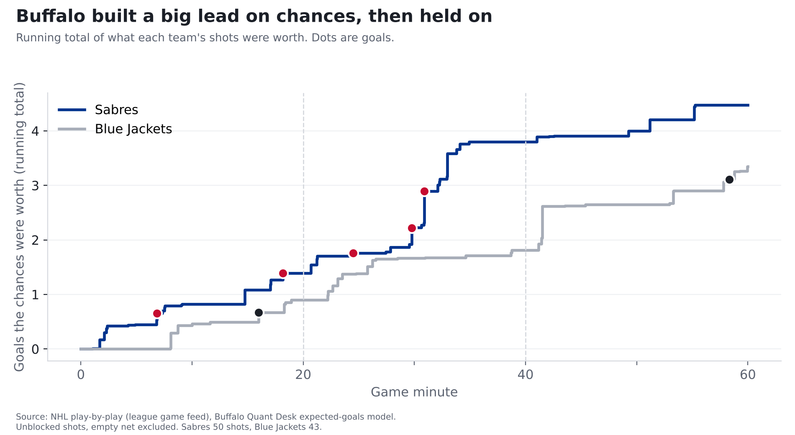
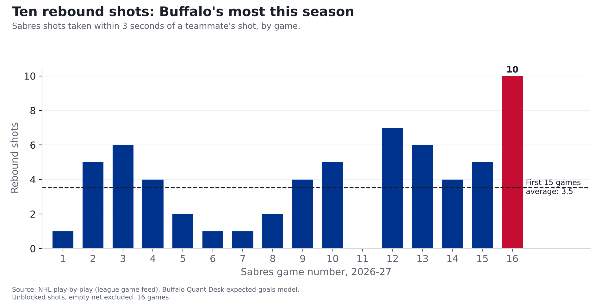

# Sabres 5, Blue Jackets 2: Buffalo won the scramble in front of the net

**Finding: The Sabres created their most dangerous night of the season Friday, with shots worth 4.5 goals, by living
around Columbus's crease. They had 10 rebound shots, about three times their usual, something fewer than 2% of NHL teams
manage in a game. Two of their five goals came off rebounds.**

*One game, 2026-11-06, in Buffalo. The Sabres are 16 games into the season.*

## How we measure "chances"

Every shot has odds of going in, based on where it was taken and what kind of shot it was. A shot from within 10 feet
goes in about 1 time in 7; one from the blue line, about 1 in 125. Add up the odds on every shot and you get what a
team's chances were worth in goals. (The full explanation, with the chart, is in our story on
[last year's 50-win season](sabres-50-win-mirage.html).)

Friday, the Sabres' shots were worth **4.5 goals** and Columbus's **3.3**. Buffalo scored 5. If you replayed
those exact shots thousands of times, Buffalo would win about 60% of the time and tie about 15%. They earned this one.

## What changed from their first 15 games

| | Friday | Average, first 15 games | Rank among 16 games |
|---|---|---|---|
| What Buffalo's chances were worth | 4.5 goals | 3.0 | 1st |
| Rebound shots | 10 | 3.5 | 1st |
| Buffalo shots from within 20 feet | 17 | 13.0 | 4th |
| Columbus shots from within 20 feet | 9 | 13.3 | 5th fewest |
| Power-play chances, in goals | 1.0 | 0.6 | 1st |
| Goals saved vs. an average goalie | +1.3 | +0.0 | 3rd |

## The rebound game

A rebound here means a shot taken within three seconds of a teammate's shot. Across the NHL over the last three seasons,
rebounds went in 11.5% of the time, against 6.3% for other shots, because the goalie is usually out of
position. NHL teams average about 3.3 rebound shots a game this season. Buffalo had 10, worth 1.5 goals on
their own.

| Period | Shooter | Distance | Worth | |
|---|---|---|---|---|
| 1 | Jack Quinn | 13 ft | 0.12 | Goal |
| 1 | Tage Thompson | 13 ft | 0.04 |  |
| 1 | Mattias Samuelsson | 11 ft | 0.02 |  |
| 1 | Noah Ostlund | 4 ft | 0.06 |  |
| 2 | Zach Benson | 7 ft | 0.05 |  |
| 2 | Zach Benson | 7 ft | 0.05 |  |
| 2 | Zach Benson | 10 ft | 0.05 |  |
| 2 | Josh Doan | 4 ft | 0.58 | Goal |
| 2 | Josh Doan | 12 ft | 0.05 |  |
| 2 | Jason Zucker | 13 ft | 0.43 |  |

Zach Benson had three of them by himself. Jack Quinn's opening goal and Josh Doan's deflection from 4 feet both came off
rebounds. Doan's shots were worth a full goal (1.0), the most of any Sabre.

## Two periods of control

Through 40 minutes, Buffalo's chances were worth 3.8 goals to Columbus's 1.8, and they led 5-1.
Columbus won the third period on chances (1.5 to 0.7), 69% of the chance value.
Some of that is expected: across the league over the last three seasons, teams trailing by three or more in the third
period got 57% of the chance value, because the team ahead sits back and protects the lead. Columbus pushed
harder than that, so the Sabres' third period was looser than a typical protect-the-lead period. It's one period, though.

## The goalie and the finishers

- **Ukko-Pekka Luukkonen** faced shots worth 3.3 goals and allowed 2, about 1.3 better than an average
  goalie. He came in -2.0 goals against an average goalie for the season; he's now -0.6.
- **Josh Norris** scored twice on shots worth 0.4 goals combined.
- **The power play** created its most dangerous chances of the season, worth 1.0 goals, but didn't score.
- **The penalty kill** allowed another goal, a Zach Werenski shot from 46 feet that goes in about 1 time in 20. Buffalo has now
  allowed 17 power-play goals in 16 games, 30th of 32 (1st is fewest).

| Period | Time | Team | Scorer | Shot | Odds it went in |
|---|---|---|---|---|---|
| 1 | 6:50 | Sabres | Jack Quinn | backhand from 13 ft, rebound | 0.12 |
| 1 | 16:00 | Blue Jackets | Kent Johnson | snap from 22 ft | 0.18 |
| 1 | 18:10 | Sabres | Josh Norris | snap from 24 ft | 0.13 |
| 2 | 4:30 | Sabres | Rasmus Dahlin | slap from 53 ft | 0.03 |
| 2 | 9:46 | Sabres | Josh Norris | backhand from 4 ft | 0.30 |
| 2 | 10:53 | Sabres | Josh Doan | deflected from 4 ft, rebound | 0.58 |
| 3 | 18:21 | Blue Jackets | Zach Werenski | wrist from 46 ft, power play | 0.05 |

## What to watch Sunday against Vegas

Rebounds come from getting bodies to the net, which is partly a habit and partly how a game breaks. One night of it
doesn't make a trend. The things to watch against Vegas: whether Buffalo keeps getting bodies to the crease, whether
Luukkonen stays at or above average, and whether the penalty kill stops leaking.

## For the stat-heads

- Expected goals (xG): our gradient-boosted model on unblocked, non-empty-net shots, rescaled per season so league xG
  equals league goals. Friday: BUF 4.47 xG on 50 unblocked shots (37 on goal), CBJ 3.35 on
  43 (26 on goal). Win probability: 20,000 simulated replays of each shot as an independent coin flip with
  p = xG.
- Rebound = same team, within 3 seconds of the previous shot attempt, same period. A raw recount from the play feed that
  also counts shots after blocked attempts gives 12 for Buffalo. Teams with 10+ rebound shots: 1.1% of team-games in
  2026-27, 1.6% in 2025-26.
- Score effects: third-period xG share for teams down 3+ goals, all team-games 2023-24 to 2025-26.
- GSAx = xG on unblocked shots faced minus goals allowed. Power play = 5v4, 5v3, 4v3.
