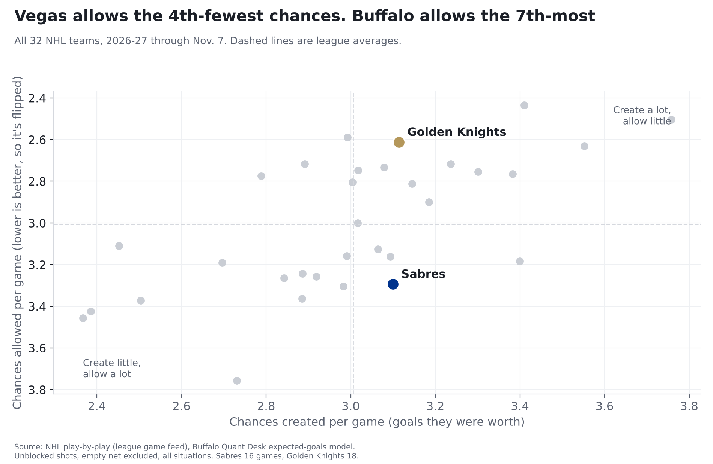
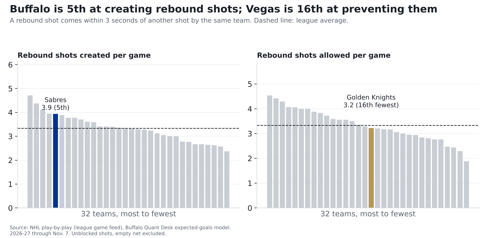
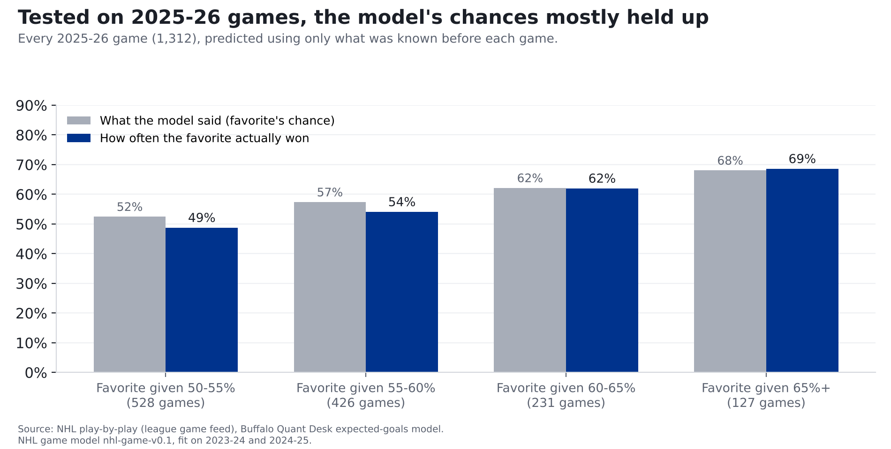

# Sabres vs. Golden Knights: Buffalo's attack meets one of the NHL's toughest defenses

**Finding: Vegas allows chances worth 2.61 goals a game, the 4th-fewest in the NHL, and few shots from close to its net
(tied for 5th-fewest). Buffalo's attack is middle of the pack (11th in chances created) but 5th at creating rebound
shots. The bigger worry is at the other end: the Sabres allow chances worth 3.29 goals a game, 26th of 32.
Our model gives Vegas a 54% chance to win and Buffalo 46%.**

*Vegas at Buffalo, Sunday, Nov. 8, 3:30 p.m. ET, KeyBank Center. Numbers are 2026-27 through November 7: Sabres
8-5-3 in 16 games, Golden Knights 11-5-2 in 18. Sixteen to 18 games is early; ranks can move a lot.*

## How we measure "chances"

Every shot has a chance of going in, based on where it was taken and what kind of shot it was. Over the last three seasons
(336,462 unblocked shots), a shot from within 10 feet went in 13.8% of the time; one from 60 feet or more, 0.8%. Add
up those chances on every shot and you get what a team's chances were worth in goals.

**The source:** the NHL's own play-by-play feed, which records where every shot came from. **The math:** each shot's chance
comes from our model, built on past seasons and tested on a season it hadn't seen before we added that season in; we nudge each season's totals so the
league's chances add up to the league's real goals. **How we checked it:** the full explanation, with the chart, is in our
story on [last year's 50-win season](sabres-50-win-mirage.html).

## The two teams, side by side

| Per game, 2026-27 | Sabres | Golden Knights | League average |
|---|---|---|---|
| Chances created (goals they were worth) | 3.10 (11th) | 3.11 (10th) | 3.01 |
| Chances allowed | 3.29 (26th) | 2.61 (4th) | 3.01 |
| Share of the chances in their games | 48.5% (21st) | 54.4% (6th) | 50% |
| Goals scored, actual | 3.06 | 3.33 | |
| Goals allowed, actual | 3.31 | 2.78 | |
| Shots from within 20 feet | 13.2 (17th) | 13.8 (12th) | 13.3 |
| Shots allowed from within 20 feet | 13.1 (13th) | 11.4 (5th) | 13.3 |
| Share of chances, last 5 games | 47.2% | 47.8% | |

Ranks are among 32 teams; 1st is best (most created, fewest allowed). Actual goals come from final scores; chances leave
out empty-net shots.

## The matchup to watch: rebounds

A rebound shot catches the goalie moving. Over the last three seasons, rebounds went in 11.5% of the time, about
1.8 times the 6.3% rate for every other shot.

Buffalo gets 3.9 rebound shots a game (5th of 32; league average 3.3), worth 0.37 goals a game. Friday's
10 against Columbus was its season high. Vegas allows 3.2 a game, 16th of 32 at keeping them down. Vegas's strength
is keeping shots away from the net in the first place. How many second looks Buffalo gets anyway is the part of this
matchup to watch.

## In goal

Goals saved compared with an average goalie facing the same shots. Positive is good. Tap a name for
that goalie's card, with his season-by-season record.

| Team | Goalie | Games | Save rate | Goals saved vs. average |
|---|---|---|---|---|
| Sabres | [Ukko-Pekka Luukkonen](../cards/ukko-pekka-luukkonen.html) | 11 | 0.878 | -0.5 (38th of 75) |
| Sabres | [Colten Ellis](../cards/colten-ellis.html) | 6 | 0.891 | +2.2 (20th of 75) |
| Golden Knights | [Carter Hart](../cards/carter-hart.html) | 10 | 0.900 | +1.8 (21st of 75) |
| Golden Knights | [Adin Hill](../cards/adin-hill.html) | 8 | 0.895 | -1.8 (55th of 75) |

Ranks are among all 75 goalies who have played this season. Buffalo has switched goalies every game for its last four, which points
to Colten Ellis on Sunday (WGR and Buffalo Hockey Beat both expect him). Vegas hadn't named a starter when we
published; NHL.com projects Adin Hill. These are small samples: a goalie's numbers over a dozen games can swing a lot.

## Our prediction: Vegas 54%, Sabres 46%

**This is our model's number.** It counts once it's logged on the [Ledger](../ledger.html) before puck drop; every logged call is graded after the game, hit or miss.

Our model expects about **3.3 goals for Vegas and 3.0 for Buffalo**, and gives about a 16% chance the game is tied
after 60 minutes. Close to a coin flip, leaning Vegas.

**Where the number comes from.** The same chances numbers above. Buffalo creates chances worth 3.10 goals a game; Vegas
allows 2.61. Sixteen or 18 games is a small sample, so we blend each team's numbers with last season's, pulled halfway
toward the league average; Buffalo's attack counts as 3.06 and Vegas's defense as 2.67. Start from the league's
3.00 per game, adjust for Buffalo's attack and Vegas's defense, and you get Buffalo's expected chances; do the same the
other way for Vegas. A final step, fit on past seasons, turns chances into goals and adds about 0.27 of a goal for playing at
home. Then we play the game out on paper: with those scoring rates, how often does each team end up ahead? Ties after 60 minutes
are split the way they went for home teams in past overtimes and shootouts (55% home wins).

**How we checked it.** We built the model on the 2023-24 and 2024-25 seasons, then had it call every 2025-26 game using only
what was known before each game. It called the winner 55% of the time; choosing the home team every time would have been right
52%. (The shot model behind the chances was later refit with 2025-26 included; re-running this test with a
version that never saw 2025-26 gave the same results.) Its percentages were also closer to what actually happened than two simple guesses, giving every home team
its usual edge or going by the teams' records, though not by much: a hockey game is close to a coin flip, and no model changes that.
This season so far (276 games) it has called 61% right; home teams have won 57%. When it made a team a 60-65% favorite in 2025-26, that team won
62% of the time. But the teams it favored slightly, at 50-55%, won 49%, no better than a coin flip, and at 55-60% they won 54%. Sunday's call is in that range,
so read it as "slight lean Vegas," not "Vegas should win."

**What it doesn't know: goalies.** The model rates teams by the chances they create and allow, not by who's in net. Buffalo's
expected starter, Colten Ellis, has saved 2.2 more goals than an average goalie would have this season; if Vegas starts Adin Hill
(-1.8), the goalie matchup leans Buffalo in a way the model doesn't count. Small samples on both sides, and
Vegas's starter wasn't named when we published.

## What to watch

- **Second chances.** Count Buffalo's shots that come right after another shot. The Sabres' season average is 3.9.
- **The goalies.** Whichever goalies start, the table above says how they've done against the chances they've faced.
- **Results vs. chances.** Buffalo is 4-1-0 in its last 5 games but has had only 47% of the chances in them. Five games
  is a small sample, but over a full season, results that run ahead of the chances tend to fade (see our
  [50-win story](sabres-50-win-mirage.html)). Sunday is a test of whether the Sabres can win the chances, too.
- **Whether the chances turn into goals.** Over a full season, chances carry over from year to year much better than lucky
  or unlucky finishing, which is why we lead with them.

## For the stat-heads

- xG: Buffalo Quant Desk model (`src/metrics/nhl_xg.py`), unblocked non-empty-net shots, all strengths, rescaled per season so
  league xG = league goals (2026-27 factor 1.001). Share = xGF / (xGF + xGA). Rebound = shot within 3 s of a same-team
  unblocked attempt. Close = within 20 ft. GSAx = xG against minus goals against on unblocked shots, empty net excluded.
- Data through 2026-11-07 (276 games). Last-5 shares use each team's five most recent games.
- Win chance: NHL game model nhl-game-v0.1 (`src/ledger/nhl_game_model.py`). Team xGF/xGA per game shrunk with K=10 games toward
  league + 0.5 x last season's edge; expected goals = (off + opp def - league) x league goals/xG ratio to date; goals =
  -0.254 + 1.032 x that + 0.272 x home (fit 2023-25); independent Poisson; regulation ties to home at 0.545.
  Brier: 2025-26 0.2446 (home-team rate 0.2504, record log5 0.2514, coin 0.25);
  2026-27 to date 0.2283 (0.2459, 0.2502). Settings chosen on 2024-25 only
  (`scripts/tune_nhl_game_model.py`). Goalies not in the model. The xG model's final fit includes 2025-26; with xG fit on 2023-25 only,
  QA re-ran the 2025-26 test: Brier 0.2444, buckets 52/48, 57/55, 62/61, 68/70, today's call unchanged (46.1%).
