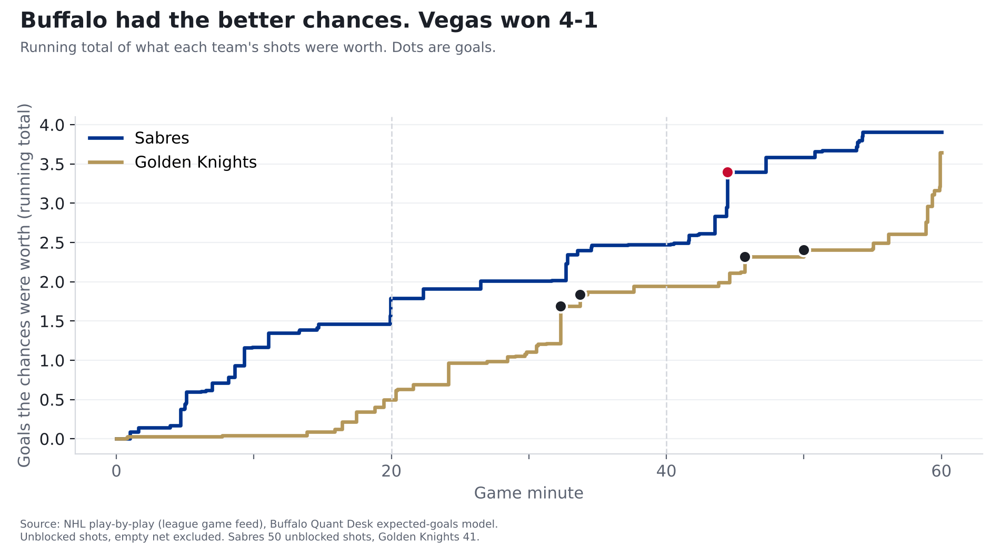
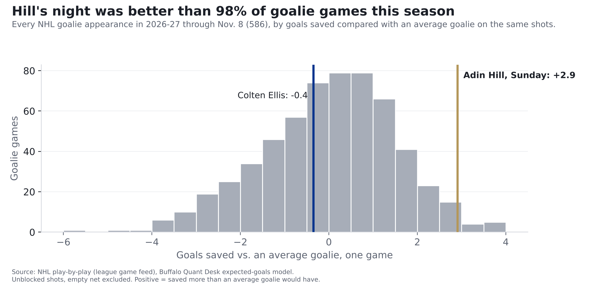

# Golden Knights 4, Sabres 1: Buffalo earned more than one goal. Adin Hill didn't allow it

**Finding: The Sabres lost 4-1 Sunday, but they had the better chances: their shots were worth 3.9 goals to Vegas's 3.6.
Replay those same shots thousands of times and Buffalo wins about 46%, Vegas about 38%, and 16% end tied. The difference was
in goal. Adin Hill stopped 28 of 29 shots, about 2.9 goals better than an average goalie, one of the best goalie
nights in the league this season. Our pregame model gave Buffalo only a 46% chance, leaning Vegas, so it goes on the Ledger as a hit,
but for the wrong reason: Vegas didn't win on chances, it won in goal.**

*One game, 2026-11-08, in Buffalo. Before the game, our model gave Vegas a 54% chance. [Our pregame story](sabres-vegas-pregame-nov-8.html).*

## How we measure "chances"

Every shot has a chance of going in, based on where it was taken and what kind of shot it was. Add those up and you get what a team's
chances were worth in goals. Sunday's goals show the range: Marner's shot from 3 feet had a 47% chance of going in;
Hertl's second goal, from 34 feet, about 9%.
(The full explanation is in our story on [last year's 50-win season](sabres-50-win-mirage.html).)

Sunday, Buffalo's 50 unblocked shots were worth **3.9 goals**. Vegas's 41 were worth **3.6**. Buffalo scored once.
In our replays, the Sabres score one goal or fewer only 8% of the time on shots like these.

## Period by period

| Period | Sabres chances, in goals | Golden Knights | What happened |
|---|---|---|---|
| 1st | 1.8 | 0.5 | Buffalo's best period. No goals. |
| 2nd | 0.7 | 1.4 | Vegas scores twice, the first one shorthanded. |
| 3rd | 1.4 | 1.7 | Beck Malenstyn makes it 2-1; Tomas Hertl answers twice. |

The first period was the Sabres' game to take: their chances were worth 1.8 goals to 0.5, and it stayed 0-0. The turn came in the second,
when Mitch Marner scored from 3 feet while Vegas was killing a penalty, a shot that goes in about 47% of the time from there.
Buffalo's power-play shots on the night were worth 0.5 goals, and it didn't score with the extra man.

| Period | Time | Team | Scorer | Shot | Chance it went in |
|---|---|---|---|---|---|
| 2 | 12:17 | Golden Knights | Mitch Marner | wrist from 3 ft, shorthanded | 47% |
| 2 | 13:43 | Golden Knights | Jack Eichel | wrist from 16 ft | 15% |
| 3 | 4:26 | Sabres | Beck Malenstyn | wrist from 4 ft | 44% |
| 3 | 5:43 | Golden Knights | Tomas Hertl | wrist from 10 ft | 20% |
| 3 | 10:00 | Golden Knights | Tomas Hertl | wrist from 34 ft | 9% |

## The goalie duel went the other way

Coming in, these two were headed opposite directions. [Colten Ellis](../cards/colten-ellis.html) had saved 2.2 more goals than an average goalie
would have on the same shots this season. [Adin Hill](../cards/adin-hill.html) was 1.9 worse than average. (Our goalie cards, which also
weigh last season, had them at +2.2 and -1.8.)

Sunday flipped it. Hill faced Buffalo shots worth 3.9 goals and allowed 1: **+2.9**. Only 12 of the 586 goalie games in the NHL this
season have been better. Ellis faced Vegas shots worth 3.6 goals and allowed 4: **-0.4**, a little below average, not a bad night.

**This is why goalies aren't in our prediction model.** In one afternoon, Hill went from -1.9 for the season to +1.0. Ellis went from +2.2
to +1.8. When we tested it before Sunday's game, a goalie's numbers over a dozen games told us much less about his next games than a team's
chances do, so a starter's numbers didn't make the model better. Sunday is what that looks like: the goalie with the worse numbers had one of the best nights in the league.

## Vegas got in the way

Buffalo tried 78 shots; Vegas blocked 28 of them. Only 7 of 556 team-games this season have had
28 or more blocked (the average is 15). Blocked shots don't count in the chance totals above, so Buffalo's real volume was even bigger than 3.9
suggests. Vegas tried 51 shots and had 10 blocked.

## Receipts: our pregame call

Before the game we logged one call on the [Ledger](../ledger.html): **the Sabres win, at 46%.** Giving Buffalo less than half means our model
leaned Vegas, and Vegas won, so by our rule (the side we gave more than 50% wins) it's a hit. It stays up either way.

We also grade every call with a simple score: the gap between the chance we gave and what happened, squared. Lower is better. Saying 46% on a
game Buffalo lost scores 0.21. A pure 50/50 guess would have scored 0.25. That's a small edge, as it should be for a call that close.
One game proves nothing either way; the point is the season-long record.

We're not taking a victory lap. The model expected a close game with Vegas slightly ahead. On chances it was close, but Buffalo was the one slightly ahead.
Vegas won because the goals didn't follow the chances, and the model can't see a goalie's hot night coming. Neither can anyone else, consistently.

## What to take from it

- **Buffalo's process held up.** Against a Vegas team that had allowed the 4th-fewest chances per game in the league before Sunday (2.6),
  the Sabres created 3.9 goals' worth. Their average coming in was 3.1.
- **The power play is still empty.** It created a little and allowed a shorthanded goal.
- **Ellis was fine.** One below-average night doesn't erase his strong start; he's still at +1.8 for the season.

## For the stat-heads

- Expected goals (xG): our gradient-boosted model on unblocked, non-empty-net shots, rescaled per season so league xG equals league goals.
  BUF 3.91 xG on 50 unblocked shots (29 on goal); VGK 3.65 on 41 (26 on goal).
- Replays: 20,000 simulations, each shot an independent coin flip with p = xG. BUF win 0.459, tie 0.159, loss 0.382.
- GSAx = xG on unblocked shots faced minus goals allowed. Hill +2.91 (29 shots on goal), Ellis -0.35. Hill's game ranks
  13th of 586 2026-27 goalie games. Season GSAx before/after: Hill -1.86/+1.05, Ellis +2.18/+1.83
  (raw, not the shrunk card values).
- Blocked attempts: attributed to the shooting team. Power play = 5v4, 5v3, 4v3 from the shooter's side.
- Ledger P0001: p = 0.46, outcome 0, Brier 0.2116; scored a hit because p < 0.5 and the event didn't happen. Model nhl-game-v0.1.
