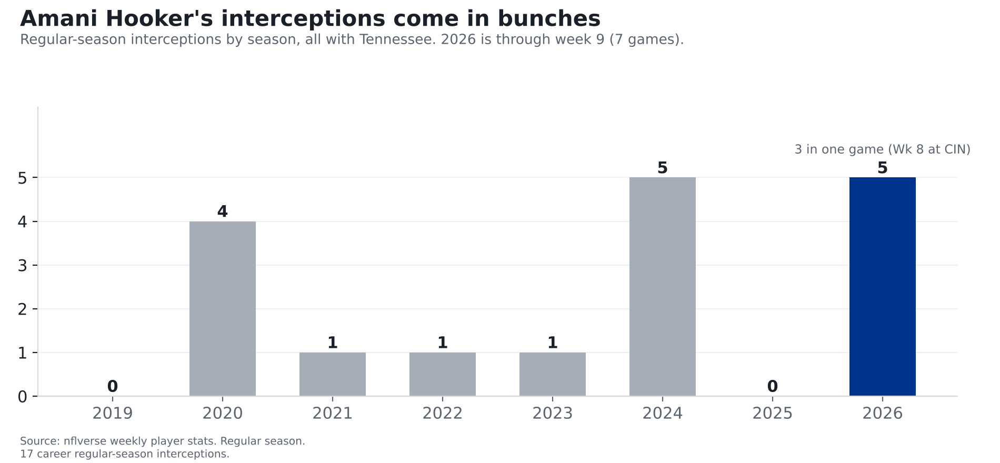
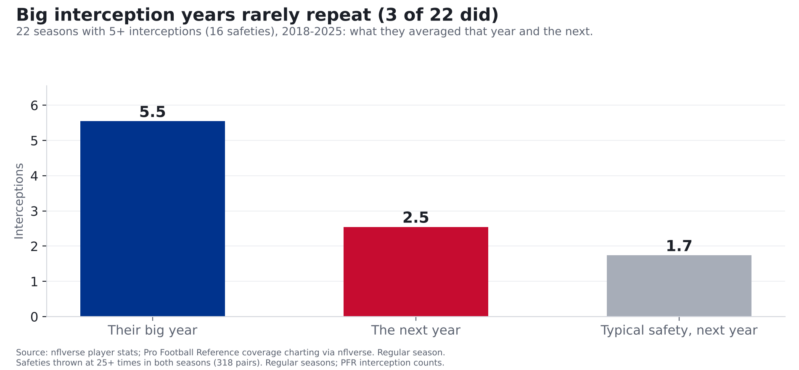
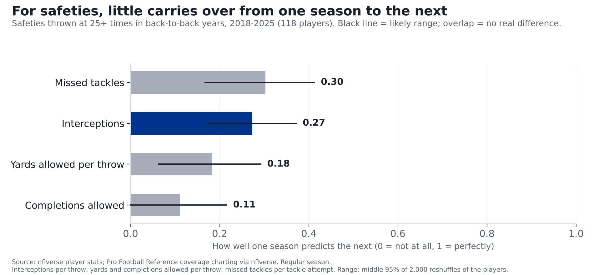

# The Bills paid a second-round pick for Amani Hooker's 5 interceptions. History says don't count on 5 more

**Hooker arrives with 5 interceptions, tied with Xavier McKinney for the NFL lead. Don't count on that pace: safeties who had five or more in a
season averaged about 2.5 the next. Behind the interceptions is a safety who's been about average in coverage this season and below
average the three seasons before. He has still given up fewer yards per throw than C.J. Gardner-Johnson or Damar Hamlin, two of the safeties
he joins.**

*The Bills traded a 2027 second-round pick to Tennessee for Hooker and a 2027 fifth-round pick on Tuesday, Nov. 10, deadline day. He's
signed through 2028. (Trade terms as announced by the Bills.) Numbers below are through week 9 of the 2026 season.*

## The interceptions are real, and they come in bunches

Hooker has 17 regular-season interceptions in 8 seasons, all with Tennessee. They don't arrive evenly: he had
5 in 2024, then 0 in 2025, then 5 in 7 games this season.
Three of this year's 5 came in one game, week 8 at Cincinnati, so this
year's total rests on a handful of plays.

That's normal for safeties, and it's the main thing to understand about this trade. We looked at every safety thrown at 25 or more
times in back-to-back seasons from 2018 to 2025: 318 pairs of seasons from 118 players. Does a big interception year repeat? Mostly,
no. The 22 times a safety had five or more interceptions in a season (16 different players), those seasons averaged 5.5
interceptions. The next year, 2.5, much closer to the 1.7 the whole group averaged than to their big year. On a scale where 0 means "one season tells you nothing about the next" and
1 means "it tells you everything," interceptions scored 0.27.

How we got that score: from Pro Football Reference's play-by-play charting (via nflverse), we took each safety's rate in one season
(interceptions per throw at him, for example) and set it beside his rate the next season, for all 318 pairs. If the players who were
high one year were always high the next, the score would be 1. If the next year looked random, it would be 0. To check it, we re-ran the
math 2,000 times, each time on a random reshuffle of the players. That's where the "give or take about 0.1" below comes from. The
5.5-to-2.5 drop is what a score of 0.27 looks like on the field: the next year lands much closer to average than to the
big year.

To be fair to Hooker, little about a safety carries over well. Tackling scored about the same as interceptions (0.30), and
coverage scored a bit lower: yards allowed per throw 0.18, completions allowed 0.11. With this few players, each score could be off
by about 0.1 either way (the black lines on the chart). The honest reading: interceptions and tackling carry over about equally, and only a little. Safeties are hard to measure, and every number here comes with that warning.

## What the Bills are getting

**Tackling: good this season, average before.** This season Hooker has missed 3 of 55 tackle attempts (5.5%, a small
sample). The average safety misses 8.9%. That ties him for 16th-fewest misses among 58 safeties
thrown at 15+ times. One more miss would have put him at 7.1%. Over 2023 to 2025 he missed 8.7%, about the
same as the average safety's 8.9%.

**Coverage: about average now, below average before.** Passes thrown his way (the stat sheets call them "targets") have gained
8.3 yards per throw this season (33 throws, a small sample), close to the average safety's 8.1. That's 31st of
58 safeties, right in the middle. Over 2023 to 2025 he allowed 9.1 yards per throw, more than the average safety's 8.2 (57th of 76
safeties thrown at 60+ times). Last season alone he allowed 11.4, 58th of 66.

**How he compares with the Bills' safeties.** As a group, Buffalo's safeties have allowed 9.7 yards per throw this season (the
8th-most of 32 teams; all NFL safeties combined: 8.2) and missed 10.1% of their tackle attempts (the
8th-most; all NFL safeties combined: 8.2%, lower than the 8.9% above because safeties who are rarely
thrown at miss fewer tackles). That's 69 throws, a small sample, and it isn't spread evenly. Cole Bishop has
allowed 7.4 yards per throw (31 throws), fewer than Hooker. C.J. Gardner-Johnson has allowed 10.4 (21
throws) and missed 19% of his tackle attempts; Damar Hamlin has allowed 13.2 (13 throws). Hooker's
8.3 beats those two, and the Bills say he'll play alongside Bishop. All of these are a few dozen throws each, so treat them as hints.

## What it means

- **Don't expect five more.** Safeties with five-interception years averaged about 2.5 over the whole next season. Hooker has 9 regular-season games left with Buffalo. If the interceptions keep coming, that's a bonus. Think "starter who's been average-to-below in coverage
  and is tackling well right now," not "takeaway machine."
- **It's a real price.** Per the Bills, it's the most draft capital the team has used to acquire a player at the trade deadline under general
  manager Brandon Beane. The Bills are paying for this season and the two years left on his contract.
- **What to watch.** Whether he takes snaps from Gardner-Johnson or Hamlin, and whether this season's tackling holds up. Buffalo's safeties
  have missed tackles more often than most teams'. His usual rate over the three seasons before this one (8.7%) is below the Bills group's 10.1%.

## For the stat-heads

- Interceptions: nflverse weekly player stats (gsis 00-0035632), regular season. 2026 through week 9. Co-leader(s): Xavier McKinney.
  He also has one playoff interception (not counted). PFR's charting counts interceptions slightly differently from nflverse; the
  carry-over analysis uses PFR counts, Hooker's career totals use nflverse.
- Coverage: Pro Football Reference charting via nflverse (`pfr_advstats` def). Targets, completions, yards allowed, missed tackles,
  combined tackles. Missed-tackle rate = missed / (missed + combined tackles). Charted by humans; treat as noisy.
- Safeties: PFR rows matched to nflverse weekly player stats on season and team (OAK/SD/STL normalized), then name with suffixes and punctuation
  removed; 12 more player-seasons matched on first initial + last name where that key is unique on the team. Players nflverse lists as
  "DB" rather than a safety position are left out, which thins the 2018-2021 sample most.
- Year-to-year: Pearson correlation of each rate between consecutive seasons, safeties with 25+ targets in both, 2018-2025,
  n=318 pairs from 118 players: interceptions per target 0.274 (95% 0.17 to 0.37),
  yards per target 0.184 (0.06 to 0.29), completion rate 0.111 (-0.00 to
  0.22), missed-tackle rate 0.303 (0.17 to 0.41). Intervals: 2,000 bootstrap draws resampling
  players (pairs share players). Missed tackles beat interceptions in 63% of draws: no real difference. r of 0.27 means one season
  explains about 7% of the next season's spread.
- Five-plus interception seasons (PFR counts, 25+ targets both years): n=22, 5.55 that season, 2.55 the next; all pairs
  1.74 the next season.
- Hooker 2026: 33 targets, 8.30 yards/target, 3 missed of 55 attempts. 2023-2025: 158 targets,
  9.06 yards/target, missed-tackle rate 0.087 (40th of 76).
- Bills safeties 2026: 69 targets, 9.71 yards/target, 11 missed of 109 attempts. League team safety
  groups: 8.24 yards/target, missed-tackle rate 0.082. By player (10+ targets):
  Cole Bishop 31 tgt, 7.4 yds/tgt, 5/50 missed; C.J. Gardner-Johnson 21 tgt, 10.4 yds/tgt, 6/32 missed; Damar Hamlin 13 tgt, 13.2 yds/tgt, 0/21 missed.
- Trade terms, "most draft capital ... at the trade deadline under Beane" and Hooker playing alongside Bishop: buffalobills.com,
  "Bills land impact safety Amani Hooker in trade with Titans" and "'A difference maker'...", Nov. 10, 2026.
