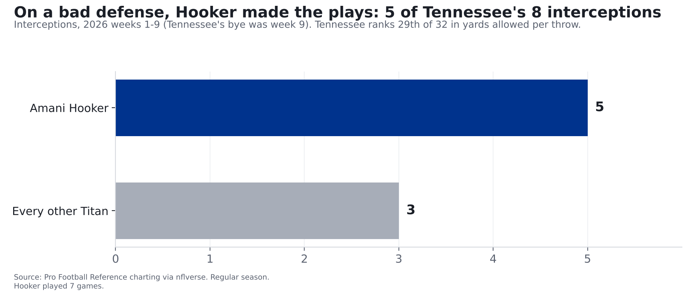
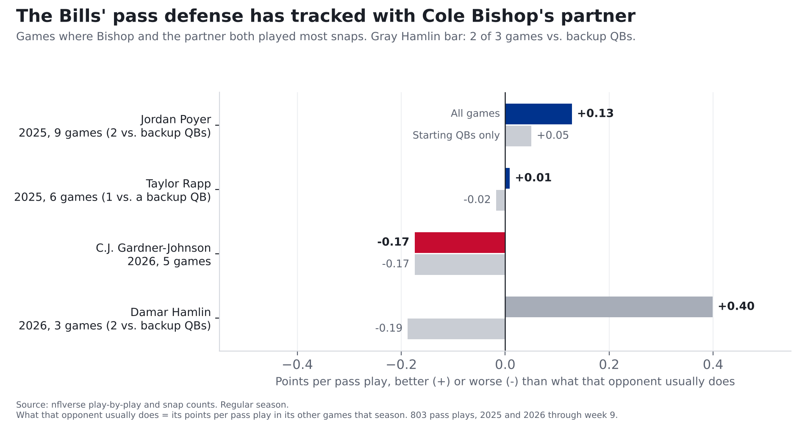

# What the Bills get in Amani Hooker: a ball hawk, and a new partner for Cole Bishop

**Amani Hooker has 5 of Tennessee's 8 interceptions this season, tied with Xavier McKinney for the NFL lead, on a defense that ranks 29th of 32 in yards
allowed per throw. He's also tackling well. And he steps into the open question on the Bills' defense: the spot next to Cole Bishop, where the
pass defense has tracked with whoever's played there. With Jordan Poyer there last season,
opponents' passing did 0.13 points a play worse than usual against Buffalo, about 6th-best in the league. With C.J. Gardner-Johnson
this season, it's done 0.17 better than usual, about 31st of 32. Bishop's own coverage barely changed between the two.**

Small samples, and other things changed along with Bishop's partner. Details below.

*The Bills traded a 2027 second-round pick to Tennessee for Hooker and a 2027 fifth-round pick on Tuesday, Nov. 10, deadline day. He's
signed through 2028. (Trade terms as announced by the Bills.) Game results are through week 9 of the 2026 season. Yards-per-throw and
tackling numbers come from Pro Football Reference's charting, which is through week 8.*

*Updated Nov. 11: headline, lead and story order revised to lead with Hooker. No numbers changed.*

## What Hooker brings: the one making plays in Tennessee

Tennessee's defense has been bad: passes against it have gained 8.2 yards per throw, 29th of 32 (league average
7.2). Hooker has been the exception. His 5 interceptions came in 7 games;
everyone else on that defense has 3 combined. He tackles well, too: 3 misses on 55 tries (5.5%),
against 9.0% for the average safety. That ties him for 16th-best of 58 regular safeties.

One honest caveat: in yards allowed per throw, he's been about the same as his teammates (8.3 on 33 throws vs. 8.2 for the rest
of the defense). The case for Hooker is the ball-hawking and the tackling, not that throws at him go nowhere. All of this is seven games, a small
sample.

## What it means for Bishop: the partner problem

Hooker likely takes the spot beside Bishop that Gardner-Johnson and Hamlin have split. Here's how the Bills' pass defense did in games
where Bishop and each partner both played most of the snaps:

| Bishop's partner | Games | Points per pass play vs. opponent's usual (+ = better) | Starting QBs only |
|---|---|---|---|
| Jordan Poyer, 2025 | 9 | +0.13 | +0.05 (7 games) |
| Taylor Rapp, 2025 | 6 | +0.01 | -0.02 (5 games) |
| C.J. Gardner-Johnson, 2026 | 5 | -0.17 | -0.17 (5 games) |
| Damar Hamlin, 2026 | 3 | +0.40 | -0.19 (1 game) |

For scale: across all 32 defenses, the Bills were +0.09 over all of 2025 (9th) and are +0.01 so far this season (14th).
Every row is a small sample, 3 to 9 games.

**Hamlin's +0.40 needs an asterisk.** Two of his three games, Baltimore and Minnesota, came against backup quarterbacks. The one against a
regular starter, Las Vegas, came out -0.19, as bad as the Gardner-Johnson games.

What this means for Bishop himself: his own coverage barely moved. Throws his way gained 8.8 yards each with Poyer beside him (27 throws) and 9.2 with
Gardner-Johnson (21). Both are a bit worse than the average safety (8.6 and 8.2), on small samples.
The difference was around him. That's the spot Hooker steps into. Whether it helps is what we'll track.

**Where these numbers come from.** Every pass play starts from a spot on the field where an average offense can expect a certain number of points,
and the play raises or lowers that number. We add those changes up for each opponent's passes against Buffalo, then compare them with what the same
offense does in its other games that season. Example: the Rams normally gain about 0.01 points per pass play. In week 5
their 55 pass plays against Buffalo were worth 19.4 points combined, about 0.34 a play more than usual. That game counts as
-0.34 for Buffalo, one of the 5 games behind Gardner-Johnson's -0.17. The partner is the other safety on the field for the most
snaps, from the league's snap counts.

**How we checked it.**
- **Luck.** We shuffled the 14 Poyer and Gardner-Johnson games between the two groups 20,000 times. A gap this big (either way) showed
  up about 1 time in 16. Suggestive, not proof.
- **Quarterbacks.** Two of Poyer's games came against backups. Without them his number drops to +0.05. All 5 Gardner-Johnson games
  came against regular starters.
- **Everything else that changed.** This season also brought a new defensive coordinator, Jim Leonhard, and other roster changes. These numbers
  can't separate those from the safety next to Bishop.

## What it means

- **It's about the pair, not just the player.** Against starting quarterbacks, Buffalo's best stretch with Bishop came with a steady veteran beside him. Hooker is in his
  8th season and making plays.
- **What we'll track.** Bills pass defense against what each opponent usually does, with Bishop and Hooker together, over the 9 games left, with backup-QB
  games marked. If it climbs back toward the Poyer-era level against starting quarterbacks (+0.05), that fits the trade working. It still
  won't separate Hooker from the new coordinator.
- **It's a real price.** Per the Bills, it's the most draft capital the team has used to acquire a player at the trade deadline under general
  manager Brandon Beane: a second-round pick for a title push this season, with two more years of Hooker after it.

## For the stat-heads

- Pass defense: nflverse play-by-play, dropbacks (pass attempts, sacks, scrambles; no two-point tries), EPA allowed, regular season. Opponent's
  norm = that offense's EPA per dropback in its other games that season (2026 through week 9). Value = (EPA allowed - norm x dropbacks)
  / dropbacks, sign flipped so + = better than norm. Counts every Bills dropback in the game, not only snaps with both safeties on the field.
- League context: same value for all 32 defenses. +0.128 would rank 6th among 2025 defenses; -0.174 31st among 2026.
- Pairings: nflverse snap counts (`raw_snap_counts`), safeties (S/FS/SS/SAF) with 50%+ of defensive snaps; partner = the other one with the
  most snaps. Bishop + Jordan Poyer: weeks 8-16, 283 dropbacks; + Taylor Rapp: weeks 1-6, 194; + C.J. Gardner-Johnson:
  weeks 1-5, 221; + Damar Hamlin: weeks 6-9, 105. Week 6 2026 was shared (Hamlin over 50%, Gardner-Johnson under);
  week 9 also had Geno Stone at 50%+. Games where Bishop played under 50%, or where the other safety is listed as "DB" (week 17 2025,
  Cameron Lewis), are excluded. Not adjusted for cornerbacks, pass rush, coordinator or injuries.
- Backup QB: the passer who led a team-game in dropbacks, when he is neither the one who has led that team in the most games through that
  week (ties: dropbacks) nor the team's main passer the season before. Flagged games in these pairings: 2025 wk 2 NYJ (T.Taylor); 2025 wk 8 CAR (A.Dalton); 2025 wk 12 HOU (D.Mills); 2026 wk 8 BAL (J.Fagnano); 2026 wk 9 MIN (C.Wentz).
- Chance check: permutation of the 14 games between Poyer and Gardner-Johnson labels, 20,000 draws (seed 0), dropback-weighted;
  two-sided p = 0.063 for a gap of 0.302.
- Bishop coverage by partner (PFR charting): 2025 with Poyer 27 targets, 8.81 yards/target; 2026 with
  Gardner-Johnson 21 targets, 9.19. Matched safeties: 8.63 (2025), 8.23 (2026).
- Tennessee 2026: PFR charting through week 8 (Tennessee's week-9 bye means it's complete for them): all charted defenders
  8.21 yards/target (29th of 32, 1st = fewest); Hooker 8.30 on 33; rest 8.20 on 232.
  Interceptions: 8 team, 5 Hooker (PFR and nflverse agree). The tie for the NFL lead (Xavier McKinney) is from nflverse
  player stats through week 9; PFR hadn't charted Green Bay's week 9 as of 2026-11-10. Career: 17 regular-season interceptions.
- Missed-tackle rate = missed / (missed + combined tackles), safeties with 15+ targets (58). PFR safeties matched to nflverse
  by season, team and name (suffixes removed; 12 by initial + last name where unique); DB-labeled players excluded.
- Trade terms and "most draft capital ... at the trade deadline under Beane": buffalobills.com, "Bills land impact safety Amani Hooker in trade
  with Titans" and "'A difference maker'...", Nov. 10, 2026.
