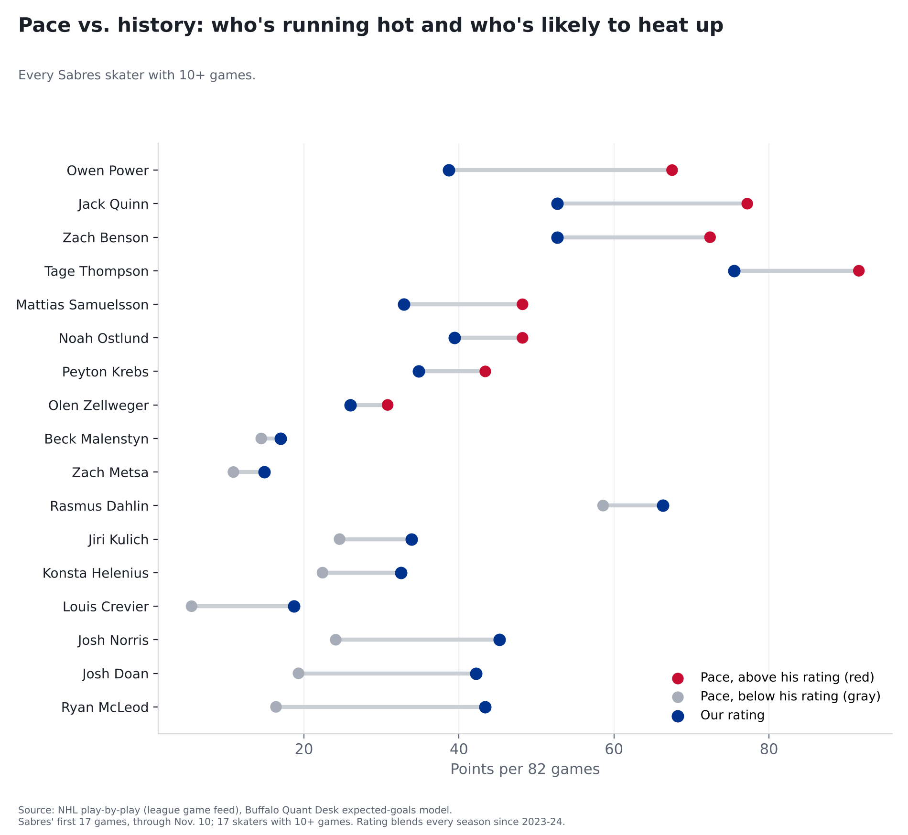
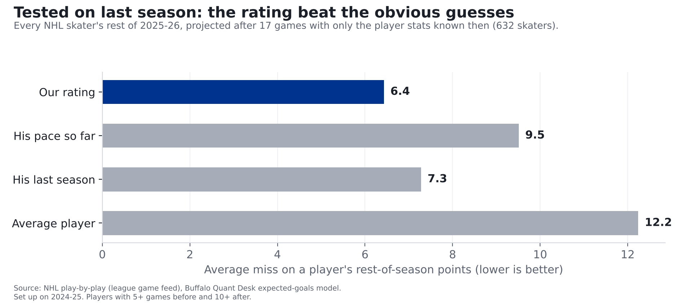

# Sabres: who's running hot, and who's likely to heat up

**Seventeen games in, Owen Power, Jack Quinn and Zach Benson are scoring well above what their track records say, and Ryan McLeod, Josh Doan and Josh Norris well below. Expect both groups to drift back toward normal.**

*Numbers through November 10, the Sabres' first 17 games. Every number here is also on each player's
[card](../cards/).*

## Hot and cold, by the numbers

Seventeen games is about a fifth of a season. Over that stretch, a few lucky bounces can make a player look like a star or a bust. So
for each Sabre we compare two things: his **pace** (his points so far, stretched over 82 games) and his **rating**, our best guess at his
points per 82 games from here on, built from this season and the last three.

| Player | Points so far | Pace (per 82) | Rating (per 82) | If he plays all 65 remaining games |
|---|---|---|---|---|
| [Tage Thompson](../cards/tage-thompson.html) | 19 in 17 | 92 | 76 | 41 goals, 79 points |
| [Rasmus Dahlin](../cards/rasmus-dahlin.html) | 10 in 14 | 59 | 66 | 16 goals, 63 points |
| [Zach Benson](../cards/zach-benson.html) | 15 in 17 | 72 | 53 | 16 goals, 57 points |
| [Jack Quinn](../cards/jack-quinn.html) | 16 in 17 | 77 | 53 | 27 goals, 58 points |
| [Josh Norris](../cards/josh-norris.html) | 5 in 17 | 24 | 45 | 21 goals, 41 points |
| [Ryan McLeod](../cards/ryan-mcleod.html) | 3 in 15 | 16 | 43 | 11 goals, 37 points |
| [Josh Doan](../cards/josh-doan.html) | 4 in 17 | 19 | 42 | 20 goals, 38 points |
| [Noah Ostlund](../cards/noah-ostlund.html) | 10 in 17 | 48 | 39 | 16 goals, 41 points |
| [Owen Power](../cards/owen-power.html) | 14 in 17 | 68 | 39 | 8 goals, 45 points |
| [Peyton Krebs](../cards/peyton-krebs.html) | 9 in 17 | 43 | 35 | 8 goals, 36 points |
| [Jiri Kulich](../cards/jiri-kulich.html) | 3 in 10 | 25 | 34 | 15 goals, 30 points |
| [Mattias Samuelsson](../cards/mattias-samuelsson.html) | 10 in 17 | 48 | 33 | 7 goals, 36 points |
| [Konsta Helenius](../cards/konsta-helenius.html) | 3 in 11 | 22 | 32 | 10 goals, 29 points |
| [Olen Zellweger](../cards/olen-zellweger.html) | 6 in 16 | 31 | 26 | 10 goals, 27 points |
| [Louis Crevier](../cards/louis-crevier.html) | 1 in 15 | 6 | 19 | 3 goals, 16 points |
| [Beck Malenstyn](../cards/beck-malenstyn.html) | 3 in 17 | 14 | 17 | 6 goals, 16 points |
| [Zach Metsa](../cards/zach-metsa.html) | 2 in 15 | 11 | 15 | 2 goals, 14 points |

Of the 17 players in the table, 8 are scoring faster than their rating and 9 slower.

**Running hot.**

**Owen Power** is on pace for 68 points per 82 games; his rating says 39. Most of it is assists: 12 of his 14 points. An assist needs a teammate to score, so a hot stretch for his linemates lifts his total too.

**Jack Quinn** is on pace for 77 points per 82 games; his rating says 53. He has 9 goals on chances worth 6.1, so he's scored 2.9 more than his chances. Finishing like that rarely lasts.

**Zach Benson** is on pace for 72 points per 82 games; his rating says 53. Same story as Power: 13 of his 15 points are assists.

**Tage Thompson** is running hot too, on a 92-point pace. His rating of 76 is still the best on the team, and at that
rate he'd finish with about 41 goals and 79 points if he plays every game.

**Likely to heat up:** Ryan McLeod, on pace for 16 with a rating of 43; Josh Doan, on pace for 19 with a rating of 42; Josh Norris, on pace for 24 with a rating of 45; Louis Crevier, on pace for 6 with a rating of 19. Their ratings say they should score faster from here.

## Where the rating comes from

**The source:** the NHL's own play-by-play for every game since the start of 2023-24: every goal, assist and shot, and where each shot came
from.

**What a chance is worth.** Not every shot is equal. Of the 360,675 shots since 2023-24 that weren't blocked (not counting empty-net
shots), the ones from within 10 feet went in 13.7% of the time; from 40 feet or more, 1.9%. We give every shot its chance of going in,
based on where and how it was taken, and add them up. That total is what a player's chances were worth. Jack Quinn's are worth 6.1 goals
this season; he has 9.

**The math, using Owen Power.** For assists, 2026-27's 12 assists in 17 games count fully; 2025-26's 21 assists in 81 games count at half; 2024-25's 33 assists in 79 games count at a quarter; 2023-24's 27 assists in 76 games count at an eighth. Then we add 10 made-up games at the average for a defenseman this season
(0.27 assists a game), so a short track record doesn't swing wildly. That works out to 31.2 assists per 82 games. Goals work the same
way, from the chances he creates, adjusted for how well he's finished over his career: 7.5 goals per 82 games.
31.2 assists plus 7.5 goals is about 39 points, his rating. His 14 points in 17 games is a 68-point pace;
his history says to expect a lot less. The finishing adjustment is pulled toward average, because chances carry over from season to season
much better than finishing does, but it still matters for a sharpshooter: it adds about 29% to Tage Thompson's goals.

## How we checked it

Our rating beat simply going by pace when we tested it on last season. We tuned the rating on 2024-25 only. Then we went back to last season, 2025-26, stopped the clock after 17 games, and had the rating project
every NHL skater's rest of the season using only player stats known at that point (632 players). Then we compared with what actually happened.

The rating missed a player's rest-of-season points by 6.4 on average. Going by his pace missed by 9.5; going by his
last season, 7.3; and guessing every player is average, 12.2. For goals alone, it missed by 3.3, against 5.3 for pace. It also beat both at the halfway point of the season,
though by less (4.3, against 4.8 for pace and 5.1 for last season), because by then a season's pace means more.

## What it means

- **Expect both groups to drift back toward their ratings.** The players running ahead of their ratings will probably slow down, and the ones behind will probably
  pick up. Not guaranteed: the rating misses by several points a player, and it can't see injuries or a player moving up or down the lineup.
- **Ice time is the missing piece.** We don't have shift data yet, so a player promoted to the top line looks the same to the rating as one
  stuck on the fourth. That's the next thing we're adding.
- **We'll keep score.** These projections are pinned to November 10. We'll check them against how the season actually
  finishes and publish the results, misses included.

## For the stat-heads

- Rating: `src/metrics/nhl_player_ratings.py`. Per-game rate = (current total + W x past totals + K x position mean) / (current GP + W x past GP + K),
  past seasons weighted W x 0.5^(age-1). Chances (xG): W=0.5, K=5; assists W=0.5, K=10.
  Goals = blended xG/game x (career goals + 40) / (career xG + 40). Points = goals + assists. Settings chosen on 2024-25 (history 2023-24).
- Test: checkpoint = date the median team had played 17 (or 41) games; skaters with 5+ games before and 10+ after; errors weighted by games after.
  2025-26 after 17 games, points per game MSE: rating 0.02253, pace 0.05312, last season
  0.02825, position average 0.08317; correlation with rest-of-season rate 0.87 vs.
  0.74 for pace.
- Caveat: the xG model was trained on 2023-24 through 2025-26, and the per-season rescale uses full-season totals, so the 2025-26 test is not
  fully out of sample for chances (the rating settings and finishing shrink were fit on 2024-25 only).
- xG: our model, unblocked non-empty-net shots, rescaled per season so league xG = league goals. Shootouts excluded. No TOI (no shift data).
- Projected season totals = points to date + rate x 65 remaining games (82 minus the Sabres' 17 played); they assume he plays every game.
- Players shown: Sabres skaters with 10+ games through 2026-11-10.
