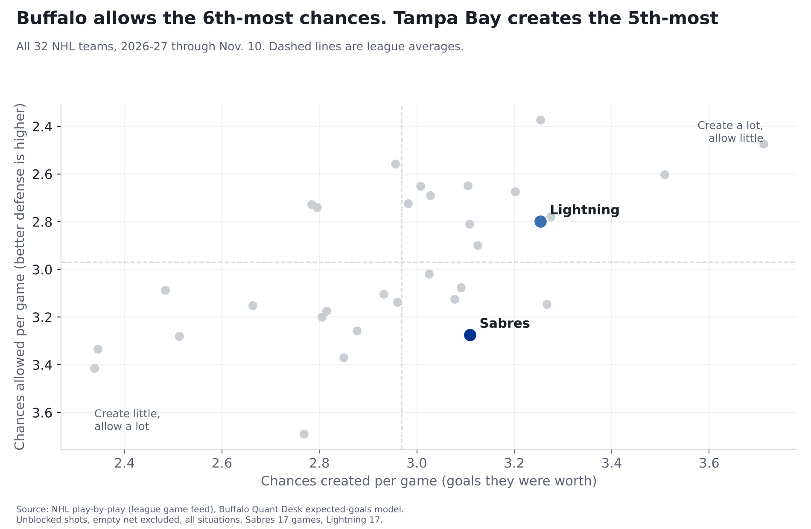
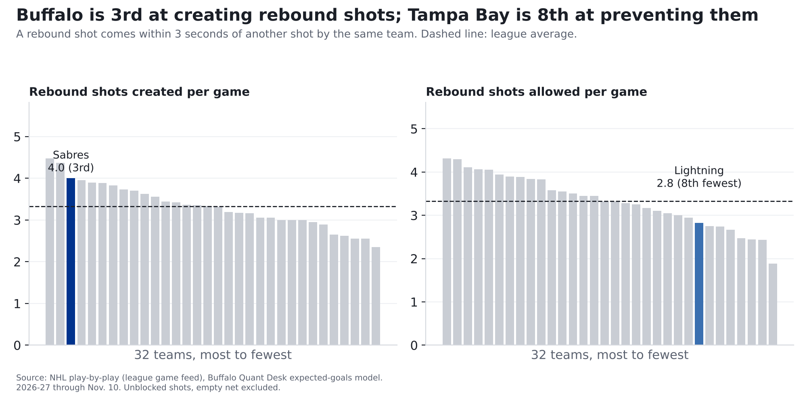
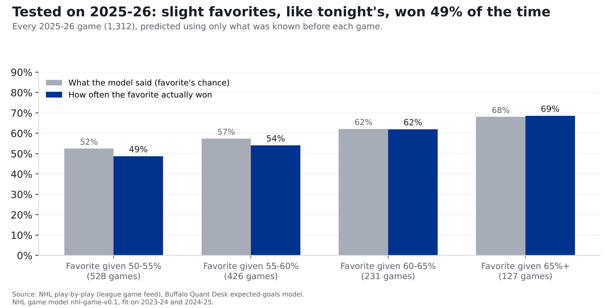

# Sabres vs. Lightning: Buffalo's best weapon meets a defense that keeps shots away from the net

**Our model calls it close: Lightning 53%, Sabres 47%. Buffalo's best weapon this season has been second chances (the Sabres are
3rd in the NHL at creating rebound shots), and Tampa Bay is 3rd at keeping shots away from its net. The bigger
worry is at Buffalo's end: the Sabres allow the 6th-most chances in the league.**

*Tampa Bay at Buffalo, Wednesday, Nov. 11, 7 p.m. ET, KeyBank Center. Numbers are 2026-27 through November 10: Sabres
8-6-3 in 17 games, Lightning 11-4-2 in 17. Seventeen games is early; ranks can move a lot.*

## The two teams, side by side

| Per game, 2026-27 | Sabres | Lightning | League average |
|---|---|---|---|
| Chances created (goals they were worth) | 3.11 (9th) | 3.25 (5th) | 2.97 |
| Chances allowed | 3.27 (27th) | 2.80 (13th) | 2.97 |
| Share of the chances in their games | 48.7% (20th) | 53.8% (7th) | 50% |
| Goals scored, actual | 2.94 | 3.71 | |
| Goals allowed, actual | 3.35 | 3.12 | |
| Shots from within 20 feet | 13.5 (14th) | 13.8 (11th) | 13.3 |
| Shots allowed from within 20 feet | 13.1 (16th) | 11.5 (3rd) | 13.3 |
| Rebound shots created | 4.0 (3rd) | 3.2 (19th) | 3.3 |
| Share of chances, last 5 games | 46.8% | 49.9% | |

Ranks are among 32 teams; 1st is best (most created, fewest allowed). Actual goals come from final scores; chances leave
out empty-net shots.

## How we measure "chances"

Every shot has a chance of going in, based on where it was taken and what kind of shot it was. Over the last three seasons
(336,462 shots that reached the net or missed it), a shot from within 10 feet went in 13.8% of the time; one from 60 feet or more, 0.8%. Add
up those chances on every shot and you get what a team's chances were worth in goals.

**The source:** the NHL's own play-by-play feed, which records where every shot came from. **The math:** each shot's chance
comes from our model, built on past seasons and tested on a season it hadn't seen; we nudge each season's totals so the
league's chances add up to the league's real goals. **How we checked it:** the full explanation, with the chart, is in our
story on [last year's 50-win season](sabres-50-win-mirage.html).

## The matchup to watch: getting to the net

A rebound shot catches the goalie moving. Over the last three seasons, rebounds went in 11.5% of the time, about
1.8 times the 6.3% rate for every other shot.

Buffalo gets 4.0 rebound shots a game (3rd of 32; league average 3.3), worth 0.37 goals a game. Tampa Bay
allows 2.8 a game (8th of 32 at keeping them down), and it's even stingier closer in: 11.5 shots a game from within 20
feet, 3rd-fewest in the league. How often Buffalo gets to the front of Tampa Bay's net is the part of this matchup to watch.

## In goal

Goals saved compared with an average goalie facing the same shots. Positive is good. Tap a Sabres goalie for his card.

| Team | Goalie | Games played in | Saves | Goals saved vs. average |
|---|---|---|---|---|
| Sabres | [Ukko-Pekka Luukkonen](../cards/ukko-pekka-luukkonen.html) | 11 | 87.8% | -1.0 (44th of 75) |
| Sabres | [Colten Ellis](../cards/colten-ellis.html) | 7 | 88.4% | +1.6 (21st of 75) |
| Lightning | Andrei Vasilevskiy | 13 | 88.3% | -0.5 (37th of 75) |
| Lightning | Dennis Hildeby | 4 | 88.0% | -1.0 (42nd of 75) |

Ranks are among all 75 goalies who have played this season. We hadn't seen confirmed starters when we published. These are small
samples: a goalie's numbers over a dozen games can swing a lot.

## Our prediction: Lightning 53%, Sabres 47%

**Logged on the [Ledger](../ledger.html) at 2026-11-11 22:14:46 UTC, before puck drop.** It gets graded after the game, hit or miss.

Our model expects about **3.4 goals for Tampa Bay and 3.2 for Buffalo**, and gives about a 16% chance the game is tied
after 60 minutes. Close to a coin flip, leaning Tampa Bay.

**Where the number comes from.** The same chances numbers above. Buffalo creates chances worth 3.11 goals a game; Tampa Bay
allows 2.80. Seventeen games is a small sample, so we blend in last season's numbers and pull them toward the league
average. That makes Buffalo's attack worth 3.09 a game and Tampa Bay's defense 2.86, against a league average of 3.00.
We do the same the other way for Tampa Bay. Home ice adds about 0.27 of a goal. Then we play the game out on paper many times.
Ties after 60 minutes go the way they have for home teams in past overtimes and shootouts (55% home wins).

**How we checked it.** We built the model on the 2023-24 and 2024-25 seasons, then had it call every 2025-26 game using only
what was known before each game. It called the winner 55% of the time; choosing the home team every time would have been right
52%. This season so far (292 games) it has called 60% right; home teams have won 56%. When it made a
team a 60-65% favorite in 2025-26, that team won 62% of the time. But the teams it favored slightly, at 50-55%, won 49%,
no better than a coin flip. Tonight's call is in that range, so read it as "slight lean Tampa Bay," not "Tampa Bay should win."

**What it doesn't count: goalies.** The model rates teams by the chances they create and allow, not by who's in net. We tested
adding each game's starting goalie and it made the predictions no better: a goalie's goals saved in the first half of a season
tells you little about his second half. A team's chances allowed carry over much better.

## What to watch

- **Second chances.** Count Buffalo's shots that come right after another shot. The Sabres' season average is 4.0.
- **Buffalo's own end.** The Sabres allow the 6th-most chances in the league. Tampa Bay creates the 5th-most.
- **Results vs. chances.** Buffalo is 3-2-0 in its last 5 games with 47% of the chances in them. Five games is a small sample,
  but over a full season, results that run ahead of the chances tend to fade (see our [50-win story](sabres-50-win-mirage.html)).

## For the stat-heads

- xG: Buffalo Quant Desk model (`src/metrics/nhl_xg.py`), unblocked non-empty-net shots, all strengths, rescaled per season so
  league xG = league goals (2026-27 factor 0.989). Share = xGF / (xGF + xGA). Rebound = shot within 3 s of a same-team
  unblocked attempt. Close = within 20 ft. GSAx = xG against minus goals against on unblocked shots, empty net excluded.
- Data through 2026-11-10 (292 games). Last-5 shares use each team's five most recent games.
- Win chance: NHL game model nhl-game-v0.1 (`src/ledger/nhl_game_model.py`), ratings as of 2026-11-11. Team xGF/xGA per game shrunk with
  K=10 games toward league + 0.5 x last season's edge; goals = -0.254 + 1.032 x expected + 0.272 x home
  (fit 2023-25); independent Poisson; regulation ties to home at 0.545. Brier: 2025-26 0.2446 (home-team rate
  0.2504, record log5 0.2514, coin 0.25); 2026-27 to date 0.2296. Goalies not in the model.
  The xG model's final fit includes 2025-26; QA re-ran the 2025-26 test with xG fit on 2023-25 only and got the same results (see the Nov. 8 Vegas pregame).
  Split-half correlation, goalies with 400+ unblocked shots per half: 0.07, 0.45, 0.17; team xGA/game: 0.75, 0.63, 0.69.
