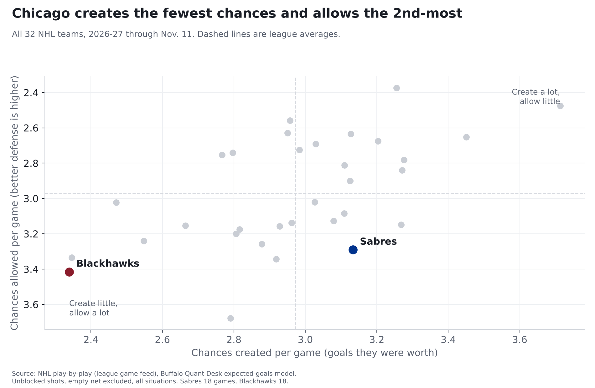
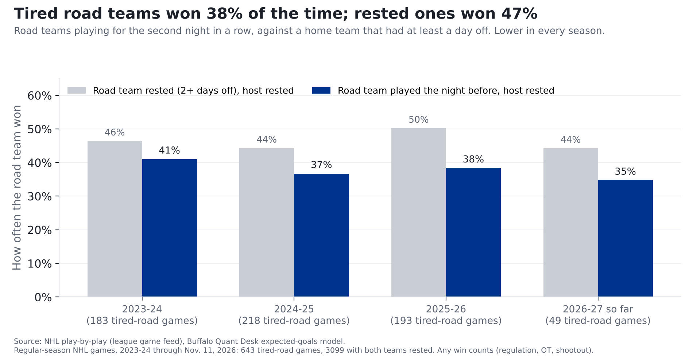
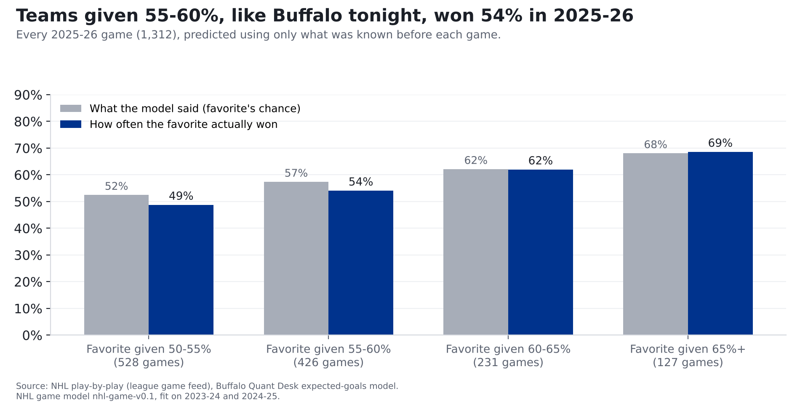

# Sabres at Blackhawks: the NHL's weakest team by chances, but Buffalo is on tired legs

**Our model leans Buffalo in Chicago: Sabres 57%, Blackhawks 43%. Chicago creates the fewest chances in the
league and allows the 2nd-most. But the model doesn't know the Sabres played last night, and that matters: last season and this one, road teams playing a second straight night against a rested home team won 38% of the time when our model gave them 46%.**

*Buffalo at Chicago, Thursday, Nov. 12, 8 p.m. ET, United Center. The Sabres lost 8-3 to Tampa Bay at home last night; the Blackhawks
haven't played since Nov. 7. Numbers are 2026-27 through November 11: Sabres 8-7-3 in 18 games, Blackhawks
4-13-1 in 18. Eighteen games is early; ranks can move a lot.*

## The two teams, side by side

| Per game, 2026-27 | Sabres | Blackhawks | League average |
|---|---|---|---|
| Chances created (goals they were worth) | 3.13 (8th) | 2.34 (32nd) | 2.97 |
| Chances allowed | 3.29 (28th) | 3.42 (31st) | 2.97 |
| Share of the chances in their games | 48.8% (20th) | 40.6% (32nd) | 50% |
| Goals scored, actual | 2.94 | 2.17 | |
| Goals allowed, actual | 3.61 | 4.22 | |
| Shots from within 20 feet | 13.4 (14th) | 10.8 (30th) | 13.3 |
| Shots allowed from within 20 feet | 12.9 (14th) | 16.2 (30th) | 13.3 |
| Rebound shots created | 3.8 (7th) | 3.1 (22nd) | 3.3 |
| Share of chances, last 5 games | 47.6% | 40.0% | |

Ranks are among 32 teams; 1st is best (most created, fewest allowed). Actual goals come from final scores; chances leave
out empty-net shots.

## How we measure "chances"

Every shot has a chance of going in, based on where it was taken and what kind of shot it was. Over the last three seasons
(336,462 shots that reached the net or missed it), a shot from within 10 feet went in 13.8% of the time; one from 60 feet or more, 0.8%. Add
up those chances on every shot and you get what a team's chances were worth in goals.

**The source:** the NHL's own play-by-play feed, which records where every shot came from. **The math:** each shot's chance
comes from our model, built on past seasons and tested on a season it hadn't seen; we nudge each season's totals so the
league's chances add up to the league's real goals. **How we checked it:** the full explanation, with the chart, is in our
story on [last year's 50-win season](sabres-50-win-mirage.html).

## The catch: the second night of a back-to-back

Since the start of 2023-24 there have been 643 games like tonight's: a road team playing for the second night in a row against a
home team that had at least a day off. The tired road team won **38%** of them. When both teams were rested, road teams won 47%
(3,099 games). The gap showed up in every one of the four seasons, which is why we don't think it's luck.

**Our model misses it.** It rates teams by the chances they create and allow, and it doesn't know who played the night before. In the
242 games like tonight's from last season and this one (games the model never saw while it was being built), it gave the tired road team
46% on average. Those teams won 38%. A gap that size over 242 games is about 2.6 times what chance alone would usually
produce. Rested road teams, by comparison, won a little more often than it said (49% against 45%).

**Where the drop comes from is less clear.** Tired road teams still got 46.9% of the chances in those games, only a little below the 48.3% for
rested road teams. Their usual starting goalie was in net 37% of the time, against 62% when rested, but the goalies who did play
were only about 0.06 of a goal a game worse than average. Neither explains the whole gap. What we can say is how often it's happened. Buffalo's only other second night this season was Oct. 13 at Montreal, a 4-3 loss.

Both Sabres goalies played in last night's loss.

## In goal

Goals saved compared with an average goalie facing the same shots. Positive is good. Tap a Sabres goalie for his card.

| Team | Goalie | Games played in | Saves | Goals saved vs. average |
|---|---|---|---|---|
| Sabres | [Ukko-Pekka Luukkonen](../cards/ukko-pekka-luukkonen.html) | 12 | 86.7% | -3.2 (60th of 75) |
| Sabres | [Colten Ellis](../cards/colten-ellis.html) | 8 | 87.3% | -0.6 (39th of 75) |
| Blackhawks | Spencer Knight | 14 | 88.1% | -2.3 (56th of 75) |
| Blackhawks | Arvid Soderblom | 5 | 84.2% | -6.2 (69th of 75) |

Ranks are among all 75 goalies who have played this season. We hadn't seen confirmed starters when we published. These are small
samples: a goalie's numbers over a dozen games can swing a lot.

## Our prediction: Sabres 57%, Blackhawks 43%

**This is our model's number.** It counts once it's logged on the [Ledger](../ledger.html) before puck drop; every logged call is graded after the game, hit or miss.

Our model expects about **3.5 goals for Buffalo and 3.0 for Chicago**, and gives about a 16% chance the game is tied after 60
minutes. That's the number we've logged, because it's the model we've tested. The back-to-back history above says to read it as
too high: if tonight goes the way games like it have, it's closer to a coin flip.

**Where the number comes from.** The same chances numbers above. Buffalo creates chances worth 3.13 goals a game; Chicago allows
3.42. Eighteen games is a small sample, so we blend in last season's numbers and pull them toward the league average. That makes
Buffalo's attack worth 3.11 a game and Chicago's defense 3.33, against a league average of 3.00. We do the same the other way
for Chicago. Home ice adds about 0.27 of a goal for the Blackhawks. Then we play the game out on paper many times. Ties after 60
minutes go the way they have for home teams in past overtimes and shootouts (55% home wins).

**How we checked it.** We built the model on the 2023-24 and 2024-25 seasons, then had it call every 2025-26 game using only
what was known before each game. It called the winner 55% of the time; choosing the home team every time would have been right
52%. This season so far (298 games) it has called 61% right; home teams have won 56%. When it gave a team
55-60% in 2025-26, as it does Buffalo tonight, that team won 54% of the time (426 games).

**What it doesn't count: goalies, or rest.** We tested adding each game's starting goalie and it made the predictions no better: a
goalie's goals saved in the first half of a season tells you little about his second half. Rest is the gap this story found, and it's
on our list to test as part of the model itself, the same way we tested goalies, before we add it.

## What to watch

- **The first period.** Chicago has the fewest chances in the league. If Buffalo's legs are there early, the Sabres should be
  the team with the puck.
- **Buffalo's own end.** The Sabres allow the 5th-most chances in the league, and Tampa Bay had more than twice their chances last night
  while the game was close (see last night's [post-game](sabres-lightning-postgame-nov-11.html)).
- **Results vs. chances.** Buffalo is 2-3-0 in its last 5 games with 48% of the chances in them. Five games is a small sample,
  but over a full season, results that run ahead of the chances tend to fade (see our [50-win story](sabres-50-win-mirage.html)).

## For the stat-heads

- xG: Buffalo Quant Desk model (`src/metrics/nhl_xg.py`), unblocked non-empty-net shots, all strengths, rescaled per season so
  league xG = league goals (2026-27 factor 0.989). Share = xGF / (xGF + xGA). Rebound = shot within 3 s of a same-team
  unblocked attempt. Close = within 20 ft. GSAx = xG against minus goals against on unblocked shots, empty net excluded.
- Data through 2026-11-11 (298 games). Last-5 shares use each team's five most recent games.
- Back-to-back: rest = days since the team's previous game in the same season; tired road = road rest 1 and home rest 2+; rested = both 2+.
  643 tired-road and 3,099 rested games, 2023-24 through 2026-11-11, regular season. Road win rate by season (tired / rested):
  2023-24 0.410 / 0.464; 2024-25 0.367 / 0.443; 2025-26 0.383 / 0.502; 2026-27 0.347 / 0.442. Model check, out of sample
  (2025-26 and 2026-27 to date): tired road mean p 0.458, won 0.376, n 242, binomial SE 0.031; rested road mean p 0.451,
  won 0.491, n 1155. Road xG share: tired 0.469, rested 0.483. "Usual starter" = the goalie who faced the most shots in the most games
  for that team that season; starter per game = goalie who faced the most unblocked shots; complete seasons only. GSAx per game for the road team:
  tired -0.059, rested +0.001.
- Win chance: NHL game model nhl-game-v0.1 (`src/ledger/nhl_game_model.py`), ratings as of 2026-11-12. Team xGF/xGA per game shrunk with
  K=10 games toward league + 0.5 x last season's edge; goals = -0.254 + 1.032 x expected + 0.272 x home
  (fit 2023-25); independent Poisson; regulation ties to home at 0.545. Brier: 2025-26 0.2446 (home-team rate
  0.2504, record log5 0.2514, coin 0.25); 2026-27 to date 0.2291. No goalie or rest term.
