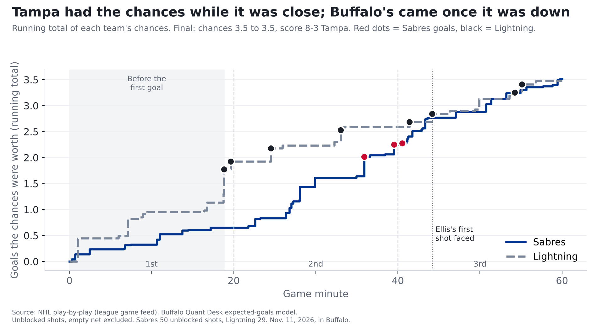
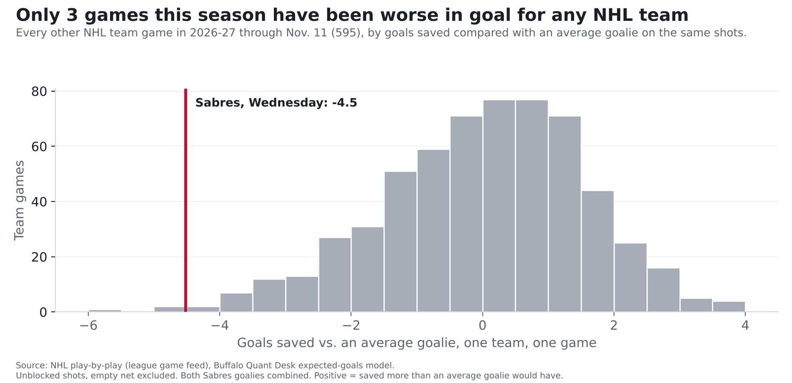

# Lightning 8, Sabres 3: outplayed early, then sunk in goal

**Finding: The Sabres were badly outplayed while this game was still close: Tampa's chances were worth 2.0 goals to Buffalo's 0.8.
Then the goaltending turned it into a blowout. Ukko-Pekka Luukkonen and Colten Ellis allowed 8 goals on shots worth 3.5, the
4th-worst night in goal for any NHL team this season, out of 596.**

*One game, 2026-11-11, in Buffalo. [Our pregame story](sabres-lightning-pregame-nov-11.html).*

## Even chances, but only on paper

Over the whole game, the chances came out even: Buffalo's 50 shots that weren't blocked were worth **3.5 goals**, Tampa's 29 were worth
**3.5**. That number hides how the game went, so we split it by the score.

| Score when the shot was taken | Sabres chances, in goals | Lightning chances, in goals |
|---|---|---|
| Tied, or Sabres down one | 0.8 (16 shots) | 2.0 (15 shots) |
| Sabres down two or more | 2.7 (34 shots) | 1.5 (14 shots) |

In the first 18:49, before anyone scored, Tampa's chances were worth 1.3 goals to Buffalo's 0.6, and the first period as a whole
went 1.9 to 0.6 Tampa. While the game was within reach, **Tampa had better than twice Buffalo's chances.** That's a small sample,
31 shots, nearly all of them in the first period.

Buffalo's push came from behind, and it was real: down two or more, the Sabres got 65% of the chances. Across the NHL this season, a team
that far behind gets 53%, so this looks like more than the usual effect of Tampa sitting on a lead, though it's only 48 shots. Down 4-0 in the second, the Sabres scored three times in
4 minutes 39 seconds, the last 0:33 into the third, to make it 4-3. Just 52 seconds later, Nikita Kucherov
made it 5-3, and that was the turn.

| Period | Time | Team | Scorer | Shot | Chance it went in | Score |
|---|---|---|---|---|---|---|
| 1 | 18:49 | Lightning | Scott Sabourin | snap from 12 ft, rebound | 47% | 0-1 |
| 1 | 19:38 | Lightning | John Carlson | snap from 12 ft, power play | 15% | 0-2 |
| 2 | 4:33 | Lightning | Brandon Hagel | snap from 12 ft | 25% | 0-3 |
| 2 | 13:02 | Lightning | Yanni Gourde | snap from 13 ft | 23% | 0-4 |
| 2 | 15:54 | Sabres | Josh Doan | tip-in from 4 ft, power play | 37% | 1-4 |
| 2 | 19:32 | Sabres | Jason Zucker | snap from 19 ft | 19% | 2-4 |
| 3 | 0:33 | Sabres | Tage Thompson | slap from 44 ft | 2% | 3-4 |
| 3 | 1:25 | Lightning | Nikita Kucherov | backhand from 15 ft | 9% | 3-5 |
| 3 | 4:11 | Lightning | Nikita Kucherov | slap from 28 ft | 16% | 3-6 |
| 3 | 14:13 | Lightning | Nikita Kucherov | slap from 33 ft, power play | 6% | 3-7 |
| 3 | 15:06 | Lightning | Brandon Hagel | snap from 33 ft | 15% | 3-8 |

## How we measure "chances"

Every shot has a chance of going in, based on where it was taken and what kind of shot it was. Add those up and you get what a team's chances were
worth in goals. Wednesday shows the range: Josh Doan's tip-in from 4 feet had a 37% chance of going in;
Tage Thompson's slap shot from 44 feet about 2%. While it was close, one Tampa rebound, Scott Sabourin's from 12 feet, was a 47% chance by itself,
more than half of Buffalo's 0.8 total in that stretch. Add up all 29 of Tampa's shots that
weren't blocked and they were worth 3.5 goals. Tampa scored 8. The shot locations come from the NHL's own
play-by-play. (The full explanation is in our story on [last year's 50-win season](sabres-50-win-mirage.html).)

To see how unusual 8 goals on those chances is, imagine replaying the game over and over, with each shot going in or missing at its own
chance. Tampa would score 8 or more **1.2% of the time**, about once in 85 games. Over the whole game those replays come out about even:
Buffalo wins 42%, Tampa 41%, tied after 60 minutes 17%. The catch: 78% of Buffalo's chances came after it was already down two or more.

## The goaltending

[Luukkonen](../cards/ukko-pekka-luukkonen.html) faced Tampa shots worth 2.7 goals and allowed 5 before he was pulled with the Sabres down 5-3
early in the third: **2.3 more than an average goalie would have allowed.** [Ellis](../cards/colten-ellis.html) faced 8 shots
worth 0.8 and allowed 3: **2.2 more than average.** Together, the Sabres stopped 64% of the shots on goal; the league
stops 89%. At the other end, [Andrei Vasilevskiy](../cards/andrei-vasilevskiy.html) stopped 28 of 31, 0.5 goals better than an average goalie.

Add the two Sabres goalies together and it's **4.5 goals worse than average** in one night. Only 3 team games this season have been worse.

Luukkonen's season goes from 0.9 goals worse than an average goalie to 3.3 worse (12 games). Ellis's season goes from
1.6 better to 0.6 worse (8 games). One night moved Ellis from above average to below. Both seasons are short enough that one game swings them hard,
which is also why our game model doesn't lean on goalies: in [our tests](sabres-vegas-pregame-nov-8.html), a goalie's first half of a season told us little about his second half.

## Receipts: our pregame call

Before the game we logged **a 47% chance the Sabres win** on the [Ledger](../ledger.html). Tampa won, so it counts as a hit, but a soft one: a
47% call is close to a coin flip. Scored the usual way (the gap between our chance and what happened, squared; lower is better), it comes to
0.22, a little better than a 50/50 guess's 0.25. That makes our record 7 of 9 on graded calls.

The model expected chances worth 3.20 goals for Buffalo and 3.44 for Tampa. The game came in at 3.5 and 3.5, close to
that. The model doesn't try to predict a night like this in goal.

## What it means for Buffalo

- **The early game is the worry, not the final score.** Coming in, Buffalo had been giving up more than
  it created: 3.1 chances created per game (9th of 32) and 3.3 allowed (27th; only 5 teams allowed more), with the league average at 3.0. Tampa's 1.9 in the first period alone was 59% of what
  Buffalo usually allows in a whole game.
- **The goaltending is the kind of thing that doesn't carry over.** A night like this is rare, and in our tests a goalie's numbers swing far more
  from stretch to stretch than a team's chances do. Expect better in net; don't expect it to fix the early-game problem.

## For the stat-heads

- Expected goals (xG): our gradient-boosted model on unblocked, non-empty-net shots, rescaled per season so league xG equals league goals
  (2026-27 factor 0.989). BUF 3.52 xG on 50 unblocked shots (31 on goal); TBL 3.48 on 29 (22 on goal).
- Score state: shots taken with BUF trailing by 0-1 (or leading): BUF 0.79, TBL 2.02; trailing by 2+: BUF 2.73, TBL 1.46. Five on five: BUF 2.40, TBL 2.70.
- Power play: chances BUF 1.11, TBL 0.72; power-play goals BUF 1, TBL 2.
- Score effects: league 2026-27, share of xG taken by the trailing team when the margin is 2+: 0.533.
- Replays: exact Poisson-binomial over shots (each an independent Bernoulli with p = xG). BUF win 0.419, tie 0.168, loss 0.413; TBL 8+ goals 0.0117.
- GSAx = xG on unblocked shots faced minus goals allowed. Luukkonen -2.31 (14 SOG), Ellis -2.21 (8 SOG), Vasilevskiy
  +0.52 (31 SOG). BUF team GSAx -4.52, 4th-lowest of 596 2026-27 team games. Save rate on shots on goal: BUF 0.636, league 0.891.
- Ledger P0009: p = 0.47, outcome 0, Brier 0.2209; scored a hit because p < 0.5 and the event didn't happen. Model nhl-game-v0.1.
