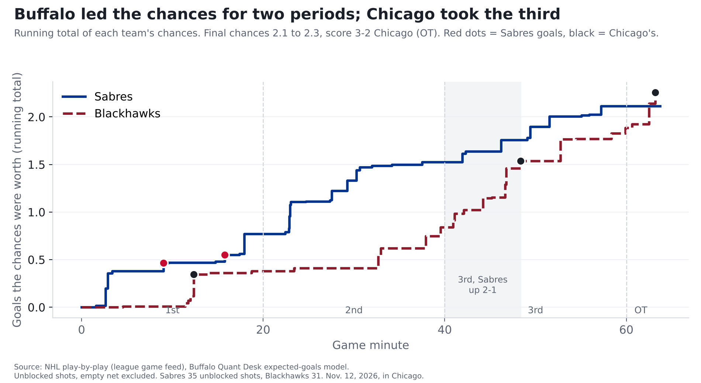
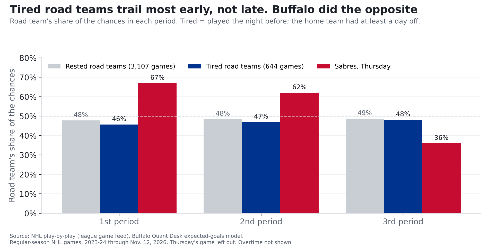

# Blackhawks 3, Sabres 2 (OT): Buffalo carried two periods, then sat on a lead it couldn't keep

**Finding: The Sabres had the better of Chicago for 40 minutes: their chances were worth 1.5 goals to Chicago's 0.8, and they led 2-1
going into the third. Then Chicago took over. With the lead in the third, Buffalo got 25% of the chances; teams up a goal in the third
usually get 42%. Chicago tied it with 11:38 left and won it 3:12 into overtime. The Sabres get a point; our 57% call
for a Buffalo win goes down as a miss.**

*One game, Nov. 12, in Chicago, the second night of a back-to-back for Buffalo. [Our pregame story](sabres-blackhawks-pregame-nov-12.html).*

## How it went

| Period | Sabres chances, in goals | Blackhawks chances, in goals |
|---|---|---|
| 1st | 0.77 (10 shots) | 0.38 (8 shots) |
| 2nd | 0.76 (16 shots) | 0.46 (7 shots) |
| 3rd | 0.59 (9 shots) | 1.04 (13 shots) |
| Overtime | 0.00 (0 shots) | 0.37 (3 shots) |
| **Game** | **2.11** (35 shots) | **2.26** (31 shots) |

Shots counted here are the ones that weren't blocked, not counting empty nets.

| Period | Time | Team | Scorer | Shot | Chance it went in | Score |
|---|---|---|---|---|---|---|
| 1 | 9:00 | Sabres | Owen Power | slap from 36 ft | 9% | 1-0 |
| 1 | 12:22 | Blackhawks | Frank Nazar | wrist from 5 ft, power play | 23% | 1-1 |
| 1 | 15:46 | Sabres | Tage Thompson | wrist from 29 ft, power play | 7% | 2-1 |
| 3 | 8:22 | Blackhawks | Frank Nazar | tip-in from 16 ft | 8% | 2-2 |
| OT | 3:12 | Blackhawks | Ryan Donato | wrist from 32 ft, 3-on-3 | 11% | 2-3 |

Over the whole game it was close to even: Buffalo's chances were worth 2.1 goals, Chicago's 2.3. Replay the 60 minutes over and over, with each
shot going in or missing at its own chance, Buffalo wins 44% of the time and Chicago 35%; the other 21%, it's tied after 60 minutes. That's how close this one was.

## The third period

Buffalo led 2-1 from 15:46 of the first until Frank Nazar's tip-in 8:22 into the third. In those first 8:22 of the third, with the
lead, the Sabres had 3 shots that weren't blocked, worth 0.23 goals. Chicago had 8, worth 0.69. That's **25% of the chances for Buffalo.**

Some of that is normal. A team protecting a one-goal lead in the third tends to sit back, and the trailing team pushes: across the NHL since 2023-24
(2,841 games), the team up a goal in the third got 42% of the chances. Buffalo sat back further than that. It's 11 shots in about eight minutes, so
it's one stretch of one game, not a trend. After the tie, the chances were even (0.36 to 0.35) until overtime, where Chicago had all 3 shots.

## Was it tired legs?

The easy story is that Buffalo ran out of gas on the second night of a back-to-back. The numbers don't back that up.

Our pregame story found that tired road teams win less often. Split their chances by period (644 games since 2023-24, not counting
Thursday's) and they don't fade late. They're furthest behind in the **first** period, with 46% of the chances against 48% for rested road
teams, and by the third they've nearly caught up (48% against 49%). Buffalo did the opposite: 67% of the chances in the
first, 36% in the third. The score explains Thursday's third period better than the schedule does.

## In goal

Alex Lyon started for Buffalo after both of the Sabres' regular goalies played in Wednesday's 8-3 loss to Tampa Bay. It was his first NHL game this season.
He faced Chicago shots worth 2.3 goals and allowed 3, 0.7 more than an average goalie would have.
At the other end, [Spencer Knight](../cards/spencer-knight.html) stopped 21 of 23, 0.1 goals better than average.
Neither goalie's night was far from average.

## Receipts: our pregame call

Before the game we logged **a 57% chance the Sabres win** on the [Ledger](../ledger.html). They lost in overtime, so it's a miss. Scored the usual way (the gap between
our chance and what happened, squared; lower is better), it comes to 0.32, worse than a 50/50 guess's 0.25. Our record on graded calls is now 7 of 10.

Our pregame story said to read the 57% as too high, because the model doesn't know about back-to-backs. Chicago won, the way that warning
pointed, but one game can't confirm it, and the 57% is what we logged and what gets graded. The model expected chances worth 3.45 goals for Buffalo and 2.97 for Chicago; the game came in well below both,
at 2.1 and 2.3.

## What it means for Buffalo

- **The Sabres can carry play against a weak team.** For two periods they did what the numbers said they should against the league's weakest team at
  creating chances.
- **Holding a lead is the thing to watch.** One stretch isn't a pattern, but if Buffalo keeps getting this far out-chanced with a lead in the third, it'll show up
  in the standings. Next up: Saturday at Dallas.

## For the stat-heads

- Expected goals (xG): our gradient-boosted model on unblocked, non-empty-net shots, rescaled per season so league xG equals league goals
  (2026-27 factor 0.992). BUF 2.11 xG on 35 unblocked shots (23 on goal); CHI 2.26 on 31 (25 on goal).
- Third period with BUF +1 (40:00 to 48:22): BUF 0.23 xG (3), CHI 0.69 (8). League third-period xG share for a team
  up one, 2023-24 to date: 0.417 (2,841 games).
- Back-to-back split: road xG share by period, tired (road rest 1, home rest 2+) P1 0.457, P2 0.470, P3 0.482;
  rested (both 2+) P1 0.478, P2 0.485, P3 0.488. Games: 644 / 3,107. Regulation only.
- Replays: exact Poisson-binomial over regulation shots (each an independent Bernoulli with p = xG). BUF win 0.438, tie 0.215, loss 0.347.
- GSAx = xG on unblocked shots faced minus goals allowed. Lyon -0.74 (25 SOG), Knight +0.11 (23 SOG).
- Ledger P0010: p = 0.57, outcome 0 (CHI won in OT; any result counts), Brier 0.3249. Model nhl-game-v0.1.
