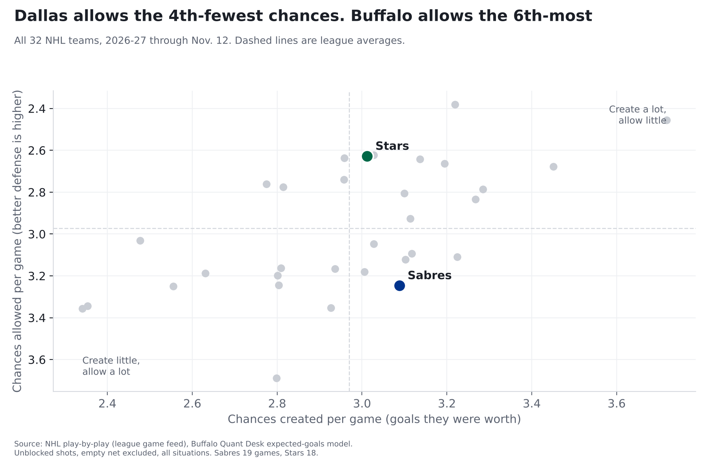
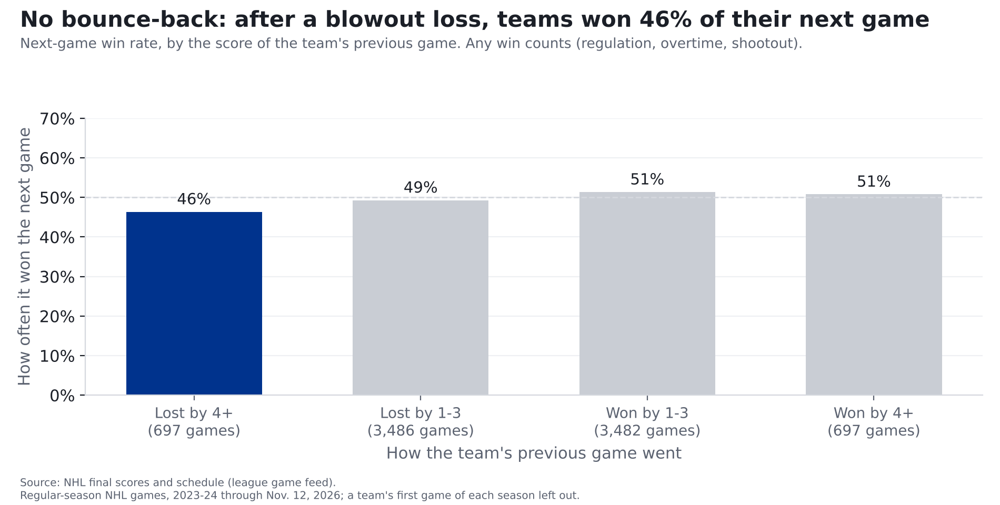
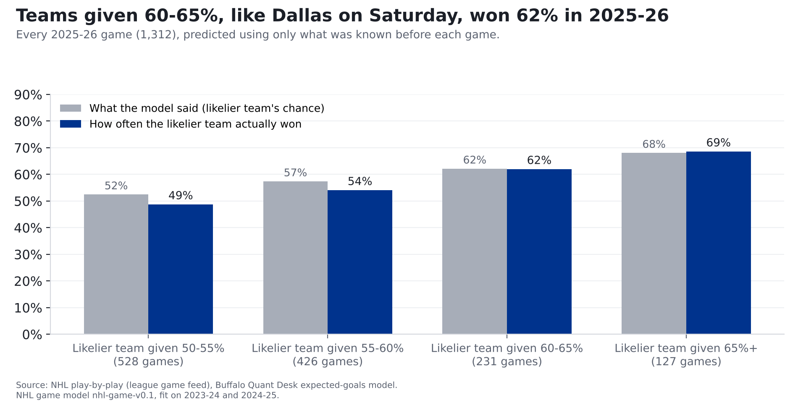

# Sabres at Stars: forget the bounce-back game. Dallas is the better team anyway

**Our model gives Dallas a 62% chance to win at home Saturday (Sabres 38%). The Stars allow the 4th-fewest chances in the NHL;
the Sabres allow the 6th-most. Dallas got blown out 8-3 at home Thursday, so you'll hear about a bounce-back game. The numbers say there's no such
thing: since 2023-24, teams coming off a loss by four or more won 46% of their next game, a little less often than everyone else (50%).**

*Buffalo at Dallas, Saturday, Nov. 14, 8 p.m. ET. Neither team has played since Thursday: Buffalo lost 3-2 in overtime at Chicago, Dallas lost 8-3 at home to
Winnipeg. Numbers are 2026-27 through November 12: Sabres 8-7-4 in 19 games, Stars 10-6-2 in 18. Early-season ranks can move a lot.*

## The two teams, side by side

| Per game, 2026-27 | Sabres | Stars | League average |
|---|---|---|---|
| Chances created (goals they were worth) | 3.09 (13th) | 3.01 (16th) | 2.97 |
| Chances allowed | 3.25 (27th) | 2.63 (4th) | 2.97 |
| Share of the chances in their games | 48.8% (20th) | 53.4% (9th) | 50% |
| Goals scored, actual | 2.89 | 2.89 | |
| Goals allowed, actual | 3.58 | 2.72 | |
| Shots allowed from within 20 feet | 12.8 (13th) | 11.1 (2nd) | 13.3 |
| Rebound shots allowed | 2.8 (10th) | 2.1 (1st) | 3.3 |
| Share of chances, last 5 games | 50.2% | 52.1% | |

Ranks are among 32 teams; 1st is best (most created, fewest allowed). Actual goals come from final scores; chances leave out empty-net shots.

## How we measure "chances"

Every shot has a chance of going in, based on where it was taken and what kind of shot it was. Over the last three seasons (336,462 shots that weren't
blocked, not counting empty nets), a shot from within 10 feet went in 13.8% of the time; one from 60 feet or more, 0.8%. Add up those chances on
every shot and you get what a team's chances were worth in goals. **The source:** the NHL's own play-by-play feed, which records where every shot came from.
**The math:** each shot's chance comes from our model, built on past seasons and tested on a season it hadn't seen; we nudge each season's totals so the
league's chances add up to the league's real goals. **How we checked it:** the full explanation is in our story on [last year's 50-win season](sabres-50-win-mirage.html).

Here's what that looks like for Buffalo: the chances the Sabres have allowed were worth 3.25 goals a game, and they've actually allowed 3.58.
Much of that gap is in goal: Buffalo's goalies have allowed about 0.23 goals a game more than an average goalie would have on the same shots.

## What makes Dallas hard to play

The Stars don't let teams near the net. They allow 11.1 shots a game from within 20 feet (2nd-fewest) and 2.1 rebound shots
(fewest), the two kinds of shots most likely to go in. Buffalo is in the middle of the league at creating chances (13th) and near
the bottom at preventing them. One caution: when the teams met in Buffalo on Oct. 8, the Sabres actually got the better chances (worth 2.6 goals to Dallas's 2.1) and
still lost 4-0. One game is a small sample, and our prediction goes by the full season.

## The bounce-back game

Dallas lost 8-3 at home Thursday. Buffalo lost 8-3 at home to Tampa Bay on Wednesday. It's natural to think a team comes out angry after a game like that.
We checked every NHL game since 2023-24. Teams coming off a loss by four goals or more won **46%** of their next game (697 games). After any
other result, teams won 50%. A blowout doesn't make a team play better next time; if anything, they win a little less. Part of the reason is simple: teams that get
blown out tend to be a little weaker to begin with.

**Does our model miss it?** Our model never looks at the last score, only at the chances teams create and allow. On games it never saw while it was
being built (last season and this one), it gave teams coming off a blowout loss 49% on average, against 50% for everyone else, because those teams
were a little weaker. They won 46% (261 games). That gap is small enough to be chance.

That's the opposite of what we found Thursday. Before the [Chicago game](sabres-blackhawks-pregame-nov-12.html), we showed that road teams playing a second night
in a row lose more often than our model says. Being tired is something the model misses; a bad last game isn't. So for Saturday, Dallas's 8-3 loss counts for exactly what its chances were worth, and nothing more.

## In goal

Goals saved compared with an average goalie facing the same shots. Positive is good. Tap a goalie for his card.

| Team | Goalie | Games played in | Saves | Goals saved vs. average |
|---|---|---|---|---|
| Sabres | [Ukko-Pekka Luukkonen](../cards/ukko-pekka-luukkonen.html) | 12 | 86.7% | -3.1 (61st of 76) |
| Sabres | [Colten Ellis](../cards/colten-ellis.html) | 8 | 87.3% | -0.5 (40th of 76) |
| Sabres | [Alex Lyon](../cards/alex-lyon.html) | 1 | 88.0% | -0.7 (43rd of 76) |
| Stars | [Jake Oettinger](../cards/jake-oettinger.html) | 14 | 89.5% | +3.6 (17th of 76) |
| Stars | [Casey DeSmith](../cards/casey-desmith.html) | 5 | 89.4% | -0.3 (37th of 76) |

Ranks are among all 76 goalies who have played this season. We hadn't seen confirmed starters when we published. A goalie's numbers over a dozen
games can swing a lot. We tested adding each game's starting goalie to our prediction and it made it no better: a goalie's goals saved in the first
half of a season tells you little about his second half.

## Our prediction: Stars 62%, Sabres 38%

**Logged on the [Ledger](../ledger.html) at 2026-11-14 00:05:13 UTC, before puck drop.** It gets graded after the game, hit or miss.

Our model expects about **3.5 goals for Dallas and 2.8 for Buffalo**, and gives about a 16% chance the game is tied after 60 minutes.

**Where the number comes from.** The chances numbers above. Buffalo creates chances worth 3.09 goals a game; Dallas allows 2.63. Early in a season we
blend in last season's numbers and pull everything toward the league average, which makes Buffalo's attack worth 3.07 a game and Dallas's defense
2.73. (The model works with the chances before our small season adjustment, so an average team is 2.99 there, against 2.97 in the table.) We do the same the other way for Dallas. Home ice adds about 0.27 of a goal for the Stars.
Then we play the game out on paper many times; ties after 60 minutes go the way they have for home teams in past overtimes and shootouts (55% home wins).

**How we checked it.** We built the model on the 2023-24 and 2024-25 seasons, then had it call every 2025-26 game using only what was known before each game.
It called the winner 55% of the time; choosing the home team every time would have been right 52%. This season so far (309 games) it has called
61% right; home teams have won 55%. When it gave a team 60-65% in 2025-26, as it gives Dallas Saturday, that team won 62% of the
time (231 games).

## What to watch

- **Second chances.** Dallas allows the fewest rebound shots in the NHL and the 2nd-fewest from close in. If Buffalo's
  chances come from the point and the outside, expect a low-scoring night for the Sabres.
- **Buffalo's own end.** The Sabres allow chances worth 3.25 goals a game, 6th-most in the league. That's the bigger reason our model has Dallas ahead.

## For the stat-heads

- xG: Buffalo Quant Desk model (`src/metrics/nhl_xg.py`), unblocked non-empty-net shots, all strengths, rescaled per season so league xG = league goals
  (2026-27 factor 0.992). Close = within 20 ft; rebound = within 3 s of a same-team unblocked attempt. Data through 2026-11-12 (309 games).
- Bounce-back: next-game win rate by previous-game goal margin, same team and season, 2023-24 to 2026-11-12, regular season, any result counts.
  Lost by 4+ 0.463 (n 697); Lost by 1-3 0.493 (n 3,486); Won by 1-3 0.513 (n 3,482); Won by 4+ 0.508 (n 697). Model check out of sample (2025-26 and 2026-27 to date), previous loss
  by 4+: mean p 0.487, won 0.460, n 261, binomial SE 0.031.
- Win chance: NHL game model nhl-game-v0.1 (`src/ledger/nhl_game_model.py`), ratings from games through 2026-11-12. Team xGF/xGA per game shrunk with K=10
  games toward league + 0.5 x last season's edge; goals = -0.254 + 1.032 x expected + 0.272 x home (fit 2023-25), on unrescaled xG;
  independent Poisson; regulation ties to home at 0.545. Brier: 2025-26 0.2446 (home-team rate 0.2504, record log5
  0.2514, coin 0.25); 2026-27 to date 0.2303. No goalie, rest or last-game term.
- GSAx = xG against minus goals against on unblocked shots, empty net excluded.
