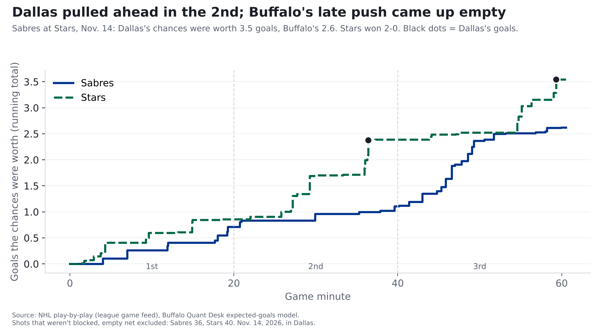
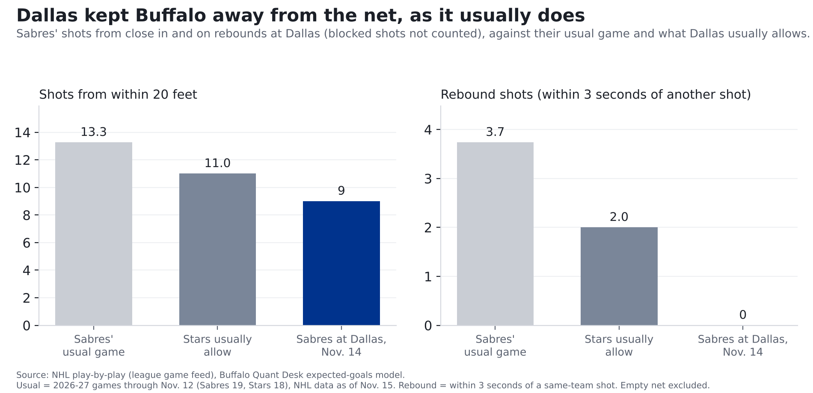

# Stars 2, Sabres 0: Dallas kept Buffalo away from the net, and Oettinger stopped the rest

**Dallas did to Buffalo what it does to most teams: it kept the Sabres away from the front of the net. Buffalo got 9 shots from within 20 feet and no
rebound shots at all. Even so, its chances were worth 2.6 goals, and a team with chances like that gets shut out only about 6% of the time.
Jake Oettinger made sure this was one of those nights, stopping all 22 shots that reached him. Dallas's own chances were worth 3.5 goals. Our pregame call gave Buffalo a
38% chance, making Dallas the likelier winner. That call was right.**

*One game, Nov. 14, in Dallas. [Our pregame story](sabres-stars-pregame-nov-14.html).*

It's the 2nd time in 20 games this season the Sabres haven't scored, both times against Dallas with Oettinger in net.
On Oct. 8 in Buffalo, as our pregame story noted, the Sabres actually had the better chances and still lost 4-0.

## How we measure "chances"

Every shot has a chance of going in, based on where it was taken and what kind of shot it was. Benn's rebound from 6 feet had a 29% chance;
Johnston's snap shot from 7 feet, about 25%. Add those chances up over a game and you get what a team's chances were worth in goals:
all 40 of Dallas's shots were worth 3.5, and Dallas scored 2. Buffalo's 36 were worth 2.6, and Buffalo scored 0. The shot locations
come from the NHL's own play-by-play. Each shot's chance comes from our model, built on past seasons and tested on a season it hadn't seen. (The full
explanation is in our story on [last year's 50-win season](sabres-50-win-mirage.html).)

## Dallas took over in the second period

| Period | Sabres chances (worth this many goals) | Stars chances (worth this many goals) |
|---|---|---|
| 1st | 0.7 (9 shots) | 0.9 (13 shots) |
| 2nd | 0.4 (7 shots) | 1.5 (16 shots) |
| 3rd | 1.5 (20 shots) | 1.2 (11 shots) |
| Game | 2.6 (36 shots) | 3.5 (40 shots) |

"Shots" here means every shot that wasn't blocked, including ones that missed the net: 22 of Buffalo's 36 reached Oettinger, and the other
14 missed. There were no empty-net shots or goals.

| Period | Time | Team | Scorer | Shot | Chance it went in | Score |
|---|---|---|---|---|---|---|
| 2 | 16:23 | Stars | Jamie Benn | snap shot from 6 ft, on a rebound | 29% | Stars 1-0 |
| 3 | 19:18 | Stars | Wyatt Johnston | snap shot from 7 ft, on the power play | 25% | Stars 2-0 |

The first period was close. Dallas took over the second, with chances worth 1.5 goals to Buffalo's 0.4, and Jamie Benn scored on a rebound
late in it. Buffalo, trailing, had more of the chances in the third (1.5 to 1.2), with 0.9 of Buffalo's 1.5 coming on the power play; 3 of its shots
came with its goalie pulled for an extra skater. Wyatt Johnston's power-play goal came with 0:42 left.

Replay the game over and over, with each shot going in or missing at its own chance, and Buffalo wins 27% of the time, Dallas 57%, and it's tied after
regulation the other 16%. Buffalo goes scoreless in only about 6% of those replays. Saturday went like one of those few.

## What we said to watch: Buffalo rarely got to the net

Our pregame story said Dallas allows the fewest rebound shots in the NHL and the 2nd-fewest from close in, and that if Buffalo's chances came from the point and
the outside, to expect a low-scoring night for the Sabres. Buffalo had 9 shots from within 20 feet, against the 13.3 it gets in a usual game and the
11.0 Dallas usually allows. It had **no rebound shots**; it usually gets 3.7, and Dallas usually allows 2.0. Going a whole game without a rebound shot is rare:
it's happened in 6% of NHL team games this season. Dallas got to the net more: 17 shots from within 20 feet and 4 rebounds, one of which was Benn's goal.

(Dallas's numbers here are slightly different from the pregame story's 11.1 and 2.1: the NHL has since corrected some of its records from earlier games.
On the corrected records, Dallas allows the fewest rebound shots and, by a hair over New Jersey, the fewest from close in.)

Dallas's defense explains part of the shutout, not all of it. Nine or fewer shots from close in isn't rare: it's happened in 20% of NHL team games this season, and 3 of
Buffalo's 20. Buffalo's chances were still worth 2.6 goals, against about 3.1 in its other games. The bigger reason it scored none is in goal.

## In goal

[Jake Oettinger](../cards/jake-oettinger.html) stopped all 22 shots on goal. Buffalo's chances were worth 2.6 goals, so he saved 2.6 goals more than
an average goalie would have: the 23rd-best goalie game in the NHL this season, out of 685.

[Alex Lyon](../cards/alex-lyon.html) started his second straight game. He faced Dallas shots worth 3.5 goals and allowed 2, 1.5 goals fewer than an
average goalie would have. Buffalo lost with a good night in its own net.

## At full strength Saturday, Dallas had most of the chances

More than half of Buffalo's chances came on the power play: 13 shots worth 1.4 goals. At five-on-five it had 16, worth 1.1.
Dallas had 32 at five-on-five, worth 2.6. So at full strength, Dallas had about 71% of the chances.

## Receipts: our pregame call

Before the game we logged **a 38% chance the Sabres win** on the [Ledger](../ledger.html), which made Dallas the likelier winner. Dallas won, so the call was right.
On our scorecard, where 0 is perfect and a coin-flip guess scores 0.25, this call scores 0.14. We've now got 8 of our 11 graded calls right, and 3 of 4
on Sabres games.

The model expected about 3.5 goals for Dallas and 2.8 for Buffalo. The chances came out 3.5 and 2.6: Dallas about what it expected,
Buffalo a little less.

**The bounce-back.** Dallas came in off an 8-3 home loss to Winnipeg on Thursday, and our pregame story found that teams coming off a loss by four or more have won
46% of their next game, a little less often than usual. Dallas won this one; one game doesn't change that number.

## What it means for Buffalo

- **The zero was unlikely.** Chances like Saturday's leave Buffalo scoreless only about 6% of the time. The shutout says more about Oettinger than about Buffalo's offense.
- **Keep an eye on Buffalo's own end.** That was our pregame story's bigger concern: the Sabres allow the 6th-most chances in the league. Saturday,
  Dallas's chances were worth 3.5 goals, and a good night from Lyon held it to 2.
- **Lyon has held up.** After Buffalo's own 8-3 loss to Tampa Bay, he was 0.7 goals worse than average in the
  overtime loss at Chicago and 1.5 better Saturday. Two games is a tiny sample.

## For the stat-heads

- Expected goals (xG): our gradient-boosted model on unblocked, non-empty-net shots, rescaled per season so league xG equals league goals
  (2026-27 factor 0.990). BUF 2.62 xG on 36 unblocked shots (22 on goal); DAL 3.54 on 40 (30 on goal).
  By period: BUF 0.71, 0.39, 1.52; DAL 0.86, 1.53, 1.15. While 0-0: BUF 1.00 (14), DAL 2.38 (28).
  BUF xGF per game in its other 19 games this season: 3.08.
- Strength: BUF 5v5 1.07 (16), power play (5v4, 4v3) 1.38 (13; 0.93 in the 3rd), 6v5 0.10 (3); DAL 5v5 2.61 (32),
  power play 0.90 (6). 5v5 xG share DAL 0.710. Penalty counts not shown (attribution unverified).
- Data revision: the pregame story (games through 2026-11-12) published DAL close-in allowed 11.1 and rebounds allowed 2.1 a game. Re-running its
  unchanged generator on the Nov. 15 NHL data gives 11.00 and 2.00 (NJD close-in allowed 11.05); BUF's numbers are unchanged.
  The pregame story stays as published.
- Close = within 20 ft (strictly under), rebound = within 3 s of a same-team unblocked attempt. Season rates per game through 2026-11-12: BUF close 13.26, rebounds 3.74;
  DAL allows close 11.00, rebounds 2.00. BUF close-in xG Saturday 1.02. Team-games with zero rebound shots, 2026-27 through 2026-11-12: 0.060 (n 618).
  Team-games with 9 or fewer close-in shots, 2026-27 through 2026-11-14: 0.200 (n 650); BUF 3 of 20.
- Replays: exact Poisson-binomial over all unblocked shots (each an independent Bernoulli with p = xG). BUF win 0.265, tie 0.162, loss 0.573;
  P(BUF 0 goals) 0.061.
- GSAx = xG on unblocked shots faced minus goals allowed. Oettinger +2.62 (22 SOG), rank 23 of 685 goalie-games this season (any minutes);
  Lyon +1.54 (30 SOG), his 2nd game this season; -0.75 at Chicago.
- Ledger P0011: p = 0.38, outcome 0 (DAL won in regulation; any result counts), Brier 0.1444. Model nhl-game-v0.1; its 2.79 / 3.49 are expected goals for 60 minutes.
