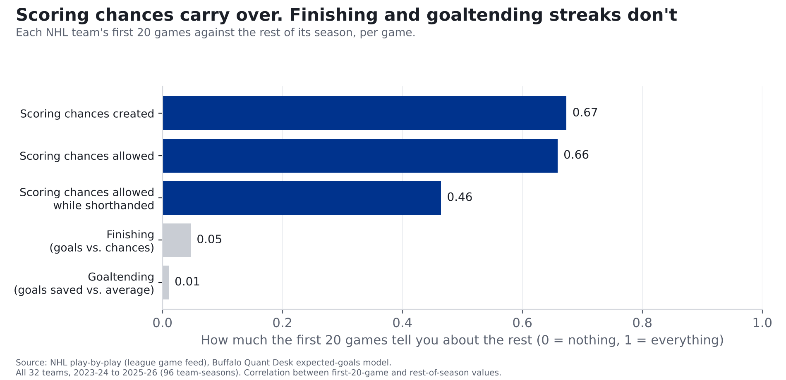

# Are the Sabres done? Not yet, but they have to stop giving up so many scoring chances

**After 20 games, our model gives the Sabres about a 1-in-6 playoff chance (16%). They're 8-8-4 with 20 points,
and in our simulations the last playoff spot in the East usually goes to a team with about 94: Buffalo needs about 74 more in its last 64
games. Its cold shooting and shaky goaltending usually don't last. The scoring chances it gives up are more likely to. Cut those to league average
and the Sabres' playoff chance doubles, to 32%.**

*Numbers are through Nov. 14, 2026, the Sabres' first 20 games of 84. Early-season numbers move a lot.*

## Where they stand

The Sabres have 20 points from 20 games (8-8-4). Our model plays out the 1,019 games left on the NHL's schedule 20,000 times.
In a typical one of those seasons, Buffalo finishes with about **85 points** (eight times in ten, between 76 and 95), and the last playoff
spot in the East goes to a team with about **94** (90 to 97). To get there, Buffalo needs about 74 points from its last 64 games:
1.16 points a game. So far it has earned 1.00 points a game. Last season's 50-win team earned 1.33.

| Eastern team | Points (games played) | Projected final points | Playoff chance |
|---|---|---|---|
| CAR | 34 (21) | 122 | 100% |
| NJD | 30 (21) | 110 | 99% |
| TBL | 28 (20) | 105 | 95% |
| OTT | 28 (21) | 101 | 87% |
| FLA | 26 (21) | 101 | 86% |
| NYR | 25 (21) | 97 | 74% |
| BOS | 27 (20) | 95 | 63% |
| MTL | 28 (20) | 95 | 60% |
| WSH | 20 (18) | 93 | 55% |
| DET | 19 (21) | 88 | 25% |
| PIT | 16 (20) | 86 | 17% |
| **BUF** | 20 (20) | 85 | 16% |
| NYI | 22 (19) | 84 | 14% |
| CBJ | 14 (18) | 80 | 5% |
| TOR | 18 (22) | 77 | 2% |
| PHI | 18 (22) | 75 | 1% |

Buffalo's 16% ranks 12th of 16 in the East. The top three in each division and the next two in the conference get in.

**We've put this on the [Ledger](../ledger.html):** "Sabres make the 2026-27 playoffs (top 3 in their division or one of the East's 2 wild cards)," 16%, logged Nov. 15 at 1:58 PM UTC, before
the Sabres' next game. It's graded after the last regular-season game in April, hit or miss.

## How we got the 16%, and how we checked it

**The source:** the NHL's own play-by-play for every game so far, and its schedule for every game left. **The reasoning:** a team's results come
from the scoring chances it creates and allows. Every shot has a chance of going in, based on where it was taken and what kind of shot it was: over
the last three seasons (336,462 shots that weren't blocked, not counting empty nets), a shot from within 10 feet went in 13.8% of the time; one from
60 feet or more, 0.8%. Add those up and you get what a team's scoring chances were worth in goals. Our game model rates every team on those
(blended with last season while the sample is small) and turns two teams' ratings into how many goals each should score in that game.
**The math:** we play every remaining game, overtime included, add up the points, apply the playoff format, and count how often Buffalo gets in.
We do the whole season 20,000 times.

**How we checked it:** we ran the same thing from this point of the season (about 20 games in) in 2023-24, 2024-25 and 2025-26, and compared it
with who actually made it. On our scorecard (lower is better; guessing 50% for everyone scores 0.25) it scored 0.15. Going by who's in a playoff
spot after 20 games scored 0.20. Last season, the one the model was never fit on, was the hardest: 0.21, against
0.25 for going by the standings.

Teams in Buffalo's range do sometimes get in. Of the 23 teams the model gave between 5% and 30% at this point, it said 16% on average and 3
made it, about what it said. **One of them was last year's Sabres**: we'd have given them 12%, and they finished with 109 points. The model's
bigger miss was at the bottom: 2 of the 11 teams it gave under 5% made it. That's a small sample, but it's a reason to treat very low numbers with care.

## Their record is about what they've earned

Take every shot in every Sabres game, let each one go in or miss at its own chance, and replay the games many times. On average, Buffalo comes out with
about **20.7 points**. It has 20. This isn't a good team stuck with bad luck in the standings. It's a slightly below-average team, 21st of 32 in
its share of the scoring chances, getting about what that earns.

## What's going wrong

| Per game, 2026-27 | Sabres | League average |
|---|---|---|
| Scoring chances created (goals they were worth) | 3.06 (10th-most of 32) | 2.96 |
| Scoring chances allowed | 3.25 (6th-most of 32) | 2.96 |
| At full strength (five-on-five), share of the scoring chances | 50.3% (18th of 32) | 50% |
| Scoring chances allowed while shorthanded | 0.79 (5th-most of 32) | 0.67 |
| Goals allowed while shorthanded | 1.05 (3rd-most of 32) | 0.69 |
| Goals scored vs. what their scoring chances were worth | -0.36 (5th-worst of 32) | 0.00 |
| Goaltending: goals saved vs. an average goalie | -0.15 (11th-worst of 32) | 0.00 |

Three problems stand out:

1. **They give up too many scoring chances, and the biggest single piece comes while a man down.** Buffalo allows about 0.29 goals' worth more a game than
   the average team. About 42% of that comes while it's shorthanded, where it has allowed 21 goals. Most of the rest comes in the odd situations
   (its own power play, 4-on-4, 3-on-3, an extra attacker); at five-on-five it's close to even. (The shorthanded numbers mix how often Buffalo is a man down
   with how well it kills penalties; we can't yet split the two.)
2. **They aren't finishing.** Buffalo has scored about 7 fewer goals than its scoring chances were worth, 5th-worst of 32.
3. **Goaltending has been a little below average**, about 0.15 of a goal a game.

## Which problems will last

We checked every team's first 20 games against the rest of its season over the last three years. How many scoring chances a team creates and allows
carries over strongly (0.67 and 0.66, on a scale where 1 means the first 20 games tell you everything and 0 means nothing). Scoring
chances allowed while shorthanded carry over about halfway (0.46). Finishing (0.05) and goaltending (0.01) barely carry over at all:
a team that can't buy a goal or a save over 20 games is about as likely as anyone to be fine the rest of the way.

Our projection doesn't carry the cold shooting or the goaltending forward; it assumes about average from here. **The problem most likely to last is
the scoring chances Buffalo gives up.** Even that tends to ease some, which the model already builds in.

## Who's underperforming

Each Sabre's points pace this season against what his track record says (our rating, built from this season and the last three), both over
an 84-game season. Ten or more games played.

| Player | Pos. | Games | G-A-P | Points pace (per 84 games) | Track record says (per 84 games) |
|---|---|---|---|---|---|
| Jason Zucker | L | 11 | 2-0-2 | 15 | 50 |
| Ryan McLeod | C | 18 | 1-3-4 | 19 | 44 |
| Josh Doan | R | 20 | 4-1-5 | 21 | 42 |
| Josh Norris | C | 20 | 4-3-7 | 29 | 47 |
| Louis Crevier | D | 17 | 0-1-1 | 5 | 19 |

These are the players furthest below their track records. Most of them should drift back up, but it's 11 to 20 games, so read it as
a guess, not a verdict. On the other side, Owen Power, Jack Quinn and Mattias Samuelsson are running furthest ahead of theirs.

The biggest finishing gap belongs to **Zach Benson**: 1 goal on scoring chances worth 7.3 (plus 1 into an empty net).
That's about 6 of the team's 7 missing goals. He's still producing (13 assists), and a player's finishing streak usually doesn't last.

In goal:

| Goalie | Shots faced | Save percentage | Goals saved vs. average |
|---|---|---|---|
| Ukko-Pekka Luukkonen | 301 | 86.7% | -3.2 |
| Colten Ellis | 181 | 87.3% | -0.6 |
| Alex Lyon | 55 (small sample) | 90.9% | +0.8 |

The league's save percentage is 89.1%. Ukko-Pekka Luukkonen, who has faced the most shots, has allowed about 3 more goals than an average goalie
would have on the same shots.

## What would change it

We reran the season with one thing changed at a time, holding everything else as it is now:

| If Buffalo... | Playoff chance | Projected final points |
|---|---|---|
| As things stand | 16% | 85 |
| Scoring chances allowed while shorthanded cut to league average | 22% | 87 |
| All scoring chances allowed cut to league average | 32% | 90 |
| Create 0.2 more goals' worth of scoring chances a game | 31% | 89 |
| Both: average defense and 0.2 more created | 52% | 94 |

- **Allow league-average scoring chances overall** and the Sabres' playoff chance goes to 32%, about double.
- **Give up less while shorthanded** (fewer penalties, a better penalty kill, or both). Bringing that part to league average moves Buffalo to 22%.
  It's the most specific fix on the list, and if nothing changes, about half of a gap like this tends to stick around.
- **Create a little more** (0.2 goals' worth of scoring chances a game) and it's 31%. Do both and it's 52%: about a coin flip.
- **Wait for the shooting and the saves to come around.** The projection already assumes about average from here, so that's built into the 16%.

## The bottom line

The Sabres aren't done. They've earned about a point a game and played like it, and in our simulations about 94 points gets a team in. The goals
should come, and the saves should be closer to average. The scoring chances they give up, especially a man down, are the part least likely to fix
itself, and that's where the season gets decided.

## For the stat-heads

- Playoff simulation (`src/metrics/nhl_playoffs.py`): nhl-game-v0.1 team ratings from games before 2026-11-15 (xGF/xGA per game shrunk with K=10 toward
  league + 0.5 x last season's edge), held fixed for the rest of the season (no extra noise for uncertainty in team strength); independent Poisson
  goals per game; regulation ties to the home team at the training-season OT/SO rate (0.545); 20,000 seasons, seed 7. Format: top 3 per division
  + 2 wild cards per conference (assumed unchanged for 2026-27). Ties: points, regulation wins, ROW, random. Divisions and conferences derived from the
  84-game schedule (4-game pairs, 3+ game pairs). BUF ratings: xGF 3.056, xGA 3.190, league 2.988 (unrescaled). Seed-to-seed noise is
  about half a point of playoff chance.
- Backtest at the 20-game mark (2023-11-26, 2024-11-23, 2025-11-20), 96 team-seasons, actual schedules, 20,000 seasons each: Brier
  0.1487 (by season 0.116, 0.122, 0.209); in-a-playoff-spot baseline 0.1975 (0.159, 0.188, 0.245); coin 0.25. Teams
  given 5-30%: mean p 0.161, made 3 of 23; under 5%: made 2 of 11. The model's coefficients were fit on 2023-24 and 2024-25, so only
  2025-26 is fully out of sample.
- Points the scoring chances were worth: Poisson-binomial over regulation shots per game, regulation ties valued at 1 + P(OT/SO win). 20.71 vs 20.
- Carry-over: Pearson r, first 20 games vs rest, per game, 96 team-seasons 2023-24 to 2025-26: xGF 0.67, xGA 0.66,
  shorthanded xGA 0.46, finishing (G - xG) 0.05, GSAx 0.01.
- xG rescaled per season so league xG = league goals (2026-27 factor 0.990). Shorthanded = opponent at 5v4, 5v3 or 4v3. BUF xGA above league
  average, per game: 0.294 = 5v5 +0.049 + shorthanded +0.124 + other situations +0.121. xG share 0.485 (21st).
  PP xGF 0.68, PP GF 0.50 a game. Penalty counts not shown (attribution unverified).
- What-ifs adjust BUF's ratings for the rest of the season only. Average defense = league minus BUF xGA rating (-0.202). Shorthanded fix = BUF
  shorthanded xGA gap (0.124) times the share of BUF's observed xGA gap the model keeps (0.678) = 0.084. +0.2 xGF. Same seed in every run.
- Player ratings: skater cards (`src/reports/skater_cards.py`) as of 2026-11-14, per 82 games scaled to 84. Pace = points / games x 84. Finishing = goals
  (empty net excluded) minus individual xG. Team finishing -7.2 goals. League save percentage 0.891 (unblocked non-empty-net shots on goal).
- Ledger P0017's resolves_at_utc field holds the next game's puck drop (the logger sets it to the cutoff time); the call is graded after the regular season ends, as its notes say.
