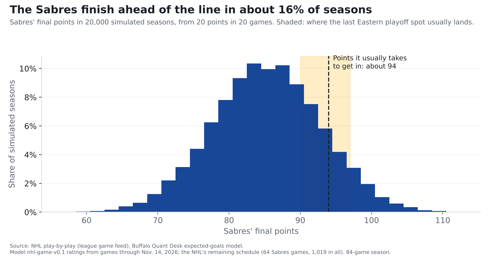
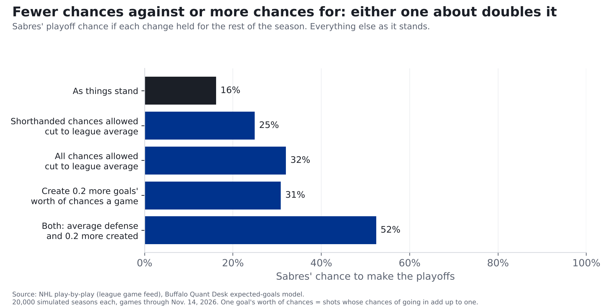

# Are the Sabres done? Not yet, but they need to stop giving up so many chances

**After 20 games, our model gives the Sabres about a 1-in-6 chance to make the playoffs (16%). They're 8-8-4 with 20 points, and it
usually takes about 94 points to get the last spot in the East: 74 more in their last 64 games. Their scoring slump and shaky
goaltending rarely last. The real problem is how many chances they give up, especially when they're
shorthanded, and that kind of problem tends to stick. Fix it, and their chances roughly double.**

*Numbers are through Nov. 14, 2026, the Sabres' first 20 games of 84. Early-season numbers move a lot.*

## Where they stand

The Sabres have 20 points from 20 games (8-8-4). Our model plays out the other 1,019 games left on the NHL's schedule 20,000 times.
In the middle of those seasons, Buffalo finishes with about **85 points** (eight times in ten, between 76 and 95), and the last playoff spot in
the East goes to a team with about **94** (90 to 97). To get there, Buffalo needs about 74 points from its last 64 games,
1.16 a game. So far it's earned 1.00 a game. Last season's 50-win team earned 1.33.

| Eastern team | Points now | Projected finish | Playoff chance |
|---|---|---|---|
| CAR | 34 in 21 | 122 | 100% |
| NJD | 30 in 21 | 110 | 99% |
| TBL | 28 in 20 | 105 | 95% |
| OTT | 28 in 21 | 101 | 87% |
| FLA | 26 in 21 | 101 | 86% |
| NYR | 25 in 21 | 97 | 74% |
| BOS | 27 in 20 | 95 | 63% |
| MTL | 28 in 20 | 95 | 60% |
| WSH | 20 in 18 | 93 | 55% |
| DET | 19 in 21 | 88 | 25% |
| PIT | 16 in 20 | 86 | 17% |
| **BUF** | 20 in 20 | 85 | 16% |
| NYI | 22 in 19 | 84 | 14% |
| CBJ | 14 in 18 | 80 | 5% |
| TOR | 18 in 22 | 77 | 2% |
| PHI | 18 in 22 | 75 | 1% |

Buffalo's 16% ranks 12th of 16 in the East. The top three in each division and the next two in the conference get in.

**We've put this on the [Ledger](../ledger.html):** "Sabres make the 2026-27 playoffs (top 3 in their division or one of the East's 2 wild cards)," 16%, logged Nov. 15 at 1:58 PM UTC, before
the Sabres' next game. It's graded after the last regular-season game in April, hit or miss.

## How we got the 16%, and how we checked it

**The source:** the NHL's own play-by-play for every game so far and its schedule for every game left. **The reasoning:** a team's results come
from the chances it creates and allows. Our game model rates every team on those chances (blended with last season while the sample is small),
turns two teams' ratings into expected goals for each game, and plays the game out, overtime included. **The math:** we play out the full schedule
20,000 times, add up the points, apply the playoff format, and count how often Buffalo gets in.

**How we checked it:** we ran the same thing from this point of the season (about 20 games in) in 2023-24, 2024-25 and 2025-26 and compared it
with who actually made it. On our scorecard, where 0 is perfect and a coin flip scores 0.25, it scored 0.15. Going by who's in a playoff spot
after 20 games scored 0.20. One honest caution: of the 23 teams we gave between 5% and 30%, the model said 16% on average and
3 made it. **One of them was last year's Sabres**: at this point we'd have given them 13%, and they finished with 109 points.

## Their record is about what they've earned

Replay each of Buffalo's games from its shots, with every shot going in or missing at its own chance, and the Sabres' chances were worth about
**20.7 points**. They have 20. This isn't a good team having bad luck in the standings. It's a middle-of-the-pack team playing like one.

## What's going wrong

| Per game, 2026-27 | Sabres | League average |
|---|---|---|
| Chances created (goals they were worth) | 3.06 (10th of 32) | 2.96 |
| Chances allowed | 3.25 (6th-most) | 2.96 |
| At full strength (five-on-five), share of the chances | 50.3% (18th) | 50% |
| Chances allowed while shorthanded | 0.79 (5th-most) | 0.67 |
| Goals allowed while shorthanded | 1.05 (3rd-most) | 0.69 |
| Goals scored vs. what their chances were worth | -0.36 (5th-worst) | -0.00 |
| Goaltending: goals saved vs. an average goalie | -0.15 (11th-worst) | -0.00 |

Three problems stand out:

1. **They give up too much when they're shorthanded.** At full strength, Buffalo is about even (50% of the chances). The extra chances against come
   while a man down: the 5th-most in the league, and 21 goals allowed. (That count mixes how often they're shorthanded with how well they kill
   penalties; we can't yet split the two.)
2. **They aren't finishing.** Buffalo has scored about 7 fewer goals than its chances were worth, 5th-worst in the league.
3. **Goaltending has been a little below average**, about 0.15 of a goal a game.

## Which problems will last

We checked every team's first 20 games against the rest of its season over the last three years. How many chances a team creates and allows
carries over strongly (0.67 and 0.66 on a scale where 1 means the first 20 games tell you everything). Chances allowed while
shorthanded carry over about halfway (0.46). Finishing (0.05) and goaltending (0.01) barely carry over at all: a team that
can't buy a goal or a save over 20 games is about as likely as anyone to be fine the rest of the way.

That's why our projection already expects Buffalo's shooting and goaltending to be about average from here. **The part that won't fix itself is the
chances they give up.**

## Who's underperforming

Each Sabre's points pace this season against his rating, our best guess at his points per 82 games from here, built from this season and the last
three. Ten or more games played.

| Player | Pos. | Games | G-A-P | Points pace (per 82) | Rating (per 82) |
|---|---|---|---|---|---|
| Jason Zucker | L | 11 | 2-0-2 | 15 | 49 |
| Ryan McLeod | C | 18 | 1-3-4 | 18 | 43 |
| Josh Doan | R | 20 | 4-1-5 | 20 | 41 |
| Josh Norris | C | 20 | 4-3-7 | 29 | 46 |
| Louis Crevier | D | 17 | 0-1-1 | 5 | 18 |

These are the players furthest below their track records. Most of them should drift back up, but it's 11 to 20 games, so read it as
a guess, not a verdict. The flip side: Owen Power, Jack Quinn and Mattias Samuelsson are running furthest ahead of theirs.

The biggest single finishing gap belongs to **Zach Benson**: 2 goals on chances worth 7.3. That's about 6 of the
team's 7 missing goals. He's still producing (13 assists), and finishing streaks like that rarely last.

In goal:

| Goalie | Shots faced | Save percentage | Goals saved vs. average |
|---|---|---|---|
| Ukko-Pekka Luukkonen | 301 | 86.7% | -3.2 |
| Colten Ellis | 181 | 87.3% | -0.6 |
| Alex Lyon | 55 | 90.9% | +0.8 |

## What would change it

We reran the season with one thing fixed at a time, holding everything else as it is now:

| If Buffalo... | Playoff chance | Projected points |
|---|---|---|
| As things stand | 16% | 85 |
| Shorthanded chances allowed cut to league average | 25% | 88 |
| All chances allowed cut to league average | 32% | 90 |
| Create 0.2 more goals' worth of chances a game | 31% | 89 |
| Both: average defense and 0.2 more created | 52% | 94 |

- **Give up less while shorthanded** (fewer penalties, a better penalty kill, or both). Cutting the chances allowed a man down to league average is worth
  about 0.12 goals a game and moves Buffalo to 25%. It's the most specific fix on the list, and about half of a problem like this tends to
  last if nothing changes.
- **Allow league-average chances overall** and the Sabres are at 32%.
- **Do that and create a little more** (0.2 goals' worth of chances a game) and it's 52%: about a coin flip.
- **Wait for the shooting and the saves to come around.** Our projection already counts on that. It's built into the 16%.

## The bottom line

The Sabres aren't done. They've earned about a point a game and played like it, in a conference where about 94 points gets you in. The goals
should come, and the saves should be about average. What won't change on its own is how many chances they allow, especially a man down. That's
where the season gets decided.

## For the stat-heads

- Playoff simulation (`src/metrics/nhl_playoffs.py`): nhl-game-v0.1 team ratings from games before 2026-11-15 (xGF/xGA per game shrunk with K=10 toward
  league + 0.5 x last season's edge), frozen for the rest of the season; independent Poisson goals per game; regulation ties to the home team at the
  training-season OT/SO rate (0.545); 20,000 seasons. Format: top 3 per division + 2 wild cards per conference (assumed unchanged for 2026-27).
  Ties: points, regulation wins, ROW, random. Divisions and conferences derived from the 84-game schedule (4-game pairs, 3+ game pairs).
  BUF ratings: xGF 3.056, xGA 3.190, league 2.988 (unrescaled).
- Backtest at the 20-game mark (2023-11-26, 2024-11-23, 2025-11-20), 96 team-seasons, actual schedules: Brier 0.1490;
  in-a-playoff-spot baseline 0.1975; coin 0.25. Rating noise (sd) chosen on 2023-24 and 2024-25 (0 was best) and kept. Teams given 5-30%:
  mean p 0.159, made 3 of 23. The model's coefficients were fit on 2023-24 and 2024-25, so those two backtest seasons aren't fully out of sample.
- Points the chances were worth: Poisson-binomial over regulation shots per game, regulation ties valued at 1 + P(OT/SO win). 20.71 vs 20.
- Carry-over: Pearson r, first 20 games vs rest, per game, 96 team-seasons 2023-24 to 2025-26: xGF 0.67, xGA 0.66,
  shorthanded xGA 0.46, finishing (G - xG) 0.05, GSAx 0.01.
- xG rescaled per season so league xG = league goals (2026-27 factor 0.990). Shorthanded = opponent at 5v4, 5v3 or 4v3.
  BUF 5v5 xGA/game 2.08 (league 2.03); PP xGF 0.68, PP GF 0.50 a game. Penalty counts not shown (attribution unverified).
- What-ifs adjust BUF's ratings for the rest of the season only: shorthanded fix = BUF shorthanded xGA/game minus league (0.124) off xGA;
  average defense = league minus BUF xGA rating (-0.202); +0.2 xGF. Same seed in every run.
- Player ratings: skater cards (`src/reports/skater_cards.py`) as of 2026-11-14; pace = points / games x 82. Rating = projected points per 82 from this
  season and the last three. Finishing = goals minus individual xG. Team finishing -7.2 goals.
