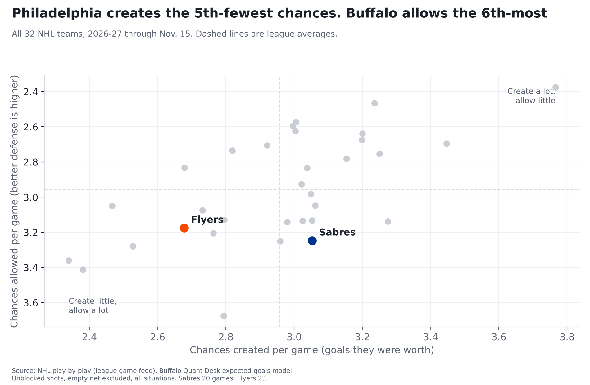
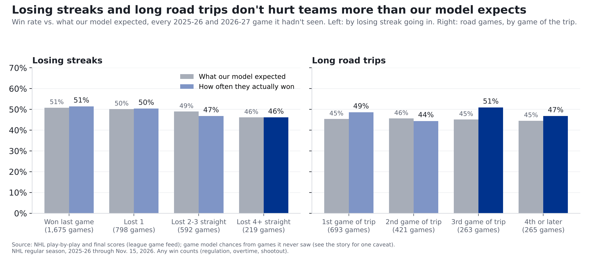
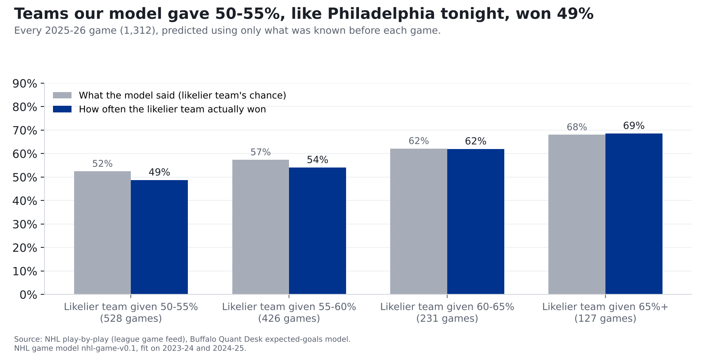

# Sabres at Flyers: four straight losses and a long road trip, and it's still a coin flip

**Our model gives Buffalo a 48% chance to win in Philadelphia Tuesday night (Flyers 52%). The Sabres have lost 4 straight (1 in overtime), and this is game
3 of a 6-game road trip. Neither of those changes the number. Since the start of last season, teams on a losing streak of four or more won 46% of their next
game, exactly what our model expected from their chances (46%). And teams deep in a road trip did as well as early in a trip: no sign of wearing down.**

*Buffalo at Philadelphia, Tuesday, Nov. 17, 7 p.m. ET. Buffalo last played Saturday (lost 2-0 at Dallas); Philadelphia played Sunday. Numbers are 2026-27 through
November 15: Sabres 8-8-4 in 20 games, Flyers 6-11-6 in 23. Early-season ranks can move a lot.*

## The two teams, side by side

| Per game, 2026-27 | Sabres | Flyers | League average |
|---|---|---|---|
| Chances created (goals they were worth) | 3.05 (10th) | 2.68 (28th) | 2.96 |
| Chances allowed | 3.25 (27th) | 3.18 (25th) | 2.96 |
| Share of the chances in their games | 48.5% (22nd) | 45.7% (27th) | 50% |
| Goals scored, actual | 2.75 | 2.30 | |
| Goals allowed, actual | 3.50 | 3.35 | |
| Rebound shots created | 3.5 (11th) | 2.8 (28th) | 3.3 |
| Share of chances, last 5 games | 50.4% | 56.6% | |

Ranks are among 32 teams; 1st is best (most created, fewest allowed). Actual goals come from final scores; chances leave out empty-net shots.

## How we measure "chances"

Every shot has a chance of going in, based on where it was taken and what kind of shot it was. Over the last three seasons (336,462 shots that weren't
blocked, not counting empty nets), a shot from within 10 feet went in 13.8% of the time; one from 60 feet or more, 0.8%. Add up those chances on
every shot and you get what a team's chances were worth in goals. **The source:** the NHL's own play-by-play feed, which records where every shot came from.
**The math:** each shot's chance comes from our model, built on past seasons and tested on a season it hadn't seen; we nudge each season's totals so the
league's chances add up to the league's real goals. **How we checked it:** the full explanation is in our story on [last year's 50-win season](sabres-50-win-mirage.html).

## The skid isn't what it looks like

In the 4 straight losses, Buffalo got 48% of the chances, close to an even split. The chances Buffalo created were worth about
12.1 goals, and it scored 6. The chances it allowed were worth about 12.9, and it gave up 17, most of that gap in one night, the 8-3 loss
to Tampa Bay. So the skid is more about finishing than goaltending. Over the whole season, Buffalo's goalies are close to average (about 0.15 goals
a game worse than an average goalie). Philadelphia's problem is different: the Flyers create the 5th-fewest chances in the league (2.68 a game) and allow
more than average.

When the teams met in Buffalo on Oct. 21, the Flyers won 3-1. The chances in that game were worth 3.4 goals for Buffalo and 3.6 for Philadelphia. One game is a small sample, and our prediction goes by the full season, blended with last season.

## Losing streaks and road trips

You'll hear that the Sabres are reeling, and that a 6-game trip (Chicago, Dallas, Philadelphia, Washington, Florida and Tampa Bay) wears a team down. We checked both against every game our model hadn't seen
while it was being built (all of last season and this one so far).

- **Losing streaks.** Teams that had lost four or more in a row won **46%** of their next game (219 games). Our model, which never looks at the streak, expected
  46%. Teams on a skid do lose more often, mostly because they tend to be weaker teams, which the model already knows from their chances. We found no extra effect from the streak itself, though 219 games can't rule out a small one.
- **Road trips.** On the third game of a trip or later, road teams won **49%** (528 games), when our model expected 45%. That's the same
  edge over the model they had on the first game of a trip (49% won, 45% expected). No sign that a long trip wears teams down.
  The edge itself isn't about trips: road teams in general have beaten our model's number (48% won, 45% expected, 1,642 games), because the model gives home teams a bit too much credit (more below). That fits what we found before the [Chicago game](sabres-blackhawks-pregame-nov-12.html):
  the tiredness that shows up in the results is the second night in a row, not the length of the trip. Buffalo has had two days off, so the back-to-back effect won't apply tonight.

So for Tuesday, the losing streak counts for exactly what the chances in those games were worth, and nothing more.

## In goal

Goals saved compared with an average goalie facing the same shots. Positive is good. Tap a goalie for his card.

| Team | Goalie | Games played in | Saves | Goals saved vs. average |
|---|---|---|---|---|
| Sabres | [Ukko-Pekka Luukkonen](../cards/ukko-pekka-luukkonen.html) | 12 | 86.7% | -3.2 (60th of 76) |
| Sabres | [Colten Ellis](../cards/colten-ellis.html) | 8 | 87.3% | -0.6 (41st of 76) |
| Sabres | [Alex Lyon](../cards/alex-lyon.html) | 2 | 90.9% | +0.8 (30th of 76) |
| Flyers | [Dan Vladar](../cards/dan-vladar.html) | 12 | 87.4% | -3.5 (62nd of 76) |
| Flyers | [Joseph Woll](../cards/joseph-woll.html) | 11 | 90.2% | +4.5 (16th of 76) |

Ranks are among all 76 goalies who have played this season. We hadn't seen confirmed starters when we published. A goalie's numbers over a dozen
games can swing a lot. We tested adding each game's starting goalie to our prediction and it made it no better (details in our [Vegas preview](sabres-vegas-pregame-nov-8.html)): a goalie's goals saved in the first
half of a season is a weak guide to his second half.

## Our prediction: Sabres 48%, Flyers 52%

**This is our model's number.** It counts once it's logged on the [Ledger](../ledger.html) before puck drop; every logged call is graded after the game, hit or miss.

Our model expects about **3.2 goals for Buffalo and 3.2 for Philadelphia** (3.17 to 3.23 before rounding, so the Flyers are a hair ahead, and ties go to the home team a little more than half the time), and gives about a 16% chance the game is tied after 60 minutes.

**Where the number comes from.** The chances numbers above. Buffalo creates chances worth 3.05 goals a game; Philadelphia allows 3.18. Early in a season we
blend in last season's numbers and pull everything toward the league average, which makes Buffalo's attack worth 3.06 a game and Philadelphia's chances allowed 3.11 a game. The other way around,
Philadelphia's attack comes out at 2.78 and Buffalo's chances allowed at 3.19. Buffalo creates more, but home ice adds about 0.27 of a goal for the Flyers, and that tips it.
Then we work out the chance of every possible final score; ties after 60 minutes go the way they have for home teams in past overtimes and shootouts (55% home wins).

**One caution, and it matters tonight.** Since the start of last season our model has given home teams more than they've actually won: 54.9% on average
in 2025-26, when home teams won 52.2% (1,312 games), and 54.1% against 53.0% this season. Home ice is what tips this game, so Buffalo's real
chance may be a little better than 48%. We're logging the model's number as it is, and we'll look at fixing the home-ice setting after this season's sample grows.

**How we checked it.** We built the model on the 2023-24 and 2024-25 seasons, then had it call every 2025-26 game using only what was known before each game.
It called the winner 55% of the time; choosing the home team every time would have been right 52%. This season so far (330 games) it has called
60% right; home teams have won 53%. When it gave a team 50-55% in 2025-26, as it gives Philadelphia Tuesday, that team won 49% of the
time (528 games). In other words, a true toss-up.

## What to watch

- **Who starts in goal for Philadelphia.** Joseph Woll has saved 4.5 goals more than an average goalie this season; Dan Vladar has allowed 3.5 more.
  Our prediction doesn't change with the starter (see "In goal"), but it's the biggest unknown going in.
- **Philadelphia's recent games.** The Flyers got 57% of the chances in their last 5 games, better than their season (46%). Early-season numbers move; watch whether that holds.

## For the stat-heads

- xG: Buffalo Quant Desk model (`src/metrics/nhl_xg.py`), unblocked non-empty-net shots, all strengths, rescaled per season so league xG = league goals
  (2026-27 factor 0.988). The game model works on unrescaled xG, so an average team is 2.99 there against 2.96 in the table. Rebound = within 3 s of a same-team unblocked attempt. Data through 2026-11-15 (330 games); Monday Nov. 16's two games
  (neither involves BUF or PHI) were not final in our feed and are left out.
- Streak and trip tests: out of sample (2025-26 and 2026-27 through 2026-11-15), team-game rows, any win counts. Previous losses in a row:
  Won last game won 0.515 vs model 0.508 (n 1,675); Lost 1 won 0.504 vs model 0.501 (n 798); Lost 2-3 straight won 0.468 vs model 0.489 (n 592); Lost 4+ straight won 0.461 vs model 0.461 (n 219). Lost 4+ binomial SE 0.034.
  Road games by game number of the road trip: 1st game of trip won 0.486 vs model 0.453 (n 693); 2nd game of trip won 0.444 vs model 0.456 (n 421); 3rd game of trip won 0.510 vs model 0.451 (n 263); 4th or later won 0.468 vs model 0.445 (n 265).
- Win chance: NHL game model nhl-game-v0.1 (`src/ledger/nhl_game_model.py`), ratings from games through 2026-11-15. Team xGF/xGA per game shrunk with K=10
  games toward league + 0.5 x last season's edge; goals = -0.254 + 1.032 x expected + 0.272 x home (fit 2023-25), on unrescaled xG;
  independent Poisson; regulation ties to home at 0.545. Brier: 2025-26 0.2446 (home-team rate 0.2504, record log5
  0.2514, coin 0.25); 2026-27 to date 0.2332. No goalie, rest, streak or road-trip term.
- GSAx = xG against minus goals against on unblocked shots, empty net excluded. Goalie GSAx per shot, first half vs second half of each season (400+ shots
  each half): r = 0.07, 0.45, 0.17 for 2023-24 to 2025-26. Adding the starting goalie to the game model did not improve 2024-25 Brier (see the Vegas preview).
- Out-of-sample caveat: the game model never saw 2025-26, but the shot model behind it (`nhl_xg.py`) was trained on 2023-24 to 2025-26 shots, so 2025-26 checks are
  not fully clean; 2026-27 is. Home-team calibration: 2025-26 mean p 0.549 vs won 0.522; 2026-27 0.541 vs 0.530.
