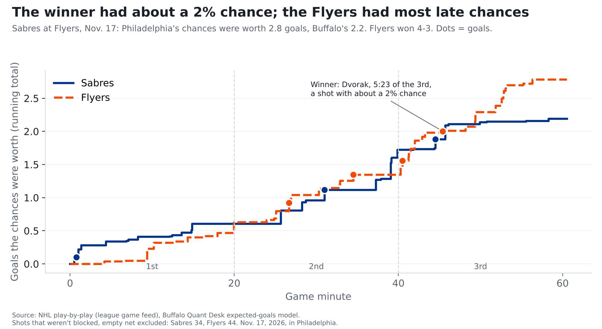
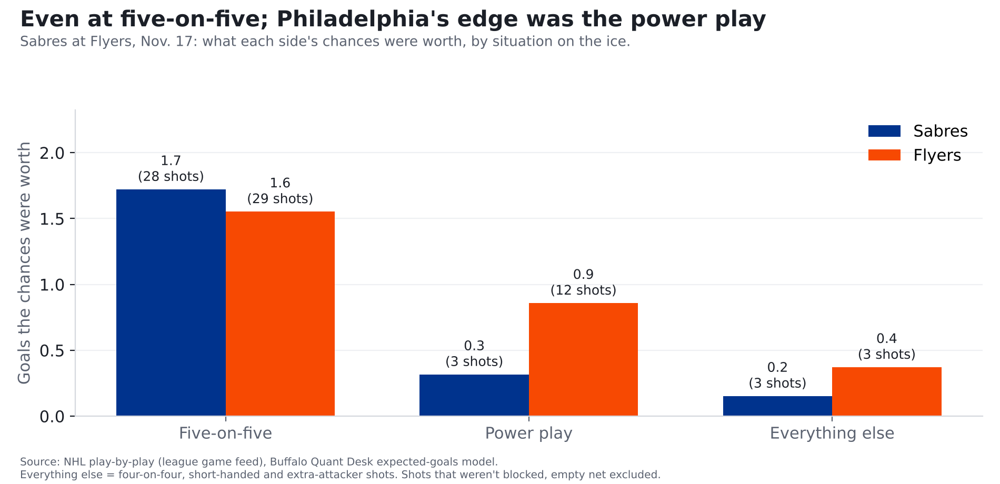

# Flyers 4, Sabres 3: Buffalo tied it in the third, and Philadelphia answered 52 seconds later on a shot that almost never goes in

**Jiri Kulich tied the game 3-3 with 15:29 left. 52 seconds later, Christian Dvorak beat Alex Lyon with a 30-foot wrist shot
that had about a 2% chance of going in, and the Flyers won 4-3. The loss wasn't all bad luck: Philadelphia's chances were worth 2.8
goals to Buffalo's 2.2, most of the difference coming on the power play and in a lopsided third period. Our pregame call gave Buffalo a 48% chance,
a near toss-up that leaned Philadelphia. The Sabres have now lost five straight (one in overtime).**

*One game, Nov. 17, in Philadelphia. [Our pregame story](sabres-flyers-pregame-nov-17.html).*

## How we measure "chances"

Every shot has a chance of going in, based on where it was taken and what kind of shot it was. Dvorak's winner, from 30 feet, had about a 2% chance;
Owen Tippett's tip-in from 13 feet, about 9%. Add those chances up over a game and you get what a team's chances were worth in goals: all
44 of Philadelphia's shots were worth 2.8, and the Flyers scored 4. Buffalo's 34 were worth 2.2, and the Sabres scored 3. The shot
locations come from the NHL's own play-by-play. Each shot's chance comes from our model, built on past seasons and tested on a season it hadn't seen. (The full
explanation is in our story on [last year's 50-win season](sabres-50-win-mirage.html).)

## The game, period by period

| Period | Sabres chances (worth this many goals) | Flyers chances (worth this many goals) |
|---|---|---|
| 1st | 0.6 (13 shots) | 0.6 (10 shots) |
| 2nd | 1.1 (11 shots) | 0.7 (11 shots) |
| 3rd | 0.5 (10 shots) | 1.4 (23 shots) |
| Game | 2.2 (34 shots) | 2.8 (44 shots) |

"Shots" here means every shot that wasn't blocked, including ones that missed the net: 19 of Buffalo's 34 reached Joseph Woll, and 33 of
Philadelphia's 44 reached Lyon. Philadelphia also had 2 shots at an empty net late; neither went in, and they're not counted above.

| Period | Time | Team | Scorer | Shot | Chance it went in | Score |
|---|---|---|---|---|---|---|
| 1 | 0:47 | Sabres | Mattias Samuelsson | snap shot from 25 ft | 4% | Sabres 1, Flyers 0 |
| 2 | 6:39 | Flyers | Jamie Drysdale | snap shot from 27 ft | 12% | Sabres 1, Flyers 1 |
| 2 | 10:59 | Sabres | Tage Thompson | snap shot from 27 ft | 16% | Sabres 2, Flyers 1 |
| 2 | 14:30 | Flyers | Owen Tippett | tip-in from 13 ft | 9% | Sabres 2, Flyers 2 |
| 3 | 0:29 | Flyers | Travis Sanheim | wrist shot from 24 ft, four-on-four | 10% | Sabres 2, Flyers 3 |
| 3 | 4:31 | Sabres | Jiri Kulich | snap shot from 28 ft | 13% | Sabres 3, Flyers 3 |
| 3 | 5:23 | Flyers | Christian Dvorak | wrist shot from 30 ft | 2% | Sabres 3, Flyers 4 |

It was tied three times, and each team took the lead twice.

Buffalo had slightly more of the chances through two periods (1.7 to 1.3). The third belonged to Philadelphia: 23 shots worth
1.4 goals to Buffalo's 10, worth 0.5. Philadelphia had about 75% of the third period's chances. Most of that came after the winning goal: 14 Flyers shots
worth 0.8 (7 of them on the power play, worth 0.4), while Buffalo, chasing the tie, managed 7 worth 0.3.

Replay the game over and over, with each shot going in or missing at its own chance, and Philadelphia wins 51% of the time, Buffalo 30%, and it's tied after
regulation the other 19%. So the Flyers deserved the edge, just not by much.

## The winner

Why only 2%? Dvorak shot from a sharp angle: about 15 feet out from the goal line and 26 feet to the side of the middle of the net, with no rebound and no
rush to help. Thompson's goal came from about the same distance, 27 feet, but nearly straight on, which is why it rated 16%. Shots from spots like Dvorak's this
season (25 to 35 feet out, at that kind of angle, no rebound or rush) have gone in 4% of the time (810 shots); our model, which also weighs the shot type,
put this one at about 2%.

## Where the chances came from

At five-on-five, it was about even, with Buffalo slightly ahead: 28 shots worth 1.7 goals, to Philadelphia's 29 worth 1.6, about 53% of the chances. The difference was the power
play: Philadelphia had 12 power-play shots worth 0.9, Buffalo 3 worth 0.3. (We don't count penalties yet.)

## In goal

[Alex Lyon](../cards/alex-lyon.html) faced chances worth 2.8 goals and allowed 4, 1.2 more than an average goalie would have. The winner was the least likely of the four. This was his 3rd game this season; across them he's 0.4 goals worse than average.

[Joseph Woll](../cards/joseph-woll.html) started for Philadelphia; our pregame story had him at 4.5 goals better than an average goalie this season. Tonight he faced chances worth
2.2 and allowed 3, about 0.8 more than average.

## What we said going in

- **Finishing.** Our pregame story said Buffalo's skid was mostly cold shooting: in the 4 losses before tonight, it scored 6 goals on chances worth about
  12.1. Tonight Buffalo scored 3 on chances worth 2.2, a bit better than its chances for once (one game). The goals it allowed were the bigger
  problem: Philadelphia's chances were worth 0.6 more than Buffalo's, and Lyon allowed 1.2 more than an average goalie would have.
- **Philadelphia's recent games.** The Flyers had 57% of the chances in their five games before this one. Tonight they had 56%. That held.
- **Who started for Philadelphia.** Woll, the better of the Flyers' two goalies by our numbers. He was a little below average tonight.

## Receipts: our pregame call

Before the game we logged **a 48% chance the Sabres win** on the [Ledger](../ledger.html), which made Philadelphia the slightly likelier winner. Philadelphia won, so the call
leaned the right way. A call this close to 50-50 can only earn a little credit when it's right, and that's what it got
(it scores 0.23 on our scorecard, where 0 is perfect and a coin flip scores 0.25). We've now got 11 of our 17 graded calls right, and 4 of 5 on Sabres games.

## What it means for Buffalo

- **Five straight losses, 8-9-4 on the season.** The trip goes on: Washington, Florida and Tampa Bay before the Sabres are home against the Rangers on
  Nov. 25. Next up: at Washington, Thursday.
- **About even at five-on-five, behind on the power play.** Philadelphia came in creating the 5th-fewest chances in the league. Tonight it out-chanced Buffalo mainly on the
  power play (0.9 to 0.3).

## For the stat-heads

- Expected goals (xG): our gradient-boosted model on unblocked, non-empty-net shots, rescaled per season so league xG equals league goals
  (2026-27 factor 0.986). BUF 2.19 xG on 34 unblocked shots (19 on goal); PHI 2.78 on 44 (33 on goal).
  By period: BUF 0.61, 1.12, 0.47; PHI 0.63, 0.72, 1.44. PHI empty-net attempts: 2, 0 goals.
- Strength: BUF 5v5 1.72 (28), PP 0.32 (3), other 0.15 (3; 6v5 2); PHI 5v5 1.55 (29),
  PP 0.86 (12), other 0.37 (3). 5v5 xG share BUF 0.526. Penalty counts not shown (attribution unverified).
- Winner: xG 0.0189; x -74, y -26, angle 60 deg (Thompson 6 deg). Similar shots (angle 55+, 25-35 ft, no rebound/rush), 2026-27: 31 of 810.
- Winner rarity: Unblocked non-empty-net shots in 2026-27 through 2026-11-17 with xG at or below it: 0.251 of all; their goal rate 0.0095.
- Replays: exact Poisson-binomial over all unblocked non-empty-net shots. BUF win 0.301, tie 0.186, loss 0.513.
- GSAx = xG on unblocked shots faced minus goals allowed. Lyon -1.22 (33 SOG; season -0.45 over 3 games); Woll -0.81 (19 SOG;
  +4.41 through 2026-11-15 on today's season rescale; the pregame story published +4.5 on the rescale as of 2026-11-15).
- Skid finishing: BUF in the 4 losses before tonight, 6 goals on 12.08 xG. PHI xG share, 5 games before tonight: 0.566; tonight 0.559.
- Ledger P0018: p = 0.48, outcome 0 (PHI won in regulation; any result counts), Brier 0.2304. Model nhl-game-v0.1; its 3.17 / 3.23 are expected goals for 60 minutes.
