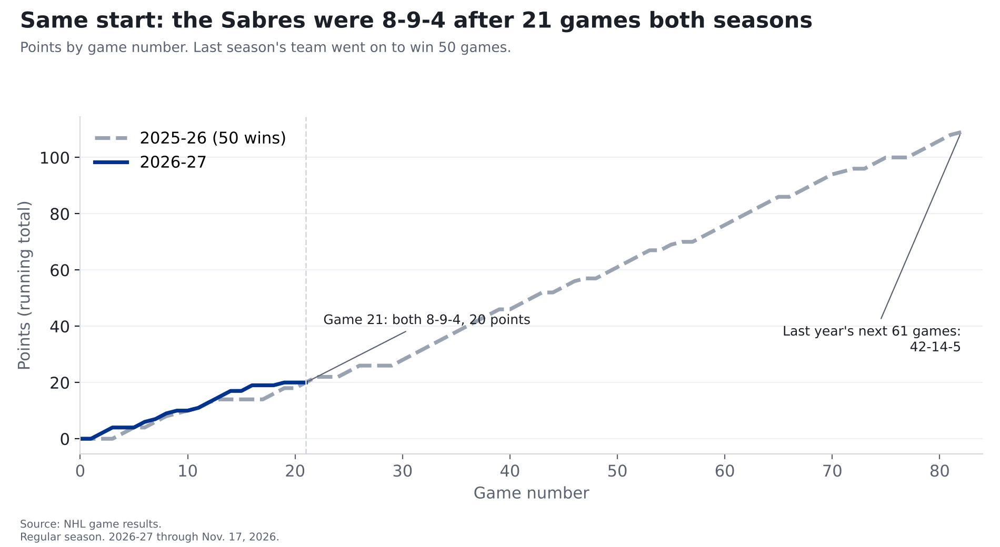
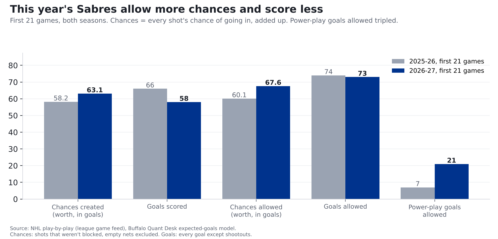
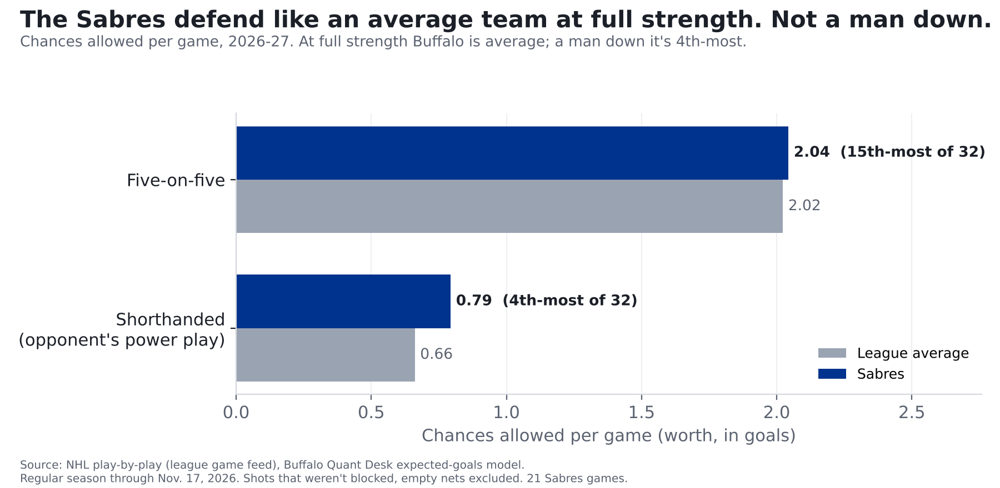

# If I were the Sabres' GM, I wouldn't sell. Here's how I'd fix this 8-9-4 team

**After 21 games last season, the Sabres were 8-9-4. After 21 games this season, they're 8-9-4: the same record, to the game.
Last year's team then went 42-14-5 and won 50.**

It did that without better scoring chances: over those 61 games it got 50% of the
chances in its games, an even split. What carried it was goaltending and finishing, and by our count no NHL team in the last three seasons beat its chances
by more over that stretch (Boston came close). This year's team is creating a few more chances than last year's did at this point, but it's giving up more, it's scoring less than its chances
are worth, and its penalty kill has allowed 21 goals to last year's 7. My plan, in short: fix the penalty kill first, keep the five-on-five lineup, be patient with the shooters, and don't sell. If the penalty kill is still leaking
at the 40-game mark, that's when I'd trade, for help a man down. Below: what's different, and why I'd do it that way.

*Numbers are through Nov. 17, 2026: the first 21 games of each season. 21 games is a small sample. The Sabres visit Alex Tuch and
Washington on Thursday.*

## How we measure "chances"

Every shot has a chance of going in, based on where it was taken and what kind of shot it was. A shot from within 10 feet goes in about 1 time in 7; one from 60 feet
or more, about 1 in 125. Add up those chances on every shot and you get what a team's chances were worth in goals. The shot locations come from the NHL's own
play-by-play, and our model is explained in our story on [last year's 50-win season](sabres-50-win-mirage.html). We count every shot that wasn't blocked, including ones that missed the net, and leave out shots at an empty net, since
there's no goalie to beat. Goal totals in the table count every goal except shootouts; when we compare goals with chances, we leave out empty-net goals the same way.

## Same record, different team

| First 21 games | 2025-26 | 2026-27 |
|---|---|---|
| Record | 8-9-4 | 8-9-4 |
| Chances created (worth this many goals) | 58.2 | 63.1 |
| Goals scored | 66 | 58 |
| Chances allowed (worth this many goals) | 60.1 | 67.6 |
| Goals allowed | 74 | 73 |
| Power-play goals allowed | 7 | 21 |

Three things are different.

**1. They give up more chances, and the penalty kill is the worst of it.** This season's chances against are worth 3.22 goals a game, 0.35 more than
at this point last year, the 6th-most of 32 teams per game (league average 2.95). At full strength, five-on-five, Buffalo is right at the league
average (2.04 a game against 2.02). A man down, it allows the 4th-most; more on that below. The goals-allowed total hasn't moved: 74 last year, 73
this year. But 8 of last year's were into an empty net, against 1 this year, so with a goalie in net this year's team has allowed 6 more.

**2. The puck stopped going in.** Not counting empty nets, last year's team scored 64 goals in its first 21 games on chances worth 58.2, about 6 more
than an average team would have. This year's has scored 57 on chances worth 63.1, about 6 fewer. So the Sabres are creating more chances than
last year (14th of 32 teams, right in the middle) and scoring less. The biggest gap is Zach Benson: 80 shots at a goalie that weren't blocked, worth about 7.5 goals,
and one goal to show for it. (His other goal was into an empty net.) Tage Thompson, with 13 goals on chances worth 9.5, is the biggest exception.

**3. Power-play goals against: the jump from 7 to 21 is mostly how many went in.** Opponents have scored 21 power-play goals on Buffalo in 21 games, tied for the 3rd-most in the league
per game. At this point last year it was 7. Those power-play chances were worth 16.7 goals this year and 14.0 last year, on 150 shots this year
and 164 last year (counting shots that missed the net, not blocked ones): fewer shots, but better ones. The average power-play shot against has been about 30% more dangerous.
Last year's 7 was unusually low, too: about half what those chances were worth.

## Who's gone

Two regulars from last season aren't on the team. Alex Tuch went to Washington in a sign-and-trade in June, and Bowen Byram was traded to Chicago in a deal for the
No. 4 pick in the draft (sources below). Tuch scored 32 goals with a goalie in net last season (33 in all) on chances worth 23.1, about 9 more than an average
shooter would have, and no Sabre beat his chances by more. That's a lot of finishing to replace, and so far, as a team, they haven't.
We can't yet tie the extra chances allowed to Byram's departure; that would take more games and a player-by-player look.

## What turned last season around

Last year's team barely changed how many chances it created or allowed. Over its last 61 games its chances were worth 2.93 goals a game for and 2.92 against,
about even. What changed was everything after the shot:

- **Goaltending.** Ukko-Pekka Luukkonen was 3.9 goals worse than an average goalie in his first 5 games, then 13.0 goals better over his next 30.
  As a team, Buffalo's goalies allowed about 23 fewer goals than the chances against were worth. This season Luukkonen is
  3.3 goals worse than average in 12 games.
- **Finishing.** The team kept scoring: about 13 more goals than its chances were worth over the last 61 games.

Put together, last year's Sabres scored and saved about 36 more goals than their chances were worth over those 61 games, more than one
every other night. Of all 96 NHL teams over the last three seasons (32 a year), that was the most over the same stretch, just ahead of
last season's Boston.

## If I were GM

*The numbers are Buffalo Quant Desk's. The calls are mine. — Charlie*

Last season's run came with the best goaltending-and-finishing stretch of any team in three years, barely ahead of Boston's, and as we
found in that [50-win study](sabres-50-win-mirage.html), that kind of luck doesn't carry over well. Chances do: this year's team is a little better on offense and worse
on defense. So here's what I'd do, in order, and how much our numbers can back up each move.

**1. Cut the chances allowed a man down.** The penalty kill is the biggest single source of the extra chances. A man down, Buffalo gives up an extra goal's worth of
chances about every 8 games compared with an average team, about half of its whole gap to a league-average defense. Five-on-five is almost none of it; the next-biggest
piece is overtime. If this pace held, getting the penalty kill to average would take away chances worth about 8 goals over the last 61 games. This
year's penalty kill faces fewer shots than last year's, just better ones. So the job is fewer, and less dangerous, shots while a man down. That's as much a coaching
job as a roster one. (Buffalo also faces 7.1 power-play shots a game that aren't blocked, against 6.3 for the average team; we can't
yet tell how much of that is taking more penalties, because we haven't finished checking the NHL's penalty data.)

**2. Don't blow up the five-on-five lineup.** At full strength the Sabres get 50% of the chances in their games, about even, and allow chances at a league-average
rate. The balance of chances is the part of a team's game that carries over best, and at full strength Buffalo's isn't broken.

**3. Be patient with the shooters.** Over the last three seasons, 11 NHL players (a small group) were 4 or more goals behind their chances after their team's first 21 games. The rest of
those seasons, as a group, they scored almost exactly what their chances were worth. A cold start is a bad reason to trade a shooter. One caution: Benson has scored
10 goals with a goalie in net in each of the last three seasons (11, 10 and 13 counting empty nets), on chances worth 12 to 15 each year. He creates chances; the goals may not catch up.

**4. Leave Buffalo's own power play alone.** When the Sabres have the extra man, they create chances at a league-average rate (17th of 32 teams per game) but they're tied for 28th in goals:
10 on chances worth 13.9. That's the same cold finishing as above, not a broken power play, and finishing tends to even out. Small sample, too.

**5. When I do shop, look for proven finishers.** Over a few weeks, finishing swings a lot. Over three years, some of it holds. Tuch scored 10 and 9 more goals than his chances
were worth the last two seasons (the year before he missed by a fraction of a goal), and has 11 goals with a goalie in net (12 in all) on chances worth 7.2 in Washington. Of 197 players whose chances were worth 10 or more goals in each
of the last three seasons, 46 beat their chances in all three, about 13 more than luck alone would produce. That's about 1 in 4: finishing is real, but it's not common. Buffalo has two, Thompson and Rasmus Dahlin.
That's the profile I'd look for. I don't know who's available or what they'd cost.

**6. Don't plan on the goalies to save it.** Luukkonen is 3.3 goals worse than an average goalie this season and the other two are about average, a combined
4.4 goals worse than the chances against were worth. Goaltending was the biggest piece of last year's run (about 23 of the 36 goals),
and it's the hardest part to predict. I'd hope for it, but I wouldn't build the plan on it.

### What it adds up to

Our [playoff chances story](sabres-playoff-chances.html) reran the season with one thing changed at a time, using games through Nov. 14, before the Nov. 17 loss to Philadelphia:

| If the Sabres... | Playoff chance |
|---|---|
| Stay as they are | 16% |
| Cut the chances they allow a man down to league average | 22% |
| Cut all the chances they allow to league average | 32% |
| Create one more goal's worth of chances every 5 games | 31% |
| Do both: league-average defense and one more goal's worth of chances every 5 games | 52% |

**My call: don't sell.** After 20 games last season our model would have given the Sabres a 12% playoff chance, and they finished with 109 points. Of the 23
teams it gave between 5% and 30% at the same point over the last three seasons, 3 made it. A team at 16% isn't done. Cutting the chances allowed a man down to league average, on its own, moves it to 22%. Fix the defense and create a little more, and it's about a coin flip.
I'd start in-house with the penalty kill. If it's still leaking by the 40-game mark, that's when I'd trade, and I'd go for help a man down first, then a proven finisher. Not a goalie.

## Sources for the roster moves

- Tuch: [Daily Faceoff](https://www.dailyfaceoff.com/news/alex-tuch-washington-capitals-buffalo-sabres-sign-trade-contract-free-agency), June 24, 2026 (sign-and-trade to Washington).
- Byram: [Daily Faceoff](https://www.dailyfaceoff.com/news/bowen-byram-trade-chicago-blackhawks-buffalo-sabres-nhl-draft-4th-overall-pick), June 23, 2026 (to Chicago with Jordan Greenway for the No. 4 pick, a second-round pick and Louis Crevier).

## For the stat-heads

- xG: our gradient-boosted model, unblocked non-empty-net shots, rescaled per season so league xG = league goals (2025-26 factor 0.971, 2026-27 0.986).
  2025-26 shots are in the model's training data; 2026-27 are out of sample.
- First 21 games, 2025-26 vs 2026-27: xGF 58.21 vs 63.10; GF 64 vs 57; xGA 60.13 vs 67.58; GA 66 vs 72; xGF% 0.492 vs 0.483.
  5v5 xGF 41.56 vs 43.56, xGA 41.00 vs 42.91; 5v5 GF 49 vs 41, GA 52 vs 44.
  Opponent power play (5v4, 5v3, 4v3): 164 vs 150 unblocked shots, xG 13.98 vs 16.66, goals 7 vs 21. Penalty counts not used.
- 2025-26 games 22-82: 42-14-5; xGF 178.96, xGA 178.25 (xGF% 0.501); GF-xGF +13.04; xGA-GA +23.25.
  Rank of (GF-xGF)+(xGA-GA) per game over games 22+ among 96 team-seasons 2023-24 to 2025-26: 1st (0.595); 2nd BOS 20252026 (0.582).
- Luukkonen GSAx: 2025-26 games 1-21 -3.91 (5 GP), games 22+ +12.98 (30 GP); 2026-27 -3.32 (12 GP).
- Tuch 2025-26 (BUF, non-empty-net): 32 G on 23.12 xG (317 unblocked). Benson 2026-27: 1 G on 7.55 xG (80). Thompson 2026-27: 13 G on 9.50 xG.
- Standings goal totals for the first 21 games (shootout decider counted as a goal): GF 67 vs 58, GA 74 vs 74.
- Ranks are per game among 32 teams through 2026-11-17.
- BUF power play (5v4, 5v3, 4v3) 2026-27: xGF/GP 0.664 (17th), GF/GP 0.476 (T-28th); 10 G on 13.94 xG.
- What-if playoff chances are read from reports/2026-11-15-sabres-playoff-chances.md (ratings through 2026-11-14, 20,000 simulated seasons each); not rerun here. Table and chart goals include empty-net goals (2025-26: 8 against; 2026-27: 1 against)
  and exclude shootouts; G-xG and xGA-GA exclude empty nets. 5v5 xGA/GP: BUF 2.043, league 2.023 (15th-most). Opp-PP xGA/GP: BUF 0.794,
  league 0.661 (4th-most); xGA/GP gap by state: 5v5 +0.020, 3v3 +0.062; opp-PP xG per unblocked shot 0.085 vs 0.111; share of BUF's total xGA/GP gap to average 0.49; times 61 games = 8.1.
- GM notes: shooters with G-xG <= -4 through team game 21, 2023-24 to 2025-26 (same team, still shooting after): n=11, rest-of-season G/xG 1.006.
  Benson G/xG 2023-24 to 2025-26: 10/11.9, 10/14.8, 10/14.0. Tuch G-xG: 20232024: -0.1 (BUF), 20242025: +9.7 (BUF), 20252026: +8.9 (BUF), 20262027: +3.8 (WSH).
  Three-season finishers (coin-flip baseline 32.7): 46 of 197 shooters with xG >= 10 in each of 2023-24 to 2025-26 had G > xG in all three; current Sabres among them: Tage Thompson, Rasmus Dahlin.
  2026-27 BUF goalies GSAx: Alex Lyon -0.45, Ukko-Pekka Luukkonen -3.32, Colten Ellis -0.65.
