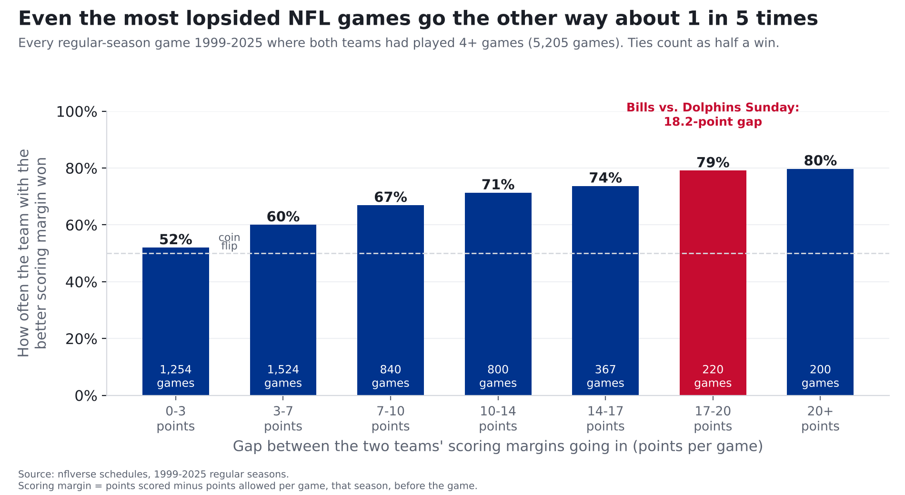
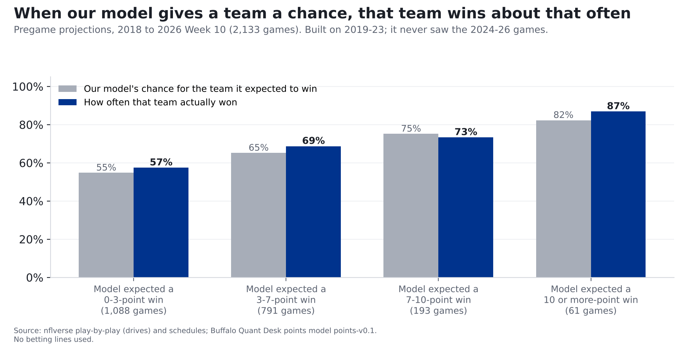

# How often do big NFL mismatches go wrong? 27 seasons of lopsided games, and where Bills-Dolphins fits

**Over 27 seasons, when one NFL team's scoring margin was 17 or more points a game better than its opponent's, the better team won
79% of the time. About 1 in 5 still lost (86 of 420 games, plus 1 tie), and past 17 points a bigger gap barely helped. Our own model
projects Bills 30, Dolphins 20 on Sunday, and gives Buffalo an 81% chance to win. History and our model point the same
way: about 4 times in 5.**

*Regular season only. History covers 1999-2025; this season counts through Week 10. We don't use betting lines: every number here comes from game
results and our own model.*

## How we measured a mismatch

For every regular-season game since 1999, we took each team's scoring margin going in: points scored minus points allowed, per game, that season, before
that game. The gap between the two teams' margins is the size of the mismatch. We only counted games where both teams had played at least 4 games, which
leaves 5,205 games. Then we checked how often the team with the better margin won. Ties count as half a win.

| Gap going in (points per game) | Games | Better team won |
|---|---|---|
| 0-3 | 1,254 | 52% |
| 3-7 | 1,524 | 60% |
| 7-10 | 840 | 67% |
| 10-14 | 800 | 71% |
| 14-17 | 367 | 74% |
| 17-20 | 220 | 79% |
| 20+ | 200 | 80% |

## Why the biggest gaps stop helping

The better team's win rate climbs with the gap, then flattens out around 79%. One big reason is that a few weeks of scores exaggerate how far apart
two teams really are. In the games with a gap of 17 or more, by the end of those seasons the gap between the same two teams had shrunk by about
23%. Take the 2021 Bills at Jacksonville: going in, Buffalo had outscored opponents by 17.1 points a game and the Jaguars had been
outscored by 11.4, a gap of about 28.6 points. By season's end it was Buffalo +11.4 and Jacksonville -12.0, a gap of 23.4. A team that has been crushing people is usually good, but not as good as its early scores say, and the same goes in reverse.
Early in the season the effect is stronger: with a 17-point gap or more, the better team won 75% through Week 8 (164 games) and 82% after (256 games).

## The biggest upsets since 1999

| Season | Final | Better team going in | Gap (points per game) |
|---|---|---|---|
| 2011, Week 8 | Rams 31, Saints 21 | Saints | 30.7 |
| 2007, Week 7 | Broncos 31, Steelers 28 | Steelers | 29.2 |
| 2021, Week 9 | Jaguars 9, Bills 6 | Bills | 28.6 |
| 2008, Week 6 | Rams 19, Washington 17 | Washington | 28.2 |
| 2002, Week 6 | Rams 28, Raiders 13 | Raiders | 28.2 |
| 2006, Week 9 | Dolphins 31, Bears 13 | Bears | 27.9 |
| 2000, Week 8 | Bengals 31, Broncos 21 | Broncos | 27.7 |
| 2008, Week 6 | Browns 35, Giants 14 | Giants | 27.5 |

Miami pulled one of them off, in Chicago in 2006. The Bills have been the much better team (a gap of 17 or more) 16 times since 1999: they went 11-5. The losses: at Titans in 2021, at Jaguars in 2021, vs. Jaguars in 2023 (in London), at Patriots in 2023, at Patriots in 2024 (Week 18: Josh Allen played 1 snap, then Mitchell Trubisky and Mike White played the rest).

## Sunday: Dolphins at Bills

By the same measure, the Bills have outscored opponents by 9.8 points a game this season (2nd
of 32 teams) and Miami has been outscored by 8.4 (30th). That's a gap of 18.2 points a game.
In the last 27 seasons, the better team won 79% of games with a gap that size (220 games).

**Our model's number: Bills 81%, right next to the 79% history gives.** It projects about 30 points for Buffalo and 20 for Miami. It's built from each offense's points per drive
and each defense's points allowed per drive this season, blended with last season's numbers and pulled toward the league average while the season is young,
plus how many drives each team usually gets and home field. The model's pull toward the middle is why it rarely expects a blowout: in 2,133 games since 2018 it has expected a
team to win by 14 or more only 6 times, and never by more than about 15.

**How we checked it.** When our model expected a team to win by 10 or more, that team won 87% of 61 games (36 of 44 in the seasons it was built on). In games from 2024 on, which it never
saw while being built, teams it expected to win by 10 or more went 15-0. That's a small group; the bigger point is that at every level, the teams it
expected to win won about as often as it said.

This is our model's number. It counts once it's logged on the [Ledger](../ledger.html) before kickoff, and every logged call is graded after the game, hit or miss.

## For the stat-heads

- History: nflverse schedules, regular season 1999-2025, games where both teams had 4+ prior games that season (5,205). Pregame margin = mean
  (PF - PA) over prior games that season. Ties = 0.5. Gap 17+: 420 games, 0.794; gap 20+: 200 games, 0.797.
  Same games' full-season margin gap / pregame gap = 0.77.
- Model: points model points-v0.1 (drive-based, trained 2019-23; K=60, prior keep 0.7); win chance from paired training misses.
  Projections 2018-2026 Wk10, Weeks 2+ only (the model needs a prior week): 2,133 games. By projected margin: 0-3: n=1088, said 0.548, won 0.574; 3-7: n=791, said 0.652, won 0.687; 7-10: n=193, said 0.751, won 0.733; 10+: n=61, said 0.823, won 0.869.
  2018 projections have no prior-season blend for 2017 (data starts 2018). BUF-MIA: 30.29 vs 19.51, P(BUF) 0.808.
- No market data read: the schedule query selects only game, team and score columns.
