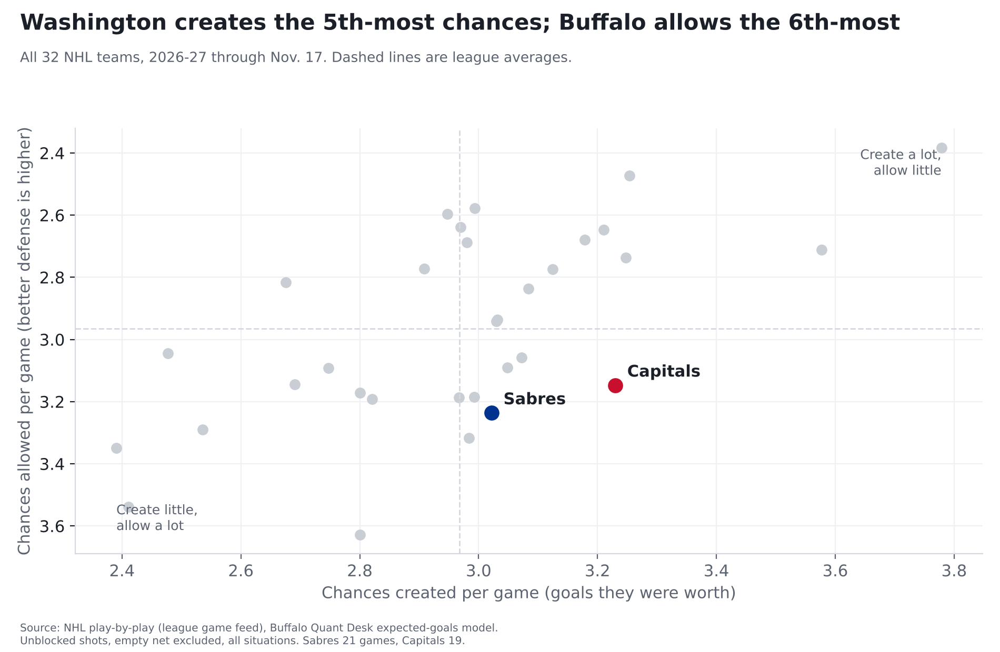
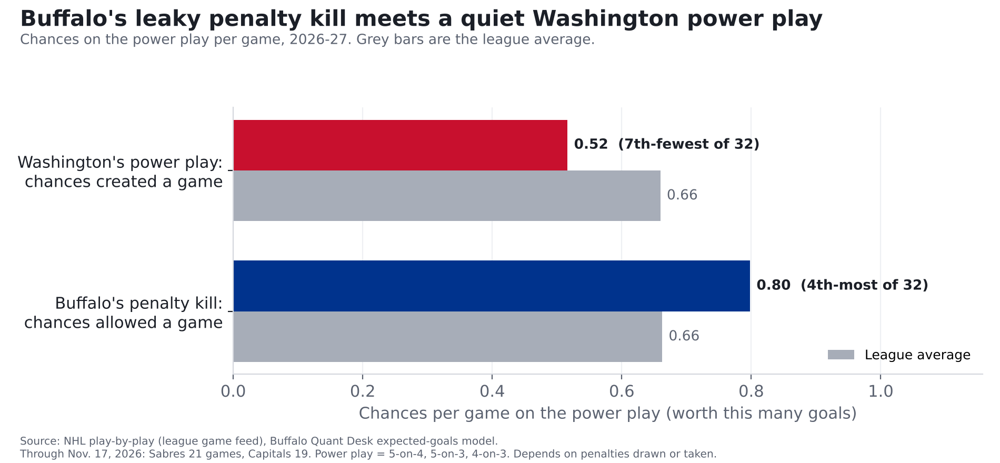
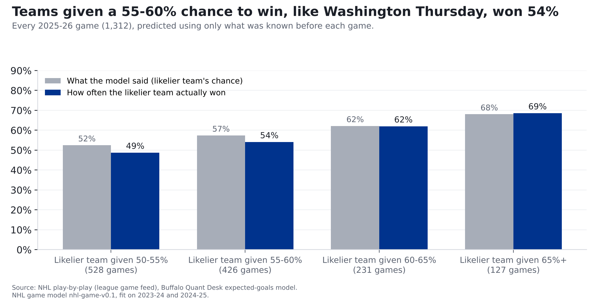

# Sabres at Capitals: Alex Tuch, a five-game skid, and a 42% chance

**Our model gives Buffalo a 42% chance to win in Washington Thursday night (Capitals 58%). The Sabres have lost 5 straight. Alex Tuch, who left Buffalo
in a June sign-and-trade, leads the Capitals with 12 goals and scored twice when they beat the Sabres 4-3 in overtime on Oct. 24. The matchup
to watch is the one Charlie said to fix first in his [GM story](sabres-if-i-were-gm.html): Buffalo's penalty kill allows the 4th-most chances in the league, but Washington's power play creates the 7th-fewest.**

*Buffalo at Washington, Thursday, Nov. 19, 7 p.m. ET, game 4 of a 6-game road trip. Both teams played Tuesday and have had a day off. Numbers are 2026-27 through November 17:
Sabres 8-9-4 (20 points) in 21 games, Capitals 10-9-0 (20 points) in 19. Early-season ranks can move a lot. These include every game played around the league Tuesday, so a few numbers differ slightly from the GM story.*

## The two teams, side by side

| Per game, 2026-27 | Sabres | Capitals | League average |
|---|---|---|---|
| Chances created (worth this many goals) | 3.02 (14th) | 3.23 (5th) | 2.97 |
| Chances allowed | 3.24 (27th) | 3.15 (22nd) | 2.96 |
| Share of the chances at five-on-five | 50.4% (17th) | 52.9% (9th) | 50% |
| Goals scored, actual | 2.76 | 3.37 | |
| Goals allowed, actual | 3.52 | 3.68 | |
| Power-play chances created | 0.67 (17th) | 0.52 (26th) | 0.66 |
| Chances allowed a man down | 0.80 (29th) | 0.79 (28th) | 0.66 |

Ranks are among 32 teams; 1st is best (most created, fewest allowed). Actual goals come from final scores; chances leave out empty-net shots.

## How we measure "chances"

Every shot has a chance of going in, based on where it was taken and what kind of shot it was. Over the last three seasons (336,462 shots that weren't
blocked, not counting empty nets), a shot from within 10 feet went in 13.8% of the time; one from 60 feet or more, 0.8%. Add up those chances on
every shot and you get what a team's chances were worth in goals. The shot locations come from the NHL's own play-by-play. The full explanation and how we
checked it are in our story on [last year's 50-win season](sabres-50-win-mirage.html).

## Tuch against his old team

Tuch has 12 goals in 19 games for Washington (11 with a goalie in net, on chances worth about 7, so he's beating his chances again), the most on the team. None has come on the power play.
In his last two seasons in Buffalo he scored about 10 and 9 more goals than his chances were worth, which is why
[If I were the Sabres' GM](sabres-if-i-were-gm.html) called him a lot of finishing to replace, and why a proven finisher is on Charlie's shopping list, after help a man down.
Tuch is the kind of finisher he means.

That Oct. 24 game, when he scored twice, wasn't close on chances: Washington's were worth 4.1 goals to Buffalo's 2.2, and the Sabres still got a point by reaching overtime.
One game is a small sample, and our prediction goes by the full season, blended with last season.

## A man down

Buffalo's penalty kill is the biggest single reason it gives up more chances than an average team (see the [GM story](sabres-if-i-were-gm.html)). It allows
0.80 goals' worth of chances a game while shorthanded (league average 0.66), 4th-most of 32, and has allowed 21 power-play goals in 21 games.
Washington's power play is one of the quieter ones: 0.52 goals' worth of chances a game, 7th-fewest, and 10 goals in 19 games. Both numbers also depend on how many penalties
get called, which we can't yet split out. If Buffalo's penalty kill is going to look better anywhere on this trip, this is a good place for it.

It cuts the other way too: Washington's penalty kill allows almost as much as Buffalo's (28th of 32), and Buffalo's power play creates chances at a
league-average rate. It just hasn't finished them, as we wrote in the [GM story](sabres-if-i-were-gm.html).

## The skid

In the 5 straight losses (1 in overtime), Buffalo got 48% of the chances, close to even. It scored 9 goals on chances worth about 14.4, and
allowed 21 on chances worth about 15.8. So the skid is both ends: the puck isn't going in, and the saves haven't been there. Neither tends to carry over from one part of a season to the next (see our
[playoff chances story](sabres-playoff-chances.html)), and the skid itself doesn't tell you much: in our [Flyers preview](sabres-flyers-pregame-nov-17.html) teams on a skid of four or more
won their next game about as often as our model expected from their chances.

## In goal

Goals saved compared with an average goalie facing the same shots. Positive is good.

| Team | Goalie | Games | Save % | Goals saved vs. average |
|---|---|---|---|---|
| Sabres | [Ukko-Pekka Luukkonen](../cards/ukko-pekka-luukkonen.html) | 12 | 86.7% | -3.1 (59th of 77) |
| Sabres | [Colten Ellis](../cards/colten-ellis.html) | 8 | 87.3% | -0.5 (40th of 77) |
| Sabres | [Alex Lyon](../cards/alex-lyon.html) | 3 | 89.8% | -0.4 (38th of 77) |
| Capitals | [Logan Thompson](../cards/logan-thompson.html) | 14 | 88.5% | -0.7 (41st of 77) |
| Capitals | [Charlie Lindgren](../cards/charlie-lindgren.html) | 6 | 86.7% | -2.5 (52nd of 77) |

Ranks are among all 77 goalies who have played this season. We hadn't seen confirmed starters when we published, and our prediction doesn't change with the
starter: a goalie's first half of a season is a weak guide to his second half (details in our [Vegas preview](sabres-vegas-pregame-nov-8.html)).

## Our prediction: Sabres 42%, Capitals 58%

**This is our model's number.** It counts once it's logged on the [Ledger](../ledger.html) before puck drop; every logged call is graded after the game, hit or miss.

Our model expects about **3.2 goals for Buffalo and 3.7 for Washington**, and gives about a 15% chance the game is tied after 60 minutes. That's a lot of goals for both sides: both defenses give up more than average.

**Where the number comes from.** The chances numbers above. Early in a season we blend in last season's numbers and pull everything toward the league
average, which makes Buffalo's attack worth 3.0 goals a game and Washington's chances allowed 3.1; the other way, Washington's attack comes out at
3.2 and Buffalo's chances allowed at 3.2. Home ice adds about 0.3 of a goal for the Capitals. Then we work out the chance of every possible
final score; ties after 60 minutes go the way they have for home teams in past overtimes and shootouts (55% home wins).

**One caution.** Our model has given home teams a little more than they've won: 54.9% on average in 2025-26, when home teams won 52.2%
(1,312 games), and 54.2% against 53.1% this season. So Buffalo's real chance on the road may be a little better than 42%.
We're logging the model's number as it is.

**How we checked it.** We built the model on the 2023-24 and 2024-25 seasons, then had it call every 2025-26 game using only what was known before each game.
It called the winner 55% of the time; always going with the home team would have been right 52%. This season (343 games) it has called
60% right. When it gave a team 55-60% in 2025-26, as it gives Washington Thursday, that team won 54% of the time (426 games).

## For the stat-heads

- xG: Buffalo Quant Desk model (`src/metrics/nhl_xg.py`), unblocked non-empty-net shots, all strengths, rescaled per season so league xG = league goals
  (2026-27 factor 0.992). Data through 2026-11-17 (343 games, every scheduled game through that date).
- Power play = 5v4, 5v3, 4v3 shots; per game over all games played, so it mixes how often a team is on the power play with what it does there. Penalty counts not used.
- Tuch 2026-27 (WSH): 11 G on 7.22 xG, non-empty-net; 12 G including empty net. 2025-26 (BUF): 32 G on 23.12 xG.
- Skid (5 games): xGF 14.35, GF 9; xGA 15.78, GA 21 (non-empty-net). Oct. 24: xGF BUF 2.16, WSH 4.05.
- Win chance: NHL game model nhl-game-v0.1 (`src/ledger/nhl_game_model.py`), ratings from games through 2026-11-17. Team xGF/xGA per game shrunk with K=10
  games toward league + 0.5 x last season's edge; goals = -0.254 + 1.032 x expected + 0.272 x home (fit 2023-25), on unrescaled xG;
  independent Poisson; regulation ties to home at 0.545. Brier: 2025-26 0.2446 (home-team rate 0.2504, coin 0.25); 2026-27 to date 0.2343.
  No goalie, rest, streak or road-trip term. The shot model was trained on 2023-24 to 2025-26 shots, so 2025-26 checks are not fully clean; 2026-27 is.
