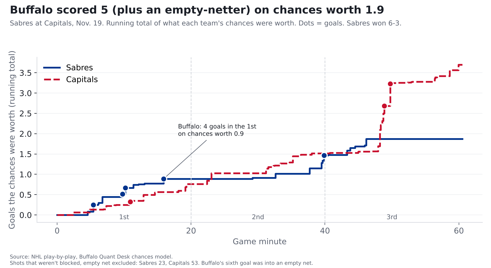
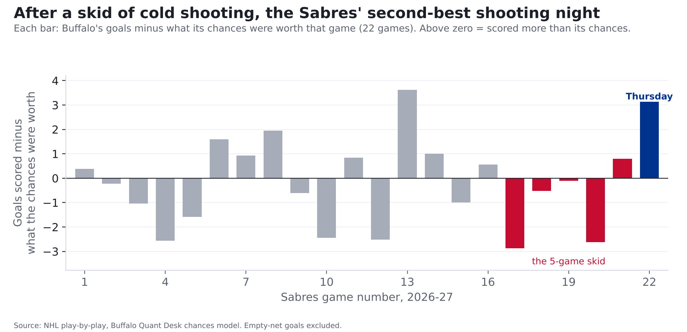

# Sabres 6, Capitals 3: the skid is over, even though Washington had the better chances

**The Sabres scored four goals in the first period and beat Washington 6-3, ending a five-game losing streak. They didn't win it with better chances:
Washington's were worth 3.7 goals and Buffalo's 1.9. Play this game over and over with those chances, and Buffalo wins it in regulation only about 14% of the time (it's tied after three periods another 13%).
This time the puck went in. After five games of cold shooting, it was Buffalo's second-best shooting night of the season. Zach Benson scored, Tage Thompson got his 14th,
and Alex Tuch scored against his old team.**

*One game, Nov. 19, in Washington. [Our preview](sabres-capitals-pregame-nov-19.html).*

## How we measure "chances"

Every shot has a chance of going in, based on where it was taken and what kind of shot it was. Jack Quinn's first goal, a snap shot from 26 feet,
had about a 16% chance. Tuch's, from 32 feet, had about 8%. Add those chances up
over a game and you get what a team's chances were worth in goals. The shot locations come from the NHL's own play-by-play; the full explanation is in our story on
[last year's 50-win season](sabres-50-win-mirage.html).

## The game

| Period | Sabres goals | Sabres chances, in goals | Capitals goals | Capitals chances, in goals |
|---|---|---|---|---|
| 1 | 4 | 0.9 (11 shots) | 1 | 0.8 (16 shots) |
| 2 | 1 | 0.6 (6 shots) | 0 | 0.8 (12 shots) |
| 3 | 0 | 0.4 (6 shots) | 2 | 2.2 (25 shots) |
| Game | 5 (+1 empty net) | 1.9 (23 shots) | 3 | 3.7 (53 shots) |

"Shots" means every shot that wasn't blocked, including misses. Shots at an empty net aren't counted.

| Period | Time | Team | Scorer | Shot | Chance it went in | Score |
|---|---|---|---|---|---|---|
| 1 | 5:25 | Sabres | Jack Quinn | snap from 26 ft | 16% | Sabres 1, Capitals 0 |
| 1 | 9:46 | Sabres | Rasmus Dahlin | wrap-around from 4 ft, power play | 7% | Sabres 2, Capitals 0 |
| 1 | 10:11 | Sabres | Beck Malenstyn | backhand from 10 ft | 15% | Sabres 3, Capitals 0 |
| 1 | 10:54 | Capitals | Alex Tuch | snap from 32 ft | 8% | Sabres 3, Capitals 1 |
| 1 | 15:55 | Sabres | Zach Benson | poked in from 8 ft, four-on-four | 12% | Sabres 4, Capitals 1 |
| 2 | 19:51 | Sabres | Tage Thompson | snap from 29 ft, power play | 13% | Sabres 5, Capitals 1 |
| 3 | 8:52 | Capitals | Ryan Leonard | snap from 25 ft, power play | 18% | Sabres 5, Capitals 2 |
| 3 | 9:44 | Capitals | Boone Jenner | poked in from 1 ft | 54% | Sabres 5, Capitals 3 |
| 3 | 19:17 | Sabres | Jack Quinn | empty net |  | Sabres 6, Capitals 3 |

Logan Thompson gave up 3 goals on the 5 shots he faced, and Washington pulled him for Charlie Lindgren after Buffalo's third goal, 10:11 in. Washington then took over: in the third period its chances were worth 2.2 goals to Buffalo's 0.4, and it
scored twice before Jack Quinn's empty-netter.

## Was it luck?

Mostly, yes, and that's not a knock. In the five losses before tonight, Buffalo scored 9 goals on chances worth about 14.3. Tonight it scored 5 (not counting the
empty-netter) on chances worth 1.9, about 3 more than chances like that usually produce. That's its 2nd-best shooting night in 22 games this season.

Our [GM story](sabres-if-i-were-gm.html) said cold shooting tends to even out, and tonight it did. What it said to fix first was the penalty kill, and Washington's
power play got 9 shots worth 1.2 goals. Overall, Washington's chances were worth about twice Buffalo's.

## Players

- **Zach Benson** scored at four-on-four in the first, his first goal since Oct. 29. Two of his three goals this season came with a goalie in net, on chances worth 7.9.
- **Tage Thompson** scored on the power play in the second. His 14 goals are 6th in the NHL.
- **Alex Tuch** scored for Washington in the first, his 13th of the season.
- **Ukko-Pekka Luukkonen** faced chances worth 3.7 goals and allowed 3, about 0.7 fewer than an average goalie would have.
  This season he's 2.4 goals worse than average in 13 games.

## The penalty kill

Our preview called Buffalo's penalty kill against Washington's quiet power play the matchup to watch. The power play wasn't quiet tonight: Washington had 9 power-play shots
worth 1.2 goals and scored once. Coming in, its power play averaged chances worth 0.52 goals a game. Buffalo's own power play scored twice on chances worth 0.6.

## Receipts: our pregame call

Before the game we logged **a 42% chance the Sabres win** on the [Ledger](../ledger.html). We gave the Sabres less than an even chance, so this one goes down as a miss. It scores
0.34 on our scorecard, where 0 is perfect and a coin flip scores 0.25. We've now got 11 of our 18 graded calls right, and 4 of 6 on Sabres games.

## What's next

The Sabres are 9-9-4. The trip ends with back-to-back games at Florida on Saturday and Tampa Bay on
Sunday, then they're home against the Rangers on Nov. 25.

## For the stat-heads

- xG: our model on unblocked, non-empty-net shots, rescaled per season (2026-27 factor 0.992). BUF 1.87 on 23 (17 on goal); WSH 3.70 on 53
  (37 on goal). By period BUF 0.89, 0.57, 0.41; WSH 0.76, 0.76, 2.18. BUF empty-net goals: 1.
- Strength: BUF 5v5 1.15 (15), PP 0.60 (7); WSH 5v5 2.23 (39), PP 1.18 (9). WSH PP xG/GP before tonight 0.516.
- Replays: exact Poisson-binomial. BUF win 0.137, tie 0.132, loss 0.731.
- GSAx: Luukkonen +0.70 (season -2.42, 13 GP); L. Thompson -2.33 (5 SOG); Lindgren -0.79 (12 SOG).
- G - xG tonight +3.13; rank 2 of 22 BUF games. Skid (5 games): 9 G on 14.35 xG.
- Data through 2026-11-19; the three late Nov. 19 games not final at publish are excluded (src/reports/pins.py).
- Ledger P0019: p = 0.42, outcome 1 (BUF won in regulation), Brier 0.3364.
