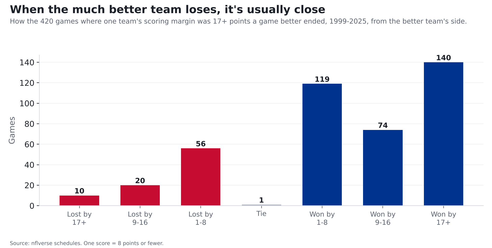

# Even a much better NFL team wins far less often on the road. Rivalry games aren't any closer.

**In the last 27 seasons, when one team's scoring margin was 17 or more points a game better than its opponent's, it won 88% of the time at home
(183 games) and only 73% on the road (237 games). Division games, the ones fans expect to be closer, came out the same as any other. And when
the much better team did lose, it was usually a close game. Sunday's Dolphins at Bills game is the home kind.**

*This follows our story on [how often big NFL mismatches go wrong](nfl-mismatches.html), using the same 5,205 regular-season games from 1999 to 2025. A
mismatch is the gap between the two teams' scoring margins (points scored minus allowed, per game) going into the game. We don't use betting lines.*

## Home field

Home teams won 56% of all these games, and the home edge shows up at every size of mismatch: in every group on the chart, the better team won 10 to
18 more games out of every 100 at home than on the road. A big gap doesn't make it go away. Among the 86 times a much better team lost, 64
were on the road.

## Sunday

The Bills have outscored opponents by 9.8 points a game this season, and Miami has been outscored by 8.4: a gap of 18.2, with the game in Buffalo.
Sunday fits the group that won 88% of the time. That describes past games, not a forecast: our model's chance for the Bills on Sunday, from the first story, is 81%.

## Rivalry games aren't closer

"Throw out the records" is a common line for division games. The numbers don't back it up. With a gap of 17 or more, the better team won 80% of division
games (171) and 79% of the rest (249). With a gap of 10 or more it was 75% and 73%. The Bills, when they were the
better team by 10 or more going in, went 4-2 against Miami from 1999 to 2025, too few games to read much into.

## When the upset comes, it's usually close

In the 86 games the much better team lost, the typical upset was decided by 5 points (half were closer, half wider), and 65% were one-score games
(8 points or fewer). When the much better team won, it won by 17 or more 42% of the time and by one score 36% of the time. Its typical winning margin was
13 points.

## One smaller note

**Cold weather.** When a team 17+ points a game better hosted outdoors at 40°F or colder, it won 28 of 29. That's a small group, and the schedule
data has no temperature for 4% of these outdoor home games, so take it as a note, not a finding.

## For the stat-heads

- Same sample as the first story: nflverse schedules, regular season 1999-2025, both teams with 4+ prior games (5,205). Ties = 0.5.
- Gap 17+: home 0.880 (n=183), road 0.728 (n=237); division 0.801 (n=171), other 0.789 (n=249).
  Gap 10+: division 0.748 (n=660), other 0.735 (n=927). All games: home team 0.561.
- Upsets (gap 17+): n=86, median margin 5.0, share decided by 8 or fewer 0.651. Better-team wins: n=333, 17+ 0.420, 8 or fewer 0.357.
- Cold: gap 17+, better team at home, roof = outdoors, temp <= 40: 29 games (28 wins); temp missing for 3.7% of 135 outdoor home games.
- Gap 17+: 1999-2019 0.797 (n=347), 2020-2025 0.781 (n=73). Home-minus-road edge by gap group: 0-3: +0.132, 3-7: +0.147, 7-10: +0.095, 10-14: +0.129, 14-17: +0.125, 17-20: +0.175, 20+: +0.127.
- No market data read: the schedule query selects only game, team, score, division, roof and temperature columns.
