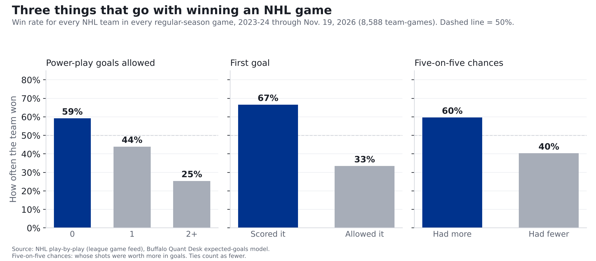
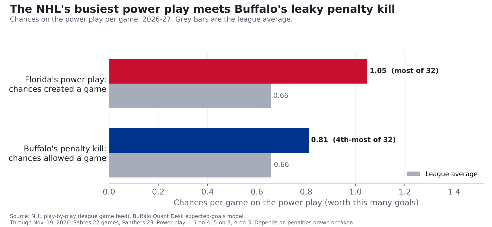

# Sabres at Panthers: three keys for Buffalo in Florida

**Our model gives Buffalo a 37% chance to win in Florida on Saturday (Panthers 63%). Three things go with winning, and they're Buffalo's keys.
Hold the NHL's busiest power play to one goal or fewer. Score first, and this time keep the lead. And get more of the chances at five-on-five.
We'll check all three after the game.**

*Buffalo at Florida, Saturday, Nov. 21, 6 p.m. ET, game 5 of a 6-game road trip. Sabres 9-9-4 (22 points), Panthers 12-8-3 (27 points), through November 19.
Buffalo played Thursday and plays again Sunday in Tampa; Florida last played Tuesday.*

The chart covers every NHL game since 2023-24 (8,588 team results). These aren't magic: better teams tend to do all three. But they're what to watch on Saturday.

## Key 1: Florida gets one power-play goal at most

**The key:** a penalty kill that gives up one goal or none.

NHL teams that allow no power-play goals win 59% of the time. Allow one and it's 44%. Allow two or more and it drops to 25% (995 games).
The Sabres are no different: since 2023-24 they've won 59% of games with none allowed (134 games) and 25% with two or more (28).

This is the hard one on Saturday. Florida's power play creates 1.05 goals' worth of chances a game, the most in the NHL (league average 0.66), and has scored 22 times in 23 games.
Buffalo's penalty kill allows 0.81 a game, 4th-most of 32, and has given up 22 goals in 22 games. It's the problem the [GM story](sabres-if-i-were-gm.html)
said to fix first. Buffalo has allowed two or more power-play goals in 5 games this season.

## Key 2: Score first, and keep it

**The key:** the first goal, and no giving it back.

NHL teams that score first win 67% of the time. Buffalo has scored first in 13 of 22 games this season, more often than not, but won only 5 of them.
Only Chicago and Vancouver have won a smaller share of the games they scored first, though 4 of Buffalo's other 8 went to overtime. It's a small sample. Florida has scored first 10 times and won 8.

## Key 3: More of the chances at five-on-five

**The key:** shots worth more than Florida's when both teams are at full strength.

Teams that get more of the five-on-five chances win 60% of the time. Buffalo has won 6 of the 12 games it's done that this season, and 3 of the 10 when it hasn't. Small samples, but the gap is there.
On paper this one is even: Buffalo gets 49.8% of the five-on-five chances (19th of 32), Florida 51.0% (15th).

**How we measure "chances."** Every shot has a chance of going in, based on where it was taken, what kind of shot it was, and things like rebounds and power plays.
A shot from within 10 feet went in 13.8% of the time over the last three seasons; one from 60 feet or more, 0.8%. Add them up and you get what a team's chances were worth in goals.
More in our story on [last year's 50-win season](sabres-50-win-mirage.html).

## Who to watch

- **Sam Reinhart** leads Florida with 12 goals, and his chances add up to the most on the team, worth about 11 goals. **Brady Tkachuk**, who played for Ottawa through last season, has 11.
- **Tage Thompson's 14 goals are 6th in the NHL.** He scored on the power play Thursday; Buffalo's power play scored twice in Washington.
- **The last meeting.** Buffalo won 5-3 at home on Oct. 12. The chances were even (3.4 to 3.5), and each team scored 2 power-play goals.
- **Rest.** Florida has had three days off; Buffalo has had one and plays again Sunday. Our model doesn't count rest.

## In goal

Goals saved compared with an average goalie facing the same shots. Positive is good.

| Team | Goalie | Games | Save % | Goals saved vs. average |
|---|---|---|---|---|
| Sabres | [Ukko-Pekka Luukkonen](../cards/ukko-pekka-luukkonen.html) | 13 | 87.3% | -2.6 (52nd of 77) |
| Sabres | [Colten Ellis](../cards/colten-ellis.html) | 8 | 87.3% | -0.6 (40th of 77) |
| Sabres | [Alex Lyon](../cards/alex-lyon.html) | 3 | 89.8% | -0.4 (39th of 77) |
| Panthers | [Jacob Markstrom](../cards/jacob-markstrom.html) | 12 | 89.8% | +0.7 (30th of 77) |
| Panthers | [Akira Schmid](../cards/akira-schmid.html) | 11 | 88.5% | -0.1 (35th of 77) |
| Panthers | [Cooper Black](../cards/cooper-black.html) | 1 | 85.7% | -1.0 (44th of 77) |

Ranks are among all 77 goalies this season. Starters weren't confirmed when we published.

## Our prediction: Sabres 37%, Panthers 63%

**This is our model's number.** It counts once it's logged on the [Ledger](../ledger.html) before puck drop; every logged call is graded after the game, hit or miss.

Our model expects about **2.8 goals for Buffalo and 3.6 for Florida**, and about a 15% chance the game is tied after 60 minutes. It works from each team's chances this season,
blended with last season's, plus home ice (about 0.3 of a goal for Florida). If it's tied after 60 minutes, Florida gets 55%: how often home teams won in overtime or a shootout in 2023-24 and 2024-25.

**One caution.** Our model has been a little high on home teams. In 2025-26 it gave them 54.9% on average, and they won 52.2% of
1,312 games. This season it's 54.4%, and they've won 52.2% of 358. So Buffalo's real chance on the road may be a little better than 37%.
We're logging the model's number as it is.

**How we checked it.** We built the model on the 2023-24 and 2024-25 seasons, then had it call every 2025-26 game using only what was known before each game.
It called the winner 55% of the time; always going with the home team would have been right 52%. This season (358 games) it has called
60% right. When it gave a team 60-65% in 2025-26, as it gives Florida on Saturday, that team won 62% of the time (231 games).

## After the game

Our recap will grade the three keys: did Buffalo hit each one, and did it win? Over a season, that will show how often Buffalo wins when it hits each one.

## For the stat-heads

- Keys: all regular-season team-games 4 seasons (2023-24 through 2026-11-19), n = 8,588. PP goals = goals at 5v4, 5v3, 4v3 by the opponent. First goal includes any goal; games scoreless after overtime count as no first goal for either team.
  5v5 "won" = team 5v5 xG > opponent 5v5 xG (unblocked, non-empty-net). Win rates: PPGA 0 0.592 (n 4,608), 1 0.440 (n 2,985), 2+ 0.254 (n 995);
  first goal 0.666 / 0.334; 5v5 xG won 0.597 (n 4,294) / lost 0.403. Descriptive, not causal; all three are correlated with team quality.
- xG: Buffalo Quant Desk model (`src/metrics/nhl_xg.py`), rescaled per season so league xG = league goals (2026-27 factor 0.989). Data through 2026-11-19 (358 games this season).
- Win chance: NHL game model nhl-game-v0.1 (`src/ledger/nhl_game_model.py`), ratings from games through 2026-11-19. Ratings: BUF off 3.00, def 3.19; FLA off 3.11, def 2.83.
  Team xGF/xGA per game shrunk with K=10 toward league + 0.5 x last season's edge; goals = -0.254 + 1.032 x expected + 0.272 x home; independent Poisson;
  regulation ties to home at 0.545. Brier: 2025-26 0.2446 (home-team rate 0.2504, coin 0.25); 2026-27 to date 0.2358. No goalie, rest or back-to-back term.
