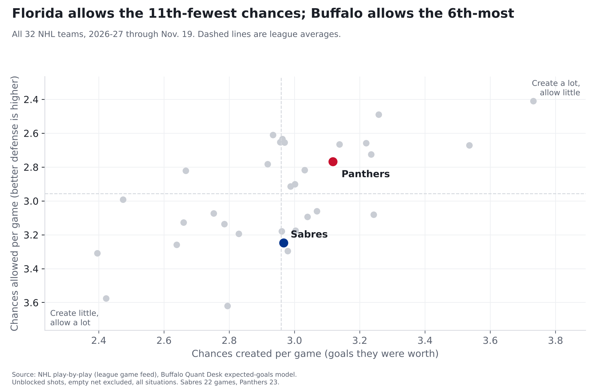
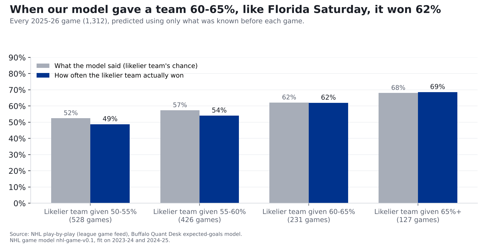

# Sabres at Panthers: the NHL's busiest power play meets Buffalo's leaky penalty kill

**Our model gives Buffalo a 37% chance to win in Florida on Saturday (Panthers 63%). The Sabres just ended a five-game skid with a 6-3 win in Washington.
The matchup to watch: Florida's power play creates more chances than any team's in the NHL, and Buffalo's penalty kill allows the 4th-most.
That's the problem the [GM story](sabres-if-i-were-gm.html) said to fix first.**

*Buffalo at Florida, Saturday, Nov. 21, 6 p.m. ET, game 5 of a 6-game road trip. Buffalo played Thursday and plays again Sunday in Tampa; Florida last played Tuesday.
Numbers are 2026-27 through November 19: Sabres 9-9-4 (22 points) in 22 games, Panthers 12-8-3 (27 points) in 23.
Early-season ranks can move a lot.*

## The two teams, side by side

| Per game, 2026-27 | Sabres | Panthers | League average |
|---|---|---|---|
| Chances created (worth this many goals) | 2.97 (17th) | 3.12 (8th) | 2.96 |
| Chances allowed | 3.25 (27th) | 2.77 (11th) | 2.96 |
| Share of the chances at five-on-five | 49.8% (19th) | 51.0% (15th) | 50% |
| Goals scored, actual | 2.91 | 3.13 | |
| Goals allowed, actual | 3.50 | 2.96 | |
| Power-play chances created | 0.66 (18th) | 1.05 (1st) | 0.66 |
| Chances allowed a man down | 0.81 (29th) | 0.83 (30th) | 0.66 |

Ranks are among 32 teams; 1st is best (most created, fewest allowed). Actual goals come from final scores; chances leave out empty-net shots.

## How we measure "chances"

Every shot has a chance of going in, based on where it was taken, what kind of shot it was, and things like rebounds and power plays. Over the last three seasons
(336,462 shots that weren't blocked, not counting empty nets), a shot from within 10 feet went in 13.8% of the time; one from 60 feet or more, 0.8%.
Add up those chances on every shot and you get what a team's chances were worth in goals. The shot locations come from the NHL's own play-by-play. The full explanation
and how we checked it are in our story on [last year's 50-win season](sabres-50-win-mirage.html).

## A man down

Florida's power play creates 1.05 goals' worth of chances a game, the most in the NHL (league average 0.66), and has scored 22 power-play goals in 23 games.
Buffalo's penalty kill allows 0.81 a game, 4th-most of 32, and has allowed 22 power-play goals in 22 games. Both numbers also depend on how many
penalties get called. Staying out of the penalty box matters on Saturday.

Buffalo's own power play scored twice in Washington on Thursday.

## The first meeting

Buffalo beat Florida 5-3 at home on Oct. 12. The chances were even: Buffalo's were worth 3.4 goals, Florida's 3.5. Each team scored 2 power-play goals.
Last season Buffalo won 3 of the 4 games between them. One game is a small sample, and our prediction goes by the full season, blended with last season.

## Notes for Saturday

- **Florida's top two.** Sam Reinhart leads the Panthers with 12 goals, and his chances add up to the most on the team, worth about 11 goals.
  Brady Tkachuk, who played for Ottawa through last season, has 11.
- **Tage Thompson's 14 goals are 6th in the NHL.**
- **Rest.** Florida has had three days off. Buffalo has had one, and plays again Sunday in Tampa. Our model doesn't count rest.

## In goal

Goals saved compared with an average goalie facing the same shots. Positive is good.

| Team | Goalie | Games | Save % | Goals saved vs. average |
|---|---|---|---|---|
| Sabres | [Ukko-Pekka Luukkonen](../cards/ukko-pekka-luukkonen.html) | 13 | 87.3% | -2.6 (52nd of 77) |
| Sabres | [Colten Ellis](../cards/colten-ellis.html) | 8 | 87.3% | -0.6 (40th of 77) |
| Sabres | [Alex Lyon](../cards/alex-lyon.html) | 3 | 89.8% | -0.4 (39th of 77) |
| Panthers | [Jacob Markstrom](../cards/jacob-markstrom.html) | 12 | 89.8% | +0.7 (30th of 77) |
| Panthers | [Akira Schmid](../cards/akira-schmid.html) | 11 | 88.5% | -0.1 (35th of 77) |
| Panthers | [Cooper Black](../cards/cooper-black.html) | 1 | 85.7% | -1.0 (44th of 77) |

Ranks are among all 77 goalies who have played this season. We hadn't seen confirmed starters when we published, and our prediction doesn't change with the
starter: a goalie's first half of a season is a weak guide to his second half (details in our [Vegas preview](sabres-vegas-pregame-nov-8.html)).

## Our prediction: Sabres 37%, Panthers 63%

**This is our model's number.** It counts once it's logged on the [Ledger](../ledger.html) before puck drop; every logged call is graded after the game, hit or miss.

Our model expects about **2.8 goals for Buffalo and 3.6 for Florida**, and gives about a 15% chance the game is tied after 60 minutes.

**Where the number comes from.** The chances numbers above. Early in a season we blend in last season's numbers and pull everything toward the league
average, which makes Buffalo's attack worth 3.0 goals a game and Florida's chances allowed 2.8. Florida's attack comes out at
3.1, and Buffalo's chances allowed at 3.2. Home ice adds about 0.3 of a goal for the Panthers. Then we work out the chance of every possible
final score. If it's tied after 60 minutes, Florida gets 55%: how often home teams won in overtime or a shootout in 2023-24 and 2024-25.

**One caution.** Our model has been a little high on home teams. In 2025-26 it gave them 54.9% on average, and they won 52.2% of
1,312 games. This season it's 54.4%, and they've won 52.2% of 358. So Buffalo's real chance on the road may be a little better than 37%.
We're logging the model's number as it is.

**How we checked it.** We built the model on the 2023-24 and 2024-25 seasons, then had it call every 2025-26 game using only what was known before each game.
It called the winner 55% of the time; always going with the home team would have been right 52%. This season (358 games) it has called
60% right. When it gave a team 60-65% in 2025-26, as it gives Florida on Saturday, that team won 62% of the time (231 games).

## For the stat-heads

- xG: Buffalo Quant Desk model (`src/metrics/nhl_xg.py`), unblocked non-empty-net shots, all strengths, rescaled per season so league xG = league goals
  (2026-27 factor 0.989). Data through 2026-11-19 (358 games, every scheduled game through that date).
- Power play = 5v4, 5v3, 4v3 shots; per game over all games played, so it mixes how often a team is on the power play with what it does there. Penalty counts not used.
- Oct. 12: xGF BUF 3.40, FLA 3.52. Reinhart 2026-27: 9 G on 11.25 xG, non-empty-net.
- Win chance: NHL game model nhl-game-v0.1 (`src/ledger/nhl_game_model.py`), ratings from games through 2026-11-19. Team xGF/xGA per game shrunk with K=10
  games toward league + 0.5 x last season's edge; goals = -0.254 + 1.032 x expected + 0.272 x home (fit 2023-25), on unrescaled xG;
  independent Poisson; regulation ties to home at 0.545. Brier: 2025-26 0.2446 (home-team rate 0.2504, coin 0.25); 2026-27 to date 0.2358.
  No goalie, rest, back-to-back or road-trip term. The shot model was trained on 2023-24 to 2025-26 shots, so 2025-26 checks are not fully clean; 2026-27 is.
