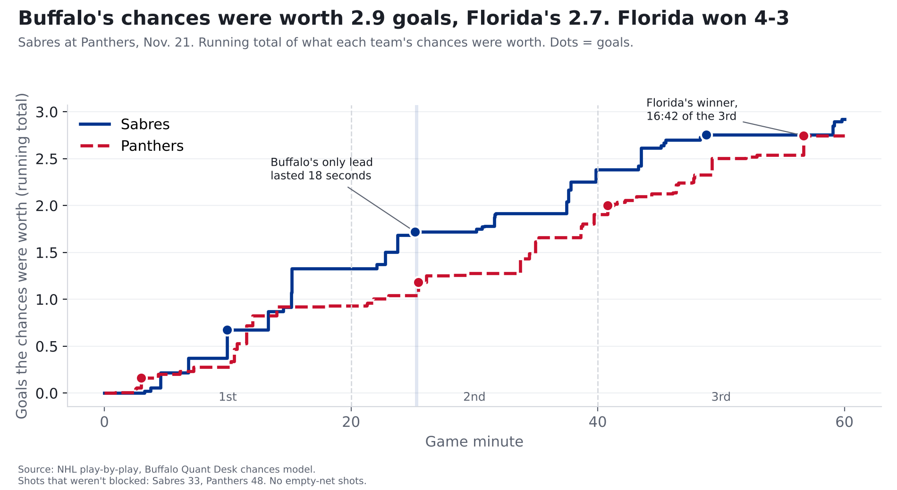

# Panthers 4, Sabres 3: Buffalo hit two of its three keys and still lost

**Florida scored with 3:18 left to beat the Sabres 4-3. Before the game we named three keys. Buffalo kept Florida's power play off the board
and got more of the chances at five-on-five. It didn't score first, and its only lead lasted 18 seconds. The chances were close: Buffalo's were worth
2.9 goals, Florida's 2.7. The difference was in goal, and Sam Bennett scored three.**

*One game, Nov. 21, in Florida. [Our preview](sabres-panthers-pregame-nov-21.html).*

## The three keys, graded

| Key | What happened | Hit? |
|---|---|---|
| Florida gets one power-play goal at most | Florida's power play scored 0 on 6 shots worth 0.6 goals | **Yes** |
| Score first, and keep it | Florida scored first, 3:00 in. Buffalo led 2-1 in the second, and Florida tied it 18 seconds later | **No** |
| More of the chances at five-on-five | Buffalo 2.3, Florida 2.0 | **Yes** |

Since 2023-24, teams that hit the first and third keys but didn't score first have won 46% of the time (1,775 games). Teams that hit all three won 78%.
Teams in Buffalo's spot win a little less than half the time. This season the Sabres have won 4 of the 10 games where the other team scored first.

The penalty kill held, but Buffalo's own power play gave up a goal: Bennett scored shorthanded 0:48 into the third to put Florida ahead 3-2.

## What decided it

**Goaltending.** Florida's chances were worth 2.7 goals and Alex Lyon allowed 4, about 1.3 more than an average goalie would have.
At the other end, Jacob Markstrom faced chances worth 2.9 and allowed 3. Play this game over and over with these chances, and Buffalo wins it in regulation
about 44% of the time, Florida about 38%, and it's tied after three periods the rest (18%).

**Sam Bennett.** All three of his goals came from 30 feet or more. Together those three shots were worth 0.3 goals. He has 10 this season.

## How we measure "chances"

Every shot has a chance of going in, based on where it was taken, what kind of shot it was, and things like rebounds and power plays. Jiri Kulich's goal, a snap shot from
4 feet, had about a 30% chance. Bennett's shorthanded goal, from 37 feet, had about 9%. Add those chances up over a game and you get
what a team's chances were worth in goals. The full explanation is in our story on [last year's 50-win season](sabres-50-win-mirage.html).

## The game

| Period | Sabres goals | Sabres chances, in goals | Panthers goals | Panthers chances, in goals |
|---|---|---|---|---|
| 1 | 1 | 1.3 (9 shots) | 1 | 0.9 (15 shots) |
| 2 | 1 | 1.1 (14 shots) | 1 | 1.0 (17 shots) |
| 3 | 1 | 0.5 (10 shots) | 2 | 0.8 (16 shots) |
| Game | 3 | 2.9 (33 shots) | 4 | 2.7 (48 shots) |

"Shots" means every shot that wasn't blocked, including misses. Florida took more of them, but Buffalo's were worth more.

| Period | Time | Team | Scorer | Shot | Chance it went in | Score |
|---|---|---|---|---|---|---|
| 1 | 3:00 | Panthers | Sam Bennett | snap from 31 ft | 11% | Sabres 0, Panthers 1 |
| 1 | 9:56 | Sabres | Jiri Kulich | snap from 4 ft | 30% | Sabres 1, Panthers 1 |
| 2 | 5:10 | Sabres | Jack Quinn | snap from 46 ft | 3% | Sabres 2, Panthers 1 |
| 2 | 5:28 | Panthers | Sam Bennett | snap from 30 ft | 14% | Sabres 2, Panthers 2 |
| 3 | 0:48 | Panthers | Sam Bennett | snap from 37 ft, shorthanded | 9% | Sabres 2, Panthers 3 |
| 3 | 8:49 | Sabres | Tage Thompson | snap from 34 ft | 3% | Sabres 3, Panthers 3 |
| 3 | 16:42 | Panthers | Sandis Vilmanis | snap from 10 ft | 21% | Sabres 3, Panthers 4 |

## Players

- **Jiri Kulich** had the best chances of anyone on the ice: his shots were worth 1.2 goals. He scored once, from 4 feet.
- **Tage Thompson** tied it 3-3 in the third, his 15th goal. That's tied for 5th in the NHL.
- **Alex Lyon** is 1.6 goals worse than an average goalie this season, in 4 games.

## Receipts: our pregame call

Before the game we logged **a 37% chance the Sabres win** on the [Ledger](../ledger.html). We gave Florida the better chance, and Florida won, so the call goes down as right.
It scores 0.14 on our scorecard, where 0 is perfect and a coin flip scores 0.25. We've now got 12 of our 19 graded calls right, and 5 of 7 on Sabres games.
The three keys aren't Ledger calls, but we'll keep grading them after every game.

## What's next

The Sabres are 9-10-4. They play again Sunday, the second night of a back-to-back, at Tampa Bay (5 p.m.), then come home for the Rangers.

## For the stat-heads

- xG: our model on unblocked shots, rescaled per season (2026-27 factor 0.994). BUF 2.92 on 33 (19 on goal); FLA 2.75 on 48
  (30 on goal). By period BUF 1.33, 1.06, 0.54; FLA 0.93, 0.97, 0.84.
- Strength: 5v5 BUF 2.29, FLA 1.97; PP BUF 0.34 (3), FLA 0.58 (6). FLA PPG 0, SHG 1.
- Replays: exact Poisson-binomial. BUF win 0.442, tie 0.181, loss 0.377.
- GSAx: Lyon -1.25 (season -1.63, 4 GP); Markstrom -0.08. Bennett: 3 G on 0.34 xG.
- Keys (definitions as in the preview): team-games 2023-24 through 2026-11-21, n = 8,598. PPGA <= 1 and 5v5 xG won but opponent scored first: win 0.456 (n 1,775);
  all three keys: 0.782 (n 2,058).
- Data through 2026-11-21; the nine late Nov. 21 games not final at publish are excluded (src/reports/pins.py).
- Ledger P0020: p = 0.37, outcome 0 (FLA won in regulation), Brier 0.1369.
