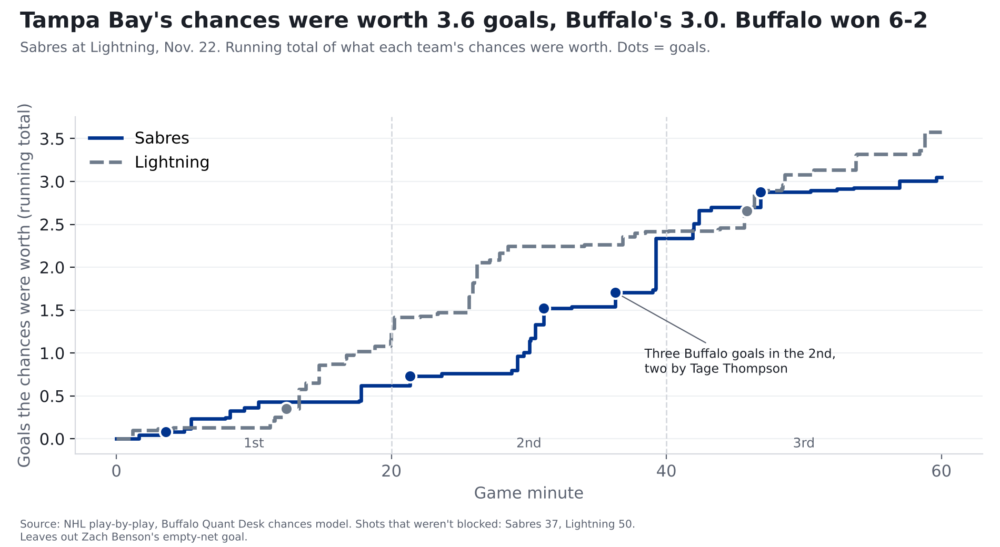

# Sabres 6, Lightning 2: Tampa Bay had more of the chances, and Buffalo finished them

**On the second night of a back-to-back, the Sabres beat Tampa Bay 6-2. The Lightning came in 10-1 at home, the NHL's best home record. Tampa Bay's chances were worth 3.6 goals,
Buffalo's 3.0. But Buffalo scored 5 on Dennis Hildeby, plus an empty-netter. At the other end, Ukko-Pekka Luukkonen allowed 2.
On Nov. 11 the chances were even, and Tampa Bay won 8-3. Our pregame call gave Buffalo 35%, so it goes down as a miss.**

*One game, Nov. 22, in Tampa. [Our preview](sabres-lightning-pregame-nov-22.html).*

## The three keys, graded

| Key | What happened | Hit? |
|---|---|---|
| Tampa Bay gets one power-play goal at most | Nikita Kucherov scored on the power play in the 1st. It was Tampa Bay's only power-play goal. Its 7 power-play shots were worth 0.7 goals | **Yes** |
| Score first, and keep it | Jiri Kulich scored 3:35 in, but Tampa Bay tied it later in the 1st. Buffalo went back ahead in the 2nd and never trailed | **Half** |
| More of the chances at five-on-five | Tampa Bay's were worth 2.6 goals, Buffalo's 2.4 | **No** |

Since 2023-24, teams in Buffalo's spot won 42% of the time (1,286 games). They allowed one power-play goal at most, scored first but saw the other team tie it,
and had fewer of the five-on-five chances. Buffalo has scored first 14 times this season and won 6 of those games, a small sample.

## What decided it

**Finishing.** Buffalo scored 4 of its goals at five-on-five, on chances worth 2.4. Noah Ostlund's goal came from 13 feet, the closest of the night.
Tage Thompson's two came from 27 and 30 feet. Hildeby faced chances worth 3.0 goals and allowed 5.

**Luukkonen.** Tampa Bay's chances were worth 3.6 goals, and he allowed 2: about 1.6 fewer than an average goalie would have.
For the season he's 0.6 goals worse than average in 14 games, 38th of 77 goalies.

Play this game over and over with these chances, and Buffalo wins it in regulation about 33% of the time, Tampa Bay about 50%,
and it's tied after three periods the rest (17%). On Sunday, Buffalo won anyway. On Nov. 11, with chances worth
3.6 for Buffalo and 3.6 for Tampa Bay, it lost 8-3.

## How we measure "chances"

Every shot has a chance of going in, based on where it was taken, what kind of shot it was, and things like rebounds and power plays. Ostlund's wrist shot from
13 feet had about a 17% chance. Kulich's opener, from 41 feet, had about 4%. Add those up over a game and you get
what a team's chances were worth in goals. Empty-net shots are left out. The full explanation is in our story on [last year's 50-win season](sabres-50-win-mirage.html).

## The game

| Period | Sabres goals | Sabres chances, in goals | Lightning goals | Lightning chances, in goals |
|---|---|---|---|---|
| 1 | 1 | 0.6 (13 shots) | 1 | 1.3 (19 shots) |
| 2 | 3 | 1.7 (14 shots) | 0 | 1.1 (15 shots) |
| 3 | 2 | 0.7 (10 shots) | 1 | 1.2 (16 shots) |
| Game | 6 | 3.0 (37 shots) | 2 | 3.6 (50 shots) |

"Shots" means every shot that wasn't blocked, including misses. Buffalo's goal totals include Benson's empty-netter; its chances don't.

| Period | Time | Team | Scorer | Shot | Chance it went in | Score |
|---|---|---|---|---|---|---|
| 1 | 3:35 | Sabres | Jiri Kulich | wrist from 41 ft | 4% | Sabres 1, Lightning 0 |
| 1 | 12:21 | Lightning | Nikita Kucherov | snap from 28 ft, power play | 10% | Sabres 1, Lightning 1 |
| 2 | 1:22 | Sabres | Jack Quinn | snap from 29 ft | 11% | Sabres 2, Lightning 1 |
| 2 | 11:05 | Sabres | Tage Thompson | slap from 30 ft, two-man advantage | 19% | Sabres 3, Lightning 1 |
| 2 | 16:17 | Sabres | Tage Thompson | snap from 27 ft | 17% | Sabres 4, Lightning 1 |
| 3 | 5:50 | Lightning | Gage Goncalves | slap from 46 ft | 6% | Sabres 4, Lightning 2 |
| 3 | 6:50 | Sabres | Noah Ostlund | wrist from 13 ft | 17% | Sabres 5, Lightning 2 |
| 3 | 18:53 | Sabres | Zach Benson | into an empty net | n/a | Sabres 6, Lightning 2 |

## Players

- **Tage Thompson** scored twice, once with a two-man advantage. He has 17, 5th in the NHL.
- **Zach Benson** had the best chances of anyone on the ice: his shots were worth 0.7 goals. His only goal was the empty-netter.
- **Ukko-Pekka Luukkonen** stopped 29 of 31 shots on goal.

## Receipts: our pregame call

Before the game we logged **a 35% chance the Sabres win** on the [Ledger](../ledger.html). We gave Tampa Bay the better chance, and Buffalo won, so the call goes down as a miss.
It scores 0.42 on our scorecard, where 0 is perfect and a coin flip scores 0.25. We've now got 13 of our 21 graded calls right, and 5 of 8 on Sabres games.
The three keys aren't Ledger calls, but we'll keep grading them after every game.

## What's next

The Sabres are 10-10-4 (24 points). They went 2-3-1 on a 6-game road trip and are home Wednesday against the Rangers (7 p.m.).

## For the stat-heads

- xG: our model on unblocked, non-empty-net shots, rescaled per season (2026-27 factor 1.000). BUF 3.05 on 37 (27 on goal);
  TBL 3.58 on 50 (31 on goal). By period BUF 0.62, 1.72, 0.71; TBL 1.29, 1.13, 1.16.
- Strength: 5v5 BUF 2.43, TBL 2.62; PP BUF 0.60 (6), TBL 0.70 (7). PPG BUF 1, TBL 1. TBL 6v5 (goalie pulled) 0.26 (2).
- Replays: exact Poisson-binomial, non-empty-net shots. BUF win 0.332, tie 0.168, loss 0.501.
- GSAx: Luukkonen +1.58 (season -0.57, 14 GP, 38th of 77); Hildeby -1.95. Nov. 11 xGF BUF 3.56, TBL 3.59.
- Key 2 is graded "Half": BUF scored first but TBL tied it. Keys (definitions as in the preview): team-games 2023-24 through 2026-11-22, n = 8,624.
  PPGA <= 1, first goal, opponent later tied or led (shootouts excluded), 5v5 xG lost: win 0.423 (n 1,286). Without the tie condition: 0.600 (n 1,856),
  of which 570 never gave the lead back and all won. All three keys hit (first-goal definition): 0.781 (n 2,063).
- Data through 2026-11-22; VAN-CHI, not final at publish, is excluded (src/reports/pins.py).
- Ledger P0022: p = 0.35, outcome 1 (BUF won in regulation), Brier 0.4225.
