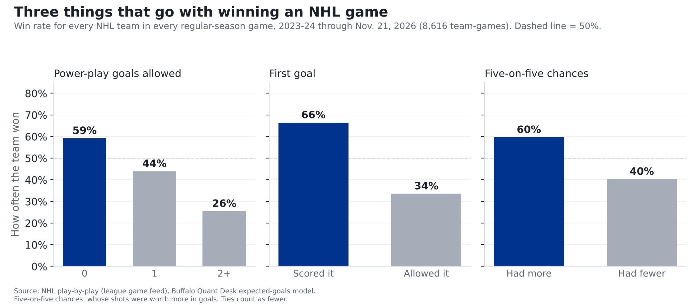
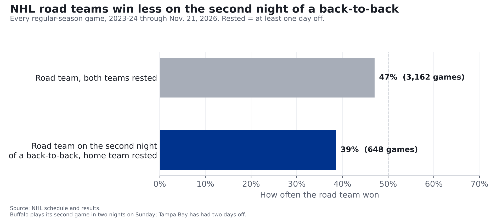
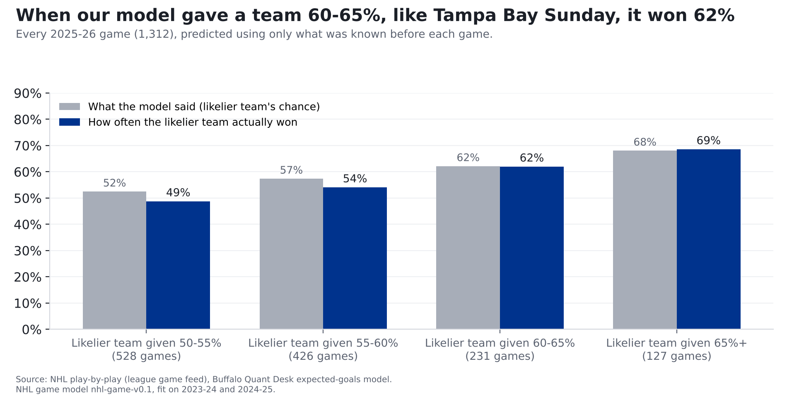

# Sabres at Lightning: a back-to-back, a 10-1 home team, and the same three keys

**Our model gives Buffalo a 35% chance to win in Tampa on Sunday (Lightning 65%). That number doesn't count rest, and rest matters today: Buffalo played
in Florida last night, and Tampa Bay has had two days off. Since 2023-24, road teams in that spot have won 39% of the time. Tampa Bay is 10-1 at home this season.
Here are the same three keys we graded after Florida.**

*Buffalo at Tampa Bay, Sunday, Nov. 22, 5 p.m. ET, the last game of a 6-game road trip. Sabres 9-10-4 (22 points), Lightning 15-5-2 (32 points), through November 21.*

The chart covers every NHL game since 2023-24 (8,616 team results). These aren't magic: better teams tend to do all three. But they're what to watch on Sunday.
Saturday in Florida, Buffalo hit the first and third and lost 4-3 ([our recap](sabres-panthers-postgame-nov-21.html)).

## Key 1: Tampa Bay gets one power-play goal at most

**The key:** a penalty kill that gives up one goal or none.

NHL teams that allow no power-play goals win 59% of the time; two or more and it drops to 26%. Tampa Bay's power play is about average: 0.68 goals' worth of chances a game,
15th of 32. The problem is Buffalo's penalty kill, which allows 0.81 a game, 4th-most in the NHL, and has given up 22 power-play goals in 23 games.
It held Florida's power play, the league's busiest, without a goal on Saturday.

## Key 2: Score first, and keep it

**The key:** the first goal, and no giving it back.

NHL teams that score first win 66% of the time. Tampa Bay has scored first 13 times this season and won 12. Buffalo has scored first 13 times and won 5.

## Key 3: More of the chances at five-on-five

**The key:** shots worth more than Tampa Bay's when both teams are at full strength.

Teams that get more of the five-on-five chances win 60% of the time. This is Tampa Bay's strength: it gets 56.4% of the five-on-five chances, 3rd in the NHL.
Buffalo gets 50.0% (19th). Buffalo has won 6 of the 13 games where it got more of them, and 3 of the 10 where it didn't. Small samples, but the gap is there.

**How we measure "chances."** Every shot has a chance of going in, based on where it was taken, what kind of shot it was, and things like rebounds and power plays.
A shot from within 10 feet went in 13.8% of the time over the last three seasons; one from 60 feet or more, 0.8%. Add them up and you get what a team's chances were worth in goals.
More in our story on [last year's 50-win season](sabres-50-win-mirage.html).

## The back-to-back

Since 2023-24, road teams playing their second game in two nights against a rested team have won 39% of the time (648 games). Road teams with both sides rested won 47%.
Buffalo has played the second night of a back-to-back twice this season and lost both, once in overtime and once in a shootout. Our model doesn't adjust for rest, so its 35% may be a little high.

## Last time

Tampa Bay won 8-3 in Buffalo on Nov. 11. The chances that night were even: Buffalo's were worth 3.6 goals, Tampa Bay's 3.6. Tampa Bay just finished far more of them.
Last season Buffalo won 3 of the 4 games between them.

## Who to watch

- **Brandon Hagel and Jake Guentzel** have 13 goals each for Tampa Bay. Hagel's chances add up to the most on the team, worth about 11 goals.
- **Tage Thompson's 15 goals are tied for 5th in the NHL.** He tied Saturday's game in the third.

## In goal

Goals saved compared with an average goalie facing the same shots. Positive is good.

| Team | Goalie | Games | Save % | Goals saved vs. average |
|---|---|---|---|---|
| Sabres | [Ukko-Pekka Luukkonen](../cards/ukko-pekka-luukkonen.html) | 13 | 87.3% | -2.1 (50th of 77) |
| Sabres | [Colten Ellis](../cards/colten-ellis.html) | 8 | 87.3% | -0.3 (36th of 77) |
| Sabres | [Alex Lyon](../cards/alex-lyon.html) | 4 | 89.0% | -1.5 (45th of 77) |
| Lightning | [Andrei Vasilevskiy](../cards/andrei-vasilevskiy.html) | 17 | 89.5% | +2.8 (19th of 77) |
| Lightning | [Dennis Hildeby](../cards/dennis-hildeby.html) | 5 | 89.9% | +0.8 (28th of 77) |

Ranks are among all 77 goalies this season. Starters weren't confirmed when we published. Alex Lyon played Saturday.

## Our prediction: Sabres 35%, Lightning 65%

**Logged on the [Ledger](../ledger.html) at 2026-11-22 13:58:15 UTC, before puck drop.** It gets graded after the game, hit or miss.

Our model expects about **2.8 goals for Buffalo and 3.7 for Tampa Bay**, and about a 15% chance the game is tied after 60 minutes. It works from each team's chances this season,
blended with last season's, plus home ice (about 0.3 of a goal for Tampa Bay). If it's tied after 60 minutes, Tampa Bay gets 55%: how often home teams won in overtime or a shootout in 2023-24 and 2024-25.

**One caution.** Our model has been a little high on home teams. In 2025-26 it gave them 54.9% on average, and they won 52.2% of
1,312 games. This season it's 54.4%, and they've won 52.7% of 372. The back-to-back works against Buffalo, though. We're logging the model's number as it is.

**How we checked it.** We built the model on the 2023-24 and 2024-25 seasons, then had it call every 2025-26 game using only what was known before each game.
It called the winner 55% of the time; always going with the home team would have been right 52%. This season (372 games) it has called
60% right. When it gave a team 60-65% in 2025-26, as it gives Tampa Bay on Sunday, that team won 62% of the time (231 games).

## After the game

Our recap will grade the three keys again: did Buffalo hit each one, and did it win?

## For the stat-heads

- Keys: all regular-season team-games, 2023-24 through 2026-11-21, n = 8,616. PP goals = goals at 5v4, 5v3, 4v3 by the opponent. First goal includes any goal; games scoreless after overtime count as no first goal for either team.
  5v5 "won" = team 5v5 xG > opponent 5v5 xG (unblocked, non-empty-net). PPGA 0 0.592 (n 4,620), 2+ 0.255 (n 1,000); first goal 0.664; 5v5 won 0.597.
- Rest: days since the team's previous game in the same season, minus one. Road on 0 rest vs home 1+: 0.386 (n 648); road and home both 1+: 0.470 (n 3,162). Descriptive.
- xG: our model, rescaled per season (2026-27 factor 1.001). Data through 2026-11-21 (372 games this season). Nov. 11: xGF BUF 3.56, TBL 3.59.
- Win chance: NHL game model nhl-game-v0.1 (`src/ledger/nhl_game_model.py`), ratings from games through 2026-11-21. Ratings: BUF off 2.99, def 3.18; TBL off 3.21, def 2.80.
  Goals = -0.254 + 1.032 x expected + 0.272 x home; independent Poisson; regulation ties to home at 0.545. Brier: 2025-26 0.2446; 2026-27 to date 0.2361. No goalie, rest or back-to-back term.
