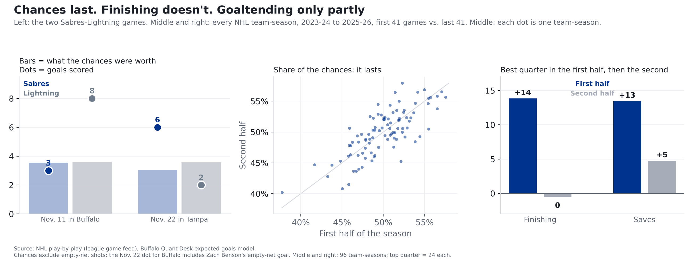

# Sabres 6, Lightning 2: a 9-goal swing from the 8-3 loss, and the chances didn't cause it

**Eleven days ago, Buffalo and Tampa Bay had even chances and Tampa Bay won 8-3. On Sunday, Tampa Bay had more of the chances and Buffalo won 6-2.
That's a 9-goal swing. Tampa Bay's edge in chances actually grew, by half a goal. Finishing and saves made up 8.5 goals of the swing, and an empty-netter one more.
Over the last three seasons, finishing hasn't carried over from one half of a season to the next, and goaltending only partly. Chances have.
And on chances, Buffalo has come out ahead in only 9 of its 24 games.**

*Buffalo at Tampa Bay, Nov. 22. Sabres 10-10-4 (24 points). [Our preview](sabres-lightning-pregame-nov-22.html).*

## Two games, one matchup

| | Nov. 11 in Buffalo | Nov. 22 in Tampa |
|---|---|---|
| Sabres' chances, worth | 3.6 goals | 3.0 goals |
| Lightning's chances, worth | 3.6 goals | 3.6 goals |
| Final | Lightning 8, Sabres 3 | Sabres 6, Lightning 2 |
| Ukko-Pekka Luukkonen | 2.2 goals worse than average (pulled) | 1.6 goals better than average |
| Colten Ellis | 2.2 goals worse than average (in relief) | Didn't play |
| Lightning goalie | Andrei Vasilevskiy: 0.6 goals better than average | Dennis Hildeby: 2.0 goals worse than average |

On Sunday Buffalo scored 5 on Dennis Hildeby, plus an empty-netter, and Tage Thompson scored twice. He has 17, 5th in the NHL.
Luukkonen started both games. On Nov. 11 he allowed 5 on chances worth 2.8 and was pulled. On Sunday he allowed 2 on chances worth 3.6.

## What lasts, and what doesn't

We split every NHL team's season into its first 41 games and its last 41, for the three seasons before this one (96 team-seasons). Then we asked:
does how a team did in the first half tell you how it would do in the second?

**Chances: yes.** The quarter of teams that got the most of the chances in the first half got 54% of them. In the second half they got 53%.
The quarter that got the least got 46%, then 46%.

**Finishing: no.** Take how many more goals a team scored than its chances were worth. The quarter of teams that did best in the first half were 14 goals better
than average. In the second half they were about average. Hot shooting didn't last.

**Saves: a little.** Take how many fewer goals a team's goalies allowed than the other team's chances were worth. The best quarter went from 13 goals better than average
to 5. About a third of it stuck. Teams with good goaltending stayed above average, just not by as much.

**How we measure "chances."** Every shot has a chance of going in, based on where it was taken, what kind of shot it was, and things like rebounds and power plays.
Add them up and you get what a team's chances were worth in goals. Across the last three seasons, the team with more of the chances won 57% of 3,936 games.
More in our story on [last year's 50-win season](sabres-50-win-mirage.html).

## Where that leaves Buffalo

The Sabres have had more of the chances in 9 of their 24 games. Only 8 NHL teams have done it in a smaller share of their games. They won 5 of those 9 and 5 of the other 15.
For the season they get 47.8% of the chances, 22nd of 32. Their chances say they should be about 7 goals behind their opponents. Not counting empty nets, they're 11 behind,
so finishing and goaltending haven't been carrying them. They've cost a few goals.

That's the honest read: Sunday's win was real, but the way they won it isn't something to count on. What would change the outlook is more games like Oct. 6 against Minnesota and Oct. 3 against Chicago,
when Buffalo's chances were worth about two goals more than the other team's.

## The keys, and our call

Of the three keys from our preview: Tampa Bay got one power-play goal (hit), Buffalo scored first but Tampa Bay tied it (missed), and Tampa Bay had more of the five-on-five chances (missed).
One of three, and a four-goal win.

Before the game we logged **a 35% chance the Sabres win** on the [Ledger](../ledger.html). Buffalo won, so the call goes down as a miss. It scores 0.42 on our scorecard,
where 0 is perfect and a coin flip scores 0.25. We're 13 of 21 on graded calls, 5 of 8 on Sabres games. Our model works from chances,
so a night like this one is exactly the kind it gets wrong.

## What's next

The Rangers are in Buffalo on Wednesday. They get 52.7% of the chances this season (9th of 32). Watch whether Buffalo wins that part of the game, not just the score.

## For the stat-heads

- xG: our model, unblocked non-empty-net shots, rescaled per season (2026-27 factor 1.000). Nov. 11 xGF BUF 3.56, TBL 3.59; Nov. 22 BUF 3.05, TBL 3.58.
- GSAx: Nov. 11 Luukkonen -2.21, Colten Ellis -2.20, Andrei Vasilevskiy +0.56; Nov. 22 Luukkonen +1.58, Hildeby -1.95.
- First-half vs second-half repeatability (games 1-41 vs 42-82 by date), 96 team-seasons 2023-24 to 2025-26: xG share r = 0.77; finishing (G - xG) r = 0.10;
  saves (xGA - GA) r = 0.22; all non-empty-net. Quartile examples: top/bottom 25% by first-half value (n = 24). An odd/even split gives lower values for finishing plus saves; first/second half is the more conservative read.
- More-xG team won 0.573 of 3,936 team-games, 2023-24 to 2025-26 (any result; equal xG excluded from "more"). This season xG side agreed with the result in 62.2%.
- BUF 2026-27: xG share 0.478 (22nd); games with more xG 9 of 24 (8 teams lower by rate); GD -10 (incl. empty-net), non-empty-net GD -11, xGD -6.6, finishing + saves -4.4.
- Swing: BUF goal margin -5 then +4; xG margin -0.03 then -0.53; finishing + saves -4.97 then +3.53; empty-net goal +1.
- Keys as in the preview; key 2 graded missed (the preview's wording: no giving it back). Tampa Bay 10-1 at home before the game.
- Data through 2026-11-22; VAN-CHI, not final at publish, excluded (src/reports/pins.py). Ledger P0022: p = 0.35, outcome 1, Brier 0.4225.
