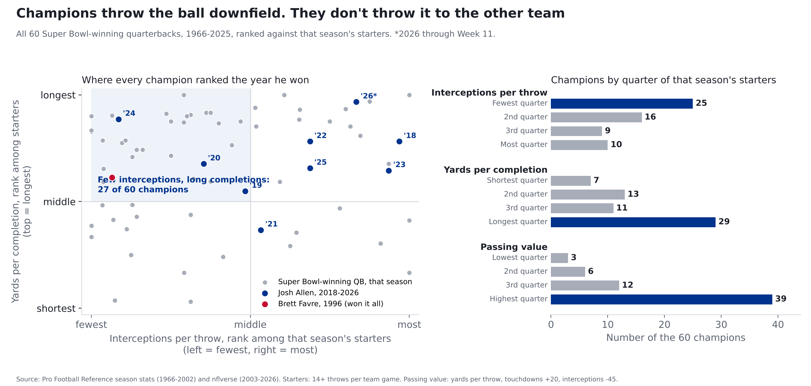

# Is Josh Allen too reckless to win it all? 60 Super Bowl champions say: throw it deep, but don't throw it away

**Allen had a rough day against Miami, and the question came back: is he too much of a gunslinger to win a Super Bowl? We ranked all 60
Super Bowl-winning quarterbacks against the other starters the year they won. Champions weren't timid: 29 of 60 ranked in the top quarter
for how far their completions went. And they protected the ball: 25 were in the quarter with the fewest interceptions, when chance
would put about 15 there. Only 10 were in the quarter with the most. Allen throws downfield like a champion. In 2024 he also protected the ball like one.
This season, his interception rate ranks 6th highest of 31 starters.**

## The Miami game

Measured by how much each of his pass plays helped or hurt Buffalo's chances to score, it was one of Allen's weaker days: only 22% of his
135 career games were worse, and it was his 2nd-worst game this season. He threw 2 interceptions, took 3 sacks
and didn't run once. But by the same measure, 39% of all NFL quarterback games this season have been worse. For most quarterbacks it would have been a normal day.
For Allen it was a dud. That's part of the "reckless" story: the bar is high.

## How we measured it

For every season since 1966, we took every starter (at least 14 throws per team game) and ranked them on three things:

- **Interceptions per throw.** Brett Favre in 1996: 13 interceptions on 543 throws.
- **Yards per completion,** how far his completed passes went. Favre in 1996: 12.0 yards. It's a rough sign of throwing downfield. We checked it against
  the actual distance of every throw since 2018: quarterbacks who rank high on one tend to rank high on the other, but it's a loose match.
- **Passing value:** yards per throw, with each touchdown worth 20 extra yards and each interception costing 45. Favre in 1996: 7.5.

Then we found where each Super Bowl winner ranked the year he won: top quarter, bottom quarter, or in between.
If a stat had nothing to do with winning, about 15 of the 60 champions would land in each quarter.

## What the champions had in common

- **They were efficient.** 39 of 60 ranked in the top quarter for passing value.
- **They threw it downfield.** 29 ranked in the top quarter for yards per completion. Only 7 were in the bottom quarter.
- **They didn't throw many interceptions.** 25 were in the quarter with the fewest. Only 10 were in the quarter with the most.

The most common champion did both: 27 of 60 were better than the middle on interceptions and on completion distance. Only 14 were
careful but short.

**How we checked it.** 7 champions didn't throw enough that season to count as starters, such as Jeff Hostetler, a backup for most of 1990.
We ranked them against the starters anyway. Without them, the pattern is the same: 24 of 53 in the fewest-interceptions quarter, 9 in the most.
The few-interceptions side holds in both halves of Super Bowl history: 14 of the first 30 champions (1966-1995) and
11 of the last 30 (1996-2025), where chance would give 7 or 8. The other side is weaker: 4 of the first 30
were in the most-interceptions quarter, but 6 of the last 30, close to chance. Champions mostly avoided interceptions, but a high
interception rate hasn't kept as many quarterbacks from winning as you might think.

## The gunslingers who won anyway

It does happen. 10 champions won in a year when their interception rate was in the league's top quarter: Bart Starr (1967), Len Dawson (1969), Terry Bradshaw (1979), Phil Simms (1986), Trent Dilfer (2000), Eli Manning (2007), Ben Roethlisberger (2008), Peyton Manning (2015), Matthew Stafford (2021), Sam Darnold (2025).

## Brett Favre

Favre is the classic gunslinger, but his title season wasn't. In 1996 his interception rate was lower than 94% of starters', and his
passing value ranked near the top of the league. In five other seasons (1993, 2003, 2005, 2008, 2010) his interception rate was among the highest 10% of
starters. None of those seasons ended in a title.

## Josh Allen

| Season | Throws | Interceptions | Interception rate, percentile* | Yards per completion, percentile* | Passing value, percentile* |
|---|---|---|---|---|---|
| 2018 | 319 | 12 | 97th | 78th | 3rd |
| 2019 | 461 | 9 | 48th | 55th | 32nd |
| 2020 | 572 | 10 | 35th | 68th | 85th |
| 2021 | 646 | 15 | 53rd | 37th | 47th |
| 2022 | 567 | 14 | 69th | 78th | 81st |
| 2023 | 579 | 18 | 94th | 65th | 52nd |
| 2024 | 483 | 6 | 9th | 89th | 91st |
| 2025 | 460 | 10 | 69th | 66th | 78th |
| 2026 (through Week 11) | 302 | 9 | 83rd | 97th | 77th |

*Percentile among that season's starters: 99th is the top, 50th is the middle. For interceptions, higher means more of them.

Allen's completions have gone farther than the typical starter's in 7 of his 8 full seasons. That's the part he shares with champions.
His interceptions are the part that moves. In 2024 he threw 6 on 483 throws, the 4th lowest rate of 36 starters, and his passing value
ranked near the top. That season looked like a champion's. This season he has 9 interceptions in 302 throws, 6th highest of 31.

## What it means

The data doesn't say Allen is too reckless to win. Champions throw downfield; Allen has done that in 7 of his 8 full seasons. What sets most champions apart is the
other part: they kept the ball away from the defense. Allen has done it before, in 2024. This season he hasn't so far.

## Caveats

- Quarterbacks don't win alone. Defenses, running games and luck matter, and this only looks at the passer.
- Interceptions are a rough stand-in for risky throws. They include tipped balls and miss risky throws that weren't caught.
- Winning teams play with the lead more, and quarterbacks with a lead throw fewer desperate passes. Some of a champion's low interception rate
  comes from being ahead, not only from being careful.
- In the 1960s there were only 9 to 15 starters per league, so a single rank moves a lot.

## For the stat-heads

- Champion QB: the winning team's passer with the most attempts in the Super Bowl box score (Earl Morrall in Super Bowl V, not Johnny Unitas).
  1968-69 champions ranked within the AFL. Ranks are percentiles within season and league among qualifiers (att >= 14 x the most games any team played);
  non-qualifiers (7) are placed within the qualified pool.
- Passing value = PFR adjusted yards per attempt, (yds + 20 TD - 45 INT) / att. It includes interceptions, so it's not independent of the interception rank.
- Sources: PFR season passing tables 1966-2002 (saved, decade totals asserted); nflverse weekly player stats 2003-2026, summed, regular season.
  nflverse is missing 19 team-games in 1999-2002, so PFR is used through 2002. In 1999-2002 the two sources agree exactly on yards, TDs and INTs for
  135 of 136 QB-seasons with the same games played (Jay Fiedler 2001 differs by 42 yards).
- Yards per completion vs. share of throws 20+ air yards, 2018-2025 qualifiers, within-season percentile correlation: 0.42.
- Allen's deep-throw percentile (20+ air yards), 2018-2025: 2018: 100%, 2019: 88%, 2020: 66%, 2021: 45%, 2022: 79%, 2023: 88%, 2024: 94%, 2025: 48%.
- Miami game: Allen EPA per dropback -0.032 on 48 dropbacks (scrambles included); his career regular-season games with 15+ dropbacks: 135
  (league QB games with 15+ dropbacks this season: 330).
- Chance check (binomial, p = 0.25, n = 60): 25+ in the fewest-interceptions quarter, p = 0.003; 10 or fewer in the most, p = 0.09;
  29+ in the longest-completions quarter, p = 8e-05.
- Percentiles: share of the other qualified starters that season below the player (ties count half). Quarter boundaries are inclusive at 25% and 75%;
  3 champions sit exactly on one (Joe Namath 1968, Ken Stabler 1976, Jim McMahon 1985). With strict boundaries the interception
  counts are 23/18/9/10 instead of 25/16/9/10. The direction holds either way.
- Data pins: nflverse weekly stats 1999-2026 (week <= 11) attempts and yards (479872, 3367804); 2026 play-by-play fingerprint (28141, -186.8888).
