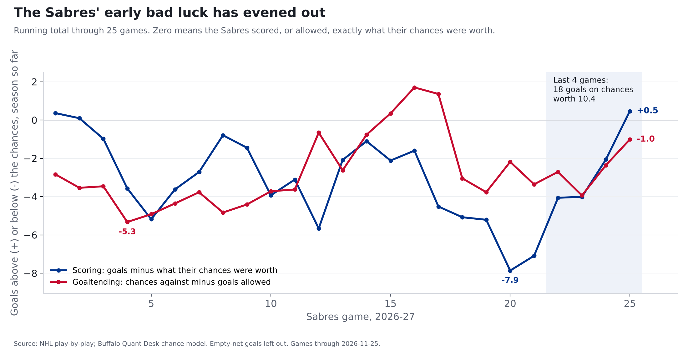

# Sabres 5, Rangers 1: 20 goals in four games, and the early bad luck has evened out

**The chances were close to even on Wednesday: the Sabres' shots were worth 2.5 goals and the Rangers' 2.3. Buffalo scored 5.
That's the fourth game of a run in which the Sabres have gone 3-1 and scored 20 goals. Leaving out 2
empty-net goals, that's 18 on chances worth about 10. It isn't a new team. Through the first 21 games they scored 57 goals on chances worth 64 and allowed 72 on
chances worth 69. The last four games paid most of that back. What's left is the part that lasts: the Sabres get 48% of the
chances in their games, 22nd in the NHL.**

## The game

Both teams had 30 shots on goal. Buffalo's goals came from Rasmus Dahlin, Josh Norris, Zach Benson, Jack Quinn and Jiri Kulich. New York's lone goal was Vladislav Gavrikov's shot from 56 feet,
a chance worth about 2% of a goal. Ukko-Pekka Luukkonen stopped everything else, about 1.3 goals better than the chances he faced.

At the other end, the Rangers started Joonas Korpisalo instead of their usual starter, Dylan Garand (16 games). Korpisalo had saved about 2.8 goals more than expected in his first 3 games.
On Wednesday he allowed 5 on chances worth 2.5.

## How we count chances

Every unblocked shot gets a value: the share of similar shots that go in, based on distance, angle, shot type and whether it's a rebound or rush.
Buffalo's closest goal came from 13 feet, a chance worth about 12%. Add up a team's shots and you get what its chances
were worth in goals. Score more than that and you finished well; allow fewer and your goalie saved some.

## The season, evened out

| | Games | Goals | Chances worth | Goals allowed | Chances against worth |
|---|---|---|---|---|---|
| First 21 games | 21 | 57 | 64.1 | 72 | 68.6 |
| Last 4 games | 4 | 18 | 10.4 | 10 | 12.3 |

*Goals in the table leave out empty-net goals.*

Over the whole season, the Sabres have now scored 0.5 more goals than their chances were worth, and their goalies
have allowed 1.0 more than expected. Both are close to zero.
That's why the record, 11-10-4, looks like a team that gets a little less than half the chances.

## What to expect

Finishing and goaltending streaks come and go; we showed in the [Tampa recap](sabres-lightning-postgame-nov-22.html) that a team's chances carry over far better than either. The Sabres'
chance share, 48%, is 22nd in the league. Expect them to look like that team, a little below average, rather than the one that
scored 20 in four games.

## Receipts

- **Our preview** said the Rangers' finishing (30th in the NHL) probably wouldn't last. It lasted one more night: 1 goal on
  chances worth 2.3. It said their goaltending would probably cool off. It did, though with Korpisalo, not Garand, in net: 5 goals allowed.
- **The Ledger** gave the Sabres 49%. They won, so the call leaned the wrong way and counts as a miss, though the chances themselves came out
  close to even. Its score was 0.26, about what a coin flip earns. Our record is 13 of 22.

## For the stat-heads

- xG model: unblocked non-empty-net shots, rescaled so 2026-27 league xG equals league goals through 2026-11-25 (factor 1.001).
- Game: xGF 2.47, xGA 2.35; all situations. Korpisalo GSAx -2.53 on the night, +2.79 in 3 games before it.
- Season (25 games): xGF% 0.479 (22nd); finishing (G - xG) +0.02 per game (15th); GSAx -0.04 per game (18th).
- Ledger P0023: p = 0.49, outcome 1, Brier 0.2601. "Right" = the side above 50% won.
