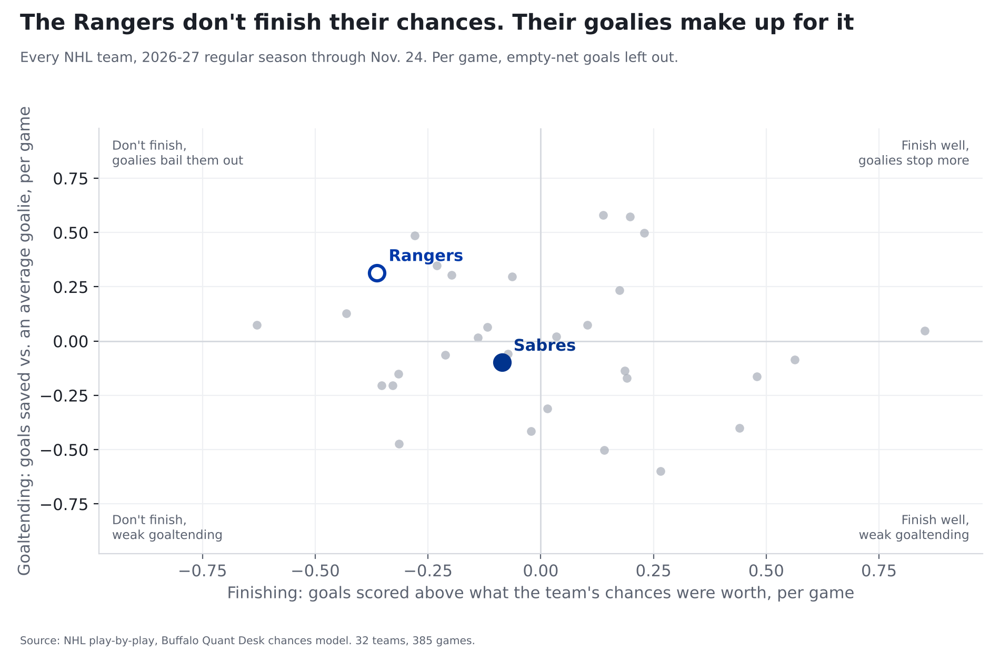

# Sabres vs. Rangers: New York can't finish its chances, and that probably won't last

**The Rangers get 53% of the chances in their games, 9th in the NHL. Buffalo gets 48%, 22nd. What the Rangers don't do is finish:
they've scored about 8 fewer goals than their chances were worth, 30th of 32. Their goalies have made up for it, saving about 7 more than an
average goalie would (6th per game). Over the last three seasons, bad finishing hasn't lasted, so the Rangers should score more than they have. Their goaltending will probably cool off some too.
Our model gives the Sabres 49% tonight.**

*Rangers at Sabres, Wednesday, Nov. 25, 7 p.m. ET. Sabres 10-10-4 (24 points), Rangers 13-9-1 (27 points), through Nov. 24.*

## The Rangers' two-sided season

**Finishing.** Every shot has a chance of going in, based on where it was taken, what kind of shot it was, and things like rebounds and power plays.
This season, a shot from within 10 feet has gone in about 13% of the time; one from 40 feet or more, about 2%. Add those up and you get
what a team's chances were worth. The Rangers' chances have been worth about 69 goals this season; they've scored 61 (not counting empty nets).
Only 2 teams have finished worse. Pavel Dorofeyev has the biggest gap on the team: 6 goals on chances worth about 9.

**Goaltending.** Dylan Garand has played in 16 of their 23 games, Igor Shesterkin in 5. Both have been better than average.

## Why that matters: what lasts

In Sunday's [Tampa Bay recap](sabres-lightning-postgame-nov-22.html), we split every NHL team's season from the last three years (96 team-seasons) into its first 41 games
and its last 41. Finishing didn't carry over; goaltending partly did. The same split, for the teams in the Rangers' spot:

- **Teams in the bottom quarter for finishing** in the first half were about 12 goals below average. In the second half, about 2 below.
- **Teams in the top quarter for saves** in the first half were about 13 goals better than average. In the second half, still 5 better.

If the Rangers follow that pattern, their shooting comes around and their goaltending stays good, just not this good. Right now the two nearly cancel out: about
8 goals missed, about 7 saved. Finishing is what tends to bounce back, so the bigger change from here is more Rangers goals. It won't necessarily show up in one game. Buffalo, for its part, finishes and saves at about an average rate (19th and 20th).

## Who to watch

- **Tage Thompson** has 17 goals, 5th in the NHL.
- **Alexis Lafrenière** leads the Rangers with 10 goals.
- **Buffalo at home:** the Sabres are 4-6-0 in Buffalo this season. The Rangers are 4-6-1 on the road.
- **Rest:** both teams last played Sunday.

## In goal

Goals saved compared with an average goalie facing the same shots. Positive is good. Goalies with three or more games.

| Team | Goalie | Games | Save % | Goals saved vs. average |
|---|---|---|---|---|
| Sabres | [Ukko-Pekka Luukkonen](../cards/ukko-pekka-luukkonen.html) | 14 | 87.8% | -0.5 (38th of 79) |
| Sabres | [Colten Ellis](../cards/colten-ellis.html) | 8 | 87.3% | -0.3 (35th of 79) |
| Sabres | [Alex Lyon](../cards/alex-lyon.html) | 4 | 89.0% | -1.5 (48th of 79) |
| Rangers | [Dylan Garand](../cards/dylan-garand.html) | 16 | 90.9% | +2.3 (19th of 79) |
| Rangers | [Igor Shesterkin](../cards/igor-shesterkin.html) | 5 | 92.7% | +5.0 (12th of 79) |
| Rangers | [Joonas Korpisalo](../cards/joonas-korpisalo.html) | 3 | 94.0% | +2.8 (18th of 79) |

Ranks are among all 79 goalies this season. Starters weren't confirmed when we published.

## Our prediction: Sabres 49%, Rangers 51%

**Logged on the [Ledger](../ledger.html) at 2026-11-25 14:42:57 UTC, before puck drop.** It gets graded after the game, hit or miss.

Our model expects about **3.1 goals for Buffalo and 3.2 for New York**, with about a 16% chance the game is tied after 60 minutes. It works from each team's chances
this season, blended with last season's, plus home ice. It rates the Rangers a little ahead, even on the road, because they've gotten more of the chances. It doesn't count finishing or goaltending, so it already treats the Rangers as average shooters with average goalies.
Last season Buffalo won 2 of the 3 games between them.

## For the stat-heads

- xG: our model on unblocked, non-empty-net shots, rescaled per season (2026-27 factor 1.001). Data through 2026-11-24 (385 games).
- Goalie games are appearances, including relief. Player goal totals are official, including empty-net goals (Alexis Lafrenière 2 of 10, Thompson 0 of 17).
- Net NYR finishing + saves -1.1. Share kept in the second half: worst-finishing quarter 14%, best-goaltending quarter 35%. NYR saves rank by season total: 7.
- NYR: xG share 0.527 (9); G - xG -8.4 (-0.36/gp, 30); xGA - GA +7.2 (+0.32/gp, 6).
  BUF: share 0.478 (22); G - xG -2.1 (19); xGA - GA -2.4 (20).
- Split-half (games 1-41 vs 42-82), 2023-24 to 2025-26, 96 team-seasons: bottom-quartile first-half finishing -11.9 -> -1.7 (n 24);
  top-quartile first-half saves +13.4 -> +4.8 (n 24).
- Win chance: NHL game model nhl-game-v0.1, ratings from games through 2026-11-24. Goals = -0.254 + 1.032 x expected + 0.272 x home; independent Poisson;
  regulation ties to home at 0.545. No goalie, finishing or rest term.
