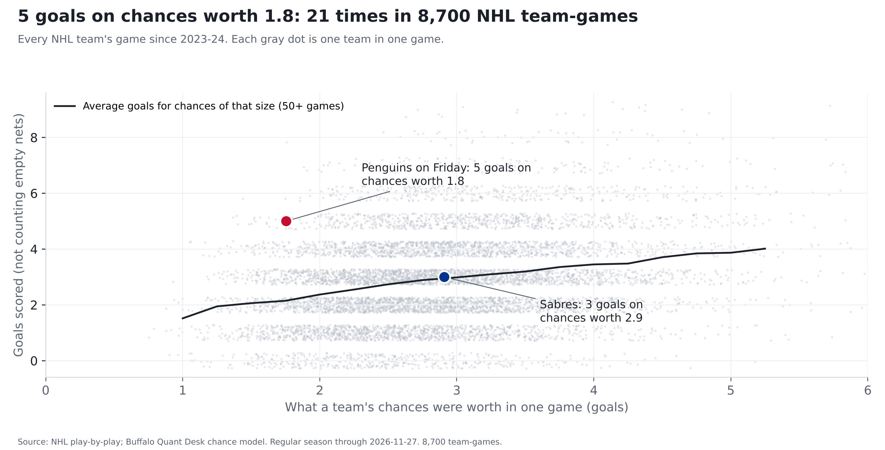

# Penguins 6, Sabres 3: Pittsburgh's finishing came back all at once

**Buffalo had the better chances on Friday, worth about 2.9 goals to Pittsburgh's 1.8. The Penguins scored 5 anyway, plus an empty-netter.
Since 2023-24, a team has scored 5 or more on chances worth 1.8 or less only 21 times in 8,700 team-games, about once every
414. Our preview said Pittsburgh's poor finishing probably wouldn't last. It didn't take long. Our call, Sabres 51%, was a miss.**

## The game

Buffalo had 36 unblocked shots to Pittsburgh's 32, and 62% of the chances. Buffalo's goals came from Jiri Kulich, Rasmus Dahlin and Josh Norris;
Josh Norris's came from 2 feet, a chance worth about 48%.

Pittsburgh's five: Ben Kindel from 18 feet (4%); Kris Letang from 43 feet (5%); Rutger McGroarty from 11 feet (12%); Blake Lizotte from 31 feet (12%); Ville Koivunen from 26 feet (12%). The percentages are each shot's chance of going in. Evgeni Malkin added an empty-netter late.

**In goal:** Ukko-Pekka Luukkonen allowed 4 goals on 12 unblocked shots worth about 0.6 and was replaced after Lizotte's goal, 3:15 into the 2nd period.
Alex Lyon allowed 1 on 20 shots worth about 1.2. Sergei Murashov was in net for Pittsburgh and allowed 3 on chances worth 2.9, about what an average goalie would.

## How rare that is

Every shot that isn't blocked gets a value: the share of similar shots that go in, based on distance, angle, shot type and whether it's a rebound or rush.
Add them up and you get what a team's chances were worth. Teams with chances worth about 1.8 (within a quarter-goal) have scored 2.1 goals on average.
Pittsburgh scored 5. The chart shows every team-game since 2023-24; only 21 had 5 or more goals on chances worth 1.8 or less, and 5 of them, counting Friday, are Pittsburgh's.

**How we checked it.** The shot values are scaled each season so that, across the league, chances add up to goals. And the 41-shot example in our preview,
Blake Lizotte with no goals on chances worth about 3, scored on Friday from 31 feet, a chance worth about 12%. That's what finishing luck looks like
when it turns.

## What it means

One game doesn't change much. Buffalo gets 48% of the chances in its games, 21st in the NHL, and that's the number that carries forward.
Pittsburgh is still 25th in finishing after Friday; one big night only moves a season so far. The Sabres are 11-11-4.

## Receipts

- **Our preview** said Pittsburgh's finishing and goaltending would probably come back toward average, and that it wouldn't necessarily show up in one game.
  The finishing showed up in one game, though one game is mostly luck either way. Murashov had an average night. We'll keep tracking both over the season.
- **The Ledger** gave the Sabres 51%. They lost, so it's a miss. On our scorecard, where 0 is perfect and a coin flip scores 0.25, it scored 0.26.
  Our record is 15 of 25.

## For the stat-heads

- xG model: unblocked non-empty-net shots, rescaled per season so league xG equals league goals through 2026-11-27 (2026-27 factor 1.003).
- Game, all situations: xGF 2.91, xGA 1.76 (xGF% 0.624). Luukkonen GSAx -3.42, Lyon +0.18.
- Rarity: team-games 2023-24 on with non-empty-net G >= 5 and xG <= 1.755: 21 of 8,700 (PIT 5). Mean G for xG within 0.25: 2.15 (n 949).
- Season: BUF xGF% 0.483 (21st); PIT finishing -0.20 per game (25th), GSAx -0.28 per game (27th).
- Ledger P0026: p = 0.51, outcome 0, Brier 0.2601. "Right" = the side above 50% won.
