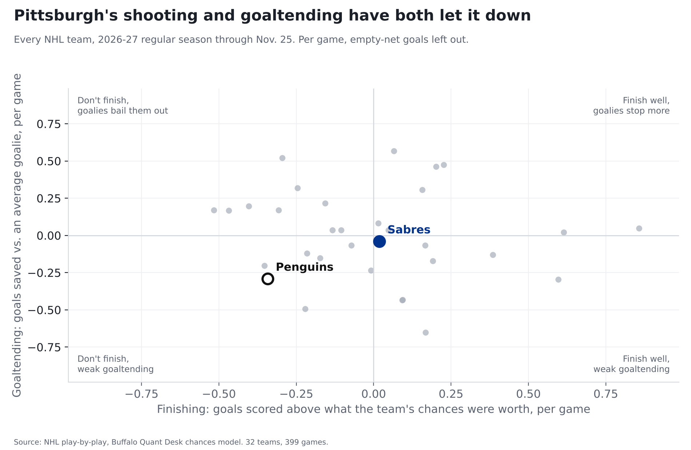

# Sabres vs. Penguins: Pittsburgh is better than its record

**The Penguins have 16 points, 2nd-fewest in the NHL. But they get 50% of the chances in their games, 14th in the league,
more than Buffalo (48%, 22nd). What has sunk them is finishing and goaltending: they've scored about 8 fewer goals than their chances were worth
(28th of 32), and their goalies have allowed about 7 more than an average goalie would (27th). Over the last three seasons, bad finishing and bad goaltending have mostly not lasted.
Our model, which looks at chances, not finishing or goaltending, calls tonight close to even: Sabres 51%.**

*Penguins at Sabres, Friday, Nov. 27, 8 p.m. ET. Sabres 11-10-4 (26 points), Penguins 7-15-2 (16 points), through Nov. 25.*

## Where Pittsburgh's season went wrong

**Finishing.** Every shot has a chance of going in, based on where it was taken, what kind of shot it was, and things like rebounds and power plays.
This season, a shot from within 10 feet has gone in about 14% of the time; one from 40 feet or more, about 2%. Add those up and you get
what a team's chances were worth. The Penguins' chances have been worth about 74 goals this season; they've scored 66 (not counting empty nets).
Only 4 teams have finished worse. Blake Lizotte has the biggest gap on the team: 0 goals on chances worth about 3, from 41 shots, a small sample.

**Goaltending.** Arturs Silovs has played in 15 of their 24 games, Sergei Murashov in 9. Both have allowed more goals than an average goalie would have on the same shots.

Put together, that's about 15 goals lost to finishing and goaltending in 24 games.

## What usually happens next

In the [Tampa Bay recap](sabres-lightning-postgame-nov-22.html), we split every NHL team's season from the last three years (96 team-seasons) into its first 41 games
and its last 41. For the teams in Pittsburgh's spot:

- **Teams in the bottom quarter for finishing** in the first half were about 12 goals below average. In the second half, about 2 below.
- **Teams in the bottom quarter for goaltending** in the first half were about 14 goals worse than average. In the second half, about 2 worse.

So if the Penguins follow the pattern, the finishing comes around. So, mostly, does the goaltending. It won't necessarily show up in one game. Buffalo, for its part, finishes and saves at about an average rate (15th and 18th).

## Who to watch

- **Tage Thompson** has 17 goals, 5th in the NHL.
- **Tommy Novak and Rickard Rakell** lead the Penguins with 9 goals each.
- **Buffalo at home:** the Sabres are 5-6-0 in Buffalo this season. The Penguins are 3-9-1 on the road.
- **Rest:** both teams last played Wednesday.

## In goal

Goals saved compared with an average goalie facing the same shots. Positive is good. Goalies with three or more games.

| Team | Goalie | Games | Save % | Goals saved vs. average |
|---|---|---|---|---|
| Sabres | [Ukko-Pekka Luukkonen](../cards/ukko-pekka-luukkonen.html) | 15 | 88.5% | +0.8 (28th of 79) |
| Sabres | [Colten Ellis](../cards/colten-ellis.html) | 8 | 87.3% | -0.3 (40th of 79) |
| Sabres | [Alex Lyon](../cards/alex-lyon.html) | 4 | 89.0% | -1.5 (50th of 79) |
| Penguins | [Arturs Silovs](../cards/arturs-silovs.html) | 15 | 87.4% | -4.1 (65th of 79) |
| Penguins | [Sergei Murashov](../cards/sergei-murashov.html) | 9 | 89.1% | -2.9 (58th of 79) |

Ranks are among all 79 goalies this season. Starters weren't confirmed when we published.

## Our prediction: Sabres 51%, Penguins 49%

**This is our model's number.** It counts once it's logged on the [Ledger](../ledger.html) before puck drop; every logged call is graded after the game, hit or miss.

Our model expects about **3.3 goals for Buffalo and 3.3 for Pittsburgh**, with about a 16% chance the game is tied after 60 minutes. It works from each team's chances
this season, blended with last season's, plus home ice. Pittsburgh gets more of the chances; Buffalo has home ice; the two about cancel out. The model doesn't count finishing or
goaltending, so it already treats the Penguins as average shooters with average goalies, which is the bounce-back the history above points to.
Last season Buffalo won 1 of the 3 games between them.

## For the stat-heads

- xG: our model on unblocked, non-empty-net shots, rescaled per season (2026-27 factor 1.001). Data through 2026-11-25 (399 games; none on Nov. 26).
- Goalie games are appearances, including relief. Player goal totals are official, including empty-net goals (Novak and Rakell 0 of 18 combined, Thompson 0 of 17).
- PIT: xG share 0.504 (14); G - xG -8.2 (-0.34/gp, 28); xGA - GA -7.0 (-0.29/gp, 27); net -15.2.
  BUF: share 0.479 (22); G - xG +0.5 (15); xGA - GA -1.0 (18).
- Split-half (games 1-41 vs 42-82), 2023-24 to 2025-26, 96 team-seasons: bottom-quartile first-half finishing -11.9 -> -1.7 (n 24);
  bottom-quartile first-half saves -14.0 -> -1.8 (n 24).
- Win chance: NHL game model nhl-game-v0.1, ratings from games through 2026-11-25. Goals = -0.254 + 1.032 x expected + 0.272 x home; independent Poisson;
  regulation ties to home at 0.545. No goalie, finishing or rest term.
