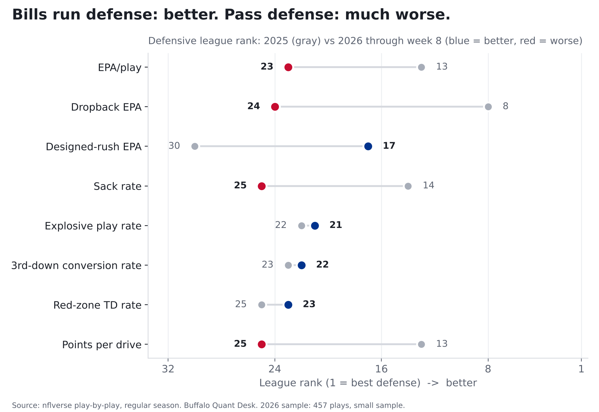
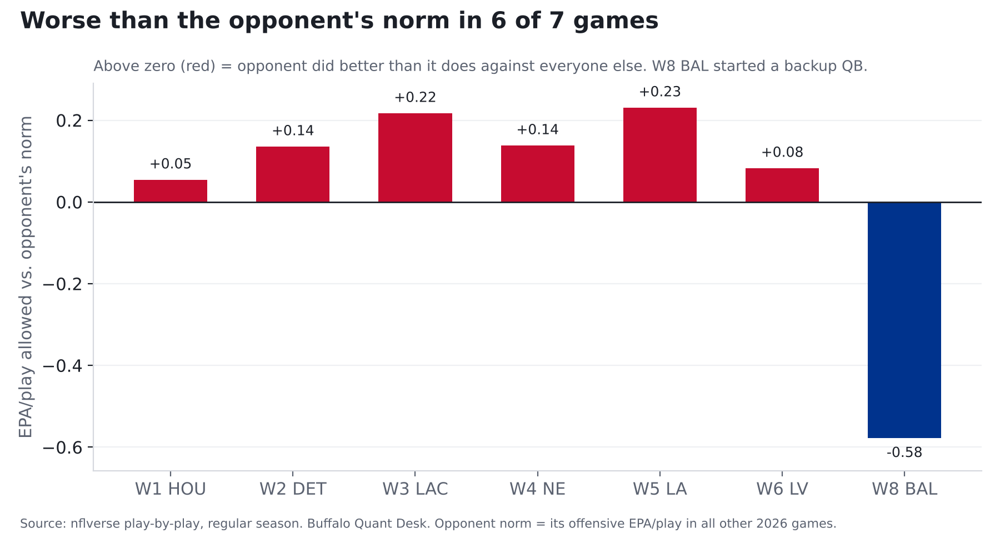

# Is the Bills defense actually fixed?

**Finding: Jim Leonhard's 3-4 lifted the run defense from 30th to 17th but the pass defense
fell from 8th to 24th, and the Bills have been worse
than their opponent's norm in 6 of 7 games.**

*Through 2026 week 8. Regular season. 457 defensive plays in 2026: small sample.*

## The short version

The run defense got better. The pass defense got a lot worse, the pass rush is down from last year,
and the one dominant game came against a Baltimore backup quarterback.

## 2025 vs 2026, every metric

Unfiltered unless labeled. League rank in parentheses (1 = best defense).

| Metric | 2025 | 2026 to date | 2026 league avg |
|---|---|---|---|
| EPA/play | -0.015 (13) | +0.063 (23) | +0.001 |
| EPA/play (neutral WP 10-90%) | +0.005 (15) | +0.047 (20) | +0.006 |
| Success rate | 42.5% (12) | 46.0% (26) | 43.5% |
| Dropback EPA | -0.067 (8) | +0.141 (24) | +0.054 |
| Designed-rush EPA | +0.053 (30) | -0.077 (17) | -0.079 |
| Sack rate | 6.8% (14) | 5.1% (25) | 6.2% |
| Explosive play rate | 10.0% (22) | 9.4% (21) | 8.6% |
| Turnover rate | 2.1% (9) | 2.0% (15) | 1.9% |
| 3rd-down conversion rate | 41.4% (23) | 42.4% (22) | 39.8% |
| Red-zone TD rate | 68.3% (25) | 68.8% (23) | 63.4% |
| Points per drive | 2.09 (13) | 2.38 (25) | 2.10 |

## Opponent-adjusted, week by week

Each game compared with what that opponent's offense does in all its *other* 2026 games.

| Week | Opp | Plays | EPA/play allowed | Opp norm | Difference |
|---|---|---|---|---|---|
| 1 | HOU | 73 | +0.069 | +0.015 | +0.054 |
| 2 | DET | 62 | +0.232 | +0.097 | +0.135 |
| 3 | LAC | 64 | -0.071 | -0.288 | +0.217 |
| 4 | NE | 71 | +0.179 | +0.041 | +0.138 |
| 5 | LA | 78 | +0.246 | +0.015 | +0.230 |
| 6 | LV | 61 | +0.095 | +0.013 | +0.082 |
| 8 | BAL | 48 | -0.497 | +0.082 | -0.578 |

Season opponent-adjusted EPA/play: **+0.068 (24th)**, vs.
+0.000 (15th) in 2025. Pass defense adjusted:
20th in 2026 vs. 10th in 2025.

Week 8 Baltimore dropbacks by passer: J.Fagnano 24, T.Huntley 5, L.Jackson 1.

## Checked a second way

The pass-defense drop could be an artifact of EPA modeling, so here it is without EPA,
straight from raw play-by-play:

| Pass defense (no EPA) | 2025 | 2026 |
|---|---|---|
| Yards per dropback allowed | 5.50 (4) | 6.36 (17) |
| Dropback success rate allowed | 41.9% (6) | 47.8% (24) |

Same story both ways.

## Method and caveats

- Plays: `pass == 1 or rush == 1`, EPA not null, run/pass play types only; kneels, spikes, two-point tries excluded.
- Neutral = win probability 10-90%. Explosive = pass 20+ or rush 10+ yards. Points per drive uses TD = 7, FG = 3.
- Opponent adjustment uses in-season numbers (6+ weeks exist), excluding the Bills game itself.
- Seven games. Rankings this early move a lot week to week; the direction is the claim, not the decimal.
