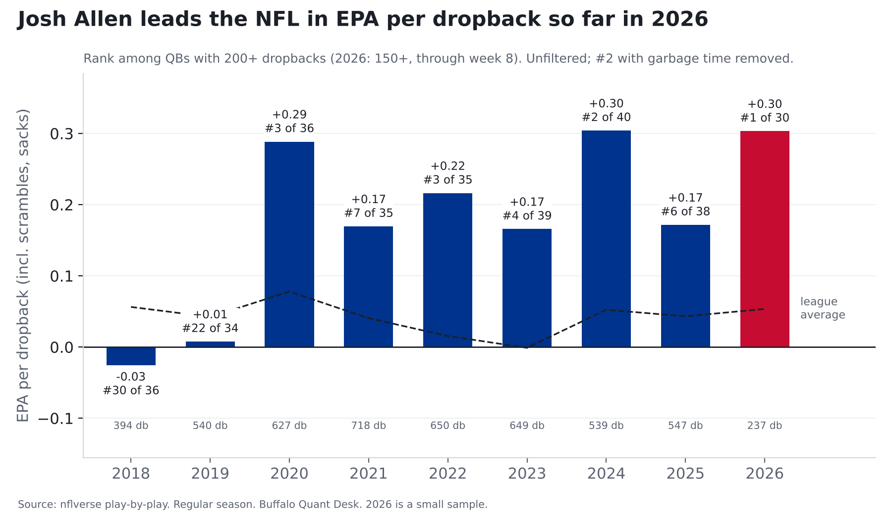
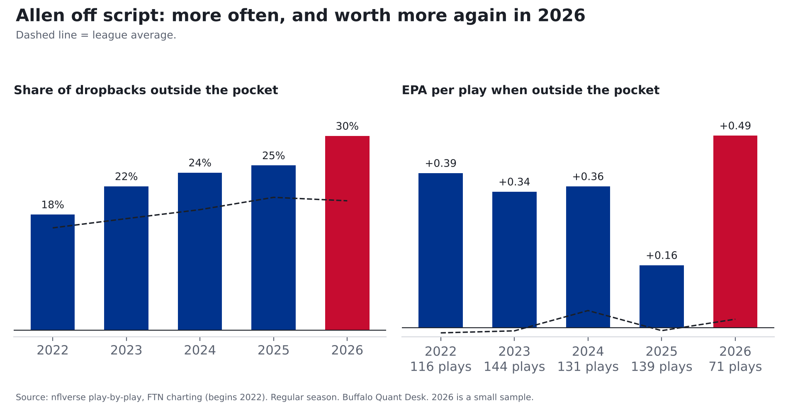
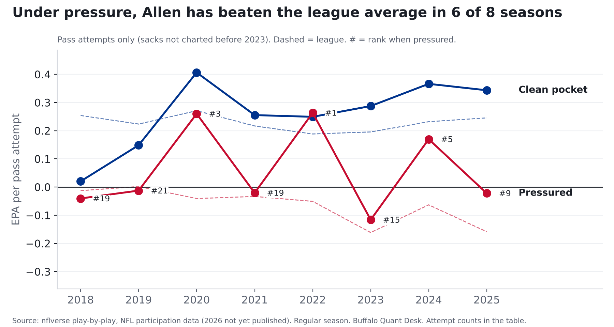
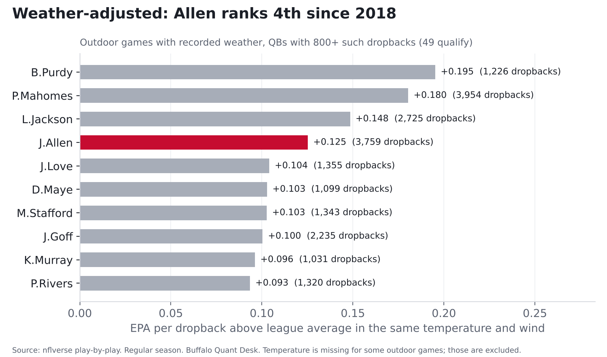

# Josh Allen, 2018 to now: what the data actually says

**Finding: Through week 8, Josh Allen leads the NFL in EPA per dropback (+0.303, unfiltered), narrowly
ahead of B.Purdy (+0.287). With garbage time removed he ranks #2. He is leaving the
pocket more than ever, and those plays are working again after a down 2025.**

*All QB numbers are per dropback, including scrambles and sacks, unless labeled. Regular season only.
2026 is 237 dropbacks through week 8: small sample.*

## The short version

1. **Best start in the league, by a hair.** +0.303 EPA per dropback leads 30 qualifying QBs,
   +0.016 ahead of B.Purdy. With win probability limited to 10-90% (garbage time out)
   he is #2 (+0.274), behind C.Williams (+0.336 on 158).
2. **In raw EPA, every coaching era has been better than the last.** +0.130 under Daboll,
   +0.199 under Dorsey, +0.222 with Brady calling plays as OC, and
   +0.303 with Brady still calling plays as head coach (7 games so far). Relative to the league,
   the edge is +0.076, +0.191,
   +0.183 and +0.250, so the Brady-OC years were about level with Dorsey's.
3. **Off script, it's working again.** 30% of his dropbacks are outside the pocket (5th-most;
   league 20%), worth +0.49 EPA per play on 71 plays
   (league +0.02; 2nd behind D.Maye). In 2025 those plays were worth +0.16.
4. **2025's dip was mostly sacks.** Counting sacks, his rank when pressured fell from #1 to
   #15. On pass attempts alone it went from #5 to #9, and his sack rate rose
   from 2.6% to 7.3% (league 6.5%).
5. **Weather doesn't slow him down relative to the league.** Weather-adjusted he ranks **4th of 49**
   since 2018. Below freezing his edge over the league is +0.139, similar to his +0.110 in all warmer
   outdoor games, on a small sample (398 dropbacks in 12 games).

## 1. Season by season, and by coaching era

| Season | Dropbacks | EPA/db | League avg | Rank |
|---|---|---|---|---|
| 2018 | 394 | -0.025 | +0.056 | #30 of 36 |
| 2019 | 540 | +0.008 | +0.042 | #22 of 34 |
| 2020 | 627 | +0.289 | +0.078 | #3 of 36 |
| 2021 | 718 | +0.169 | +0.040 | #7 of 35 |
| 2022 | 650 | +0.216 | +0.015 | #3 of 35 |
| 2023 | 649 | +0.166 | -0.001 | #4 of 39 |
| 2024 | 539 | +0.304 | +0.052 | #2 of 40 |
| 2025 | 547 | +0.172 | +0.043 | #6 of 38 |
| 2026 | 237 | +0.303 | +0.053 | #1 of 30 |

Staff eras: Daboll as OC (2018-21); Dorsey as OC (2022 to week 10 of 2023; fired Nov. 14, 2023); Brady as OC
(week 11 of 2023 through 2025); Brady as head coach, still calling plays, with Pete Carmichael as a non-play-calling
OC (2026). The last two eras have the same play-caller.

| Era | Games | Dropbacks | EPA/db | League EPA/db | Success | CPOE | Avg depth of target | Sack rate | Out of pocket | Play action |
|---|---|---|---|---|---|---|---|---|---|---|
| Daboll OC 2018-21 | 61 | 2,279 | +0.130 | +0.054 | 48.8% | +1.1 | 9.0 | 5.2% | n/a | n/a |
| Dorsey OC 2022-23 wk10 | 26 | 1,038 | +0.199 | +0.008 | 52.8% | +3.6 | 8.9 | 4.4% | 19.7% | 19.1% |
| Brady OC 2023 wk11-25 | 39 | 1,347 | +0.222 | +0.040 | 48.7% | +1.9 | 8.1 | 4.8% | 24.2% | 20.6% |
| Brady HC + play-caller 2026 | 7 | 237 | +0.303 | +0.053 | 48.1% | +4.0 | 9.0 | 5.5% | 30.0% | 26.6% |

The 2026 offense throws deeper than Brady's OC version (average depth of target 9.0 yards vs
8.1) and uses more play action (27% vs 21%).

## 2. Off script

| Season | Dropbacks | Out of pocket | League | Out-of-pocket plays | EPA out of pocket | League | EPA in pocket |
|---|---|---|---|---|---|---|---|
| 2022 | 650 | 17.8% | 15.8% | 116 | +0.392 | -0.013 | +0.178 |
| 2023 | 649 | 22.2% | 17.2% | 144 | +0.345 | -0.008 | +0.115 |
| 2024 | 539 | 24.3% | 18.6% | 131 | +0.358 | +0.044 | +0.287 |
| 2025 | 547 | 25.4% | 20.5% | 139 | +0.159 | -0.007 | +0.176 |
| 2026 | 237 | 30.0% | 20.0% | 71 | +0.487 | +0.022 | +0.225 |

He is out of the pocket a bit more often, but frequency isn't what changed: holding his 2025 per-play values fixed,
the extra 5% of plays outside the pocket adds essentially nothing (-0.001 EPA per dropback).
The jump is in what those plays are worth, on 71 plays so far.

## 3. Under pressure

The NFL's participation data does not chart sacks and scrambles before 2023, so the most consistent long-run view
available uses **pass attempts only**. Pressure charting itself also changed in 2023 (league pressure rates drop), so
compare ranks and gaps to the league within a season rather than raw levels across years.

| Season | Attempts | Pressured attempts | EPA clean | League | EPA pressured | League | Rank pressured |
|---|---|---|---|---|---|---|---|
| 2018 | 319 | 107 | +0.020 | +0.254 | -0.041 | -0.013 | #19 of 34 |
| 2019 | 458 | 122 | +0.148 | +0.223 | -0.013 | +0.002 | #21 of 34 |
| 2020 | 572 | 198 | +0.406 | +0.271 | +0.260 | -0.041 | #3 of 36 |
| 2021 | 646 | 194 | +0.255 | +0.217 | -0.021 | -0.033 | #19 of 35 |
| 2022 | 566 | 154 | +0.249 | +0.188 | +0.263 | -0.051 | #1 of 34 |
| 2023 | 577 | 136 | +0.287 | +0.195 | -0.116 | -0.162 | #15 of 35 |
| 2024 | 482 | 115 | +0.366 | +0.232 | +0.170 | -0.063 | #5 of 40 |
| 2025 | 459 | 84 | +0.343 | +0.245 | -0.022 | -0.159 | #9 of 38 |

He has beaten the league's pressured average in 6 of 8 seasons (every season since 2020).
Career, pass attempts: +0.274 clean, +0.076 pressured (league +0.228 / -0.060).

From 2023, sacks are charted, so here is the full-dropback view:

| Season | Dropbacks | Pressured | EPA pressured | Rank |
|---|---|---|---|---|
| 2023 | 649 | 183 | -0.215 | #4 of 39 |
| 2024 | 539 | 151 | +0.066 | #1 of 40 |
| 2025 | 547 | 146 | -0.382 | #15 of 38 |

**How much should we read into 2025?** On pass attempts, how a QB does under pressure carries over less from year to
year than clean-pocket play (0.24 vs 0.37 correlation across 182 QB season-pairs since
2018), though the gap is not statistically firm. Sack rate is more stable (0.46 league-wide across
209 pairs), and sacks drove his 2025 dip, so that part deserves more weight.
2026 pressure data has not been published yet.

| Season | Allen sack rate | League |
|---|---|---|
| 2018 | 7.1% | 6.5% |
| 2019 | 7.0% | 6.4% |
| 2020 | 4.1% | 5.7% |
| 2021 | 3.6% | 6.0% |
| 2022 | 5.1% | 6.4% |
| 2023 | 3.7% | 6.8% |
| 2024 | 2.6% | 6.5% |
| 2025 | 7.3% | 6.5% |
| 2026 | 5.5% | 6.2% |

## 4. Weather

Outdoor games with recorded weather. Each dropback is compared with the league average in the same temperature and wind band.

| Temperature | Games | Allen dropbacks | Allen EPA | League EPA | Allen edge |
|---|---|---|---|---|---|
| 32F and below | 12 | 398 | +0.162 | +0.023 | +0.139 |
| 33-45 | 25 | 868 | +0.095 | +0.003 | +0.093 |
| 46-60 | 25 | 965 | +0.131 | +0.044 | +0.086 |
| 61-75 | 27 | 992 | +0.228 | +0.055 | +0.173 |
| 76+ | 14 | 536 | +0.144 | +0.057 | +0.087 |

| Wind | Games | Allen dropbacks | Allen EPA | League EPA | Allen edge |
|---|---|---|---|---|---|
| 0-9 mph | 56 | 2,025 | +0.197 | +0.059 | +0.137 |
| 10-14 | 26 | 945 | +0.087 | +0.011 | +0.076 |
| 15+ | 21 | 789 | +0.122 | -0.008 | +0.130 |

His edge holds in every temperature band. The biggest is in mild weather (61-75F); the sub-freezing sample
(12 games) is too small to rank the bands against each other.

| Rank | QB | Outdoor dropbacks | EPA above same-conditions average |
|---|---|---|---|
| 1 | B.Purdy | 1,226 | +0.195 |
| 2 | P.Mahomes | 3,954 | +0.180 |
| 3 | L.Jackson | 2,725 | +0.148 |
| 4 | J.Allen | 3,759 | +0.125 |
| 5 | J.Love | 1,355 | +0.104 |
| 6 | D.Maye | 1,099 | +0.103 |
| 7 | M.Stafford | 1,343 | +0.103 |
| 8 | J.Goff | 2,235 | +0.100 |
| 9 | K.Murray | 1,031 | +0.096 |
| 10 | P.Rivers | 1,320 | +0.093 |

The 4th-place ranking holds across reasonable choices (3rd with a 1,500 or 2,000 dropback minimum; 5th for 2018-25
only; 5th unadjusted). Temperature is missing for some outdoor games in the source data, mostly 2022 and 2026;
427 Allen outdoor dropbacks are excluded for that reason.

By roof type: fixed dome: +0.419 in 11 games (league +0.037) · closed retractable roof: +0.087 in 9 games (league +0.053) · outdoors: +0.164 in 113 games (league +0.039). The fixed-dome figure is 11 games.

## 5. Turnovers

Interception-worthy plays, from FTN charting. Rank 1 = fewest.

| Season | Int-worthy plays | Per dropback | Per pass attempt (excl. sacks) | League per dropback | Rank | INT rate (per attempt) |
|---|---|---|---|---|---|---|
| 2022 | 34 | 5.2% | 6.0% | 4.7% | 26th of 35 | 2.5% |
| 2023 | 25 | 3.9% | 4.3% | 3.6% | 30th of 39 | 3.1% |
| 2024 | 13 | 2.4% | 2.7% | 2.9% | 12th of 40 | 1.2% |
| 2025 | 18 | 3.3% | 3.9% | 2.8% | 30th of 38 | 2.2% |
| 2026 | 7 | 3.0% | 3.4% | 2.7% | 19th of 30 | 2.4% |

The rate is down from the 2022 peak and was better than average in 2024, but in 2025 and 2026 it is above the league
average again, and his actual interception rate is up from 2024 and 2025.

## 6. Coverage

| Season | Man dropbacks | EPA vs man | Zone dropbacks | EPA vs zone |
|---|---|---|---|---|
| 2018 | 136 | -0.138 | 183 | +0.102 |
| 2019 | 247 | +0.047 | 211 | +0.175 |
| 2020 | 231 | +0.397 | 341 | +0.327 |
| 2021 | 227 | +0.079 | 419 | +0.223 |
| 2022 | 191 | +0.162 | 375 | +0.299 |
| 2023 | 300 | +0.199 | 347 | +0.143 |
| 2024 | 303 | +0.319 | 236 | +0.284 |
| 2025 | 229 | +0.086 | 317 | +0.228 |

2018-22 rows exclude sacks and scrambles (not charted then); 2023-25 include them.

- 2023-25: +0.212 vs man (4th of 40), +0.210 vs zone (2nd).
  League +0.034 vs man, +0.032 vs zone.
- 2023-25, pass attempts only (same basis as below): +0.233 vs man (10th of 38),
  +0.279 vs zone (5th).
- 2018-22, pass attempts: +0.129 vs man (34th of 52), +0.244 vs zone
  (10th). League +0.149 vs man, +0.156 vs zone.

Early in his career he was below the league average against man coverage. Since 2023 he has been among the best in the
league against both, on either basis.

## Designed runs

EPA per designed run (not scrambles), by season: 2018: +0.13 on 36 (QBs league-wide -0.02) · 2019: +0.21 on 52 (QBs league-wide -0.13) · 2020: -0.07 on 51 (QBs league-wide +0.03) · 2021: +0.18 on 64 (QBs league-wide -0.01) · 2022: +0.08 on 56 (QBs league-wide +0.03) · 2023: +0.39 on 54 (QBs league-wide -0.10) · 2024: +0.47 on 51 (QBs league-wide -0.04) · 2025: +0.44 on 46 (QBs league-wide -0.03) · 2026: +0.13 on 28 (QBs league-wide +0.05). The 2026 figure is on a small number of runs.

## Method and caveats

- Players are identified by NFL player ID; the source spells Allen two ways in some 2019 and 2021 games.
- Dropbacks come from nflverse play-by-play. On a scramble the QB is recorded as the rusher and is credited here.
- Garbage-time filter: win probability between 10% and 90%. The headline uses unfiltered numbers and reports both.
- Pressure, coverage and time to throw come from NFL participation data (2018-25). Before 2023 it does not chart sacks
  or scrambles, which is why the long-run pressure series uses pass attempts only.
- Out-of-pocket, play action and interception-worthy plays come from FTN charting (2022+).
- Weather bands: temperature 32F and below, 33-45, 46-60, 61-75, 76+; wind 0-9, 10-14, 15+ mph. Fixed domes and closed roofs excluded; open-roof games kept.
- Coaching eras checked against reporting on the November 2023 coordinator change and the 2026 staff.
- Independently reviewed by our QA process before publication: every number recomputed from source data.
