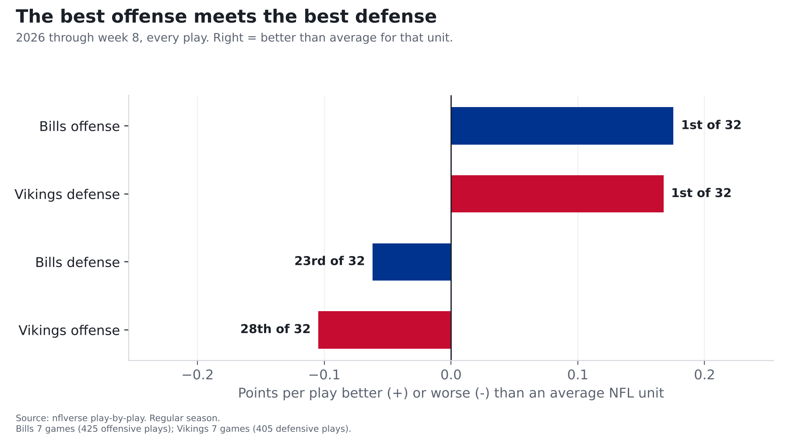
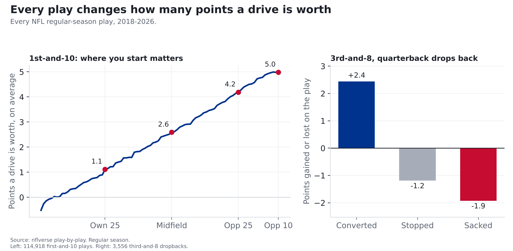
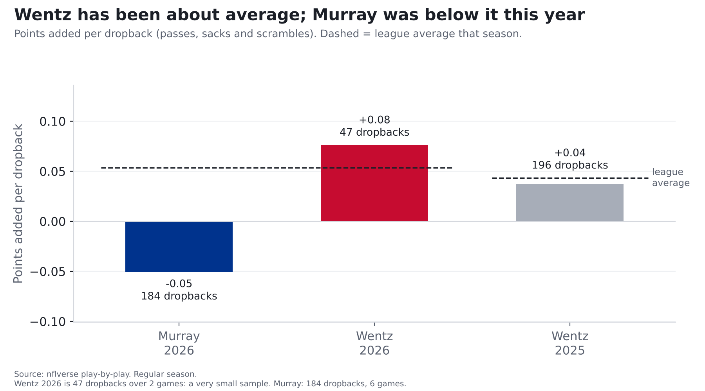

# Bills at Vikings: the NFL's best offense meets its best defense, and Minnesota's backup QB

**Finding: Through eight weeks, the Bills have the most efficient offense in football and the Vikings have the most
efficient defense (counting every play; with garbage time removed they rank 3rd and 2nd). Something has to give
Monday night. Buffalo's weak spot is its pass defense (24th of 32), and with Kyler Murray hurt, Minnesota starts Carson
Wentz, who has been about an average NFL passer over the last two seasons. Murray was below average this year.**

*Bills at Vikings, Monday Night Football, Nov. 9, 8:15 p.m. ET, U.S. Bank Stadium (indoors). Both teams have played
7 games. Numbers count every play unless noted.*

## How we measure "efficiency": points per play

Yards don't tell you much on their own. A 6-yard gain on 3rd-and-5 keeps a drive alive; the same 6 yards on 3rd-and-10
usually means a punt. So we measure every play by **how many points it adds to or takes away from the drive**.

**The source:** the NFL's official play-by-play, cleaned up and published free by the nflverse project. It covers every
snap: down, distance, field position, time left and what happened.

**The reasoning:** start with how many points a drive is usually worth from a given spot. Across every NFL play from
2018 to 2026:

- 1st-and-10 at your own 25 is worth about **1.1 points** on average.
- At midfield, about **2.6**. At the opponent's 25, about **4.2**.
- Every play moves that number. On 3rd-and-8, a quarterback who drops back and converts adds about **+2.4 points**.
  If he doesn't convert (an incompletion, a short gain or a turnover), the drive loses about **1.2**. If he's sacked, about **1.9**.

**The math:** take the points the drive was worth after the play, subtract what it was worth before, and you have that
play's value. Average it over every play a team runs and you get its **points per play**. The "points a drive is worth"
numbers come from the nflverse project's public expected-points model, built on years of NFL games.

**How we checked it:** across the whole league, plays average out to about zero each season, as they should (we test
this on every data load). And it tracks scoring: this season, teams' points per play and their points per drive move
together very closely (correlation 0.91 across all 32 offenses).

So when we say the Bills' offense is **+0.18 points per play** and the league average is +0.00, that's
about 11 extra points per game over the 61 offensive plays the Bills average. That's the gap shown in the chart above.

## The Bills' offense vs. the Vikings' defense

| | Bills offense | Vikings defense | League average |
|---|---|---|---|
| Points per play | +0.18 (1st) | -0.17 allowed (1st) | +0.00 |
| Points per pass play | +0.30 (1st) | -0.21 allowed (1st) | +0.06 |
| Points per drive | 3.08 (1st) | 1.37 allowed (1st) | 2.11 |
| Sacks per pass play | 5.5% taken (11th) | 10.6% made (1st) | 6.3% |

Ranks: 1st is best for that unit. Take out blowout garbage time and the Bills' offense ranks 3rd and the Vikings'
defense 2nd, so the strength-on-strength billing holds either way.

The Vikings get to the quarterback more than anyone (10.6% of pass plays). The Bills' offensive line has been
slightly better than average at preventing sacks (11th).

## The Vikings' offense vs. the Bills' defense

| | Vikings offense | Bills defense | League average |
|---|---|---|---|
| Points per play | -0.10 (28th) | +0.06 allowed (23rd) | +0.00 |
| Points per pass play | -0.03 (25th) | +0.14 allowed (24th) | +0.06 |
| Points per designed run | -0.21 (28th) | -0.08 allowed (17th) | -0.08 |
| Sacks per pass play | 9.1% taken (30th) | 5.1% made (25th) | 6.3% |

This is the Bills' problem area. Their pass defense has allowed +0.14 points per pass play, 24th in the league,
and their pass rush gets home on only 5.1% of pass plays. Minnesota's offense has struggled (28th), but its quarterback
just changed.

## The quarterback change

Kyler Murray is out with a strained hamstring, so Carson Wentz starts. The two have been different kinds of passers:

| Quarterback | Season | Games | Dropbacks | Points per dropback | League average | Sacked on |
|---|---|---|---|---|---|---|
| Kyler Murray | 2026 | 6 | 184 | -0.05 | +0.05 | 8.2% |
| Carson Wentz | 2026 | 2 | 47 (small sample) | +0.08 | +0.05 | 12.8% |
| Carson Wentz | 2025 | 5 | 196 | +0.04 | +0.04 | 9.7% |

Among 30 quarterbacks with 150+ dropbacks this season, Murray ranks 23rd. Wentz's 2026 number looks better, but
47 dropbacks is far too few to read much into. Over the last two seasons combined (243 dropbacks), Wentz has been about
league average. The catch:
he's been sacked more often than average (3.8 percentage points above the league rate), and Minnesota's offense already
allows sacks at the 3rd-highest rate in the league. That's an opening for a Bills pass rush that hasn't found many.

## What we're watching

**Our model's numbers for this game.** A call only counts once it's logged on the [Ledger](../ledger.html) before kickoff, and every logged call is graded after the game.

| # | What we expect | Chance |
|---|---|---|
| 1 | Minnesota's pass plays add points overall (more than zero points per dropback; the league average is +0.06) | **65%** |
| 2 | Minnesota's designed runs lose points overall (less than zero per run; the league average is -0.08) | **81%** |
| 3 | The Bills sack the quarterback on more than 6% of his dropbacks | **66%** |

How we get these: we start from each side's season average, pull it halfway back toward the league average (seven games
is a small sample), combine offense and defense, and then look at how much a team's single-game number usually bounces
around its average. For calls 1 and 3 we used Wentz's own passing and sack numbers in place of the Vikings' team numbers,
which were mostly Murray's games. That moved call 1 from 58% to 65% and call 3 from 62% to 66%.

## For the stat-heads

- Points per play = EPA (expected points added) per play, nflverse/nflfastR expected-points model. Team numbers:
  `src/metrics/team.py` season tables, regular season through week 8, `pass == 1 or rush == 1`, EPA not null,
  no kneels, spikes, two-point tries or no-plays. Points per pass play = EPA per dropback (sacks and scrambles included);
  designed run = rush excluding scrambles. League averages are means of the 32 team values.
- Garbage-time filter (win probability 10-90%): Bills offense +0.15 (3rd),
  Vikings defense -0.14 (2nd), Bills defense +0.05 (20th),
  Vikings offense -0.10 (28th).
- Expected-points examples: mean `ep` on 1st-and-10 by yard line; mean EPA on 3rd-and-8 dropbacks by outcome,
  2018-2026 regular season. League mean EPA/play by season ranges -0.021 to +0.043.
  Correlation of 2026 team EPA/play with points per drive: 0.91 (n = 32).
- QB splits by gsis id (`COALESCE(passer_player_id, rusher_player_id)`), `qb_dropback == 1`, EPA not null, no two-point
  tries. League average in the QB table = all such dropbacks that season (play-weighted); the model calls use the
  mean of team-game values instead, which differs slightly (2026 EPA/dropback 0.053 play-weighted vs 0.056 team-game mean).
- Draft calls: Ledger model v0.1-locshift (`src/ledger/model_v01.py`), shrink 0.5. Expected game value = league +
  0.5 x (offense vs league + defense vs league); probability from the 2026 within-team game-to-game spread.
  Wentz substitution (`off_override`): dropback-weighted, league-relative, 2025-26 (243 dropbacks): EPA/dropback
  -0.0073, sack rate +0.0378. Expected values: call 1 +0.072 (team-based +0.037);
  call 2 -0.154; call 3 0.078 (team-based 0.074).
- off_override replaces Minnesota's whole 2026 offensive level (line and receivers included) with Wentz's own number;
  196 of his 243 dropbacks came with Minnesota in 2025, so the supporting cast is mostly the same. The team value it
  replaces includes Wentz's 47 dropbacks from weeks 1-2. Baseline for both is the mean of team-game values.
- Small samples throughout: 7 games per team; Wentz 2026 is 47 dropbacks.
- Injury news: Vikings coach Kevin O'Connell announced Nov. 5, 2026 that Wentz starts with Murray out (strained hamstring,
  hurt in the week 8 loss to Detroit). Source: ESPN, Nov. 5, 2026.
