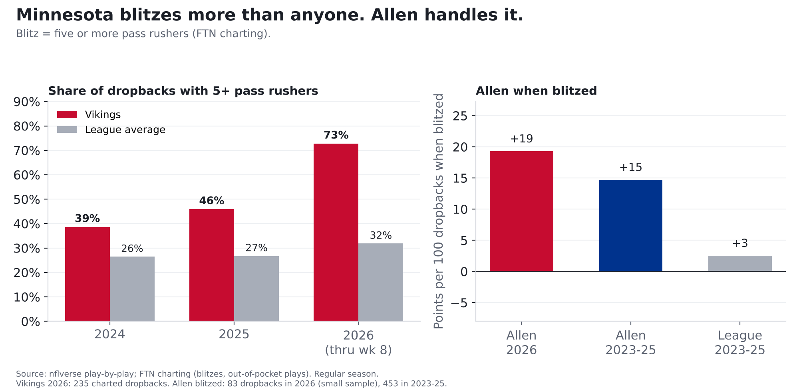
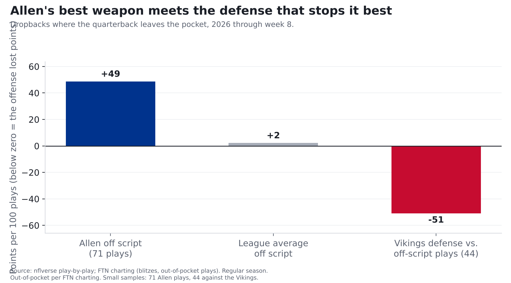
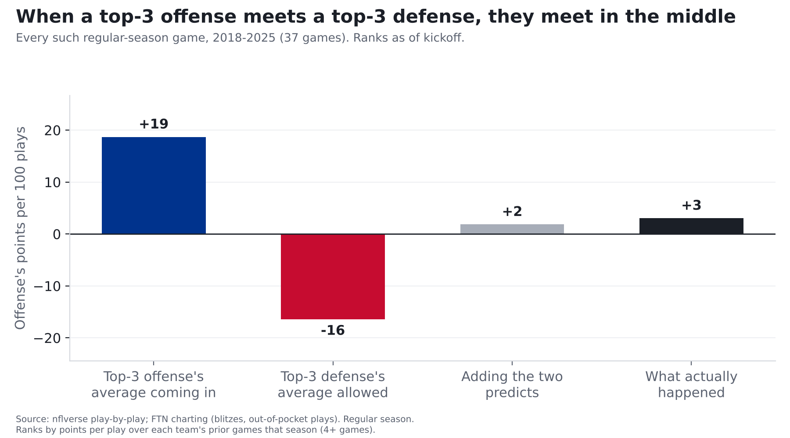

# Josh Allen and the Bills offense vs. the NFL's best defense

**Finding: Monday night is the best offense in football (3.08 points per drive) against the best defense (1.20 allowed), and the Vikings play defense
like no one else: they send five or more pass rushers on 73% of dropbacks, the most in the NFL by a mile (league average 32%).
Josh Allen has been one of the league's best quarterbacks against the blitz (5th of 33). The collision to watch is
Allen's improvising: every 100 of his plays outside the pocket have been worth about 49 points to Buffalo, and no defense has been
better against those plays than Minnesota's, where every 100 have cost offenses about 51. Both are small samples.**

*Bills at Vikings, Monday Night Football, Nov. 9, 8:15 p.m. ET, U.S. Bank Stadium (indoors). Both teams have played
7 games. Numbers count every play unless noted. Part 1 covered the Vikings' offense with
Carson Wentz; our predictions for the game come in part 3, logged before kickoff.*

## How we measure it: what a play is worth

Nobody scores on every play, but every play moves a drive closer to points or further away. Yards alone don't capture
that: 6 yards on 3rd-and-5 keeps a drive alive, 6 yards on 3rd-and-10 usually means a punt. So we measure every play by
**how much it moved the drive toward points or away from them**. (Same method as [part 1](wentz-vs-bills-defense.html).)

**The source:** the NFL's official play-by-play, cleaned and published free by the nflverse project, plus FTN's
play-by-play charting, which records things the official feed doesn't, like how many defenders rushed and whether
the quarterback left the pocket.

**The reasoning:** since 2018, 1st-and-10 at your own 25 has been worth about **1.1 points**: that's the average of the
next score in the half, with the other team's scores counted as minus points. 1st-and-10 at the opponent's 25 has been worth
about **4.2**. On 3rd-and-8, a quarterback who converts adds about **+2.4**; one who gets sacked loses about
**1.9**.

**The math:** what the drive was worth after the play, minus what it was worth before, is that play's value. Add up 100 plays and you get **points per 100 plays**, a fair way to compare teams that run different numbers of plays.
A positive number is good for the offense; below zero means the plays, on balance, moved drives away from points. The
average run costs a team a little, because short gains on early downs don't move a drive much closer to points.

**How we checked it:** it tracks scoring. Every 100 Bills plays have been worth +18 points (league average 0), and Buffalo
scores 3.08 points per drive, both 1st. Against Minnesota, every 100 plays have cost offenses about 17 points, and
the Vikings allow 1.20 points per drive, both 1st.

## Strength on strength

| | Bills offense | Vikings defense | League average |
|---|---|---|---|
| Points per 100 plays | +18 (1st) | -17 allowed (1st) | 0 |
| Per 100 pass plays | +30 (1st) | -21 allowed (1st) | +6 |
| Per 100 designed runs | +2 (6th) | -11 allowed (9th) | -8 |
| Points per drive | 3.08 (1st) | 1.20 allowed (1st) | 2.09 |
| Big plays (20+ yard passes, 10+ yard runs) | 13.4% of plays (1st) | 8.6% allowed (14th) | 8.7% |
| Sacks | 5.5% of pass plays (11th) | 10.6% made (1st) | 6.3% |
| Turnovers | 2.6% of plays (26th) | 2.7% forced (4th) | 1.9% |
| Third downs converted | 45% (5th) | 30% allowed (2nd) | 40% |
| Red-zone trips ending in a touchdown | 71% (4th) | 38% allowed (1st) | 64% |

Ranks: 1st is best for that unit. For the Vikings, a negative number means offenses lost points against them. Take out blowout garbage time and the Bills' offense ranks 3rd and the Vikings'
defense 2nd.

Two places Buffalo has an edge on paper: **big plays**, where the Bills lead the league and Minnesota is merely
14th, and **the run game** (6th vs. a run defense that's 9th). The place Minnesota has the edge: **turnovers**.
The Bills give the ball away on 2.6% of plays (26th), and the Vikings take it away at the 4th-best rate.

## Is Minnesota's defense really this good, or is it the schedule?

Mostly real. The Vikings have faced a below-average set of offenses (their opponents' average rank is 18.9;
5 of 7 rank 17th or worse). But when we compare each game to what that opponent does against everyone else,
Minnesota is still narrowly 1st (just ahead of Tampa Bay): it has held offenses about 18 points per 100 plays below
their own averages, vs. about 17 for Tampa Bay.

| Week | Opponent | Opponent's offense this season | Last season |
|---|---|---|---|
| 1 | GB | 17th | 4th |
| 2 | CHI | 8th | 8th |
| 3 | TB | 26th | 19th |
| 4 | MIA | 23rd | 22nd |
| 5 | NO | 22nd | 27th |
| 7 | IND | 30th | 9th |
| 8 | DET | 6th | 7th |

2 of their 7 opponents have a top-10 offense this season.

## The blitz

We count a blitz as five or more pass rushers. Most defenses do it on about a third of dropbacks. Minnesota does it on
almost three of every four (73%), and has led the league three years running (39% in 2024, 46% in 2025; league
26% and 27%). The next-most aggressive defense this season blitzes 44% of the time. A Vikings blitz isn't bigger
than anyone else's (5.36 rushers on average; league 5.35). It just comes far more often.

Both versions work. When Minnesota blitzes, every 100 dropbacks have cost offenses about 19 points (171 plays); when it
doesn't, about 24 (64 plays, a small sample), so they've been about as good, maybe slightly better, when they sit back.
Around the league, blitzes this season have come out about even (0 points per 100 dropbacks) and produced sacks on 8.3% of
them; Minnesota's blitzes get sacks 11.1% of the time.

Allen is the kind of quarterback that approach is built to test, and so far he has passed:

| Allen when blitzed | Dropbacks | Points per 100 dropbacks | League average |
|---|---|---|---|
| 2026 | 83 (small sample) | +19 (5th of 33 QBs with 40+) | 0 |
| 2023-25 | 453 | +15 | +3 |

Like most quarterbacks, he's better when he isn't blitzed (+36 per 100 this season; 10 of 33 did better when blitzed).
He starts from such a high level that even when blitzed he's 5th of 33.

## The off-script collision

The biggest change in Allen's 2026, from our [Josh Allen story](josh-allen-2018-to-now.html): he's leaving the pocket on
30% of dropbacks (league 20%), and those plays are working: every 100 have been worth +49 points (71 plays; league
average +2).

Minnesota is the toughest test for that so far this season. When quarterbacks leave the pocket against the Vikings, every 100 of
those plays have cost their offense about 51 points, the best mark in the league (44 plays, a small sample). With garbage time removed it's
about 46 per 100, 2nd (40 plays).

We checked this a second way, with plain success rate (did the play keep the offense on schedule?) instead of points.
It tells the same story: Allen's off-script plays succeed 55% of the time, the league's 42%, and Minnesota allows
32%. The samples are small on both sides, so this is a matchup to watch, not a verdict.

## Deep shots

The Bills throw deep (20+ yards in the air) on 16% of their passes (4th; league 11%), and those throws have been
worth +79 points per 100 (9th; 32 throws, a small sample; league +42). Minnesota's short-pass defense is the
league's 2nd-best, but deep throws against it have still been worth +18 per 100 (10th-best; 22 throws, a small sample). A defense that sends extra rushers
leaves fewer defenders back, which is where Buffalo's big-play offense lives.

## What usually happens when the best meet the best

Since 2018, a top-3 offense has met a top-3 defense 37 times in the regular season. Coming in, those offenses
averaged +19 points per 100 plays, and those defenses held offenses to about 16 below zero. In the game itself, the offense averaged
**+3**, close to what you get by simply adding the two strengths together (+2). The offense fell short of
its own average 73% of the time. Against everyone else, those same top-3 offenses averaged +13.

The Bills have been the top-3 offense in 6 of those games:

| Season | Game | Bills coming in (points per 100 plays) | Bills in the game |
|---|---|---|---|
| 2022 | Week 13 vs. NE | +11 | +17 |
| 2022 | Week 18 vs. NE | +12 | +10 |
| 2023 | Week 15 vs. DAL | +12 | +19 |
| 2024 | Week 15 vs. DET | +20 | +48 |
| 2025 | Week 12 vs. HOU | +17 | -16 |
| 2025 | Week 16 vs. CLE | +15 | +6 |

## What we're watching

- **The blitz vs. Allen.** If Minnesota's pressure gets home, Buffalo's offense is in for a long night. If Allen beats it the way he
  has all season, the Bills' deep game is open behind it.
- **Allen on the move.** It's his best weapon this year and Minnesota's best counter. Those plays could decide the night.
- **Turnovers.** The one area where the Bills' offense is below average meets a defense that takes the ball away.
- Our predictions for the game, including how many points each team scores, come in part 3, logged on the
  [Ledger](../ledger.html) before kickoff.

## For the stat-heads

- Points added = EPA (nflverse/nflfastR expected points). Team splits: `src/metrics/team.py`, regular season through
  week 8, `pass == 1 or rush == 1`, EPA not null, no kneels/spikes/two-point tries/no-plays. Pass play = dropback
  (sacks and scrambles included). Designed run excludes scrambles. Explosive = pass 20+ or rush 10+ yards. League averages are means of team values.
- Garbage-time filter (WP 10-90%): Bills offense +0.15 (3rd), Vikings defense -0.14 (2nd).
- Opponent quality: average 2026 offensive rank of Minnesota's seven opponents 18.9.
- Opponent adjustment: same method as `src/metrics/adjust.py` `league_adjusted_rank`, pinned to week 8 (each game's EPA/play allowed minus the opponent's
  EPA/play in its other games, play-weighted). Vikings -0.179 (1st); pass defense -0.269 (1st).
- Blitz = FTN `n_pass_rushers >= 5` on charted dropbacks, every season. FTN changed `n_blitzers` in 2026: it now equals
  `n_pass_rushers - 4` on 97% of 2026 charted dropbacks, so `n_blitzers > 0` means different things before and after
  (Vikings under the old flag: 44%, 51%, 73% for 2024-26). The 2025-to-2026 jump (46% to 73%) rests
  on one source; no second check is possible until 2026 NFL participation data is published.
  Vikings 2026 sack rate: 11.1% blitzing, 9.4% not.
  Allen 2026 blitz rate faced 35%; sacked on 7.2% of blitzed dropbacks. Drop from not-blitzed to blitzed:
  Allen 0.17, league 0.08; 23rd-smallest of 33.
- Off script = FTN `is_qb_out_of_pocket`; Allen by gsis id (00-0034857), dropbacks = `COALESCE(passer_player_id, rusher_player_id)`.
  Vikings face out-of-pocket plays on 19% of dropbacks (20th-highest rate; league 20%): 17% when
  blitzing, 23% when not. Garbage-time filtered (WP 10-90%): -0.46 (2nd, 40 plays).
- Deep = air yards 20+ on true pass attempts (no sacks). Minnesota's short-pass (under 20 air yards) EPA allowed -0.07; league +0.12.
- Best vs best: ranks by EPA/play over prior games only; a week counts once every team has played 4+ games. 2018-2025
  regular season, 3,148 team-games eligible; additive prediction = offense avg + defense avg - league average over the
  same prior weeks. #1 offense vs. #1 defense: 5 games,
  offense averaged +0.14.
- 2026 NFL participation data (pressure, coverage) has not been published, so this story doesn't use pressure for 2026.
- Data pinned through 2026 week 8.
