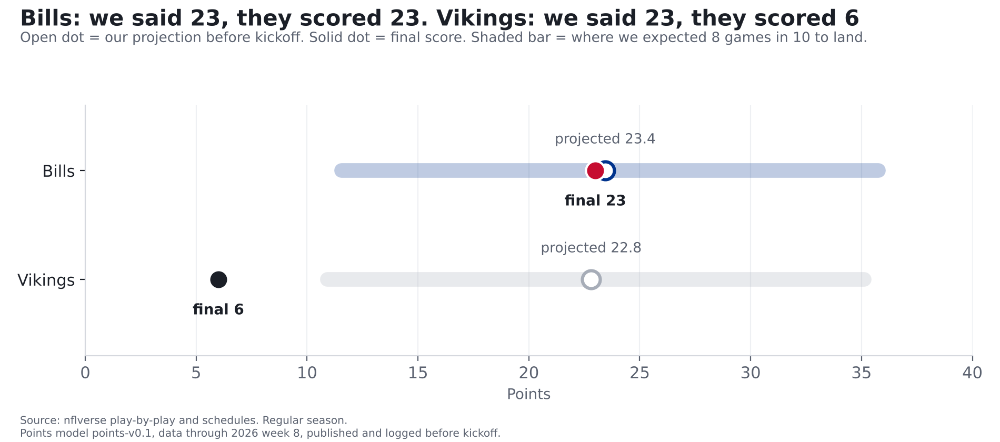
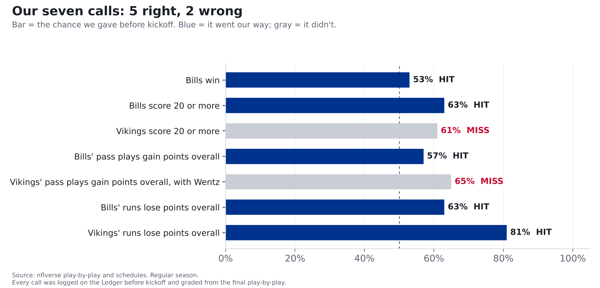

# Bills 23, Vikings 6: we nailed Buffalo's half and missed Minnesota's

**Finding: Our model projected the Bills to score 23.4 points. They scored 23. It projected the Vikings to score 22.8. They
scored 6, a miss that big happened only about 3 times in 100 when we tested the model. On the Ledger, 5 of our 7 calls
were right, including the one that matters most: the Bills win. Both misses came from Minnesota's passing game, which had one of the worst nights
of any team this season.**

*Bills at Vikings, Monday Night Football, Nov. 9. Our prediction ran Monday morning ([part 3](bills-vikings-prediction.html)) and every call
was logged on the [Ledger](../ledger.html) before kickoff. Here's how they did.*

## The scorecard

| Call | Our chance | What happened | Result |
|---|---|---|---|
| Bills win | 53% | Bills 23, Vikings 6 | **Hit** |
| Bills score 20 or more | 63% | Bills 23 | **Hit** |
| Vikings score 20 or more | 61% | Vikings 6 | **Miss** |
| Bills' pass plays gain points overall | 57% | Gained 0.003 points over 36 pass plays | **Hit** |
| Vikings' pass plays gain points overall, with Wentz | 65% | Lost about 26 points over 33 pass plays | **Miss** |
| Bills' runs lose points overall | 63% | Lost about 3 points over 39 runs | **Hit** |
| Vikings' runs lose points overall | 81% | Lost about 2 points over 11 runs | **Hit** |

**How we grade.** A call is a hit when the side we gave more than 50% happens. We also score every call by how far our chance was from what
happened, squared, so a confident miss costs more than a timid one. Lower is better. This week's calls scored 0.22; guessing 50/50 on
every one would have scored 0.25. Across all 8 calls on the Ledger so far, including last week's Sabres call, we're 6 for
8 with a score of 0.22. Small numbers, but that's the point of keeping the record: it adds up.

**One hit we're not bragging about.** The Bills' pass plays had to gain points overall for that call to hit. Over 36 dropbacks they gained
0.003 points, about as close to zero as it gets. By the rule we set before kickoff, that's a hit, the same way we'd have counted a miss
by that margin. Fairly, it was a coin landing on its edge.

## Buffalo: right on the number

The Bills scored 23 on 13 drives, about 1.8 points a drive, less than the
2.2 our model expected, but over more drives than the 11 it planned on. It came out to
almost exactly the projection.

Part 3 said this was the best offense in football against the best defense at stopping it, and that the two would mostly cancel out.
That's what happened: Josh Allen went 21 of 31 for 234 yards with 1 interception and was sacked
4 times, and Buffalo's pass plays finished almost exactly even. The run game did the steady work: 39 designed runs
for 132 yards.

## Minnesota: what we missed

Carson Wentz went 14 of 31 for 139 yards, threw 2 interceptions (Dorian Williams and Terrel Bernard) and was sacked
2 times. Minnesota's pass plays cost it about 26 points of field position over 33 dropbacks, the
3rd-worst passing game by any team in 272 games this season. The Vikings turned it over 3 times and
turned it over on downs 2 more, on their way to 6 points.

**The weak spot that wasn't.** Part 1 said short throws were where the Bills defense was most beatable this season. Monday, Minnesota's
25 short throws cost it 16 points. One game doesn't erase seven, but the Bills' defense closed the gap we
pointed at, and its points allowed per drive went from 25th in the league to 16th in one night
(2.35 to 2.10, with the league at 2.05).

**Why our Vikings calls missed.** Our model had Minnesota around 23 points, mostly from Kyler Murray's games and last season, with
a typical range of 11 to 35. Six was below that range: in testing, only about 3 in 100 teams fell
that far short of their projection. And the pass call (65%) was built on the one piece we told you we hadn't tested: swapping in Wentz's own
numbers. One game can't tell us whether that swap is wrong. It does tell us not to use it on the Ledger again until we've tested it, so we won't.

## What it means

- **The Bills' defense might be turning a corner, or might have met a bad night.** Its numbers jumped in one game; one game is a small sample.
  We'll know more after the next two.
- **Next:** the Bills play at the Jets on Sunday, Nov. 15. Our prediction and Ledger calls come before kickoff.
- **The record is the point.** 6 of 8 so far. Every call stays up, hit or miss.

## For the stat-heads

- Points model points-v0.1, inputs pinned to 2026 week 8 (as published). Projections BUF 23.44, MIN 22.81;
  80% ranges from training residuals. MIN residual -16.8; share of residuals at or below it: training 0.034, out of sample
  (2024-26, n=1234) 0.032.
- Grades: P0002-P0004 from raw_schedules; P0005-P0008 from clean_team_week (model_v01.game_values, offense side), the same definitions the
  models used. BUF EPA/dropback +0.000 (+0.0029 total over 36). Brier this week 0.2158; all
  graded calls 0.2152 (n=8).
- MIN EPA per dropback ranks 3 of 272 2026 team-games (1 = worst). Short = pass attempts with air yards under 20.
- BUF points allowed per drive, regular season through week 8: 2.351 (25 of 32); through week 9: 2.101 (16 of 32).
- FTN charting (blitz counts) for this game wasn't published yet when we ran this, so part 2's blitz angle isn't graded here.
