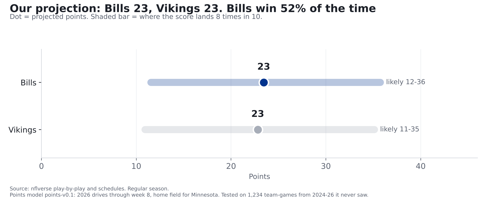

# Bills at Vikings: our prediction for Monday night

**Finding: Our model sees a coin flip with a small Buffalo edge. It projects the Bills to score about 23 points and the Vikings
about 23, and gives Buffalo a 52% chance to win. Strength meets strength on the Bills' side of the ball,
and the model splits the difference: Buffalo's offense has been the best in football, Minnesota's defense the best at
stopping it. On the other side, a below-average Vikings offense (1.78 points per drive after our adjustment; league 2.07)
meets a below-average Bills defense (2.23 allowed). We're putting seven calls on the [Ledger](../ledger.html), every one from
a model we tested on past games first. One call we planned to make, on sacks, failed its test, so it's out.**

*Bills at Vikings, Monday Night Football, Nov. 9, 8:15 p.m. ET, U.S. Bank Stadium (indoors). This is part 3 of our week 9 preview.
[Part 1](wentz-vs-bills-defense.html) covered Carson Wentz against the Bills defense; [part 2](bills-offense-vs-vikings-defense.html)
covered Josh Allen and the Bills offense against Minnesota's defense. Numbers are 2026 through week 8, the same as both parts.*

## The calls

| Call | Our chance | Where it comes from |
|---|---|---|
| Bills win (any result, including overtime) | **52%** | Points model, win chance |
| Bills score 20 or more points | **63%** | Points model |
| Vikings score 20 or more points (from part 1) | **61%** | Points model |
| Bills' pass plays gain points overall | **57%** | Matchup model |
| Vikings' pass plays gain points overall, with Wentz | **65%** | Matchup model |
| Bills' runs lose points overall | **63%** | Matchup model |
| Vikings' runs lose points overall | **81%** | Matchup model |

"Gain points" and "lose points" mean what part 1 and part 2 explained: every play moves a drive closer to points or further
away, and we add it up over the night. A team's runs "lose points" if, all added together, its running plays left it worse off
than when they started. That happens a lot: in the 990 past team-games we tested on (2023-2025), a team's runs lost points overall 64% of the time.
So 63% for the Bills is actually a vote of confidence in their run game; it's a little *below* the usual rate.

**These are our model's numbers.** They count once they're logged on the [Ledger](../ledger.html) before kickoff; every logged call is graded after the game, hit or miss.

## How many points will Buffalo score?

**Our projection: about 23 points**, most likely between 12 and 36 (8 times in 10), with a
**63% chance of 20 or more.** It's the same model, and the same math, that gave Minnesota about 23 in part 1.

**Where the number comes from.** Points come from drives, so we start there. This season the Bills' offense has scored
3.08 points per drive (77 drives), 1st of 32 in the league; the league average is 2.07.
Minnesota's defense has allowed 1.20 per drive (74 drives), 1st of 32 (1st = fewest allowed). Seven games is a small
sample, so we pull both numbers part of the way back toward last season and the league average: Buffalo's offense counts as
2.83 and Minnesota's defense as 1.45.

**The math:** start from the league's 2.07 points per drive. Buffalo's offense is 0.75 better than average, so add that;
Minnesota's defense is 0.62 better than average, so take that off. That leaves about 2.21 points per drive (numbers are rounded).
Multiply by the 10.9 drives a team gets in a typical Bills or Vikings game, and you get 24. The same final
step as in part 1, fit on past games, turns that into a real score. Buffalo is on the road, so it doesn't get the home-field bump of
about 1.5 points that Minnesota does. That's how we get to 23.

That's why the best-on-best matchup from part 2 nets out close to average: the model treats a great offense against a great defense
as mostly cancelling out. Part 2 found the same thing in past games: when a top-3 offense met a top-3 defense, the result landed
close to simply adding the two strengths together.

## Who wins?

**Our model gives the Bills a 52% chance and the Vikings 48%.** With the two teams projected less than a point
apart, that's close to even.

**Where it comes from.** A projection is never exactly right, so we ask how wrong it tends to be. We took the 1,247 games
from 2019-2023 the model was built on, and for each one wrote down how far each team's real score landed from its projection.
Then we replay those 1,247 pairs of misses on top of Monday's two projections, as if this game were played 1,247 times. The
Bills finish ahead in 52% of them (a tie counts as half for each side, since overtime is close to a coin flip). Keeping each game's two misses
together keeps any link between them; in practice there's almost none (how far one team misses says almost nothing about the other).

## How we checked it

**The win chance.** Before using it, we had the model give a win chance for every 2024, 2025 and 2026 game (2026 through week 8),
617 games it had never seen, using only what was known before kickoff. The team it favored won 63% of the time.
Just taking the home team every time would have been right 52% of the time. And its percentages mean what they say:

When it called a game close (50-60%), the favorite won 58% of the time. When it leaned 60-70%, 65%.
Our miss score (explained under "For the stat-heads") was 0.227, better than a 50/50 guess on every game (0.249) and better than
giving the home team its usual 53% (0.249). Lower is better.

**The points.** The points model was tested the same way in part 1: an average miss of 7.5 points on 1,234 team-games
it never saw, better than guessing the league average (7.9) or each team's own average (8.1).

**The matchup calls.** The pass and run calls come from a separate, simpler model: it takes what each offense has done this season,
what each defense has allowed, and how much a team's games normally swing around its average. We tested every kind of call before using it on
990 past team-games (2023-2025, week 8 on, using only earlier games), and compared it with just using the league's usual rate:

| Kind of call | Our model's miss score | League rate's | Verdict |
|---|---|---|---|
| Pass plays gain points | 0.230 | 0.245 | Better, and its percentages held up |
| Runs gain or lose points | 0.226 | 0.231 | A little better |
| Sacks on more than 6% of dropbacks | 0.254 | 0.252 | **Worse. Dropped.** |

**Why the sack call is out.** We planned to say there was a 66% chance the Bills sack Wentz on more than 6% of his dropbacks.
But this kind of call did worse than just using the league's usual rate. When it was confident (above 55%), it said 64% on average and
it happened 54% of the time. Sacks in a single game swing too much for this model to read, so we're not calling them.

**A caution on the run calls.** The run model is honest in the range where Monday's calls sit: when it said runs would gain points
24% of the time, they did 26% (Minnesota's call), and when it said 38%, they did 37% (Buffalo's).
It gets too confident when it says runs will *gain* points (above 55% it said 61% and they
happened 46%, on only 52 games). Neither of Monday's run calls is in that range.

## What the models don't know

- **Wentz.** The points model doesn't know Minnesota changed quarterbacks; its numbers come mostly from Kyler Murray's games. The
  Vikings' pass call does swap in Wentz's own numbers (2025 and 2026, 243 dropbacks), but that swap wasn't part of the test above.
- **Injuries.** Both Bills starting tackles were on this week's injury report. None of our models know who plays; check the final report
  before kickoff.
- **One game is one game.** A 52% chance means the Bills lose this one about half the time. That's the point of the Ledger: one call
  doesn't prove anything, but a season of graded calls does.

## For the stat-heads

- Points model points-v0.1 (`src/ledger/points_model.py`): ratings = (points + 60 x prior) / (drives + 60), prior = league + 0.7 x last
  season's gap; raw = (league + off gap + def gap) x average pace; calibrated score = 7.07 + 0.679 x raw + 1.45 x home,
  fit on 2019-23. Ranges and 20+ chances use the empirical training residuals.
- Win chance (points-win-v0.1): 1,247 same-game (home miss, away miss) residual pairs from training, added to Monday's two projections;
  ties within half a point split 50/50. Residual correlation 0.035. Out of sample (2024-26, n=617): Brier 0.2269 vs 0.2492
  (50/50) and 0.2486 (training home-win rate 0.534). "Miss score" in the story is the Brier score: the average squared gap between
  the chance we gave and what happened (1 or 0).
- Matchup model v0.1-locshift (`src/ledger/model_v01.py`): expected = league + 0.5 x (offense gap + defense gap), plus the pooled within-team game-to-game
  spread; P = share of that spread above the threshold. Metrics: EPA per dropback (with scrambles and sacks), EPA per designed rush.
  Bills dropback EPA expected +0.031 (offense +0.309, Vikings defense -0.247, league +0.056);
  Vikings dropback +0.072 with Wentz's relative value; rush: Bills -0.057, Vikings -0.154.
- Matchup backtest: `scripts/backtest_model_v01.py`, 2023-25 weeks 8+, n=990 per call type, baseline = league share over the threshold in prior weeks
  of that season. Sack-rate > 6%: Brier 0.2536 vs 0.2516.
- Data pinned through 2026 week 8. No betting lines are used anywhere in these models.
