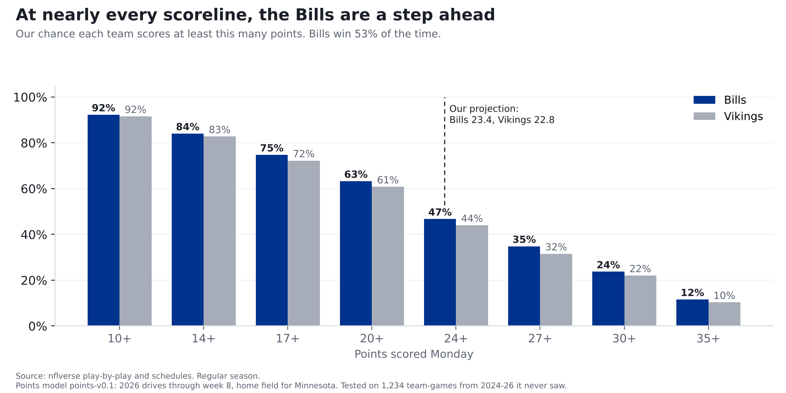
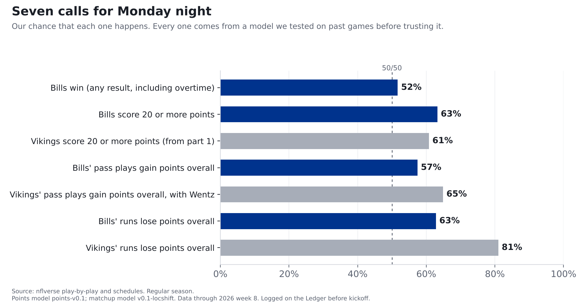
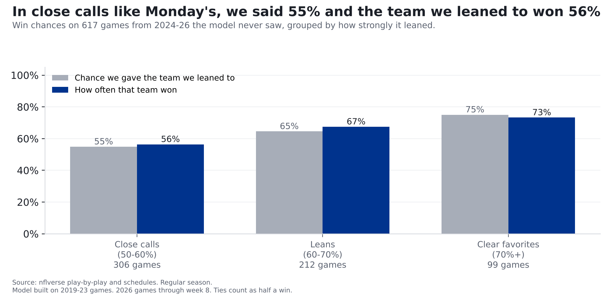

# Bills at Vikings: our prediction for Monday night

**Finding: This one is about as close as games get. Our model has both teams scoring about 23 points, but at nearly every
scoreline, Buffalo is a little more likely to get there. Add it all up and the Bills win 53% of the time.
If we have to name a final: Bills 23, Vikings 20.**

*Bills at Vikings, Monday Night Football, Nov. 9, 8:15 p.m. ET, U.S. Bank Stadium (indoors). Part 3 of our week 9 preview.
[Part 1](wentz-vs-bills-defense.html) covered Carson Wentz against the Bills defense; [part 2](bills-offense-vs-vikings-defense.html)
covered Josh Allen against Minnesota's defense. Numbers are 2026 through week 8.*

## The scoreboard ladder

Picture a ladder of scorelines: 10 points, 14, 17, 20 and up. For each rung, here's our chance that each team climbs at least that high Monday:

| Points | Bills | Vikings |
|---|---|---|
| 10 or more | **92%** | 92% |
| 14 or more | **84%** | 83% |
| 17 or more | **75%** | 72% |
| 20 or more | **63%** | 61% |
| 24 or more | **47%** | 44% |
| 27 or more | **35%** | 32% |
| 30 or more | **24%** | 22% |
| 35 or more | **12%** | 10% |

Read it like this: there's a 75% chance the Bills score 17 or more, and a 72% chance the Vikings do. The gaps are small,
a couple of points of probability, and they all come from the same thing: our Bills projection is 0.6 points higher. That small gap is also why, when we replay past games with both teams at once (more on that below), the Bills finish ahead 53% of the time.

## Where the 23 comes from

Points come from drives, so that's where we start. Four steps:

1. **How good is each side?** This season the Bills average 3.08 points per drive, the most in the NFL
   (1st of 32). Minnesota's defense gives up just 1.20 per drive, the fewest. An average offense scores 2.07 per drive.
2. **Don't overreact to seven games.** A hot start isn't a guarantee, so we blend this season with last season and the league average.
   That makes the Bills' offense 2.83 and the Vikings' defense 1.45: still far better than average, just less extreme.
3. **Let them meet.** The Bills' offense is 0.75 points per drive better than average. Minnesota's defense is
   0.62 better than average. Those almost cancel out, leaving about 2.21 points per drive: a bit better than an average offense, which would rank about 11th of 32 this season.
4. **Count the drives and check against history.** About 11 drives a game gets you to about 24. A last adjustment,
   learned from past games, trims projections that history says run too high or too low and gives the home team about 1.5 points.
   Buffalo is on the road, so it lands at **23.4**.

Minnesota goes through the same four steps from the other direction: a below-average offense (1.78 per drive) against a below-average
Bills defense (2.23 allowed), plus the home bump. That's **22.8**.

So the most interesting matchup of the night, the best offense against the best defense, mostly cancels itself out. Part 2 found that's
usually what happens: when a top-3 offense meets a top-3 defense, the result lands close to adding the two together.

## From 23 points to those percentages

Nobody scores exactly what we project. So we looked at 2,494 past team-scores from 2019-2023 and asked how far off we were. Half the time, a team
landed within about 6 points of our number. Eight times in ten, within about 12. (Those are the games the model was built on; on games it had never seen, its average miss was 7.5 points.)

Then we play Monday's game over and over, once for every one of those past misses, on top of today's projections. In some replays the Bills
score a lot; in others they're held down. Eight times in ten they land between 12 and 36. Count how often the Bills reach 20 or more in all those replays and you get 63%. Count
24 or more and it's 47%, just under half, because 23.4 is right in the middle. That's the whole ladder.

**Who wins?** Same idea, both teams at once. We replay 1,247 real past games, each team's miss side by side, on top of Monday's projections.
Buffalo finishes ahead in 53% of them. (A game tied after 60 minutes counts as half for each side, since overtime is close to a coin flip.)

## Why Bills 23, Vikings 20?

Our projections aren't real football scores; nobody finishes with 23.4. Real scores bunch up around field goals and touchdowns. Since 2019
the most common NFL finals have been 20-17, 27-24, 23-20. We take the common final closest to our two projections, with the Bills winning, since they're
our model's favorite. That's 23-20, a final that's happened 33 times in 1,865 games from 2019 to 2025 (ties not counted). We look at the 10 most common finals; a longer list can land on a different score. It's a way of saying "close, slight Bills edge,"
not a separate prediction, so it doesn't go on the Ledger. Exact scores almost never hit.

## The calls going on the Ledger

| Call | Our chance | Where it comes from |
|---|---|---|
| Bills win (overtime counts; a tie counts as a miss) | **53%** | Points model, win chance |
| Bills score 20 or more points | **63%** | Points model |
| Vikings score 20 or more points (from part 1) | **61%** | Points model |
| Bills' pass plays gain points overall | **57%** | Matchup model |
| Vikings' pass plays gain points overall, with Wentz | **65%** | Matchup model |
| Bills' runs lose points overall | **63%** | Matchup model |
| Vikings' runs lose points overall | **81%** | Matchup model |

What "gain points" and "lose points" mean: every play moves a drive closer to scoring or further away, and we add it up over the night.
A team's runs "lose points" if, all told, its running plays left it worse off than before. That's normal: in the 990 past team-games we
tested on (2023-2025), a team's runs lost points overall 64% of the time. So 63% for the Bills is about the usual
rate, a shade better; the Vikings' 81% is well above it.

**These are our model's numbers.** They count once they're logged on the [Ledger](../ledger.html) before kickoff; every logged call is graded after the game, hit or miss.

## Did we check it? Yes, before trusting it

**The scoreline chances.** We ran the model on 1,234 team-games from week 2 on in 2024, 2025 and 2026 that it had never seen. When it said
something had a 20% chance or less, it happened 12% of the time (it said 12%), and at 80% or more it
happened 89% (it said 89%). In the middle it ran a few points low: when it said 50%, it happened
55%. At the 20-point line itself it averaged 60% and teams got there 65% of the time. So our 20-or-more chances
for both teams are probably a few points low. Real scores bunch up on 17, 20, 24 and 27, and our model smooths that bunching out, so "at least X"
comes out a little low right at those lines. We're logging the model's numbers as they are and will fix this before using these lines again.

**The win chance.** On 617 unseen games (week 2 on, 2024-2026), the team our model favored won 63% of the time. Taking the
home team every time would have been right 52% of the time.

**The pass and run calls.** These come from a simpler model, tested on 990 past team-games per kind of call (2023-2025, using only
earlier games each time). We graded it against just guessing the league's usual rate. Lower grade is better:

| Kind of call | Our grade | Guessing the usual rate | Verdict |
|---|---|---|---|
| Pass plays gain points | 0.230 | 0.245 | Better; its percentages held up in the range where Monday's calls sit |
| Runs gain or lose points | 0.226 | 0.231 | A little better |
| Sacks on more than 6% of dropbacks | 0.254 | 0.252 | **Worse. Dropped.** |

**The call we threw out.** We were going to say there was a 66% chance the Bills sack Wentz on more than 6% of his dropbacks.
But this kind of call did worse than simply guessing the usual rate. When it was confident (above 55%), it said 64% and was right
54% of the time. Sacks in one game swing too much to call, so we're not.

**One caution on the run calls.** The run model gets too confident when it says runs will *gain* points (above 55% it said
61%; it happened 46%, on only 52 games). Neither of Monday's run calls is in that range:
in the ranges where they sit, it said 24% and 38%, and it happened 26% and 37%.

## What the model doesn't know

- **Wentz.** The points model doesn't know Minnesota switched quarterbacks; its numbers come mostly from Kyler Murray's games and last season's.
  The Vikings' pass call does use Wentz's own numbers (243 dropbacks over 2025 and 2026), but that swap is the one piece we haven't tested.
- **Injuries.** Both Bills starting tackles were on this week's injury report (ClutchPoints, Nov. 5). Our models don't know who plays.
- **One game is one game.** 53% means the Bills lose this about half the time. One call proves nothing; a season of graded calls does.
  That's why everything goes on the Ledger.

## For the stat-heads

- Points model points-v0.1 (`src/ledger/points_model.py`): ratings = (points + 60 x prior) / (drives + 60), prior = league + 0.7 x last
  season's gap; raw = (league + off gap + def gap) x average pace; calibrated score = 7.07 + 0.679 x raw + 1.45 x home,
  fit on 2019-23 (week 2 on). Ladder chances = share of the 2,494 empirical training residuals that put the projection at or above each line.
  Ladder calibration out of sample, all 8 lines pooled: said 12% / happened 12% (n=1,800); said 30% / happened 34% (n=2,073); said 50% / happened 55% (n=1,704); said 70% / happened 74% (n=2,017); said 89% / happened 89% (n=2,278).
- Win chance (points-win-v0.1): 1,247 same-game (home miss, away miss) residual pairs from training, added to Monday's two projections;
  margins within half a point split 50/50. Residual correlation 0.035. Out of sample (2024-26, week 2 on, n=617): Brier 0.2263 vs 0.2492
  (50/50) and 0.2486 (training home-win rate 0.534). The "grade" in the story is the Brier score: the average squared gap between
  the chance we gave and what happened (1 or 0); tied test games count as 0.5 there and in the chart, and as misses in "the team it favored won".
- Named final: the 10 most frequent regular-season finals 2019-2025 (ties excluded), nearest to (favorite, underdog) projections by squared distance.
- Matchup model v0.1-locshift (`src/ledger/model_v01.py`): expected = league + 0.5 x (offense gap + defense gap), plus the pooled within-team game-to-game
  spread; P = share of that spread above the threshold. EPA per dropback (with scrambles and sacks), EPA per designed rush.
  Bills dropback EPA expected +0.031 (offense +0.309, Vikings defense -0.247, league +0.056);
  Vikings dropback +0.072 with Wentz's relative value; rush: Bills -0.057, Vikings -0.154.
- Matchup backtest: `scripts/backtest_model_v01.py`, 2023-25 weeks 8+, n=990 per call type, baseline = league share over the threshold in prior weeks
  of that season. Sack rate > 6%: Brier 0.2536 vs 0.2516.
- Data pinned through 2026 week 8. No betting lines are used anywhere in these models.
