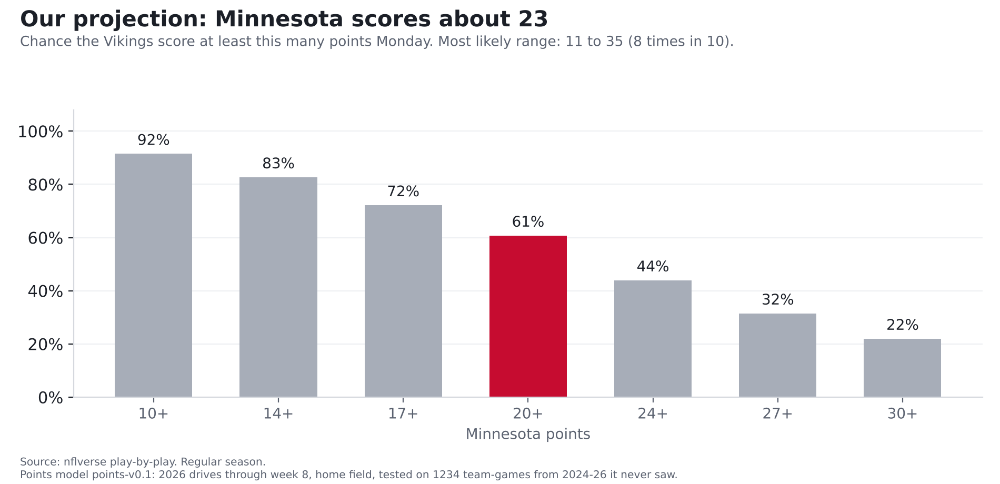

# Carson Wentz vs. the Bills defense: short passes, sacks and risky throws

**Finding: Compared with the rest of the league, the Bills' defense is weakest on short passes, the ones thrown less than 20 yards downfield. They rank
25th of 32 there, and 25th with garbage time removed. Even accounting for the offenses they've faced, short passes have been worth about
21 more points to opponents than you'd expect against an average defense, roughly 3 a game. That's where most of Minnesota's passing will go: like most quarterbacks, Carson Wentz threw short
on 88% of his attempts last season. But Wentz brings two weak spots of his own. He was sacked on 9.7% of his dropbacks, the
5th-highest rate among 43 quarterbacks, and his share of throws that should have been intercepted was the 2nd-highest. Our model projects about 23 points for Minnesota.**

*Bills at Vikings, Monday Night Football, Nov. 9, 8:15 p.m. ET, U.S. Bank Stadium (indoors). Kyler Murray is out with a
strained hamstring, so Wentz starts. Numbers are 2026 through week 8 unless noted, and Wentz's are mostly from 2025,
since he has dropped back only 47 times this year.*

## How we measure it: what a play is worth

Nobody scores on every play, so how can a short pass be "worth" points? Because every play moves a drive closer to
points or further away. Since 2018, 1st-and-10 at your own 25 has been worth about **1.1 points**: that's the
average of the next score in the half, with the other team's scores counted as minus points (so a punt that hands them good
field position counts against you). 1st-and-10 at the opponent's 25 has been worth about **4.2**. So a pass that moves
the ball from one spot to the other is worth about **3 points**, even though nobody has scored yet. On 3rd-and-8, a
conversion is worth about **+2.4 points**, and a sack costs about **1.9**.

**The source:** the NFL's official play-by-play, published free by the nflverse project, covering every snap. For
blitzes and risky throws we add charting from FTN Data, whose analysts watch every play and mark things the official
feed doesn't, like how many defenders rushed and whether a throw should have been picked off.

**The math:** take what the drive was worth after the play, subtract what it was worth before, and that's the play's
value. Add up 100 plays and you get **points per 100 plays**, a fair way to compare teams that run different numbers
of plays. A good defense keeps that number low. It adds up fast: the Bills give up about 11 more points per 100 short
passes than average and face about 35 a game, which works out to about 4 points a game. Part of that is the schedule:
the offenses Buffalo has played have also been good on short passes in their other games. Measured against what those same
offenses did elsewhere, the gap is about 21 points, or 3 a game. That's the number we lead with.

**How we checked it:** we ran the efficiency numbers two ways, on all plays and on close-game plays only (when either team
had between a 10% and 90% chance to win), so a few blowout drives can't drive the story. Where the two disagree, we say so.

## Where the Bills bend: short throws

Every 100 short passes against an average defense are worth about **+12 points** to the offense. Against the Bills,
**+24**, 25th of 32. Over the 242 short passes they've faced in 7 games, that's about 28 points of value more than an
average defense would have given up (21 after adjusting for the offenses they've faced). The second check agrees: in close games it's +24 per 100 (25th), and they give up 6.8 yards per short attempt
(25th; league 6.5).

Deep throws are a different story. Opponents have tried them on only 9.7% of attempts against Buffalo
(9th-fewest), and in close games those deep throws have been worth 0 points per 100 against the Bills, 6th in the league
(league average +41; only 20 attempts, a small sample). Counting blowouts they're 18th, but that's only 26 deep attempts.

Overall the Bills rank 24th against the pass (+14 points per 100 dropbacks; league +5), give up 20-yard plays on 9.6% of dropbacks (25th; league 8.1%),
and allow third-down conversions 42% of the time (22nd; league 40%).

## What Wentz brings

| | Wentz 2025 | Wentz 2026 | Murray 2026 | League 2026 |
|---|---|---|---|---|
| Dropbacks | 196 | 47 (small sample) | 184 | |
| Points per 100 dropbacks, all plays | +4 | +8 | -5 (23rd of 30) | +5 |
| Points per 100 dropbacks, close games | -4 | 0 | -6 (23rd) | +6 |
| Sacked | 9.7% | 12.8% | 8.2% | 6.2% |
| Share of throws 20+ yards downfield | 11.9% | 7.7% | 12.4% | 11.4% |
| Throws that should have been intercepted | 6.0% | 2.6% | 2.6% | 3.0% |

League averages for 2025: +4 points per 100 dropbacks, +5 in close games, sacked 6.5%, deep share 11.5%,
should-have-been-intercepted 3.2%.

Two things stand out.

**Wentz looks better overall than in close games.** Counting every play, he was about league average last season
(+4 points per 100 dropbacks; league +4). With garbage time removed he drops to -4, 32nd of 43, meaning that when games were close his
dropbacks moved his team further from points, not closer.
Some of his best numbers came when games were already decided (53 dropbacks outside close games, a small sample). Murray this year was 23rd of 30 overall and 23rd in close
games. By these numbers, neither has been an above-average passer when the game is still in doubt.

**Risk.** Wentz was sacked on 9.7% of dropbacks (5th-highest rate of 43) and threw 10 passes that FTN's charters
marked as should-have-been-intercepted, 6.0% of his attempts (2nd-highest rate; league 3.2%). He got away with most of
them: his actual turnover rate was 2.6%, about league average (2.6%).

## Where it meets

- **Short passes are the matchup.** Most of Wentz's throws are short (88%, about the league norm) and the Bills are at
  their weakest there. His own short-throw numbers were good overall (9th of 43) but 27th in close games.
  That's where we'd expect the Vikings to attack.
- **The Bills blitz a lot without getting home.** Buffalo sends extra rushers on 39% of dropbacks (7th-most), but
  gets sacks on only 7.1% of those plays (league 8.3%) and 3.9% without a blitz (league 5.2%).
  Wentz's sack habit is the best chance for that to change. Against the blitz last season, his dropbacks ranked
  29th of 43 for value, on only 57 plays.
- **The ground game shouldn't scare anyone.** The average run costs a team a little, because short gains on early downs don't move a drive
  much closer to points. Minnesota's designed runs rank 28th: every 100 have cost the Vikings about 21 points (league average: about 8).
  The Bills' run defense ranks 17th, right around average (runs against Buffalo have lost the offense about 8 points per 100, the league norm).
- **Turnovers.** Buffalo forces turnovers on 2.7% of dropbacks (18th; league 2.8%). That's about average. If Wentz keeps
  putting the ball in harm's way, Monday is a chance for that number to go up.

## How many points will Minnesota score?

**Our projection: about 23 points**, most likely somewhere between 11 and 35 (8 times in 10). We give Minnesota a **61% chance of
scoring 20 or more.**

**Where the number comes from.** We start with drives, because points come from drives. This season Minnesota's offense has
scored 1.72 points per drive (76 drives), below the league's 2.07. The Bills' defense has allowed 2.35 per drive
(77 drives), worse than average. Seven games is a small sample, so we pull both numbers part of the way back toward
last season and the league average: Minnesota's offense counts as 1.78 and Buffalo's defense as 2.23.

**The math:** start from the league's 2.07 points per drive. Minnesota's offense is 0.30 worse than average, so take that off;
Buffalo's defense is 0.15 worse than average, so add that back. That leaves about 1.93 points per drive (numbers are rounded). Multiply by the 10.9 drives a team gets in a typical Vikings or Bills game this season, and you get 21. A final step,
fit on past games, turns that into a real score. It accounts for scoring that drives don't capture cleanly (defensive and
punt-return touchdowns, safeties, missed extra points and two-point tries), pulls very high and very low projections toward the middle because past games show they overshoot,
and adds about 1.5 points for playing at home. That's how we get to 23.

**How we checked it.** We built the model on 2019-2023 games, then had it predict every 2024, 2025 and 2026 game from week 2 on
(2026 through week 8), games it had never seen, using only what was known before kickoff. Its average miss was 7.5 points. That beat simply guessing the league
average (7.9) and guessing each team's own scoring average (8.1), but not by a lot: football scores bounce around.
It lands within 7 points 55% of the time. When it gave something a 60-80% chance, that thing happened 74% of the
time (it said 70% on average), so its percentages are close to accurate, if anything a little cautious.

**What it doesn't know: Wentz.** Minnesota's numbers come mostly from Kyler Murray's games, and the model doesn't know the
quarterback changed. We didn't adjust for it, because we haven't tested an adjustment. The table above doesn't settle it either
way: on value per dropback Wentz has been about even with Murray, but on only 47 dropbacks this year, and he gets sacked
more often. Treat the 23 as a projection for Minnesota's offense in general, not for Wentz specifically.

**Logged on the [Ledger](../ledger.html) on Nov. 9 at 7:48 a.m. ET, before kickoff.** This call (Vikings 20 or more points, 61%) is graded after the game, hit or miss, and stays up either way.

Our other predictions for Monday come in part 3, after part 2 looks at the Bills offense against Minnesota's defense.

*Update, Nov. 9: [Part 2](bills-offense-vs-vikings-defense.html) and [part 3, our full prediction](bills-vikings-prediction.html) are now published.*

## For the stat-heads

- Points per 100 plays = mean EPA (nflverse expected points added) x 100. Opponent-adjusted short-pass gap: Buffalo's short-pass EPA
  allowed minus, game by game, the opponent's short-pass EPA per attempt in its other 2026 games times its short attempts vs. Buffalo
  (raw gap vs. league average: 27.8; adjusted: 20.5). Dropbacks: `qb_dropback == 1`, EPA not null, no two-point tries, QB by
  gsis id via `COALESCE(passer_player_id, rusher_player_id)` (scrambles included). Short/deep: pass attempts excluding
  sacks, `air_yards` < 20 vs >= 20. Close games: `wp` between 0.10 and 0.90. Regular season; 2026 through week 8.
- QB ranks among quarterbacks with 150+ dropbacks (43 in 2025, 30 in 2026). League values in the QB table are
  play-weighted over all dropbacks. Wentz 2025 close-game sample: 143 dropbacks; 2026: 45. Wentz 2025 short throws, close games: 27th of 43.
- FTN charting (`raw_ftn`, joined on game and play id): blitz = `n_blitzers` > 0; should-have-been-intercepted =
  `is_interception_worthy` on pass attempts. Wentz 2025: 10 of 168 attempts; 57 dropbacks vs. the blitz.
- Bills defense: 293 dropbacks faced, 242 short and 26 deep attempts, 113 blitzes. Team ranks are among 32
  defenses (1st = best, except blitz rate where 1st = most). Team tables from `src/metrics/team.py` (`max_week=8`).
- Points model points-v0.1 (`src/ledger/points_model.py`): ratings = (points + 60 x prior) / (drives + 60), prior = league + 0.7 x last
  season's edge; expected drives = average of both teams' drives per game (shrunk 3 games toward league); score = 7.07 + 0.679 x
  drive points + 1.45 x home, fit on 2019-23. Chances from the empirical distribution of training misses (SD 9.5).
  Test MAE by season: 2024 7.44 (league 7.89, team ppg 7.77), 2025 7.52 (league 7.98, team ppg 8.23), 2026 7.43 (league 7.77, team ppg 8.74).
- Injury news: Kevin O'Connell announced Nov. 5, 2026 that Wentz starts with Murray out (strained hamstring). Source: ESPN.
