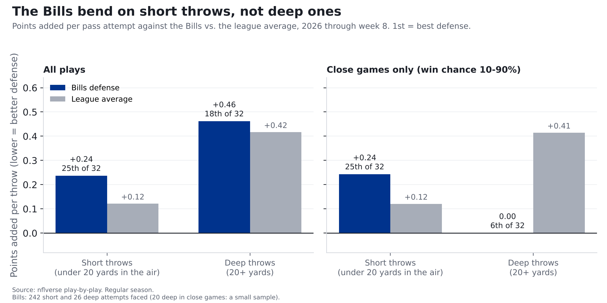
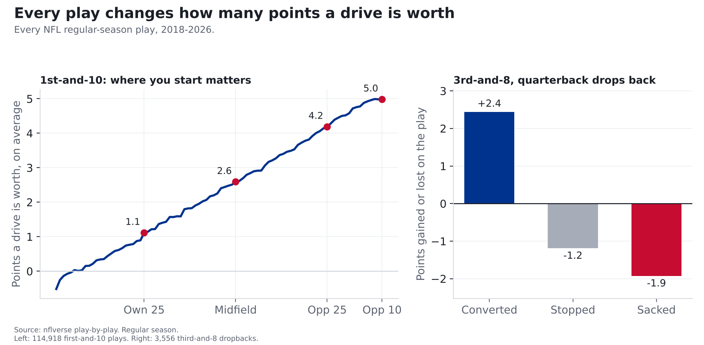
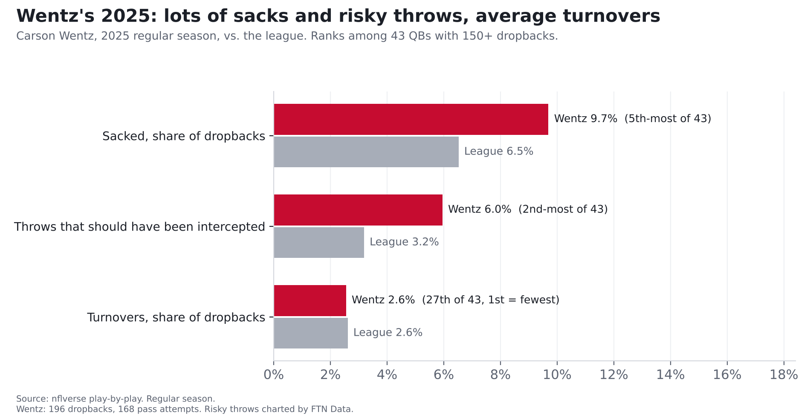

# Carson Wentz vs. the Bills defense: short passes, sacks and risky throws

**Finding: The Bills' defense gives up the most on short passes, the ones thrown less than 20 yards downfield. They rank
25th of 32 there, and 25th with garbage time removed. That's where most of Minnesota's passing will go: like most quarterbacks, Carson Wentz threw short
on 88% of his attempts last season. But Wentz brings two weak spots of his own. He was sacked on 9.7% of his dropbacks, the
5th-highest rate among 43 quarterbacks, and he threw the 2nd-most passes that should have been intercepted.**

*Bills at Vikings, Monday Night Football, Nov. 9, 8:15 p.m. ET, U.S. Bank Stadium (indoors). Kyler Murray is out with a
strained hamstring, so Wentz starts. Numbers are 2026 through week 8 unless noted, and Wentz's are mostly from 2025,
since he has thrown only 47 times this year.*

## How we measure it: points per play

Every play changes how many points a drive is worth. 1st-and-10 at your own 25 is worth about **1.1 points**
on average; at the opponent's 25, about **4.2**. On 3rd-and-8, a quarterback who converts adds about
**+2.4 points**, and one who gets sacked costs his team about **1.9**.

**The source:** the NFL's official play-by-play, published free by the nflverse project, covering every snap. For
blitzes and risky throws we add charting from FTN Data, whose analysts watch every play and mark things the official
feed doesn't, like how many defenders rushed and whether a throw should have been picked off.

**The math:** take what the drive was worth after the play, subtract what it was worth before, and that's the play's
value. Average it over many plays and you get **points added per play**. A good defense keeps that number low.

**How we checked it:** we ran every key number two ways, on all plays and on close-game plays only (when either team
had between a 10% and 90% chance to win), so a few blowout drives can't drive the story. Where the two disagree, we say so.

## Where the Bills bend: short throws

Against short throws, the Bills allow **+0.24 points per attempt** (25th of 32; league average +0.12). The
second check agrees: in close games it's +0.24 (25th), and they give up 6.8 yards per short attempt
(25th; league 6.5).

Deep throws are a different story. Opponents have tried them on only 9.7% of attempts against Buffalo
(9th-fewest), and in close games the Bills have allowed 0.00 points per deep throw, 6th in the league
(league average +0.41; only 20 attempts, a small sample). Counting blowouts they're 18th, but that's only 26 deep attempts.

Overall the Bills rank 24th against the pass, give up 20-yard plays on 9.6% of dropbacks (25th; league 8.1%),
and allow third-down conversions 42% of the time (22nd; league 40%).

## What Wentz brings

| | Wentz 2025 | Wentz 2026 | Murray 2026 | League 2026 |
|---|---|---|---|---|
| Dropbacks | 196 | 47 (small sample) | 184 | |
| Points added per dropback, all plays | +0.04 | +0.08 | -0.05 (23rd of 30) | +0.05 |
| Points added per dropback, close games | -0.04 | 0.00 | -0.06 (23rd) | +0.06 |
| Sacked | 9.7% | 12.8% | 8.2% | 6.2% |
| Share of throws 20+ yards downfield | 11.9% | 7.7% | 12.4% | 11.4% |
| Throws that should have been intercepted | 6.0% | 2.6% | 2.6% | 3.0% |

League averages for 2025: +0.04 per dropback, +0.05 in close games, sacked 6.5%, deep share 11.5%,
should-have-been-intercepted 3.2%.

Two things stand out.

**Wentz looks better overall than in close games.** Counting every play, he was about league average last season
(+0.04 per dropback; league +0.04). With garbage time removed he drops to -0.04, 32nd of 43.
Some of his best numbers came when games were already decided. Murray this year was 23rd of 30 overall and 23rd in close
games. By these numbers, neither has been an above-average passer when the game is still in doubt.

**Risk.** Wentz was sacked on 9.7% of dropbacks (5th-most of 43) and threw 10 passes that FTN's charters
marked as should-have-been-intercepted, 6.0% of his attempts (2nd-most; league 3.2%). He got away with most of
them: his actual turnover rate was 2.6%, about league average (2.6%).

## Where it meets

- **Short passes are the matchup.** Most of Wentz's throws are short (88%, about the league norm) and the Bills are at
  their weakest there. His own short-throw numbers were good overall (9th of 43) but 27th in close games.
  That's where we'd expect the Vikings to attack.
- **The Bills blitz a lot without getting home.** Buffalo sends extra rushers on 39% of dropbacks (7th-most), but
  gets sacks on only 7.1% of those plays (league 8.3%) and 3.9% without a blitz (league 5.2%).
  Wentz's sack habit is the best chance for that to change. Against the blitz last season, his points per dropback ranked
  29th of 43, on only 57 plays.
- **The ground game shouldn't scare anyone.** Minnesota's designed runs rank 28th (-0.21 per run); the Bills' run defense
  ranks 17th (-0.08 allowed, right around the league average of -0.08).
- **Turnovers.** Buffalo forces turnovers on 2.7% of dropbacks (18th; league 2.8%). That's about average. If Wentz keeps
  putting the ball in harm's way, Monday is a chance for that number to go up.

## What we're watching

**Our model's numbers for this game.** A call only counts once it's logged on the [Ledger](../ledger.html) before kickoff, and every logged call is graded after the game.

| # | What we expect | Chance |
|---|---|---|
| 1 | Minnesota's pass plays add points overall (more than zero points per dropback; the league average is +0.06) | **65%** |
| 2 | Minnesota's designed runs lose points overall (less than zero per run; the league average is -0.08) | **81%** |
| 3 | The Bills sack the quarterback on more than 6% of his dropbacks | **66%** |

How we get these: start from each side's season average, pull it halfway back toward the league average (seven games is a
small sample), combine offense and defense, and look at how much a single game usually bounces around. For calls 1 and 3
we used Wentz's own passing and sack numbers in place of the Vikings' team numbers, which were mostly Murray's games.

## For the stat-heads

- Points added = EPA (nflverse expected points). Dropbacks: `qb_dropback == 1`, EPA not null, no two-point tries, QB by
  gsis id via `COALESCE(passer_player_id, rusher_player_id)` (scrambles included). Short/deep: pass attempts excluding
  sacks, `air_yards` < 20 vs >= 20. Close games: `wp` between 0.10 and 0.90. Regular season; 2026 through week 8.
- QB ranks among quarterbacks with 150+ dropbacks (43 in 2025, 30 in 2026). League values in the QB table are
  play-weighted over all dropbacks. Wentz 2025 close-game sample: 143 dropbacks; 2026: 45. Wentz 2025 short throws, close games: 27th of 15.
- FTN charting (`raw_ftn`, joined on game and play id): blitz = `n_blitzers` > 0; should-have-been-intercepted =
  `is_interception_worthy` on pass attempts. Wentz 2025: 10 of 168 attempts; 57 dropbacks vs. the blitz.
- Bills defense: 293 dropbacks faced, 242 short and 26 deep attempts, 113 blitzes. Team ranks are among 32
  defenses (1st = best, except blitz rate where 1st = most). Team tables from `src/metrics/team.py` (`max_week=8`).
- Calls: Ledger model v0.1-locshift, shrink 0.5, pinned to week 8. Wentz substitution 243 dropbacks (2025-26):
  EPA/dropback -0.0073, sack rate +0.0378 vs. league. Expected: call 1 +0.072, call 2 -0.154, call 3 0.078.
- Injury news: Kevin O'Connell announced Nov. 5, 2026 that Wentz starts with Murray out (strained hamstring). Source: ESPN.
