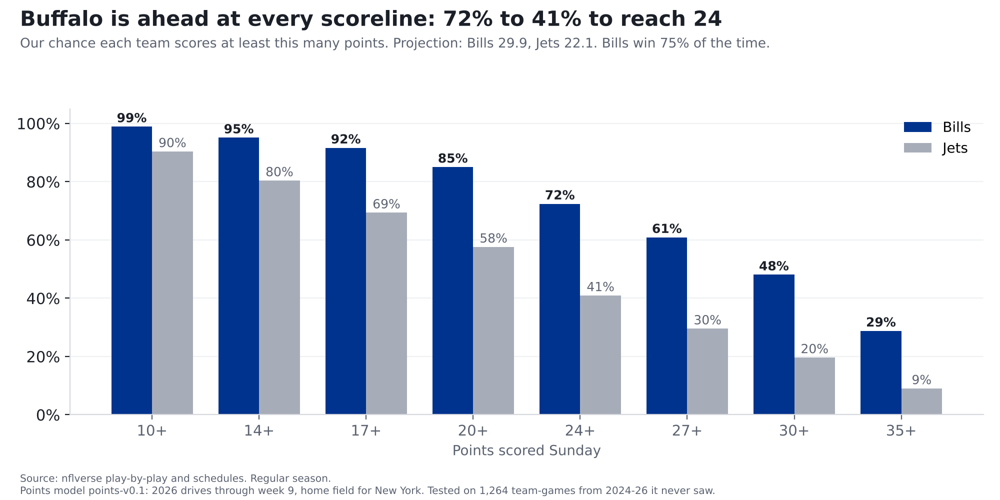
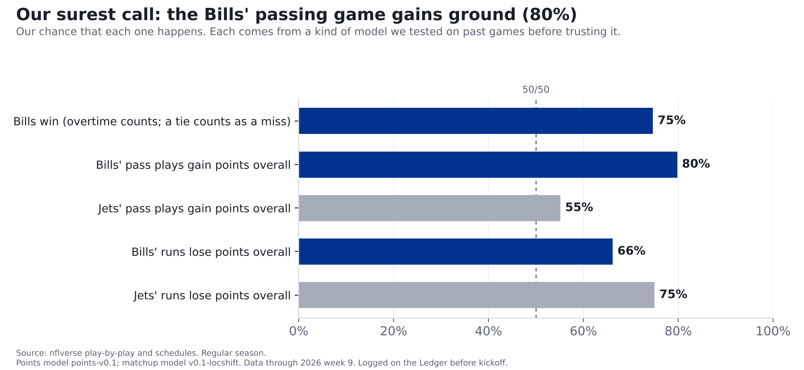
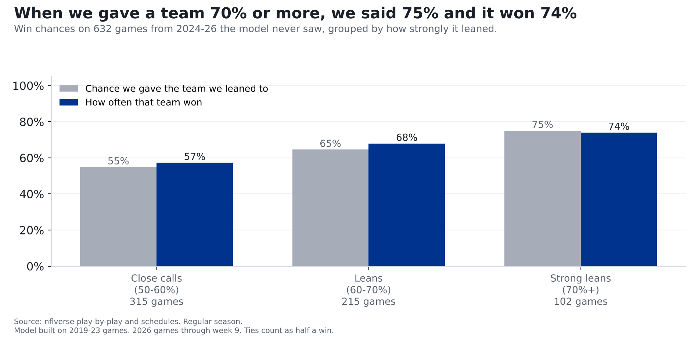

# Bills at Jets: our prediction. Buffalo's passing game gets one of the NFL's leakiest pass defenses

**Finding: We project the Bills for 29.9 points and the Jets for 22.1, which gives Buffalo a 75% chance to win. The biggest mismatch on
the field: the Bills' passing game, 4th-best in the NFL, against a Jets pass defense that's 7th-worst. Our matchup model gives an
80% chance the Bills' pass plays gain ground Sunday, our most confident pass call yet, and the model's confident calls have held up.**

*Bills at Jets, Sunday, Nov. 15, 1 p.m. ET, MetLife Stadium. Numbers are 2026 through week 9. [Last week's prediction](bills-vikings-prediction.html)
and [how it went](bills-vikings-postgame.html): 5 of 7 calls hit.*

## The matchup that decides it

We grade every play in points, though not scoreboard points: every play moves a drive closer to scoring or further away, and we turn that into
points. Last week at Minnesota,
Josh Allen's 36-yard completion to Ty Johnson on third-and-8 was worth about 3.8 points; a 7-yard sack on third-and-14 cost about
1.8. Add up every pass play and divide by how many there were.

This season the Bills' pass plays have gained 0.26 points each on average, 4th in the NFL, over 273 pass plays (sacks and
scrambles count). The Jets' pass defense has given up 0.16 a play, 7th-most of 32, over 312 pass plays. An average pass play gains 0.05.

Our matchup model counts every game equally instead of every play, so the numbers shift a little. In a typical game the Bills' passing gains about 0.27 a play, the Jets' pass defense
allows about 0.19, and an average game is 0.05. Start from average, add half of how far above average the Bills are and half
of how far the Jets' defense is, and you get about **0.23 points a play** for Buffalo on Sunday. Games swing a lot, so that's not a
promise; the model says there's an **80%** chance that, all told, the Bills' passing plays leave them better off than they started.

**Is 80% too bold?** It's the most confident pass call we've made, so we checked the model's record at that level. We tested it on 990
past team games from 2023-2025 that it had never seen. In the 134 where it gave a passing game 70% or more, it said 75% on average, and the
passing game came out ahead 78% of the time.

The rest of the game is closer to even. The Jets score 1.92 points per drive (19th of 32); the Bills' defense allows
2.10 (16th).

## The scoreboard ladder

For each scoreline, here's our chance that each team gets at least that many points Sunday:

| Points | Bills | Jets |
|---|---|---|
| 10 or more | **99%** | 90% |
| 14 or more | **95%** | 80% |
| 17 or more | **92%** | 69% |
| 20 or more | **85%** | 58% |
| 24 or more | **72%** | 41% |
| 27 or more | **61%** | 30% |
| 30 or more | **48%** | 20% |
| 35 or more | **29%** | 9% |

Read it like this: there's a 72% chance the Bills score 24 or more, and a 41% chance the Jets do.

## Where the 30 comes from

Points come from drives. Four steps:

1. **How good is each side?** This season the Bills average 2.89 points per drive, the most in the NFL (1st of 32). The Jets' defense
   allows 2.37 per drive, 6th-most. An average offense scores 2.05.
2. **Don't overreact to nine weeks.** We mix in last season and an average team. That makes the Bills' offense 2.73 and the Jets' defense 2.40.
3. **Let them meet.** Both sides tilt toward Buffalo: its offense is well above average and the Jets' defense is below it, which leaves about
   3.07 points per drive.
4. **Count the drives and check against history.** About 11 drives a game gets you to about 34. A final check against past games pulls
   extreme projections like this 34 back toward normal and gives the home team about 1.5 points. Buffalo is on the road, so it lands at **29.9**.

The Jets go through the same steps from the other direction. After mixing in last season, their offense rates 1.81 per drive against a Bills
defense at 2.08, plus the home bump.
That's **22.1**.

## How a 30-point projection becomes 75%

Nobody scores exactly what we project. We looked at 2,494 past team scores from 2019-2023 and asked how far off we were. Half the time, a team landed
within about 6 points of our number; eight times in ten, within about 12. (On games the model had never seen, our average miss was 7.5 points.)

Then we play Sunday's game over and over, once for every one of those past misses. Eight times in ten the Bills land between 18 and
42 points. For who wins, we took 1,247 real past games, noted how far off we were for each team in that same game, applied each pair
to Sunday's projections, and checked who came out ahead: Buffalo, 75% of the time. (A game tied after 60 minutes counts as half for each side.)

## The calls going on the Ledger

| Call | Our chance | Where it comes from |
|---|---|---|
| Bills win (overtime counts; a tie counts as a miss) | **75%** | Points model, win chance |
| Bills' pass plays gain points overall | **80%** | Matchup model |
| Jets' pass plays gain points overall | **55%** | Matchup model |
| Bills' runs lose points overall | **66%** | Matchup model |
| Jets' runs lose points overall | **75%** | Matchup model |

A team's runs "lose points" if, all told, its running plays left it worse off
than before. That's normal: in 990 past team games, runs lost points overall 64% of the time.

**Why no 20-point calls this week.** Last week we said our chances of a team reaching 20 points ran a few points low, and that we'd fix that before using
those 20-point chances again. We haven't fixed it yet, so they're still in the ladder above but aren't logged. The whole middle of the ladder has the same issue: on games the model never saw, when it gave a
team a 40-60% chance of reaching a scoreline, it said 50% on average and the team got there 55% of the time. Read the middle of the ladder as a little low.

**Logged on the [Ledger](../ledger.html) on Nov. 13 at 7:54 p.m. ET, before kickoff.** All 5 calls are graded after the game, hit or miss, and stay up either way.

## Did we check it?

**The win chance.** On 632 games from 2024-2026 the model had never seen, the team it gave the better chance won 63% of the time. Taking the
home team every time would have been right 52%. When it gave a team 70% or more, as it gives Buffalo Sunday, it said 75% on average and that team
won 74% of the time (102 games; a tie counts as half a win).

**The pass and run calls.** These come from a simpler model, tested on 990 past team games (2023-2025) against just guessing the league's usual rate.
It beat the guess on pass calls and edged it on run calls.

## What the model doesn't know

- **Injuries.** Our models don't know who plays. Check the final injury reports before kickoff.
- **One game is one game.** 75% means the Jets win this about one time in four. That's why every call goes on the Ledger and gets graded.

## For the stat-heads

- Matchup model v0.1-locshift (`src/ledger/model_v01.py`): expected = league + 0.5 x (offense gap + defense gap), plus the pooled within-team game-to-game spread;
  P = share of that spread above the threshold. EPA per dropback (scrambles and sacks included), EPA per designed rush. Bills dropback EPA expected
  +0.233 (offense +0.270, Jets defense +0.195, league +0.049); Jets dropback
  +0.028; rush: Bills -0.067, Jets -0.113.
- Matchup backtest (`scripts/backtest_model_v01.py`, 2023-25 weeks 8+, n=990 per call type), Brier vs league-rate baseline: dropback 0.2296 vs
  0.2452; rush 0.2263 vs 0.2312. Dropback calibration: said 26% / happened 32% (n=19); said 39% / happened 37% (n=191); said 50% / happened 57% (n=229); said 62% / happened 61% (n=417); said 75% / happened 78% (n=134).
- Raw dropback EPA per play, 2026 weeks 1-9: Bills offense +0.263 (rank 4), Jets defense +0.161 (rank 26 of
  32, 1 = best), league +0.047.
- Points model points-v0.1 (`src/ledger/points_model.py`): ratings = (points + 60 x prior) / (drives + 60), prior = league + 0.7 x last
  season's gap; calibrated score = 7.07 + 0.679 x raw + 1.45 x home, fit on 2019-23 (week 2 on).
- Win chance (points-win-v0.1): 1,247 same-game residual pairs; out of sample (2024-26, week 2 on, n=632): Brier 0.2248 vs 0.2492
  (50/50) and 0.2490 (home-win rate).
- Ladder calibration out of sample (2024-26, all 8 scorelines pooled), chances 0.4-0.6: said 0.499, happened 0.548, n=1,744.
- Data pinned through 2026 week 9. No betting lines are used anywhere in these models.
