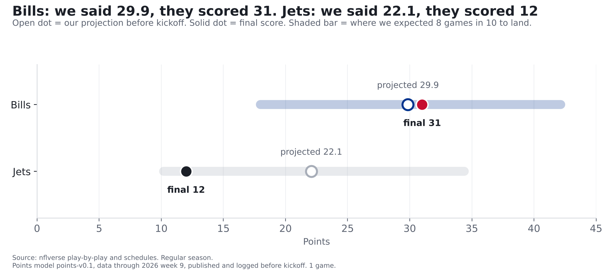
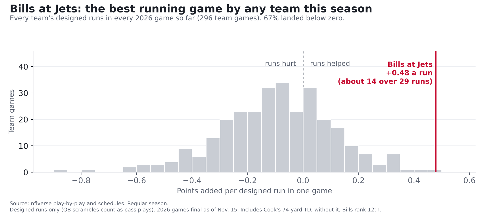
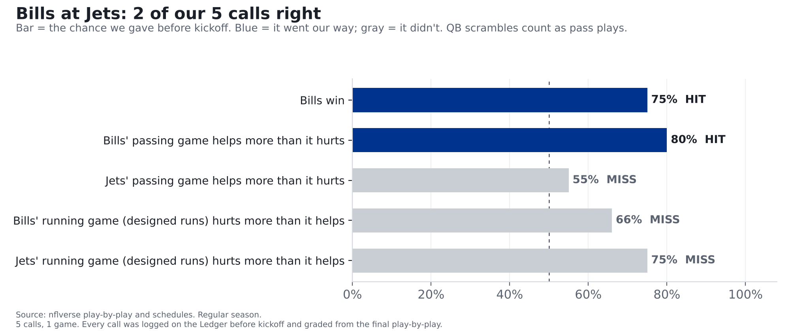

# Bills 31, Jets 12: our win call held, our run calls didn't

**We gave the Bills a 75% chance to win and projected them for 29.9 points. They won 31-12. Our surest call, that the Bills'
passing game would help more than it hurt, hit too. But we missed three calls. Two were run calls, built on the idea that running games usually
hurt more than they help: counting every run, Buffalo's designed runs had the best game of any team's this season, and the Jets' runs helped, just barely. The third,
on the Jets' passing game, was close to a coin flip.**

*Bills at Jets, Sunday, Nov. 15, MetLife Stadium. Our prediction ran Saturday ([our preview](bills-jets-prediction.html)), and every call was
logged on the [Ledger](../ledger.html) before kickoff. Here's how they did. League numbers are as of Sunday night, Nov. 15 (the Sunday and Monday night games weren't final yet).*

## The calls

| Call | Our chance | What happened | Result |
|---|---|---|---|
| Bills win | 75% | Bills 31, Jets 12 | **Hit** |
| Bills' passing game helps more than it hurts | 80% | Helped: added about 5 points over 22 pass plays | **Hit** |
| Jets' passing game helps more than it hurts | 55% | Hurt: cost about 9 points over 48 pass plays | **Miss** |
| Bills' running game (designed runs) hurts more than it helps | 66% | Helped: added about 14 points over 29 designed runs | **Miss** |
| Jets' running game (designed runs) hurts more than it helps | 75% | Helped: added 1.1 points over 20 designed runs | **Miss** |

*Running-game calls count designed runs only; quarterback scrambles count as pass plays.*

**What "helps" and "hurts" mean.** Every snap starts from a spot where an average offense can expect a certain number of points from the drive.
A good play raises that number and a bad one lowers it. In the first quarter, on fourth-and-1 from his own 37,
Josh Allen ran for 2 yards. That doesn't sound like much, but it kept the drive alive. Before the snap, Buffalo was a little more likely to give up
the next score than to get it (about -0.5 points). After it, Buffalo could expect about 1.8, so the play was worth about 2.3 points. Add up every designed run, good and bad, and you get whether a team's running
game helped or hurt. Buffalo's added about 14. That's not 14 points on the scoreboard. It means the runs kept
moving drives toward points.

## What we missed: the running games

Our model expected Buffalo's designed runs to cost a little, the way most teams' do. In 67% of 296 team games this season,
a team's designed runs added up to less than zero. Instead, the Bills ran 29 times for 204 yards, and the runs added
about 14 points. Counting every run, that's the best running game by any team this season (1st of 296),
and better than any Bills game in 2023, 2024 or 2025. That counts James Cook's late 74-yard touchdown; without it, the game would rank
12th. One game and 29 runs is a small sample.

**Was it one big run?** Partly. Cook's 74-yard touchdown run, with 4:52 left and the game all but decided (Buffalo had a
98% chance to win), was worth about 6.4 points by itself. Take it out and Buffalo's other 28 designed runs still added about 7 points. Count only the runs while the
game was still in doubt (each team with at least a 10% chance to win) and they still helped. Cook finished with 18 carries for
157 yards. Allen's 4 designed runs gained only 6 yards but added about 6
points: two fourth-and-1 conversions and two 1-yard touchdowns. So this miss wasn't bad luck on one play. Buffalo ran the ball well
all day, and our model didn't see it coming.

**The Jets' runs: a coin on its edge.** We gave a 75% chance that the Jets' designed runs would hurt more than they helped. Over 20 runs
they added 1.1 points, just barely above zero. By the rule we set before kickoff, that's a miss, and it counts.

## The passing games and the win

On 22 pass plays, Allen went 11 of 21 for 196 yards with
1 interception, and the passing game added about 5 points. That's the call we gave 80%, and it hit.

The Jets used two quarterbacks. Geno Smith started and was hurt on his last throw before halftime. Rookie Cade Klubnik opened the
second half, Smith came back for one drive, and Klubnik played the rest. Smith went 13 of 21 for 148 yards;
Klubnik went 11 of 20 for 137 yards with 1 interception and was
sacked 3 times. Together, the Jets' passing game cost them about 9 points over 48 pass plays.
We had given 55% that it would help more than it hurt, close to a coin flip, so it's a miss, but not a confident one.

The Jets scored 12 points on 11 drives: 4 field goals, no touchdowns, 2 turnovers and 1 turnover on downs.
Buffalo scored 31 on 11 drives, with 4 touchdowns.

## The record

**How we grade.** A call is a hit when the side we gave 50% or more happens. We also score every call by how far our chance was from what
happened, squared, so a confident miss costs more than a timid one. This week our five calls scored 0.28; guessing 50/50 on every call
would score 0.25, and lower is better. So this week we did worse than a coin flip, mostly because of the two run calls we were most confident in.
Across all 16 graded calls on the Ledger, Bills and Sabres, we're 10 for 16 with a score of 0.24, a little better
than 50/50. That's still a small record. It grows every week, misses included.

## What it means

- **Run calls need a better model.** Our run calls lean hard on "running games usually hurt," and two of them missed this week. Before we put
  run calls at 75% again, we'll check how often that confidence has held up for strong running teams.
- **Our Bills score was close; the Jets' wasn't.** We said 29.9 for Buffalo and they scored 31. The Jets' 12 came in well under our
  22.1, but inside the range we expected 8 games in 10 to land (10 to 34).
- **The defense keeps climbing.** Buffalo now allows about 1.99 points a drive (14th of 32 teams, league average
  2.05). It was 16th before Sunday and 30th after week 7. Four teams hadn't played yet when we ran this, so that rank can still move.
- **Next:** the Bills host Miami on Sunday, Nov. 22, with our predictions logged before kickoff.

## For the stat-heads

- Points model points-v0.1 and win model points-win-v0.1, inputs pinned to 2026 week 9 (as published): BUF 29.86,
  NYJ 22.08, P(BUF win) 0.7466; 80% ranges from training residuals.
- "Helps/hurts" is nflverse expected points added (EPA), summed over plays. Example play 129: EP -0.52 before, EPA +2.31.
- Grades: P0012 from raw_schedules; P0013-P0016 from clean_team_week (model_v01.game_values, offense side), the definitions the models used.
  Actual values: P0013 BUF EPA/dropback +0.211; P0014 NYJ EPA/dropback -0.186; P0015 BUF EPA/rush +0.477; P0016 NYJ EPA/rush +0.056. Brier this week 0.2806; all graded calls
  0.2384 (n=16).
- BUF EPA per designed run +0.477 (n=29); without play 3897 (74-yard TD, win probability
  0.98 before the snap) +0.267 (n=28); win probability 0.10-0.90 only +0.325 (n=24). Rank 1 = best
  of 296 2026 team-games final as of Sunday night, Nov. 15 (the Sunday and Monday night games weren't final yet). Best BUF game by the same measure: 2023 +0.269, 2024 +0.333,
  2025 +0.432. Without play 3897, BUF would rank 12 of 296.
- NYJ dropbacks: Smith 22 (EPA -3.4), Klubnik 26 (EPA -5.5). The play-by-play
  notes Smith was injured on play 2022 (00:25, 2nd quarter) and returned on play 2656 (07:54, 3rd quarter);
  it doesn't say why Klubnik took over again after that drive.
- BUF points allowed per drive, regular season: through week 9 2.101 (16 of 32); through week 10 games final as of this
  run 1.990 (14 of 32).
- Hit rule: the side given 50% or more happens (`ledger.summary`). The logged Ledger wording for P0012-P0016 is unchanged; this story uses the
  plain-English labels from the reworded preview.
