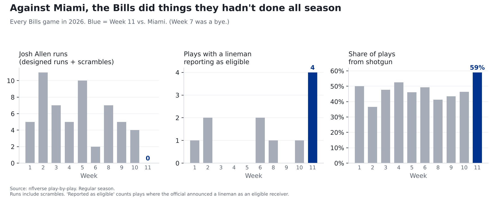

# Josh Allen didn't run once, and six more signs the Bills were trying things out against Miami

**For the first time in 135 regular-season games since 2018 where he played more than a handful of plays, Josh Allen didn't run the ball once against Miami:
no designed runs, no scrambles. The Bills also ran their first fake punt of the season. They lined up for an onside kick with a 14-point lead, then kicked deep.
And they sent in an extra lineman more often than in any other game this season. In a 26-9 win, it looked a lot like a team trying things out.**

*One game, Nov. 22, against the rest of the 2026 season. [Our recap of the game](bills-dolphins-postgame-wk11.html).*

## 1. Allen never ran

Allen averaged 6 runs a game (designed runs plus scrambles) in the Bills' first nine games. Against Miami: zero. That had never happened in any of his
135 regular-season games since 2018 where he played more than a handful of plays. We can't tell from the play-by-play whether that was a plan to keep him healthy,
a game plan against Miami, or chance.

How we counted: we went through the play-by-play of every Bills regular-season game since 2018 and counted each play where Allen carried the ball, not counting
kneel-downs. We kept the 135 games where he threw, ran or was sacked at least 20 times. That leaves out one game, the 2019 finale, when he was in for 5 plays.
Before Sunday, his fewest runs in any of those games was 1, and that happened 6 times. Never zero.

That means no quarterback sneak, either. Allen ran at least one in each of the Bills' first 9 games this season, according to FTN's play charting.
Against Miami, the Bills' fourth-and-1 went to James Cook instead.

## 2. Fourth-and-1 went to Cook, not Allen

On the opening drive, the Bills went for it on fourth-and-1 near midfield. Before Sunday, Allen had carried 6 of the Bills' 9 fourth-and-1 plays this season.
This time guard Austin Corbett checked in with the referee as an eligible receiver, an extra blocker on the field, and James Cook ran it up the middle for 2 yards.

## 3. The punter threw a pass, and more trick plays

On fourth-and-8 from their own 34, up 3-0 in the first quarter, punter Tommy Doman Jr. threw to tight end Keleki Latu for a 30-yard gain and a first down.
It was the Bills' first fake punt this season. Buffalo is one of only 5 teams to run a fake punt this season (not counting botched snaps).

The Palm Beach Post's Tom D'Angelo [also counted](https://sports.yahoo.com/articles/were-bills-looking-ahead-chiefs-001633008.html) a flea flicker and an end-around.
The play-by-play doesn't mark trick plays, and FTN hasn't charted this game yet, so we can't pin down those two plays.

## 4. They showed an onside kick, then didn't kick it

Leading 23-9 at the start of the fourth quarter, the Bills lined up in onside-kick formation, took a 5-yard delay-of-game penalty, and then kicked deep.
Teams have kicked onside 28 times this season, and every one came from a team that was behind. The Bills hadn't tried one all season.

## 5. More extra linemen than in any game this season

Four times, an offensive lineman reported in as an eligible receiver: Tylan Grable twice and Corbett twice, including on Cook's 1-yard touchdown.
The Bills had never done it more than twice in a game this season. Around the league it's common enough: 54 of 316 team games this season had four or more.

## 6. More shotgun than in any other game this season

The Bills lined up in shotgun on 59% of their plays, their most this season (their other games ranged from 37% to 53%).
That's still a little under the league average of 62%.

## 7. Deep shots early

Allen threw 5 of his 11 first-quarter passes 20 or more yards downfield, then went deep only twice the rest of the game. The [recap](bills-dolphins-postgame-wk11.html) has the details.

## What it means

None of this proves a plan. A home game against a struggling division rival is a natural place to try a fake, keep the quarterback out of harm's way, or show future
opponents something new to study. Or it may just have been one week's game plan. What the numbers do say: this game looked different from the Bills' other nine.
Kansas City comes to Buffalo on Thanksgiving night. Whether Allen goes back to running, and whether the extra linemen stay, is worth watching.

## For the stat-heads

- Runs: plays with Allen as `rusher_player_id` (designed runs and scrambles, not kneel-downs or two-point tries; Josh Allen had none, and backup Kyle Allen took the final kneel).
  Career: regular-season Bills games 2018 through 2026 week 11 where Allen was passer or rusher on 20+ plays (n = 135 of 136; the one left out, 2019_17_NYJ_BUF, had 5 plays and no runs).
- Eligible linemen: plays whose description includes "reported in as eligible". Shotgun: nflverse `shotgun` on pass or rush plays.
  Fake punt: 27 air yards, 30-yard gain.
- Fake punts: pass or run plays from "(Punt formation)", excluding aborted snaps. Onside kicks: plays described as "kicks onside" (n = 28); kicking team's margin from `score_differential` on the kickoff (nflverse lists the receiving team as `posteam`). The Bills' look was a no-play tagged "(Onside Kick formation)".
- League context is 2026 regular-season games in the play-by-play when this ran; week 11 games not yet loaded: 2026_11_NYJ_LAC, 2026_11_JAX_NYG, 2026_11_LV_DEN, 2026_11_MIN_SF, 2026_11_CIN_WAS.
