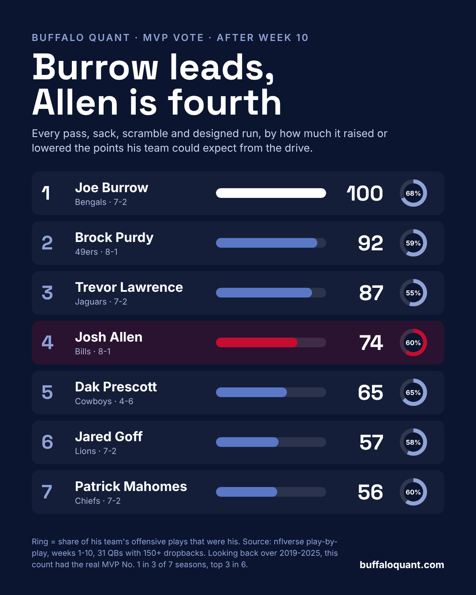
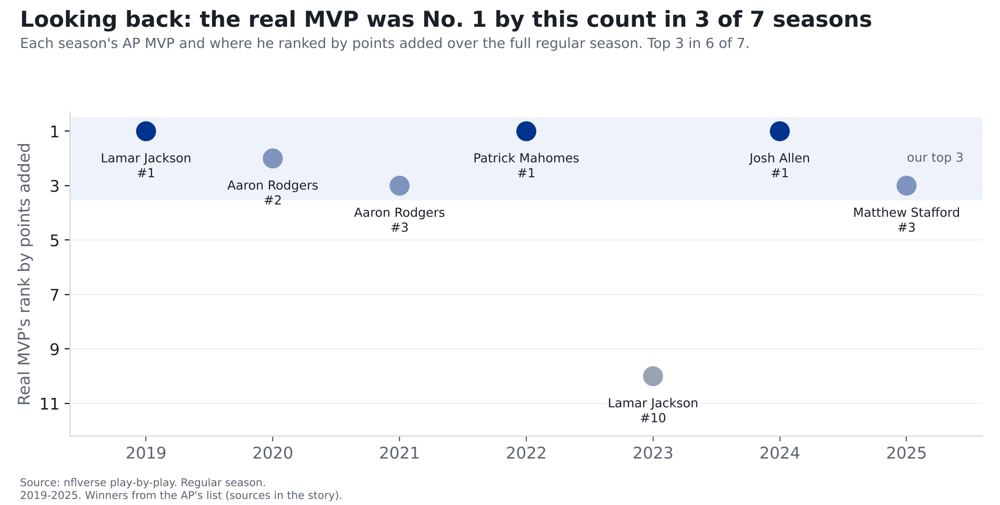

# Our MVP vote after 10 weeks: Joe Burrow

**Joe Burrow's plays have been worth about 100 points more than an average offense would expect from the same situations,
more than any other quarterback. Brock Purdy is second at 92. Josh Allen is fourth at 74.
We ran this measure over the last seven full seasons (the same seasons we used to choose it): this count had the real MVP No. 1 three times
and in its top three six times.**

*Points added for every quarterback with 150+ dropbacks, through week 10. Numbers as of Tuesday, Nov. 17 (every week 10 game final). We'll update the vote as the season goes.*

## Our ballot

| # | Player | Team | Team record | Points added | Share of team's plays | Rank, close games only |
|---|---|---|---|---|---|---|
| 1 | Joe Burrow | Bengals | 7-2 | 100 | 68% | 1 |
| 2 | Brock Purdy | 49ers | 8-1 | 92 | 59% | 2 |
| 3 | Trevor Lawrence | Jaguars | 7-2 | 87 | 55% | 3 |
| 4 | Josh Allen | Bills | 8-1 | 74 | 60% | 4 |
| 5 | Dak Prescott | Cowboys | 4-6 | 65 | 65% | 7 |
| 6 | Jared Goff | Lions | 7-2 | 57 | 58% | 13 |
| 7 | Patrick Mahomes | Chiefs | 7-2 | 56 | 60% | 6 |
| 8 | C.J. Stroud | Texans | 3-6 | 55 | 64% | 5 |
| 9 | Drake Maye | Patriots | 5-5 | 46 | 56% | 10 |
| 10 | Jordan Love | Packers | 6-4 | 44 | 66% | 12 |

*Points added: every pass, sack and scramble, plus his own designed runs. Share of team's plays: the share of his team's offensive plays that were his passes, sacks, scrambles or runs. Close games only: the same count leaving out plays when either team was below a
10% chance to win.*

## Why Josh Allen is fourth

The same count had Josh Allen No. 1 in 2024, the year he won MVP. This year he's at 74, 26 behind Joe Burrow. Most of the gap comes from one
thing: **Allen has thrown far less.** He wins some of it back with his legs and with less costly turnovers.

- **Throwing.** Burrow has 343 throws and scrambles (not counting sacks and his own turnovers); Allen has 270, 73 fewer. The Bills drop back to pass on
  54% of their plays, one of the three lowest rates in the NFL; the Bengals, 67%, the highest. Throw for throw Burrow has been a little better: each of those plays is
  worth about four-tenths of a point, a bit more for Burrow. The bigger difference is how many: Burrow's add up to about 142 points, Allen's to about 103.
- **Sacks and turnovers.** Allen has more of them (17 sacks and 8 turnovers of his own, against Burrow's 15 and 7; a sack that loses the ball counts once, as a turnover), but Burrow's turnovers have been
  costlier: about 3.9 points each, to 2.3 for Allen's. All told they've cost Allen about 39 points and Burrow about 44.
- **Running.** Allen's 36 designed runs have added about 10 points, against 2 for Burrow.

Add those up and you get each total: 142 - 44 + 2 = 100 for Burrow, 103 - 39 + 10 = 74 for Allen (rounded).

So the biggest reason he's fourth is volume. You can read that two ways: he's had fewer chances to help, so he's helped less, or a count
like ours undersells a quarterback on a team that runs well. Decide for yourself.

**What about the Bills' 8-1 record?** It isn't in our score. Looking back over the last seven seasons, giving extra credit for team wins ranked the real MVP
No. 1 less often (two times vs. three), in the top three just as often (six), and a bit closer to the top on average. With it, Allen would be
No. 4 this year. This is our vote on who has added the most, not a guess at the voters', so we left record out.

## How we score it

**Points added.** Every snap starts from a spot where an average offense can expect a certain number of points from the drive.
A good play raises that number and a bad one lowers it. Joe Burrow's best play this season: on first-and-10,
from a spot where an average offense could expect just over 2 points, a 28-yard touchdown added about
4.5 points to that. Add up every play a quarterback is responsible for, good and bad, and you get his points added. A quarterback
who throws an interception or takes a sack loses points the same way. Joe Burrow's 373 plays add up to about 100.

**Why it's a quarterback.** Every pass starts with him, so he touches far more plays than anyone else. The best non-quarterback,
Jaxon Smith-Njigba (WR, Seahawks), is at about 65 (see "Best of the rest" below), and a catch counts for the thrower too, so his total overlaps with his quarterback's.

**Share of the offense.** The table's "share of team's plays" column is context only; adding it to the score didn't match past MVPs better.

**The check.** We ran the same count over full past seasons and asked where each real AP MVP ranked:

The miss was 2023: Lamar Jackson won the award but ranked No. 10 by points added (62, behind
Brock Purdy's 157). Voters see things this count doesn't, so treat it as our vote, not a forecast of theirs.

## Best of the rest (not quarterbacks)

| Player | Pos. | Team | Points added | Runs + passes thrown his way |
|---|---|---|---|---|
| Jaxon Smith-Njigba | WR | Seahawks | 65 | 112 |
| Tee Higgins | WR | Bengals | 53 | 73 |
| Ja'Marr Chase | WR | Bengals | 48 | 87 |
| Christian Watson | WR | Packers | 39 | 79 |
| Brock Bowers | TE | Raiders | 34 | 72 |

*A catch's points also count for the quarterback who threw it.*

## What about defense?

We don't rank defenders here. We can't yet split a defense's points saved among its players fairly. It's next on our list.

## For the stat-heads

- Points added = nflverse expected points added (EPA), regular season weeks 1-10, excluding two-point tries, kneels and
  no-plays. QB credit: all dropbacks (passer, or rusher on scrambles) plus designed runs where he is the rusher. Minimum
  150 dropbacks. Example play: game 2026_03_CIN_PIT, play 1963, EP 2.04, EPA +4.54.
- Allen split (QB's own turnovers only; receiver fumbles stay in throws): per throw/scramble 0.415 (Burrow) vs 0.383 (Allen);
  of the 38.9-point throwing gap, about 30.3 is volume (73 plays x 0.415) and 8.7 is value per play.
  Dropback rate uses this story's play filter; the Bills' rank among the lowest is within a fraction of a play of the next team.
- Close-games rank: same sum over plays with win probability 0.10-0.90.
- Check: full regular seasons 2019-2025; real MVP's rank by this measure:
  2019 Lamar Jackson #1; 2020 Aaron Rodgers #2; 2021 Aaron Rodgers #3; 2022 Patrick Mahomes #1; 2023 Lamar Jackson #10; 2024 Josh Allen #1; 2025 Matthew Stafford #3 (mean rank 3.0). Variants tested on the same seven seasons and not
  used: points x share of team plays: No. 1 2, top 3 5, mean rank 3.3 (2019 #1, 2020 #3, 2021 #5, 2022 #1, 2023 #9, 2024 #2, 2025 #2); points x team win share: No. 1 2, top 3 6, mean rank 2.1 (2019 #1, 2020 #2, 2021 #2, 2022 #1, 2023 #5, 2024 #2, 2025 #2).
  The measure was chosen on these same seasons, so the check is in-sample. Winners matched by gsis id.
  MVP winners from https://www.nfl.com/news/matthew-stafford-rams-qb-most-valuable-player-2025 and https://www.pro-football-reference.com/awards/ap-nfl-mvp-award.htm and https://foxsports.com/stories/nfl/nfl-most-valuable-player-complete-list-winners-year.
- Non-QB credit: designed runs plus every target (full EPA), so it double counts with the passer.
