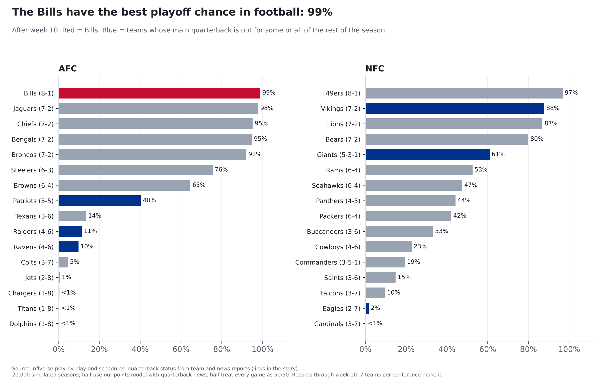
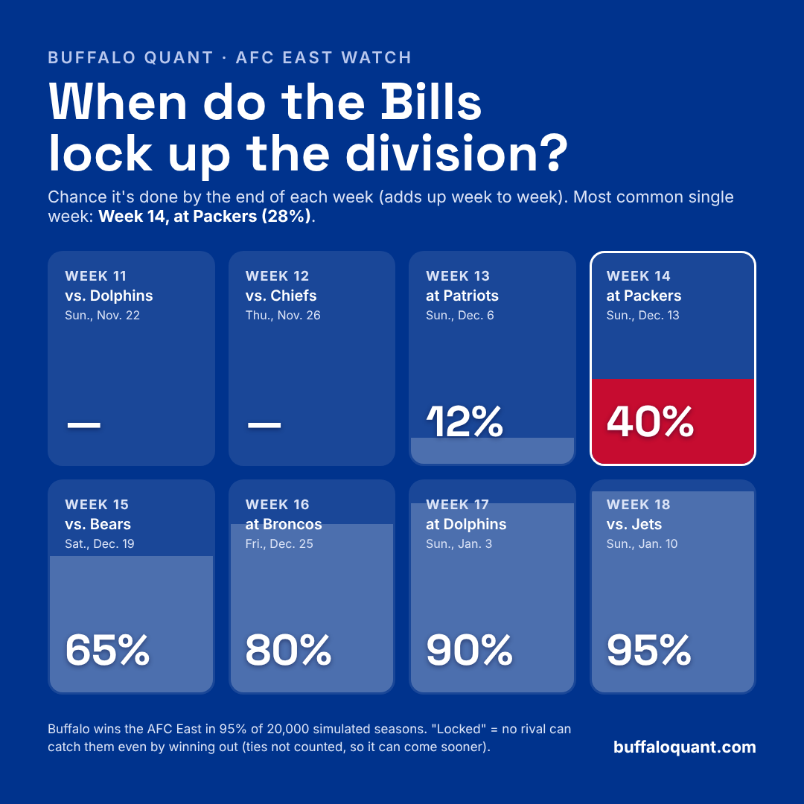
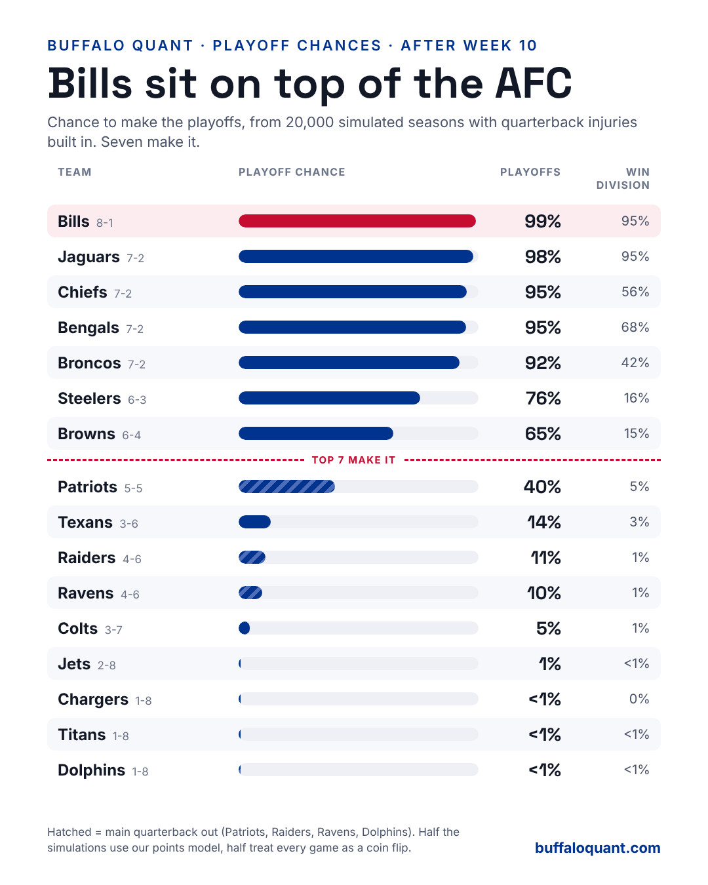
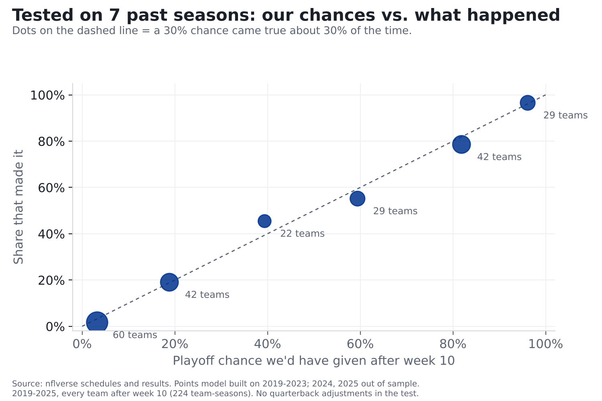

# The Bills have a 95% chance to win the AFC East, and most often lock it up in week 14 or 15

**After 10 weeks, Buffalo (8-1) leads the AFC East by 3½ games. In 20,000 simulated rest-of-seasons, the Bills win
the division 95% of the time and make the playoffs 99% of the time. They lock up the division as early as week 13
(12% of simulations), and most often in week 14 (28%) or week 15 (24%). We also ran
every other team, with this season's quarterback injuries built in.**

*Our playoff chances for all 32 teams, with games through week 10. Numbers as of Tuesday, Nov. 17 (every week 10 game final). We'll update them as the season goes.*

## The Bills

- **Division:** 95%. Buffalo leads by 3½ games with 8 to play. Next up: the Dolphins on
  Sunday, Nov. 22.
- **Playoffs:** 99%. **Top seed (the only first-round bye):** 39%.
- **Wins:** about 13 (12.7 on average across the simulations).
- **Clinching:** by the end of week 13, 12% of the time. By week 14, 40%. By week 15, 65%.
  The middle of all the simulated clinch weeks is week 15.
- **The team chasing them:** the Patriots (5-5) have 7 games left, so they can finish with at most 12 wins.
  The Patriots won the first meeting in week 4, 29-26. The rematch is week 13 on the road,
  the only meeting left between the top two teams in the division. The Patriots win the division in 5% of our simulations. With Drake Maye
  likely out at least four more games, their playoff chance is 40%, down 7 percentage points from what it would be with him.

**What "clinch" means here:** the week Buffalo's win total gets out of reach, when even a rival winning every remaining game
couldn't catch the Bills. We only count it clinched when no rival can even pull level, because the league's tiebreakers can't all be
worked out ahead of time, so the real clinch can come sooner than our chart shows.

## How we got these numbers

**Step 1: how good is each team?** Our points model rates every offense and defense by points per drive this season, the same
model behind our weekly game predictions. It projects the score of every remaining game.

**Step 2: play out the rest of the season, 20,000 times.** For each game, we take our projected score and add the kind of
surprise real games produce. We use the misses from real past games, so a team our model expects to win by 7 still loses about as often as real
teams expected to win by 7 have. Teams also get better or worse as a season goes on. In past seasons, a team's scoring drifted about 3 points
a game from where it stood after 10 weeks, and the points it gave up drifted about 2. So each simulated season gives every team its own
lasting nudge up or down. Put together: in 19,069 of the 20,000 simulated seasons the Bills finished first in the AFC East, and in
916 the Patriots did. That's the 95%.

**Step 3: quarterbacks.** This is where injury news comes in. We looked at 3,266 team games from 2019 to 2025 (each game counted once for each team). In the
648 where a team started someone other than its main quarterback, it scored 2.5 fewer points than our
model expected, and its opponent scored 0.9 more. That's the penalty we apply in every game a team's main quarterback
misses. When a starter is hurt with no timeline, we don't guess. We draw how many games he misses from 100 past absences that
ended with the starter coming back. The typical one lasted 2 games.

**Step 4: seed the playoffs.** Four division winners and three wild cards per conference, with ties broken by head-to-head, then
division record, then conference record. The league's full tiebreaker list goes deeper; past these three steps we flip a coin.

**How we checked it.** We ran the same method after week 10 of each of the last seven seasons (2019-2025) and
compared it with who actually made the playoffs. The honest result: by this point in a season, the standings already say a lot.
Treating every remaining game as a coin flip did about as well as our model. Blending the two half and half did at least as well
as the coin flip in 5 of 7 seasons. So that blend is what you see here: half of the simulated seasons use our model and the
quarterback news, half treat every game as 50/50. Teams we put at 90% or better made it 97% of the time
(29 teams). Teams at 10% or less made it 2% of the time (60 teams).

**A caution about that test.** Our points model was built on 2019-2023, so 5 of those 7 seasons flatter it. Across the 2 seasons it hadn't
seen (2024 and 2025) taken together, the standings alone did better. The blend edged them in 2024 but fell well behind in 2025. So read the gaps between teams with similar
records as a hint, not a sure thing. The standings are doing most of the work here; the model and the quarterback news nudge them.

## Quarterback injuries we built in

Nine teams are without their main quarterback (the one with the most dropbacks this season), or waiting to hear how long
he'll be out, because of an injury, a trade or a benching. In each game he misses, we apply the penalty from step 3. The change column compares each team's playoff
chance with and without that penalty. Last column: why, with the reports we used.

| Team | Main QB | Starting now | How long | Playoff chance (change from QB news, in percentage points) | Why |
|---|---|---|---|---|---|
| Dolphins | Malik Willis | Kyle McCord | at least 3 more games, then drawn from past absences | <1% (no change) | Willis is on injured reserve (core muscle), not season-ending; IR means at least four games. [1](https://www.thefantasyfootballers.com/news/647012/kyle-mccord-new-starting-qb-in-miami/) [2](https://atozsports.com/?p=512550) |
| Vikings | Kyler Murray | Kirk Cousins | no timeline (drawn from past absences) | 88% (down 1) | Murray (hamstring) is week to week and has missed two games; Cousins starts. [1](https://www.thelines.com/nfl/vikings-kyler-murray-out-week-to-week-with-strained-hamstring/) [2](https://www.thelines.com/nfl/vikings-bank-on-reunion-with-kirk-cousins-to-transform-struggling-offense/) |
| Patriots | Drake Maye | Tommy DeVito | at least 4 more games, then drawn from past absences | 40% (down 7) | The Patriots fear Maye fractured his ankle and say he likely won't play in week 12; he could miss the rest of the season (ESPN). We assume at least 4 more games, then draw the rest from past injuries. [1](https://www.espn.com/nfl/story/_/id/50500352/patriots-qb-drake-maye-leg-miss-extended-sources-say) [2](https://www.rotowire.com/football/headlines/drake-maye-injury-not-expected-to-be-available-in-week-12-per-vrabel-648145) |
| Cardinals | Jacoby Brissett | Carson Beck | rest of season | <1% (no change) | Brissett traded to Baltimore; Gardner Minshew out for the season (elbow); rookie Carson Beck starts. [1](https://www.foxnews.com/outkick-sports/cardinals-name-rookie-carson-beck-starter-rule-out-gardner-minshew-ii-season-elbow-injury) [2](https://www.nfl.com/news/cardinals-have-all-the-confidence-in-rookie-qb-carson-beck-ahead-of-first-nfl-start) |
| Ravens | Tyler Huntley | Jacoby Brissett | rest of season | 10% (down 3) | Huntley (toe) is on injured reserve for the season; Brissett started Monday. Lamar Jackson is out 6-10 weeks after thumb surgery (per the team), so he may return late in the season. We don't model that return, so Baltimore's chances may be a little low. [1](https://sports.yahoo.com/nfl/article/nfl-monday-night-football-preview-ravens-look-to-stay-relevant-with-jacoby-brissett-chargers-look-for-a-win-135635040.html) [2](https://bolavip.com/en/nfl/why-arent-lamar-jackson-or-tyler-huntley-playing-today-for-ravens-vs-chargers-in-2026-nfl-week-10-mnf) |
| Raiders | Kirk Cousins | Fernando Mendoza | rest of season | 11% (down 3) | Cousins went back to Minnesota before the trade deadline; rookie Fernando Mendoza starts. [1](https://www.thelines.com/nfl/vikings-bank-on-reunion-with-kirk-cousins-to-transform-struggling-offense/) [2](https://www.si.com/nfl/grading-fernando-mendoza-carson-beck-first-starts) |
| Giants | Jameis Winston | J.J. McCarthy | rest of season | 61% (down 8) | The Giants made McCarthy the starter over Winston in week 7. [1](https://abc7ny.com/post/source-giants-turning-jj-mccarthy-qb1-week-texans/19965065/) |
| Eagles | Jalen Hurts | Tanner McKee or Joe Milton | rest of season | 2% (down 1) | Hurts is out for the season (blood clots). [1](https://www.newsweek.com/eagles-qb-jalen-hurts-season-comes-to-stunning-end-after-alarming-health-news-12588895) |
| Seahawks | Sam Darnold | Drew Lock | back week 12 (assumed) | 47% (up 2) | Darnold (quad, ribs) sat week 10 ("Sam will be another week," the coach said Nov. 9) and Seattle is off in week 11. We assume he's back in week 12. [1](https://abc7news.com/post/seahawks-start-qb-drew-lock-raiders-giving-sam-darnold-more-time-heal/20027067/) |

The QB news moved the Giants' chances the most (down 8 percentage points). Seattle's own penalty touches no games,
because Seattle is off this week and we assume Darnold is back after that; its small change comes from other teams' quarterback news and
simulation noise. Two of the bigger moves, the Giants and the Ravens, come from teams whose "main" quarterback by dropbacks wasn't their opening-day starter
(Jaxson Dart opened the season for New York before Jameis Winston took over; Lamar Jackson started Baltimore's first four games before Tyler Huntley).
We apply the same penalty, though the gap between two backups may be smaller. For injuries with a minimum stay (Miami, New England), the extra games come from only 10 past absences that
lasted 4+ games, and our list of past injuries leaves out ones that lasted to the end of a season. So if Maye's injury does end his season, we probably give the Patriots a little too much credit. Other injuries matter too, but we can't measure them
reliably yet, so we don't adjust for them. Not in the table: the Jets' Geno Smith. Smith's ankle tests didn't show anything major (NFL Network); he's questionable for week 11 and starts if cleared (coach). We assume he plays. [1](https://www.nbcsports.com/nfl/profootballtalk/rumor-mill/news/geno-smith-getting-tests-on-ankle-will-start-in-week-11-if-healthy) [2](https://thejetpress.com/jets-receive-positive-injury-update-geno-smith-despite-various-injuries-01m7kdtsq83n)
We will update this list as news comes in.

## All 32 teams

**AFC**

| Team | Record | Playoffs | Win division | Top seed |
|---|---|---|---|---|
| Bills | 8-1 | 99% | 95% | 39% |
| Jaguars | 7-2 | 98% | 95% | 16% |
| Chiefs | 7-2 | 95% | 56% | 16% |
| Bengals | 7-2 | 95% | 68% | 12% |
| Broncos | 7-2 | 92% | 42% | 14% |
| Steelers | 6-3 | 76% | 16% | 2% |
| Browns | 6-4 | 65% | 15% | 1% |
| Patriots | 5-5 | 40% | 5% | <1% |
| Texans | 3-6 | 14% | 3% | <1% |
| Raiders | 4-6 | 11% | 1% | 0% |
| Ravens | 4-6 | 10% | 1% | 0% |
| Colts | 3-7 | 5% | 1% | 0% |
| Jets | 2-8 | 1% | <1% | 0% |
| Chargers | 1-8 | <1% | 0% | 0% |
| Titans | 1-8 | <1% | <1% | 0% |
| Dolphins | 1-8 | <1% | <1% | 0% |

**NFC**

| Team | Record | Playoffs | Win division | Top seed |
|---|---|---|---|---|
| 49ers | 8-1 | 97% | 83% | 47% |
| Vikings | 7-2 | 88% | 34% | 17% |
| Lions | 7-2 | 87% | 40% | 19% |
| Bears | 7-2 | 80% | 23% | 11% |
| Giants | 5-3-1 | 61% | 59% | 2% |
| Rams | 6-4 | 53% | 7% | 2% |
| Seahawks | 6-4 | 47% | 10% | 1% |
| Panthers | 4-5 | 44% | 43% | <1% |
| Packers | 6-4 | 42% | 3% | 1% |
| Buccaneers | 3-6 | 33% | 33% | <1% |
| Cowboys | 4-6 | 23% | 21% | 0% |
| Commanders | 3-5-1 | 19% | 18% | <1% |
| Saints | 3-6 | 15% | 14% | <1% |
| Falcons | 3-7 | 10% | 9% | 0% |
| Eagles | 2-7 | 2% | 1% | 0% |
| Cardinals | 3-7 | <1% | 0% | 0% |

## For the stat-heads

- Simulator: `src/metrics/nfl_playoffs.py`. Ratings: points model points-v0.1 (points per drive, k=60 shrinkage to last season),
  frozen at week 11. Game outcomes: projected points plus a paired (home, away) residual drawn from training seasons
  2019-2023; ties within half a point are coin flips. 20,000 sims, seed 2026; 50% of sims are 50/50 games.
- Strength drift: per-sim normal shocks, offense sd 3.06 and defense sd 2.26 points per game, from the
  variance of 2019-2025 team-season mean residuals (weeks 11-18, ratings frozen at week 11) minus game noise.
- QB effect (2019-2025, n=3,266 team-games, 20% non-main starters): team -2.45 (se 0.42),
  opponent +0.85 (se 0.43) points vs. the model. "Main QB" = most dropbacks in the season before that week
  (first QB to drop back = starter). Includes benchings and long-term replacements, not only injuries.
- Backtest Brier score, playoff yes/no, 224 team-seasons (lower is better): model alone 0.1239, standings alone (50/50
  games) 0.1231, half-and-half 0.1223. By season (model / standings / mix):
  2019 0.0867 / 0.0855 / 0.0856; 2020 0.1152 / 0.1172 / 0.1154; 2021 0.1242 / 0.1262 / 0.1237; 2022 0.1013 / 0.1199 / 0.1093; 2023 0.1602 / 0.1762 / 0.1667; 2024 0.1046 / 0.1058 / 0.1047; 2025 0.1754 / 0.1305 / 0.1508. The mix was compared after
  seeing these seasons, so treat it as a sensible default, not a tuned edge. Drift in the backtest leaves out the tested season but can use later ones. The points model was fit on 2019-2023, so those
  seasons are in-sample; out of sample (2024, 2025): model 0.1400, standings 0.1182, mix 0.1277.
- Tiebreakers simplified (head-to-head, division record for division ties, conference record, coin flip); strength of victory,
  strength of schedule, common games and points steps are skipped. Real ties are counted as half a win.
- Full table of chances: `reports/2026-wk11-nfl-playoff-odds.csv`. Quarterback status file with every source: `config/nfl_qb_status_2026_wk11.json`.
