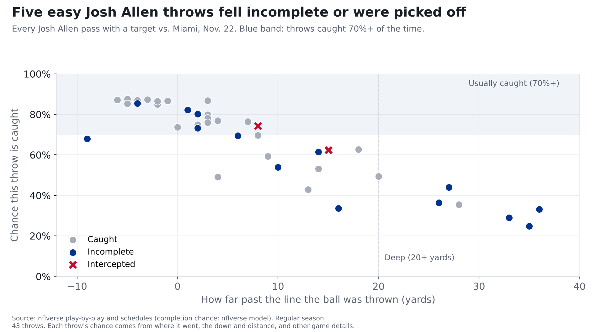
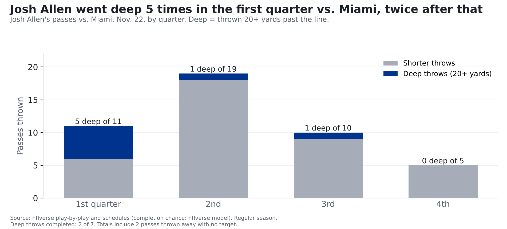

# Bills 26, Dolphins 9: the defense kept Miami out of the end zone, and five easy Josh Allen throws fell incomplete

**Buffalo's defense held Miami to three field goals and no touchdowns. Josh Allen threw for 304 yards, but five throws that usually get caught fell
incomplete or were picked off. On the same 43 throws, an average quarterback would have completed about 29. Allen completed 27.
Four of those five came with Buffalo already up by 14 or more. And the Bills settled for field goals on 3 of their 5 trips inside the Miami 20.**

*One game, Nov. 22, in Buffalo. The Bills are 9-1. [Our preview](nfl-mismatches.html).*

## Josh Allen: 27 of 45, 304 yards, 1 touchdown, 2 interceptions

Every throw has a chance of being caught, based on how far it went, where on the field, the down and distance, and other game details.
Add those chances up and you get how many completions an average quarterback would get on the same throws. On Sunday that was about 29. Allen got 27,
about 2 short. In his other nine games this season, he'd completed more than an average quarterback would have. Of his 133 regular-season games
with 15 or more throws since 2018, this ranks 32nd-worst. A bad day, but not one of his worst.

While the game was still in doubt, it looked different. With the Bills' chance of winning between 10% and 90%, he completed 18 of 25 targeted throws,
where an average quarterback would have completed about 16.

The five throws that usually get caught but weren't:

| Quarter | Time | Down | Intended for | Yards past the line of scrimmage | Chance it's caught | Result | Score |
|---|---|---|---|---|---|---|---|
| 2 | 14:10 | 1 and 7 | D.Knox | 2 | 73% | Incomplete | Bills up 6 |
| 2 | 1:45 | 2 and 10 | K.Latu | 8 | 74% | Intercepted | Bills up 17 |
| 2 | 1:14 | 1 and 10 | T.Johnson | 1 | 82% | Incomplete | Bills up 14 |
| 2 | 0:38 | 1 and 10 | K.Latu | 2 | 80% | Incomplete | Bills up 14 |
| 4 | 2:47 | 1 and 10 | D.Moore | -4 | 85% | Incomplete | Bills up 14 |

Four of the five came with Buffalo already up by 14 or more: three in the two-minute drill before halftime, and one with under three minutes left in a
23-9 game. A missed throw isn't always the quarterback's fault: some of these could be drops or tipped balls. The play-by-play doesn't say which.

**Did he pass up open short receivers?** The public data can't show who was open on each play. That takes tracking data the NFL doesn't release.
What we can see: two of every three passes (67%) went less than 10 yards past the line of scrimmage, more than his 63% the rest of the season
(league so far: 67%). All five easy misses were short throws. The problem wasn't skipping the short guy; it was the short ball not connecting.

The deep shots came early. He threw 5 of his 11 first-quarter passes 20 or more yards. After that, just twice in 34 passes.
Two of his seven deep throws were caught. Both interceptions came in the second quarter, on throws 8 and 15 yards downfield.

Play-by-play charting that marks catchable balls, interception-worthy throws and which read each pass went to usually posts a day or two after the game.
When it does, we'll check these throws against it.

## The defense

Miami's offense averaged -0.26 points per play over 55 plays, the 22nd-worst of 316 team games this season (through Sunday's early games).
Only 1 in 4 of its plays gained enough yards to keep a drive on track. Buffalo sacked Kyle McCord twice and picked him off once, and Miami's only points came on three field goals.

"Points per play" is how much each play helped or hurt a team's chances of scoring, based on down, distance and field position, averaged over the game. Zero is average.

## Field goals instead of touchdowns

Buffalo reached the Miami 20 five times and scored two touchdowns. Tyler Bass made 4 of 5 field goals; he missed from 54 yards in the third quarter.
Buffalo's offense averaged +0.04 points per play, about average.

## Receipts: our pregame call

Before the game we logged **an 81% chance the Bills win** on the [Ledger](../ledger.html). They won, so the call goes down as right. It scores 0.036 on our scorecard,
where 0 is perfect and a coin flip scores 0.25. Our model expected about 30 points for Buffalo and 20 for Miami. Buffalo scored 26; Miami scored 9, about 10 and a half fewer than we expected.
We've now got 13 of our 20 graded calls right, 8 of 13 on Bills games.

## What's next

Kansas City in Buffalo on Thanksgiving night. We'll have a preview with logged calls before kickoff.

## For the stat-heads

- Completion chance: nflverse `cp` per pass attempt (sacks excluded). CPOE this game -4.4 on 43 attempts with cp; 2026 before this game +2.7 (243 attempts).
  Win probability 0.10-0.90 only: 18 of 25, expected 15.9. Easy misses (cp 0.70+) inside that window: 1 of 5.
  2 attempts had no listed target (thrown away): out of the expected-completions numbers, in the throw-depth numbers.
  Career rank: completions minus expected per attempt, regular-season games 2018 through 2026 week 11 with 15+ attempts.
- Throw depth (air yards), all 45 attempts: deep = 20+, short = under 10. Game 15.6% deep, 66.7% short; Allen 2026 before 16.3% / 62.6%
  (targeted only: 62.1% short); league 2026 11.7% / 67.2%.
- Miami EPA/play -0.262, success rate 0.255 (plays: pass or rush with EPA; no kneels, spikes, two-point tries or no-plays); rank 22 of 316 2026 team-games, lowest first.
  League context leaves out week 11 games not in the play-by-play when this ran: 2026_11_NYJ_LAC, 2026_11_JAX_NYG, 2026_11_LV_DEN, 2026_11_MIN_SF, 2026_11_CIN_WAS.
- Pregame: points model v0.1, values as logged with Ledger P0021 (data through week 10): BUF 30.3, MIA 19.5, P(BUF) 0.81. Brier 0.0361.
