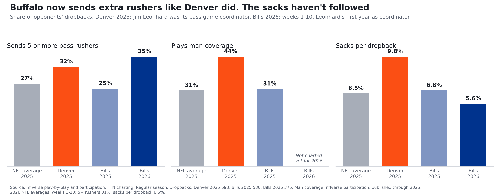

# Buffalo hired Denver's pass-defense coach. Now the Bills send extra rushers like Denver did. The sacks haven't come

**Before Jim Leonhard became Buffalo's defensive coordinator, he coached Denver's pass defense. In 2025 that defense played more man coverage than
any team in the NFL and got more sacks per dropback than anyone. Through nine games under Leonhard, the Bills send five or more pass rushers
on 35% of dropbacks, up from 25% last season. But their sack rate has dropped to 20th in the league. On Thursday they face
Patrick Mahomes, who has been good this season whether teams send extra rushers or not.**

*Part 1 of our Bills-Chiefs series. Regular-season data: all of 2025, and 2026 through Week 10 (the Bills' first 9 games; Week 11 isn't fully charted yet).
A "dropback" is any pass play: completions, incompletions, sacks and scrambles.*

## What Denver did in 2025

Leonhard was Denver's defensive backs coach and pass game coordinator, and in 2025 its assistant head coach. Vance Joseph was the coordinator.
Denver's pass defense had a clear style:

- **Man coverage.** Denver played man on 44% of dropbacks, the most in the NFL. The league average was 31%. Its most common
  look was one deep safety with everyone else in man (31% of dropbacks).
- **Extra rushers.** Denver sent five or more on 32% of dropbacks, 6th in the league.
- **Sacks.** Denver got a sack on 9.8% of dropbacks, 1st in the NFL.

## The one time Denver faced Mahomes

Denver and Kansas City met twice in 2025, and Denver won both. But Mahomes played in only one of them: Week 11, a 22-19 Denver win.
He didn't play after Week 15, so the Week 17 game (20-13 Denver) was against a backup, and we leave it out.

Against Mahomes, Denver played man on 33% of his 49 dropbacks. That's below its 44% for the season, but it's about what Denver was doing
by then: after playing man on 56% of dropbacks through Week 8, it dropped to 35% from Week 9 on. It sent five or more rushers 27% of the time.
Mahomes was held to +0.02 points per dropback, below his 2025 average of +0.17.
(Points per dropback is how much each pass play helped the offense, on average, measured in points.)
One game is a small sample, and it can't tell us which part of Denver's plan worked.

## What Buffalo does now

This season, Buffalo sends five or more rushers on 35% of dropbacks (8th in the league), up from 25%
(21st) in 2025. Teams across the league are sending more this year (27% last season, 31% now), but Buffalo's jump is more than twice as big.

The extra rushers haven't turned into sacks. Buffalo gets a sack on 5.6% of dropbacks, 20th in the league, down from 6.8% in 2025 (league average this season: 6.5%).
And the pass defense overall has slipped: opponents gain +0.01 points per dropback (11th), compared with -0.07 (8th) last season.

We can't tell yet whether Buffalo plays as much man coverage as Denver did. That data for 2026 isn't out.

## Why it matters Thursday

Kansas City's passing game ranks 6th this season at +0.17 points per dropback. Against five or more rushers, Mahomes has averaged
+0.14 points per dropback; against four or fewer, +0.18. That's a small sample (93 and 234 dropbacks). Extra rushers cost him about what they
cost every offense (league-wide: +0.06 against four or fewer, +0.01 against five or more). The difference is that even against extra rushers, he's
far above the league. When Buffalo does send five or more, it gets a sack on 6.8% of those dropbacks, 25th in the league
(league average: 8.6%).

Tomorrow: what has slowed Mahomes down over the last four seasons.

## How we measured it

FTN, a charting service, records how many players rushed the passer on every NFL play. For example, on a Week 2 sack of Jared Goff
(by Greg Rousseau), FTN counted 5 Bills rushers. We count every dropback (passes, sacks and scrambles) and divide.
Man or zone coverage comes from charting published by nflverse; it's out through 2025 only. "Points per dropback" measures how much each pass play moved
the offense closer to or further from scoring, in points. Above zero helps the offense; below zero hurts it. It's the same measure we use in every Bills story.
Plays wiped out by penalties are left out.

## For the stat-heads

- Dropbacks: `pass == 1`, EPA not null, no two-point tries, spikes or no-plays; regular season. 2025 full season; 2026 weeks 1-10 (all final, FTN coverage 100%).
- FTN's 2026 blitzer count equals rushers minus four (zero when four or fewer rush) on all but 1 of 11,091 dropbacks (89% in 2025), so we use rushers only. Two FTN rows with impossible rusher counts are dropped.
- DEN 2025: 693 dropbacks; 5+ rushers 0.322 (6); man wk 1-8 0.557, wk 9+ 0.355; 5+ wk 9+ 0.306; sack rate 0.098 (1); EPA/db -0.078 (5).
  Participation: man 0.444 (1st), pressure 0.345 (2).
- BUF 2025: 530; 5+ 0.251 (21); sack 0.068 (14); EPA/db -0.067 (8);
  man 0.313 (14); pressure 0.338 (5).
- BUF 2026 on 5+ rusher dropbacks: sack rate 0.068 on 133 (25); league 0.086.
- BUF 2026 wk 1-10: 375; 5+ 0.355 (8); change +0.104 vs league +0.046 (24 of 32 teams up); sack 0.056 (20); EPA/db +0.012 (11).
- League 2026 wk 1-10: 5+ 0.313; sack 0.065; EPA/db vs 4 or fewer +0.065, vs 5+ +0.010.
- League 2025: 5+ 0.267; sack 0.065; man 0.308; pressure 0.298.
- DEN vs. KC, 2025_11_KC_DEN: 49 Mahomes dropbacks, EPA/db +0.017; man 0.327, pressure 0.306, 5+ 0.265. Mahomes 2025 EPA/db +0.165 (587, all of his 2025 dropbacks including his partial Week 15).
- KC 2026 offense EPA/db +0.167 (6). Mahomes vs 5+ rushers +0.137 (n 93); vs 4 or fewer +0.179 (n 234). Small samples.
- Leonhard's Denver titles: defensive backs coach and pass game coordinator (2024); assistant head coach and pass game coordinator (2025). Coordinator: Vance Joseph.
