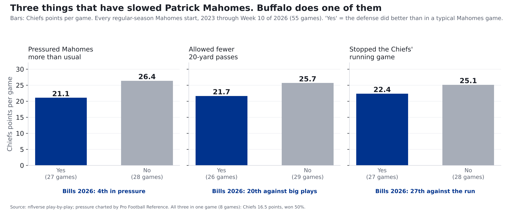

# How to slow down Patrick Mahomes: three things that have worked, and Buffalo does one

**In 55 regular-season starts since 2023, Mahomes and the Chiefs have won 38. Defenses that slowed them down tended to do three things: pressure Mahomes, keep him
from hitting big passes, and stop the Chiefs' running game. In the only 8 games where a defense did all three, Kansas City scored 16.5 points a game and went
4-4. Buffalo's defense gets pressure as well as almost anyone. Against big plays it ranks 20th, and against the run it ranks 27th.**

*A "dropback" is any pass play: completions, incompletions, sacks and scrambles.*

*Part 3 of our Bills-Chiefs series. [Part 1: Rousseau and the pass rush](bills-chiefs-leonhard-file.html). [Part 2: who's left](bills-chiefs-whos-left.html).*

## 1. Pressure him

When a defense pressured Mahomes more than in a typical game, Kansas City scored 21.1 points and won 59%. When it didn't,
26.4 points and 79%.

Sending extra rushers didn't make the difference. In games where defenses sent five or more rushers more often than usual, the Chiefs scored 24.4
points; otherwise 23.1. About the same.

**Buffalo:** 4th in the NFL in pressure this season (29 pressures for every 100 dropbacks; league average 25), led by Greg Rousseau.

## 2. Take away the big play

When a defense allowed fewer 20-yard pass plays than usual, Kansas City scored 21.7 points and won 62%.
Otherwise, 25.7 and 76%.

**Buffalo:** opponents gain 20 or more yards on 9.1% of dropbacks, 20th in the NFL (league average 8.3%). This season the Chiefs
hit one on 8.9% of Mahomes' dropbacks (11th among offenses).

## 3. Stop the run

When a defense stopped the Chiefs' runs more often than usual, Kansas City scored 22.4 points and won 67%.
Otherwise, 25.1 and 71%. In the 17 games where they scored 20 or fewer, their runs worked 35% of the time,
against 44% in the rest.

**Buffalo:** opponents' designed runs work 46% of the time, 27th in the NFL (league average 43%). Kansas City's runs
work 48% of the time this season (5th).

## All three at once

In the 8 games where a defense did all three, the Chiefs averaged 16.5 points and went 4-4. That's a small sample.
In their other 47 games: 25.0 points, and they won 72%. Mahomes still wins plenty of games where defenses do things right. But it's the closest thing to a recipe in the data.

## What it means Thursday

Buffalo's pass rush gives it a real shot at the first part. The question is everything else. Buffalo is 20th at stopping big pass plays and 27th against the run,
and Kansas City runs the ball well (5th).
Watch two things early: whether the Chiefs can run the ball, and whether Mahomes finds anything deep.

## How we measured it

We took every regular-season game Mahomes started since 2023 (at least 20 dropbacks), 55 in all: 16 in 2023, 16 in 2024, 14 in 2025,
and 9 this season through Week 10. For each, we measured three things against a typical Mahomes game (the middle game of the 55):

- **Pressure:** pressures charted by Pro Football Reference, per dropback. Typical: 20 for every 100.
- **Big plays:** share of dropbacks that gained 20 or more yards. Typical: 7.5%.
- **Running game:** share of designed runs (not quarterback scrambles) that left the Chiefs more likely to score than before the snap. On first-and-10 that usually takes 5 yards:
  a 4-yard run counted 9% of the time, 5 yards 69%, 6 yards 96%. On third-and-2, a run that got the first down counted 99% of the time. Typical: 41%.

We checked it a second way, putting all four measures (including extra rushers) into one calculation of Kansas City's points. Each of the three mattered on its own: a typical swing in any one was worth
2 to 3 points. Extra rushers added nothing. These are patterns from 55 games, not proof that any one tactic causes a loss.

## For the stat-heads

- Games: Mahomes as passer or scrambler on 20+ dropbacks, regular season, 2023 to 2026 Week 10 (n = 55; KC 38-17).
- Data: nflverse play-by-play as re-posted Nov. 25, 2026 (2026 EPA changed in that update; fingerprint asserted). Run "worked" = nflverse `success` (EPA > 0). Ties at the median count as "No".
- Medians: pressure rate 0.205 (PFR `times_pressured` / nflverse dropbacks), 20+ yard dropback rate 0.075, designed-run success 0.414, FTN 5+ rushers 0.214.
- Split results (KC pts, win rate, n): pressure 21.1/0.593/27 vs 26.4/0.786/28;
  explosives 21.7/0.615 vs 25.7/0.759; run 22.4/0.667 vs 25.1/0.714;
  5+ rushers 24.4/0.704 vs 23.1/0.679.
- OLS of KC points on standardized measures (points per 1 SD): pressure -2.26, 20+ rate +3.25, run success +2.47, 5+ rushers +0.92. n = 55; descriptive.
- BUF 2026 wk 1-10 defense: pressure 0.285 (4), 20+ allowed 0.091 (20), run success allowed 0.456 (27). League 0.245, 0.083, 0.426.
- KC 2026 offense: 20+ rate 0.089 (11), run success 0.477 (5), pressure on Mahomes 0.232.
