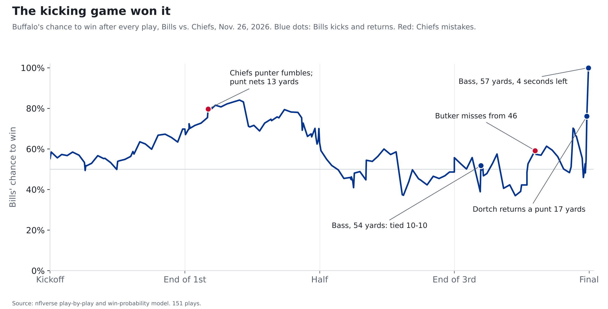

# Bills 13, Chiefs 10: James Cook carried it, the kicking game won it, Tyler Bass finished it

**Buffalo beat Kansas City in the rain without much of a passing game. James Cook carried 32 times for 117 yards and scored the only Bills
touchdown. Tyler Bass tied the game from 54 yards and won it from 57 with 4 seconds left. By our count, the
kicks, punts and returns, by both teams, added about 64 percentage points to the Bills' chance to win, far more than the passing game took away (36).**

## The kicking game

Every play changes a team's chance to win. Buffalo started Thursday at 55% and finished at 100%. The 57-yarder alone took it from about 76% to 100%,
and the punt return just before it was worth about 22 percentage points. Add up every play by type and the game splits cleanly: the kicks, punts and
returns, by both teams, were worth about **+64 percentage points** to Buffalo, the runs about +20, and the passing game about -36,
most of that from Josh Allen's two interceptions (-33). Penalties that wiped out plays account for the last -3.

- **Bass from 54**, early in the fourth quarter, tied it 10-10.
- **Harrison Butker missed from 46** with 6 minutes left and the game still tied.
- **Kansas City's punting:** Matt Araiza fumbled in the second quarter, and the punt netted only 13 yards. With 15 seconds left,
  Greg Dortch returned a punt 17 yards to the Kansas City 39 and put Bass in range.
- **Bass from 57**, 4 seconds left, won it.

Kicks from 57 yards or more have been good 60% of the time since 2023 (205 tries). Since 2018, there have been 11 field goals of 57 yards or more that
won a game in its last 10 seconds. Bass has 2 of them, this one and his 61-yarder against Miami in 2024. No other kicker has more than one.
It was also only the 2nd game of his career with two makes from 54 or longer.

## Cook

Cook's 32 carries tied his career high, set at Pittsburgh in 2025. No Bill has carried more in a game since Fred Jackson's 33 in 2009. His runs worked, leaving
Buffalo more likely to score, 56% of the time; the average NFL run this season works 43% of the time. He scored the only Bills touchdown, his 10th
straight game with a touchdown.

Buffalo ran 40 designed runs, 61% of its plays, the 6th-highest share in its 143 regular-season games since 2018.

## Allen's quiet day

The flip side: Allen completed 10 of 21 passes for 81 yards with 2 interceptions, the fewest passing yards in any of his 105
career wins. Only 1 of his 151 games with 15 or more throws had fewer yards, and that one was a loss. Buffalo didn't complete a pass of 20 yards
or more, the 5th time that's happened in those 143 games.

## The rain, as forecast

Our model, which doesn't know about weather, projected 25.6 to 23.9. The teams scored 13 and 10. In [part 4](bills-chiefs-rain-and-wind.html)
we found teams in rain and a 10+ mph wind had scored about 18.3 points each, against the 22.9 we'd expect from the same teams in dry weather. Thursday came in well below even
that. One game proves nothing, but it was the kind of game the forecast pointed to.

## The recipe from part 3

[Part 3](bills-chiefs-slowing-mahomes.html) named three things that slowed Mahomes: pressure, no big pass plays, and stopping the run.

- **Big plays:** 2 of Kansas City's 31 pass plays gained 20 or more yards (6%). In Mahomes' typical game since
  2023 it's 8%. That's close to normal, so call this one even, not a win for Buffalo.
- **The run:** Kansas City's runs worked, leaving it more likely to score, 63% of the time (19 runs), above Mahomes' typical game (41%). Buffalo, 27th against the run in part 3, didn't stop it.
- **Pressure:** the charting data isn't out yet. We'll add it when it is.

This is one game, 31 pass plays and 19 runs, so it's a small sample.

## Receipts

Both of our calls hit. The Bills won (55%), and Allen ran 7 times (4 designed runs, 3 scrambles), so "4 or more"
(80%) came in. Our accuracy scores: 0.20 and 0.04, where 0 is a perfect call. Our record is now 15 of 24.

## For the stat-heads

- Win chance by play type: nflverse `wpa` from Buffalo's side, summed by play type; pregame 0.552 + +0.637 + +0.200 + -0.362 + -0.027 (no-plays) = 1. Kicking game = nflverse `special` = 1 (field goals,
  extra points, punts, kickoffs; nflverse leaves `special_teams_play` = 0 on field goals). Passing = `pass` = 1, runs = `rush` = 1, no-plays left out.
- Long field goals: every attempt in our play-by-play, 2018 on (kick details aren't in our 1999-2017 table). Late winner = made, 10 seconds or fewer left,
  kicking team tied or down 1-2 before the kick.
  57+ make rate 0.595 on 205 attempts, 2023 through Week 12 of 2026. Bass's earlier one: 2024_09_MIA_BUF, 61 yards.
- Cook: 32 carries tie his max in nflverse; Bills games with a 32+ carry rusher since 1999: 7, most recently above 32: 2009_17_IND_BUF. Run "worked" = nflverse `success`;
  league = 2026 designed runs through Week 12 (0.428).
- Allen games: passer with 15+ attempts (sacks excluded), regular season and playoffs, 2018 through 2026 Week 12. Wins: 105. Median passing yards in wins 239.
- Designed run share: `rush` = 1 over pass + rush plays (no kneels, spikes, two-point tries, no-plays). 20+ passes: dropbacks with `yards_gained` >= 20.
- Part 3 measures use Mahomes games since 2023, as part 3 did; run "worked" = nflverse `success`.
- Weather from nflverse's game note ("Rain Temp: 33° F, Humidity: 97%, Wind: NE 19 mph").
- Ledger: P0024 Brier 0.2025; P0025 Brier 0.0400. 2026 play-by-play fingerprint through Week 12: (28843, -180.1391).
